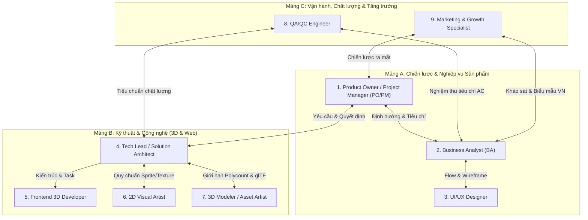
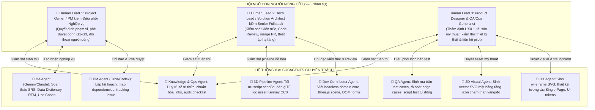
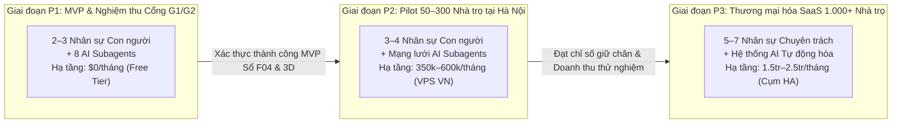

# Cơ cấu Vị trí Nhân sự & Mô hình Vận hành Đội ngũ Dự án QLNT

> **Tài liệu Quản trị Nhân sự & Vận hành (Staffing & Team Structure Specification)**  
> **Mã tài liệu:** `DOC-HR-001`  
> **Dự án:** Quản lý nhà trọ (QLNT)  
> **Người lập:** HR-PM (Quản trị Nhân sự & Vận hành Dự án)  
> **Ngày ban hành:** 2026-11-12  
> **Trạng thái:** `Đã phê duyệt — Áp dụng chính thức từ Sprint 1 (P1 MVP)`  
> **Căn cứ tham chiếu:**  
> - `3.DOC_AI/quan-tri/RULES_CORE.md` (Quy tắc cốt lõi và thẩm quyền các vai trò)  
> - `3.DOC_AI/quan-tri/MO_HINH_VAN_HANH.md` (Mô hình 3 mảng A, B, C và các cổng nghiệm thu G1–G3)  
> - `01-quan-ly/DECISIONS.md` (`QLNT-D001` $\rightarrow$ `QLNT-D014`)  
> - `01-quan-ly/KE_HOACH_CHUAN_HOA_KY_THUAT_VA_NHAN_SU.md` (Kế hoạch chuẩn hóa kỹ thuật và nhân sự)  
> - `01-quan-ly/HO_SO_DIEU_PHOI_SPRINT_1_VA_QUY_MO_HA_TANG.md` (Hồ sơ điều phối Sprint 1 và hạ tầng)  

---

## 1. Mục tiêu & Nguyên tắc Thiết kế Cơ cấu Nhân sự

### 1.1. Mục tiêu cốt lõi
1. **Thiết lập danh mục chức danh và trách nhiệm rõ ràng** cho toàn bộ 9 vị trí chuyên môn thuộc 3 mảng A, B, C trong toàn bộ vòng đời phát triển của dự án Quản lý nhà trọ (QLNT).
2. **Hiện thực hóa mô hình Tinh gọn kết hợp Trí tuệ nhân tạo (`AI-Augmented Lean Team`)**, tối ưu hóa tuyệt đối năng suất của đội ngũ nòng cốt (2–3 nhân sự con người) thông qua việc phân rã công việc cho 8 AI Subagents chuyên trách.
3. **Tuân thủ triệt để nguyên tắc `"$0 First"` (`QLNT-D014`)** trong Giai đoạn P1 MVP: vận hành không phát sinh chi phí nhân sự cồng kềnh, không thuê mướn vượt định mức khi chưa xác thực xong mô hình nghiệp vụ trên thị trường mục tiêu.
4. **Vạch rõ lộ trình mở rộng nhân sự (Scaling Roadmap)** theo từng mốc phát triển sản phẩm (P1 MVP $\rightarrow$ P2 Pilot $\rightarrow$ P3 Commercial SaaS), đảm bảo tính kế thừa, tránh đứt gãy tri thức và kiểm soát rủi ro chi phí.

### 1.2. Nguyên tắc phân định 3 Mảng (A - B - C)
- **Mảng A (Chiến lược & Nghiệp vụ Sản phẩm):** Sở hữu tầm nhìn sản phẩm, trải nghiệm người dùng, đặc tả chức năng và tiêu chí nghiệm thu. Chịu trách nhiệm bảo đảm sản phẩm giải quyết đúng bài toán nhức nhối của chủ nhà trọ và khách thuê tại Việt Nam.
- **Mảng B (Kỹ thuật & Công nghệ - Game/3D & Web):** Sở hữu giải pháp kiến trúc, chất lượng mã nguồn, hiệu năng đồ họa WebGL/Three.js, tính toàn vẹn dữ liệu Local-First và chuẩn giao tiếp tách tầng (`IGameRenderer`).
- **Mảng C (Vận hành, Chất lượng & Tăng trưởng):** Sở hữu quy trình bảo đảm chất lượng (QA/QC), quản trị tri thức dự án, vận hành hạ tầng Cloud/Server, khảo sát thị trường và chiến lược tăng trưởng người dùng thực tế.

---

## 2. Danh mục 9 Vị trí Chuyên môn thuộc 3 Mảng A, B, C

---

### 2.1. Nhóm Mảng A: Chiến lược & Nghiệp vụ Sản phẩm

#### Vị trí 1: Product Owner / Project Manager (PO/PM)
- **Mảng phụ trách:** Mảng A (Đầu mối điều phối liên mảng A - B - C).
- **Mục tiêu vị trí:** Định hình tầm nhìn sản phẩm game hóa quản lý nhà trọ, quản lý phạm vi, ngân sách, tiến độ và phê duyệt các cổng kiểm soát chất lượng (`G1`, `G2`, `G3`).
- **Trách nhiệm chính:**
  - Chốt các quyết định dự án (`DECISIONS.md`, từ `QLNT-D001` đến `QLNT-D014` và các quyết định tiếp theo).
  - Quản lý và ưu tiên hóa Product Backlog, lập kế hoạch Sprint trong Orca Tasks và GitHub Project #2.
  - Kiểm soát đường găng dự án, tháo gỡ điểm nghẽn và đưa ra phán quyết khi phát sinh xung đột nghiệp vụ hoặc kỹ thuật.
  - Đại diện cho lợi ích người dùng cuối (Chủ trọ, Khách thuê, Sale trọ).
- **Yêu cầu năng lực:**
  - Tư duy sản phẩm SaaS và Gamification; hiểu sâu thị trường nhà trọ/bất động sản cho thuê tại Việt Nam.
  - Kỹ năng quản trị dự án theo Agile/Scrum; năng lực điều phối đội ngũ lai (Human + AI Agents).
- **Đầu ra chủ yếu:** `PROJECT_BRIEF.md`, `DECISIONS.md`, Kế hoạch Sprint, Báo cáo tiến độ và Biên bản nghiệm thu cổng.

#### Vị trí 2: Business Analyst (BA)
- **Mảng phụ trách:** Mảng A (Nghiệp vụ cốt lõi).
- **Mục tiêu vị trí:** Chuyển hóa tầm nhìn và nhu cầu thị trường thành các bộ đặc tả nghiệp vụ chi tiết, ma trận truy vết và hợp đồng dữ liệu chuẩn hóa, không có độ trễ hay mơ hồ.
- **Trách nhiệm chính:**
  - Soạn thảo và chuẩn hóa các tài liệu: `BRD.md`, `SRS.md`, `USE_CASES.md`, `GLOSSARY.md`, và Ma trận truy vết `MA_TRAN_TRUY_VET_P1.md`.
  - Phân tích chi tiết quy trình nghiệp vụ: Sổ quản lý ảo hàng tháng F04 (`QLNT-D010`), cơ chế Single-Page in-place edit (`QLNT-D011`, `QLNT-D013`), chu kỳ thu tiền và duyệt bill (`R-05`), quản lý sự cố và nhật ký phòng (`NT-03`).
  - Xây dựng Từ điển Dữ liệu (Data Dictionary) cho 10 bảng dữ liệu bao phủ các biểu mẫu trọ thực tế tại Việt Nam.
- **Yêu cầu năng lực:**
  - Khả năng phân tích luồng hệ thống, mô hình hóa quy trình (BPMN/UML); hiểu rõ logic tính tiền điện, nước bậc thang, công nợ và hợp đồng thuê trọ.
  - Kỹ năng bóc tách yêu cầu thành Acceptance Criteria (AC) có thể kiểm thử tự động.
- **Đầu ra chủ yếu:** `SRS.md`, `USE_CASES.md`, `DAC_TA_SO_QUAN_LY_AO_SINGLE_PAGE_VA_RENDERER.md`, `MA_TRAN_TRUY_VET_P1.md`.

#### Vị trí 3: UI/UX Designer
- **Mảng phụ trách:** Mảng A (Trải nghiệm người dùng & Giao diện).
- **Mục tiêu vị trí:** Kiến tạo trải nghiệm tương tác trực quan, thân thiện, kết hợp hài hòa giữa không gian game 3D isometric và giao diện quản lý Single-Page tiện dụng trên thiết bị di động.
- **Trách nhiệm chính:**
  - Thiết kế luồng trải nghiệm (UX Flows), cấu trúc thông tin (Information Architecture) cho Sổ quản lý ảo F04 trên Mobile Portrait và Web Responsive.
  - Xây dựng Wireframe chi tiết cho bộ 3 trang chi tiết phòng (Trang 1: Thông tin & Thu tiền; Trang 2: Thiết bị; Trang 3: Lịch sử) ở chế độ Single-Page lật trang mượt mà.
  - Tối ưu hóa công thái học trên thiết bị di động: đảm bảo vùng chạm tương tác (touch target) tối thiểu $44 \times 44\text{px}$, hiển thị rõ ràng các trạng thái cảnh báo chấm than vàng/đỏ.
  - Thiết kế Design System, typography, icon và bảng màu nhận diện thương hiệu.
- **Yêu cầu năng lực:**
  - Thành thạo công cụ thiết kế (Figma/Penpot); am hiểu sâu sắc Design Guidelines của iOS/Android và responsive web.
  - Tư duy thiết kế giao diện Game UI/HUD lồng ghép với Business SaaS.
- **Đầu ra chủ yếu:** `THIET_KE_UX_FLOW_VA_MOBILE_P1.md`, Wireframe SVG/Figma, Design Tokens & UI Guidelines.

---

### 2.2. Nhóm Mảng B: Kỹ thuật & Công nghệ (3D & Web)

#### Vị trí 4: Tech Lead / Solution Architect
- **Mảng phụ trách:** Mảng B (Kiến trúc & Lãnh đạo Kỹ thuật).
- **Mục tiêu vị trí:** Bảo đảm kiến trúc hệ thống bền vững, tuân thủ nguyên tắc phân tách tầng (`Headless Domain Core` tách rời `Presentation Adapter`), kiểm soát chất lượng mã nguồn và bảo mật dữ liệu.
- **Trách nhiệm chính:**
  - Thiết lập và duy trì `TECH_PROFILE.md`, chuẩn hóa giao diện hợp đồng `IGameRenderer` (`NT-01`) và kiến trúc Hybrid `WebGL 3D + DOM Overlay`.
  - Phê duyệt cấu trúc dữ liệu Local-First (Dexie.js IndexedDB), hàng đợi đồng bộ Outbox Sync và cơ chế Row-Level Security (RLS) trên Supabase PostgreSQL.
  - Thiết lập chuẩn Codebase (TypeScript strict mode, React 19, Vite, Zustand), quy trình CI/CD và môi trường phát triển cục bộ (`Docker Compose`).
  - Rà soát mã nguồn (Code Review), giải quyết các bài toán hiệu năng phức tạp và tháo gỡ rào cản kỹ thuật cho lập trình viên.
- **Yêu cầu năng lực:**
  - Chuyên môn sâu về TypeScript, React, kiến trúc DDD (Domain-Driven Design), Three.js/WebGL và cơ sở dữ liệu PostgreSQL.
  - Năng lực thiết kế hệ thống có tính sẵn sàng cao, bảo mật nhiều lớp và tối ưu hóa chi phí đám mây.
- **Đầu ra chủ yếu:** `TECH_PROFILE.md`, `DANH_SACH_CAI_THIEN_VA_CHUAN_HOA_KY_THUAT.md`, Skeleton dự án, Cấu hình CI/CD và Bộ quy chuẩn kỹ thuật.

#### Vị trí 5: Frontend 3D Developer
- **Mảng phụ trách:** Mảng B (Lập trình Giao diện & Hiệu ứng Đồ họa).
- **Mục tiêu vị trí:** Lập trình hiện thực hóa thế giới 3D Isometric, hoạt ảnh gập mở Sổ quản lý ảo và giao diện DOM Overlay Single-Page mượt mà trên cả nền tảng Web và Mobile Capacitor.
- **Trách nhiệm chính:**
  - Lập trình tầng hiển thị Three.js: Camera Isometric cố định (`QLNT-D008`), ánh sáng, đổ bóng, cơ chế nạp và hiển thị tòa nhà, phòng trọ và nhân vật avatar.
  - Hiện thực hóa hoạt ảnh 3D đóng/mở cuốn sổ quản lý F04 (`QLNT-D010`, `QLNT-D012`).
  - Lập trình tầng DOM Overlay (React 19 + Tailwind CSS) hiển thị Mặt bằng tầng 2D và Tờ chi tiết Single-Page in-place edit (`QLNT-D013`), kết nối sự kiện qua `Domain Event Bus`.
  - Tối ưu hóa bộ nhớ, draw calls, quản lý vòng đời tài nguyên WebGL (dispose textures/geometries), bảo đảm duy trì $30–60\text{ FPS}$ và kích hoạt cơ chế Auto-Fallback sang 2D Slide-Card khi phần cứng yếu.
- **Yêu cầu năng lực:**
  - Thành thạo Three.js, WebGL shaders cơ bản, React 19, Tailwind CSS và State Management (Zustand).
  - Kinh nghiệm đóng gói ứng dụng di động qua Capacitor và tối ưu hiệu năng đồ họa Web trên Mobile.
- **Đầu ra chủ yếu:** Mã nguồn module 3D Scene, Hoạt ảnh Sổ ảo, DOM Overlay Forms và các Unit/Component Tests.

#### Vị trí 6: 2D Visual Artist
- **Mảng phụ trách:** Mảng B (Mỹ thuật 2D & Đồ họa Vector).
- **Mục tiêu vị trí:** Sáng tạo và chuẩn hóa toàn bộ tài nguyên mỹ thuật 2D, bao gồm sơ đồ mặt bằng căn hộ/tầng lầu, hệ thống biểu tượng cảnh báo và sprite game hóa.
- **Trách nhiệm chính:**
  - Thiết kế hệ thống Mặt bằng tầng 2D dạng vector **SVG / High-DPI Canvas 2x** cho các cấu hình phòng mẫu trọ phổ biến tại Việt Nam (phòng đơn, gác lửng, căn hộ dịch vụ mini).
  - Thiết kế bộ icon nhận diện trực quan: Chấm than vàng (nộp bill/thu tiền), Chấm than đỏ (báo hỏng thiết bị/sự cố), icon phân loại trạng thái thiết bị và huy hiệu phần thưởng.
  - Chuẩn hóa quy cách xuất asset (SVG tối ưu kích thước $< 50\text{KB}$, Sprite Sheet nén PNG-8/WebP).
- **Yêu cầu năng lực:**
  - Thành thạo Illustrator/Photoshop hoặc công cụ vector chuyên nghiệp; tư duy mỹ thuật phong cách game isometric/casual.
  - Hiểu biết về kỹ thuật render SVG và Canvas trên trình duyệt web.
- **Đầu ra chủ yếu:** `QUY_CHUAN_2D_VA_BRIEF_ASSET_3D.md`, Thư viện Asset SVG/PNG, Sprite Sheets chuẩn hóa.

#### Vị trí 7: 3D Modeler / Asset Artist
- **Mảng phụ trách:** Mảng B (Mô hình hóa 3D & Tối ưu Asset).
- **Mục tiêu vị trí:** Quản lý, tuyển chọn, dựng mô hình và tối ưu hóa toàn bộ pipeline asset 3D (tòa nhà, phòng, đồ nội thất, avatar) đạt chuẩn nhẹ và tương thích thiết bị di động.
- **Trách nhiệm chính:**
  - Tuyển chọn và làm sạch các mô hình 3D mã nguồn mở từ thư viện **Kenney Animated Characters** và **Kenney Furniture Kit** (CC0).
  - Vận hành pipeline sinh asset tự động bằng thư viện **sand3d** kết hợp Blender 4.x và `@gltf-transform/cli`.
  - Kiểm soát nghiêm ngặt ngân sách đồ họa (Polycount Budget): $< 3.000$ tris cho nhân vật avatar, $< 500$ tris cho đồ vật nội thất; Texture Atlas nén chuẩn KTX2/Basis Universal hoặc WebP dung lượng $< 250\text{KB}$.
  - Thiết lập Checklist Brief đầu vào cho 5 nhóm Object 3D và lộ trình thay thế dần từ khối cơ bản (box/primitive) sang object hoàn thiện (`QLNT-D008`).
- **Yêu cầu năng lực:**
  - Sử dụng thành thạo Blender 4.x, công cụ tối ưu hóa glTF (`gltf-transform`), hiểu rõ PBR materials và rigging nhân vật cơ bản.
  - Kỹ năng tự động hóa pipeline 3D qua Python script (`bpy`).
- **Đầu ra chủ yếu:** Danh mục file `.glb` đã nén, Checklist Brief 5 nhóm Asset 3D, Pipeline scripts.

---

### 2.3. Nhóm Mảng C: Vận hành, Chất lượng & Tăng trưởng

#### Vị trí 8: QA/QC Engineer
- **Mảng phụ trách:** Mảng C (Đảm bảo & Kiểm thử Chất lượng).
- **Mục tiêu vị trí:** Thiết lập hệ thống kiểm thử toàn diện, đảm bảo tính đúng đắn của logic tính toán tiền nong, tính toàn vẹn dữ liệu, bảo mật phân quyền đa người thuê và hiệu năng ổn định trên thiết bị thật.
- **Trách nhiệm chính:**
  - Xây dựng Kế hoạch kiểm thử và Ma trận Test Case chi tiết (`KE_HOACH_VA_MA_TRAN_KIEM_THU_P1.md`), bao phủ 100% tiêu chí nghiệm thu `AC-01..AC-21` và 8 quy tắc bất biến (`NT-01..NT-08`).
  - Thực hiện kiểm thử chức năng (Functional Testing): Chu trình đóng/mở sổ, in-place edit, duyệt bill, cộng điểm thưởng, phân quyền truy cập Sale trọ (`F03`) và Bản đồ công khai (`F06`).
  - Kiểm thử phi chức năng (Non-functional): Đo đạc FPS trên thiết bị di động Android/iOS tầm trung, kiểm thử bảo mật Row-Level Security (RLS) chống rò rỉ dữ liệu giữa 2 chủ trọ khác nhau, kiểm tra liên kết ảnh hết hạn sau 15 phút (`Private Signed URL`).
  - Thực hiện quy trình nghiệm thu môi trường Staging theo biểu mẫu chuẩn `X02_Checklist_Check Enviroment (STG) Before build.xlsx`.
- **Yêu cầu năng lực:**
  - Kỹ năng thiết kế test cases (phân vùng tương đương, giá trị biên, bảng quyết định); thành thạo kiểm thử API, kiểm thử Web/Mobile.
  - Khả năng tự động hóa kiểm thử (Playwright/Vitest) và sử dụng công cụ đo kiểm hiệu năng trình duyệt (Lighthouse, Chrome Performance Profile).
- **Đầu ra chủ yếu:** `KE_HOACH_VA_MA_TRAN_KIEM_THU_P1.md`, `QUALITY_AND_RELEASE.md`, Báo cáo lỗi (Bug Reports), Biên bản nghiệm thu kiểm thử.

#### Vị trí 9: Marketing & Growth Specialist
- **Mảng phụ trách:** Mảng C (Thị trường, Tăng trưởng & Quan hệ Khách hàng).
- **Mục tiêu vị trí:** Khảo sát thực địa hành vi của chủ trọ và sinh viên/người đi làm, thu thập dữ liệu/biểu mẫu thực tế, xây dựng cộng đồng người dùng thử nghiệm tại Hà Nội và thúc đẩy tăng trưởng sản phẩm.
- **Trách nhiệm chính:**
  - Thực hiện nghiên cứu thị trường, đối thủ cạnh tranh và phân tích thói quen quản lý nhà trọ truyền thống (sổ sách, Excel, Zalo).
  - Thu thập, số hóa và cung cấp cho BA bộ biểu mẫu thực tế tại Việt Nam: Hợp đồng thuê nhà trọ, Biên bản bàn giao tài sản/thiết bị phòng, Phiếu thu tiền điện nước (`ISS-01`).
  - Xây dựng tệp khách hàng thử nghiệm (Pilot Landlords) tại các khu vực tập trung đông sinh viên/lao động ở Hà Nội (Cầu Giấy, Đống Đa, Bách Kinh Xây).
  - Soạn thảo tài liệu hướng dẫn sử dụng, kịch bản onboarding, nội dung truyền thông tính năng "Quản lý nhà trọ như chơi game" và cơ chế tích điểm đổi quà.
- **Yêu cầu năng lực:**
  - Kỹ năng nghiên cứu thị trường, phân tích dữ liệu hành vi người dùng; am hiểu văn hóa thuê trọ tại Việt Nam.
  - Kỹ năng giao tiếp thực địa, xây dựng quan hệ với chủ trọ và tổ chức cộng đồng người dùng.
- **Đầu ra chủ yếu:** `NGHIEN_CUU_THI_TRUONG.md`, Bộ biểu mẫu trọ Việt Nam thực tế, Kế hoạch tuyển mộ Pilot và Kịch bản Onboarding.

---

## 3. Mô hình Tinh gọn kết hợp AI (`AI-Augmented Lean Team`) cho Giai đoạn P1 MVP ($0 Cost Optimization)

### 3.1. Bối cảnh & Thách thức Giai đoạn P1 MVP
Giai đoạn P1 đặt trọng tâm vào việc xác thực tính khả thi của sản phẩm (PoC & MVP):
- Phân hệ **Sổ quản lý ảo hàng tháng F04** hiển thị dưới dạng **Single-Page** lồng ghép trong không gian **3D Isometric**.
- Yêu cầu tốc độ triển khai nhanh, chất lượng tài liệu và mã nguồn chuẩn chỉnh, trong khi chi phí phát sinh phải giữ ở mức tối ưu **`$0 / tháng`** theo quyết định `QLNT-D014`.
- Nếu tuyển dụng đủ 9 nhân sự con người toàn thời gian ở giai đoạn này sẽ gây lãng phí lớn về ngân sách và chi phí quản lý vận hành.

### 3.2. Cấu trúc Đội ngũ Tinh gọn: 2–3 Nhân sự Con người + 8 AI Subagents

Để giải quyết bài toán trên, dự án áp dụng mô hình **AI-Augmented Lean Team**:

### 3.3. Phân công vai trò cụ thể trong Lean Team

| Nhân sự Con người | Vai trò kiêm nhiệm | AI Subagents hỗ trợ trực tiếp | Thẩm quyền & Trách nhiệm tối cao |
| :--- | :--- | :--- | :--- |
| **Human Lead 1** | **Chủ dự án / PO kiêm PM Lead & BA Cấp cao** | • `PM Agent` • `BA Agent` • `Knowledge & Ops Agent` | • Ban hành quyết định dự án (`QLNT-D001..D014`). • Phê duyệt các cổng nghiệm thu Cổng G1, G2, G3. • Chốt phạm vi nghiệp vụ và tiêu chí hoàn thành (DoD). |
| **Human Lead 2** | **Tech Lead kiêm Senior Fullstack & 3D Specialist** | • `Dev Contributor Agent` • `3D Pipeline Agent` • `Knowledge & Ops Agent` | • Quản trị repository Git, phê duyệt toàn bộ Pull Request. • Phán quyết kiến trúc hệ thống (`Headless Core`, `IGameRenderer`). • Kiểm soát bảo mật RLS, hạ tầng Serverless/Cloud và hiệu năng WebGL. |
| **Human Lead 3** *(hoặc linh hoạt kiêm nhiệm giữa Lead 1 & 2)* | **Product Designer & QA/Ops Generalist** | • `UX Agent` • `2D Visual Agent` • `QA Agent` | • Kiểm định trải nghiệm người dùng thực tế trên thiết bị di động. • Nghiệm thu mỹ thuật mặt bằng SVG và icon. • Thực hiện kiểm thử trên máy thật và làm việc với các chủ trọ pilot. |

### 3.4. Cơ chế vận hành & Kiểm soát Chất lượng (Human-in-the-loop)
1. **AI Subagents chịu trách nhiệm tạo tác (Drafting & Execution):**
   - Nghiên cứu tài liệu, soạn thảo dự thảo đặc tả, viết mã nguồn theo kiến trúc có sẵn, tạo test case tự động, tìm kiếm tài nguyên CC0 và phát hiện lỗi tĩnh.
   - Hoạt động tự động theo các brief giao việc trên Swarm Message Board hoặc Orca Tasks.
2. **Con người chịu trách nhiệm thẩm định & Phê duyệt (Review & Approval):**
   - 100% nội dung nghiệp vụ chưa có tiền lệ phải được đánh dấu `Dự thảo / Cần xác nhận` và chỉ được ban hành khi Human Lead chốt.
   - 100% code do AI sinh ra phải vượt qua kiểm tra tĩnh (Typecheck, Lint) và được Human Tech Lead review trước khi merge vào nhánh chính.
3. **Tối ưu hóa Chi phí $0 trong P1:**
   - **Chi phí Nhân sự:** Tinh gọn tối đa, tận dụng năng lực AI để thay thế các vị trí nhân sự cơ bắp/lặp lại.
   - **Chi phí Công cụ & Hạ tầng:** Tận dụng 100% các công cụ miễn phí: Cloudflare Pages (Free), Supabase PostgreSQL (Free Tier 500MB), Cloudflare R2 (Free Tier 10GB, 0đ Egress), Local-First Dexie.js (Free), Kenney Assets (CC0 Free), Sand3d / Blender (Mã nguồn mở miễn phí).

---

## 4. Lộ trình Mở rộng Nhân sự theo các Giai đoạn Dự án (Scaling Roadmap)

Dự án QLNT được định hướng phát triển qua 3 giai đoạn rõ rệt với cơ cấu nhân sự mở rộng tương ứng:

---

### 4.1. Bảng So sánh Chi tiết Nhân sự & Năng lực qua các Giai đoạn

| Tiêu chí | Giai đoạn P1: MVP & Cổng G1/G2 | Giai đoạn P2: Pilot Thực tế Hà Nội (P1 Release / P2) | Giai đoạn P3: Thương mại hóa SaaS Scale-up |
| :--- | :--- | :--- | :--- |
| **Quy mô Người dùng** | Nội bộ Team + Chủ dự án (`1–20 nhà trọ`, `< 200 phòng`) | `50 – 300 chủ nhà trọ` `1.500 – 5.000 khách thuê` | `1.000+ chủ nhà trọ` `15.000+ khách thuê` (`2.000+ CCU`) |
| **Quy mô Nhân sự Con người** | **2 – 3 người** (Lean Team) | **3 – 4 người** (Bổ sung CS/Ops thực địa) | **5 – 7 người** (Đội ngũ chuyên trách đầy đủ) |
| **Hệ thống AI Subagents** | 8 Subagents phụ trách sâu từng mảng tài liệu & code | 8 Subagents hỗ trợ code, automation test & marketing content | Mạng lưới AI Agent hỗ trợ CSKH tự động (Chatbot Bot AI), giám sát hệ thống |
| **Cơ cấu Chức danh Con người** | 1. PO/PM Lead (kiêm BA) 2. Tech Lead (kiêm 3D/Dev) 3. Generalist UX/QA | 1. PO/PM Lead 2. Tech Lead (Fullstack/Architect) 3. Frontend 3D Developer (chuyên sâu) 4. Operations, Support & Growth Specialist | 1. Product Owner / CEO 2. Tech Lead / Solution Architect 3. 02 Frontend 3D Developers 4. 01 Backend & DevOps Engineer 5. 01 QA/QC Lead 6. 01 Growth & Customer Success Lead |
| **Trọng tâm Công việc** | • Hoàn thiện hồ sơ thiết kế • Dựng prototype Sổ F04 Single-Page • Tối ưu Three.js WebGL & fallback | • Triển khai ứng dụng thực tế cho chủ trọ Hà Nội • Thu thập phản hồi & fix bug tức thì • Tinh chỉnh tính năng thu tiền & duyệt bill | • Mở rộng thị trường toàn quốc • Đóng gói tính năng trả phí cao cấp • Tối ưu cụm máy chủ chịu tải cao & bảo mật |
| **Chi phí Hạ tầng Đề xuất** | **$0 / tháng** (Cloudflare Pages + Supabase Free + R2 Free) | **~350.000đ – 600.000đ / tháng** (01 Cloud VPS tại Việt Nam `4 vCPU / 8GB RAM`) | **~1.500.000đ – 2.500.000đ / tháng** (Cụm App Server + Managed DB HA) |

---

### 4.2. Tiêu chí Kích hoạt Tuyển dụng & Mở rộng (Scaling Triggers)
Việc chuyển đổi cơ cấu nhân sự từ giai đoạn này sang giai đoạn tiếp theo bắt buộc phải dựa trên **chỉ số đo lường thực tế (Metrics-Driven)**, tuyệt đối không mở rộng nhân sự đón đầu khi chưa đạt tiêu chí:
1. **Từ P1 lên P2:**
   - 100% tiêu chí nghiệm thu Cổng G1 (Thiết kế) và Cổng G2 (Prototype) được phê duyệt.
   - Thử nghiệm nội bộ đạt mốc $30–60\text{ FPS}$ trên thiết bị Android/iOS cấu hình cơ bản, hoạt ảnh mở Sổ F04 không gây lag giật.
   - Đã ký kết hợp tác thử nghiệm (Pilot Agreement) với tối thiểu 10 chủ nhà trọ thực tế tại Hà Nội.
   - *Hành động:* Ký hợp đồng với 01 Frontend 3D Developer chuyên trách và 01 Chuyên viên Vận hành/Chăm sóc khách hàng thực địa.
2. **Từ P2 lên P3:**
   - Tỷ lệ giữ chân người dùng (Retention Rate): $> 60\%$ chủ nhà trọ tiếp tục sử dụng sau 3 chu kỳ thu tiền hàng tháng.
   - Tỷ lệ lỗi thanh toán/thất thoát dữ liệu $= 0\%$.
   - Doanh thu từ bản trả phí hoặc cam kết mở rộng quy mô đạt điểm hòa vốn chi phí vận hành VPS.
   - *Hành động:* Bổ sung Backend/DevOps chuyên trách cụm HA, QA Lead chuyên trách kiểm thử tự động tải lớn và mở rộng đội ngũ Growth/CSKH.

---

## 5. Ma trận Phân công Trách nhiệm (RACI Matrix)

Bảng phân công trách nhiệm cho 9 vị trí chuyên môn qua các quy trình và đầu việc cốt lõi của dự án:
- **R (Responsible):** Người trực tiếp thực hiện công việc.
- **A (Accountable):** Người chịu trách nhiệm giải trình tối cao và có quyền phê duyệt cuối cùng (duy nhất 1 vai trò cho mỗi đầu việc).
- **C (Consulted):** Người được tham vấn chuyên môn trước khi thực hiện hoặc ban hành.
- **I (Informed):** Người được thông báo kết quả sau khi hoàn thành.

| STT | Quy trình / Gói Công việc Trọng yếu | 1. PO/PM | 2. BA | 3. UX | 4. Tech Lead | 5. FE 3D | 6. 2D Art | 7. 3D Art | 8. QA/QC | 9. Mkt/Growth |
| :---: | :--- | :---: | :---: | :---: | :---: | :---: | :---: | :---: | :---: | :---: |
| **1** | Xác lập Mục tiêu, Phạm vi & Quyết định Dự án | **A** | C | I | C | I | I | I | I | C |
| **2** | Khảo sát Thực địa & Thu thập Biểu mẫu Trọ VN | I | C | I | I | I | I | I | I | **R/A** |
| **3** | Phân tích Nghiệp vụ, SRS & Ma trận Truy vết (RTM) | A | **R** | C | C | I | I | I | C | C |
| **4** | Đặc tả Quy trình Sổ F04 Single-Page in-place edit | A | **R** | C | C | I | I | I | C | I |
| **5** | Thiết kế Wireframe, UX Flow Mobile & HUD Game | A | C | **R** | C | C | C | I | I | I |
| **6** | Thiết kế SVG Mặt bằng tầng 2D & Icon Chấm than | I | C | C | C | I | **R/A** | I | I | I |
| **7** | Tuyển chọn, Dựng & Nén Asset 3D (`sand3d`, Kenney) | I | I | I | C | C | I | **R/A** | I | I |
| **8** | Thiết kế Kiến trúc Tách tầng & Hợp đồng `IGameRenderer` | A | C | I | **R** | C | I | C | I | I |
| **9** | Lập trình Headless Domain Core & State Store (Zustand) | A | C | I | **R** | C | I | I | C | I |
| **10** | Lập trình Three.js 3D Isometric & Hoạt ảnh Sổ F04 | A | I | C | C | **R** | C | C | C | I |
| **11** | Lập trình Tầng DOM Overlay Forms (React 19 + SVG) | A | C | C | C | **R** | C | I | C | I |
| **12** | Thiết lập Hạ tầng Cloud $0, Sync Outbox & Bảo mật RLS | A | I | I | **R** | C | I | I | C | I |
| **13** | Lập Kế hoạch, Ma trận Test Case & Nghiệm thu AC | A | C | I | C | I | I | I | **R** | I |
| **14** | Kiểm thử Hiệu năng Mobile (30–60 FPS) & RLS Security | A | I | I | C | C | I | I | **R** | I |
| **15** | Tuyển mộ Khách hàng Thử nghiệm & Vận hành Pilot Hà Nội | A | I | I | I | I | I | I | I | **R** |
| **16** | Nghiệm thu Cổng G1 (Thiết kế), G2 (PoC), G3 (Phát hành) | **A** | C | C | C | I | I | I | C | C |

---

## 6. Nguyên tắc Phối hợp, Giao tiếp & Bàn giao Công việc

### 6.1. Kênh Giao tiếp & Công cụ Vận hành
- **Orca Tasks & GitHub Project #2:** Kênh phân rã và quản lý trạng thái tác vụ duy nhất (`Todo` $\rightarrow$ `In Progress` $\rightarrow$ `In Review` $\rightarrow$ `Done`).
- **Swarm Message Board / Context:** Kênh giao tiếp đồng bộ giữa các AI Subagents và Điều phối viên. Mỗi thông điệp giao việc phải nêu rõ: người nhận (@mention), mục tiêu đầu ra, các ràng buộc kỹ thuật và file sở hữu.
- **Git Repository (`TEAM_ORCA/4.Du_an/QLNT`):** Mọi thay đổi tài liệu và mã nguồn phải được thực hiện trên nhánh làm việc riêng, tạo Pull Request và chỉ được merge vào nhánh chính sau khi vượt qua review của Lead chuyên môn.

### 6.2. Quy định Bàn giao Tri thức & Kế thừa (Handover Protocol)
- Mọi thành viên (Con người và AI Subagent) trước khi bắt đầu công việc phải đọc và tuân thủ `RULES_CORE.md`, `MO_HINH_VAN_HANH.md` và `HANDOVER.md`.
- Khi kết thúc lượt làm việc hoặc chuyển giao vị trí:
  - Cập nhật nhật ký bàn giao tại `3.DOC_AI/HANDOVER.md`.
  - Ghi nhận trạng thái hoàn thành của từng subtask và các rủi ro tồn đọng.
  - Tuyệt đối không để xảy ra tình trạng "giữ tri thức một mình": mọi giải pháp kỹ thuật, schema dữ liệu, mẫu wireframe đều phải được văn bản hóa thành tài liệu Markdown trong repo dự án.

---

> **Kết luận:**  
> Cơ cấu tổ chức nhân sự theo mô hình **AI-Augmented Lean Team (2–3 nhân sự con người + 8 AI Subagents chuyên trách)** là giải pháp tối ưu cho phép dự án QLNT đạt tốc độ triển khai vượt trội, bảo đảm chất lượng chuyên môn cấp cao nhưng vẫn duy trì chi phí thực thi **`$0 / tháng`** trong Giai đoạn P1 MVP. Mô hình này thiết lập nền móng vững chắc để mở rộng đội ngũ an toàn và hiệu quả khi dự án bước sang giai đoạn thương mại hóa.
