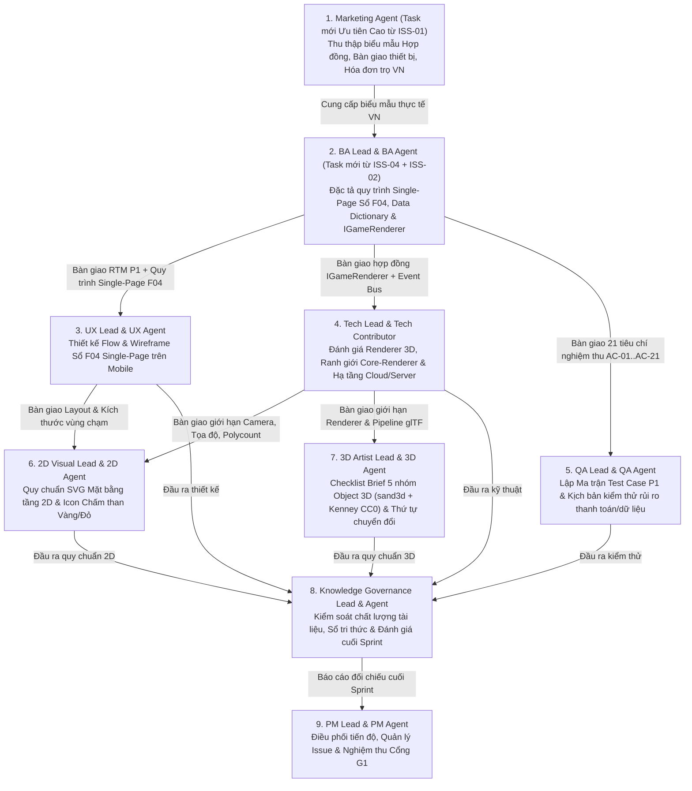

# Hồ sơ Điều phối Sprint 1: Mục tiêu, Bản đồ Phụ thuộc (Dependency Map) & Các Quyết định Cần Chủ Dự Án Chốt (Xử lý Issue `#8` / `ISS-08`)

- **Dự án:** Quản lý nhà trọ (QLNT)
- **Tác giả:** PM Lead (Codex / PM vận hành)
- **Ngày lập:** 2026-11-12
- **Trạng thái:** `Đã được Chủ dự án phê duyệt (QLNT-D014) — Hạ tầng & chuẩn thực thi cho Dev được quản lý chính thức tại 04-van-hanh/`
- **Căn cứ tham chiếu:**
  - `3.DOC_AI/quan-tri/RULES_CORE.md`
  - `01-quan-ly/DECISIONS.md` (Từ `QLNT-D001` đến `QLNT-D014`)
  - `04-van-hanh/HA_TANG_VA_VAN_HANH_HE_THONG.md` & `04-van-hanh/QUALITY_AND_RELEASE.md` (Hồ sơ chuẩn để các Dev bám theo thực hiện)
  - `01-quan-ly/BAO_CAO_DANH_GIA_SAN_SANG_SPRINT_1.md` (Báo cáo rà soát độc lập của 9 Lead)

---

## 1. Mục tiêu Cốt lõi của Sprint 1 (Sprint 1 Goal)

> **Mục tiêu Sprint 1:** Hoàn tất toàn bộ **Hồ sơ Thiết kế Nghiệp vụ, Giao diện & Kiến trúc Kỹ thuật Khả thi cho Giai đoạn P1 (MVP)** — lấy phân hệ **Sổ quản lý ảo hàng tháng F04 (`QLNT-D010`..`D013`)** và **Khung thế giới 3D Camera Isometric cố định (`QLNT-D008`)** làm trung tâm — đảm bảo đủ điều kiện vượt qua **Cổng G1 (Yêu cầu & Thiết kế sẵn sàng)** để bước sang giai đoạn lập trình và dựng Prototype 3D.

### 5 Đầu ra Đo lường được (Measurable Deliverables) của Sprint 1:
1. **Về Nghiệp vụ (`BA Lead`):** Hoàn thiện bộ đặc tả 18 chức năng P1, Ma trận truy vết yêu cầu (`MA_TRAN_TRUY_VET_P1.md` - 21 AC), và Đặc tả chi tiết quy trình thực hiện + hiển thị chế độ **Single-Page** cho Sổ quản lý ảo F04 (`DAC_TA_SO_QUAN_LY_AO_SINGLE_PAGE_VA_RENDERER.md`) chuẩn hóa theo biểu mẫu thực tế tại Việt Nam.
2. **Về Thị trường & Tham khảo (`Marketing Lead`):** Cung cấp bộ biểu mẫu hợp đồng thuê trọ, biên bản bàn giao thiết bị, hóa đơn điện/nước thực tế tại VN (`ISS-01`) nạp vào `2.Tai_lieu_tham_khao/3.Tai_lieu_nghiep_vu/` cùng báo cáo khảo sát thị trường Hà Nội.
3. **Về Trải nghiệm & Hình ảnh (`UX Lead`, `2D Visual Lead`, `3D Artist Lead`):** Hoàn thành sơ đồ luồng & Wireframe tương tác cho Sổ quản lý ảo F04 (chế độ Single-Page trên mobile), quy chuẩn Sprite/SVG 2x cho mặt bằng tầng 2D, và Checklist Brief đầu vào cho 5 nhóm Object 3D (`sand3d` + `Kenney CC0`).
4. **Về Kỹ thuật & Hạ tầng (`Tech Lead`):** Chốt phương án render Sổ 3D trên mobile, hoàn thiện hợp đồng `IGameRenderer` (`NT-01`), và trình duyệt Kế hoạch & Quy mô Cấu hình Hạ tầng Máy chủ/Cloud (`ISS-09`).
5. **Về Kiểm thử & Quản trị (`QA Lead`, `Knowledge Governance Lead`):** Ánh xạ 100% tiêu chí nghiệm thu AC-01..AC-21 sang kịch bản kiểm thử P1 và đồng bộ đầy đủ sổ đăng ký tri thức (`SO_DANG_KY_TRI_THUC.md`).

---

## 2. Bản đồ Phụ thuộc giữa các Team trong Sprint 1 (Cross-Team Dependency Map)

### Thứ tự Đường găng (Critical Path) cần ưu tiên xử lý:
- **Chặng 1 (Khởi động ngay — Ưu tiên Cao):**
  1. `Marketing`: Thực hiện task mới từ `#1` (`ISS-01`) thu thập bộ biểu mẫu hợp đồng/hóa đơn trọ thực tế tại VN.
  2. `BA Lead`: Hoàn thiện đặc tả quy trình hiển thị **Single-Page** cho Sổ quản lý ảo F04 và hợp đồng `IGameRenderer` (từ `#2` và `#4`).
  3. `Tech Lead` + `PM Lead`: Trình phương án, kế hoạch và quy mô cấu hình hạ tầng Máy chủ/Cloud (từ `#9`).
- **Chặng 2 (Thiết kế song song):**
  - `UX`, `Tech`, `QA` dựa trên đặc tả đã chốt của `BA` để hoàn thành Wireframe Single-Page, Kiến trúc kỹ thuật và Bộ kịch bản kiểm thử P1.
- **Chặng 3 (Quy chuẩn Asset & Tổng kết Sprint):**
  - `2D Visual` và `3D Artist` chốt quy cách Sprite/SVG và Checklist Brief 3D; `Knowledge Governance` và `PM` nghiệm thu tổng thể để trình duyệt **Cổng G1**.

---

## 3. Danh mục Cụ thể: PM Lead Đang Cần Gì & Cần Chủ Dự Án Chốt Gì?

Để Sprint 1 chính thức vận hành đúng quy tắc `RULES_CORE.md`, **PM Lead trình Chủ dự án xem xét và xác nhận 04 quyết định cụ thể sau**:

| STT | Nội dung cần Chủ dự án chốt | Trạng thái đề xuất hiện tại | Tác động nếu được duyệt |
| :--- | :--- | :--- | :--- |
| **1** | **Phê duyệt Đặc tả Quy trình Single-Page & Hợp đồng `IGameRenderer` cho Sổ F04 (`#2` & `#4`)** | BA Lead đã lập dự thảo chi tiết tại [DAC_TA_SO_QUAN_LY_AO_SINGLE_PAGE_VA_RENDERER.md](file:///Users/uni/Documents/AI/AI-Workspace/AI-Workspace/TEAM_ORCA/4.Du_an/QLNT/02-nghiep-vu/DAC_TA_SO_QUAN_LY_AO_SINGLE_PAGE_VA_RENDERER.md) và cập nhật `TECH_PROFILE.md`. | Đóng Issue `#2` và `#4`; chuyển làm chuẩn đầu vào chính thức cho team `UX`, `Tech` và `QA`. |
| **2** | **Phê duyệt Phương án, Kế hoạch & Quy mô Cấu hình Hạ tầng Máy chủ / Cloud (`#9`)** | Tech Lead & PM Lead đã lập bảng quy mô cấu hình chi tiết theo từng giai đoạn tại Mục 4 dưới đây (và trong `DANH_GIA_HA_TANG_CLOUD_VA_TRI_THUC_VAN_HANH.md`). | Ghi nhận thành quyết định `QLNT-D014` trong `DECISIONS.md` và đóng Issue `#9`. |
| **3** | **Xác nhận tạm hoãn (`Blocked / On-Hold`) cho 4 Issue công cụ chưa thể xử lý ngay (`#3`, `#5`, `#6`, `#10`)** | Giữ các Issue cài đặt môi trường (`pnpm`, `openpyxl`, `Blender 4.x`, `Docker`) ở trạng thái `Tạm hoãn (On-Hold)` cho tới khi kết thúc pha tài liệu Sprint 1 và bắt đầu viết code / sinh model 3D. | Không làm gián đoạn các task thiết kế & phân tích của Sprint 1. |
| **4** | **Chốt danh sách Task của Sprint 1 và cho phép bắt đầu thực thi các Task Ưu tiên Cao** | Hiện có **35 Sprint Tasks** (9 Lead Tasks + 26 Subtasks, bao gồm 2 task mới ưu tiên cao từ `#1` và `#4`). | Các Agent bắt đầu chuyển trạng thái task từ `Todo` sang `In Progress` và xuất bản sản phẩm theo đúng thứ tự đường găng. |

---

## 4. Phương án, Kế hoạch & Quy mô Cấu hình Hạ tầng Máy chủ / Cloud (`Tech Lead` + `PM Lead` trình duyệt cho Issue `#9`)

Dưới đây là đề xuất cụ thể về **Phương án, Lộ trình 3 giai đoạn và Quy mô Cấu hình (Sizing & Cost)** để Chủ dự án phê duyệt:

### 4.1. Bảng Quy mô Cấu hình Chi tiết theo Giai đoạn (Infrastructure Sizing Plan)

| Giai đoạn | Quy mô người dùng mục tiêu | Phương án Hạ tầng Đề xuất | Cấu hình Chi tiết (Compute / DB / Storage / Network) | Chi phí ước tính / tháng |
| :--- | :--- | :--- | :--- | :--- |
| **Giai đoạn 1: Sprint 1 & P1 MVP / Staging (STG)** | Nội bộ Team + Chủ dự án nghiệm thu trên Web & Mobile (`1 – 20 nhà trọ thử nghiệm`, `< 200 phòng`) | **Managed Cloud Serverless (Cloudflare + Supabase)** *(Không cần thuê hay quản trị VPS)* | • **Web & 3D Asset CDN:** `Cloudflare Pages` (Unlimited static requests, nén Brotli cho file `.glb` và SVG). • **Database & Realtime:** `Supabase Free/Pro` (Region Singapore `ap-southeast-1`, `2 vCPU shared, 1GB RAM`, `500MB–8GB PostgreSQL`, hỗ trợ `200 concurrent Realtime WebSocket connections`, bật `Row-Level Security`). • **Object Storage (Ảnh bill & CCCD):** `Cloudflare R2` (Miễn phí `10GB/tháng`, **0đ phí băng thông Egress**, bật `Private Bucket + Signed URL`). | **$0 / tháng** *(Gói Free đáp ứng 100% giai đoạn STG & MVP)* |
| **Giai đoạn 2: Pilot Thực tế tại Hà Nội (P1 Release / P2)** | `50 – 300 chủ nhà trọ` `1.500 – 5.000 khách thuê` (`~300 – 800 CCU` giờ cao điểm đóng tiền ngày 1–5 đầu tháng) | **Hybrid Cloud hoặc Cụm VPS Việt Nam + Cloudflare CDN** | • **Máy chủ App & DB (01 Cloud VPS tại VN - Viettel/VNG/FPT/Vietnix):** **`4 vCPU, 8GB RAM, 100GB NVMe SSD`**, băng thông `300Mbps+`, chạy `Docker Compose` (`Caddy` + `Node.js Fastify/NestJS` + `PostgreSQL 16` + `Redis 7`). • **Lưu trữ ảnh Bill/CCCD & Asset 3D:** `Cloudflare R2` (`50GB–100GB`, Private Signed URL) + `Cloudflare CDN` đứng trước chống DDoS và cache 100% model 3D `.glb`. • **Backup:** Tự động nén và đẩy bản sao lưu PostgreSQL mã hóa mỗi đêm (02:00 AM) lên Cloudflare R2. | **~350.000đ – 600.000đ / tháng** *(~$15 – $25 / tháng)* |
| **Giai đoạn 3: Mở rộng Thương mại SaaS (P3 Scale-up)** | `1.000+ chủ nhà trọ` `15.000+ khách thuê` (`2.000+ CCU`) | **Tách cụm App Server & Managed Database (HA)** | • **Node App & Realtime Cluster:** `02 VPS (4 vCPU, 8GB RAM)` chạy sau Load Balancer. • **Database chuyên biệt:** `01 Dedicated DB Server (8 vCPU, 16GB RAM, 250GB NVMe RAID)` kèm Read-Replica. • **Storage & CDN:** `Cloudflare R2 + CDN Pro`. | **~1.500.000đ – 2.500.000đ / tháng** *(~$60 – $100 / tháng)* |

### 4.2. Kế hoạch Triển khai Hạ tầng 4 Bước (Không làm chậm tiến độ P1)
1. **Bước 1 (Trong Sprint 1 - Ngay sau khi Chủ dự án duyệt):** Chốt kiến trúc **Local-First (`IndexedDB`) + Cloud Adapter (`Supabase / PostgreSQL RLS` + `Private Signed URL Storage`)** trong hồ sơ kỹ thuật. Chưa tốn bất kỳ chi phí thuê máy chủ nào.
2. **Bước 2 (Khi bắt đầu viết code Prototype P1):** Khởi tạo Project miễn phí trên **Cloudflare Pages** và **Supabase (Singapore)** gắn với GitHub Actions của repo `theGonlyK/QLNT` để mỗi lần merge code sẽ tự động sinh link HTTPS Staging cho Chủ dự án test ngay trên điện thoại.
3. **Bước 3 (Trước cổng phát hành G3 - Pilot Hà Nội):** Nếu Chủ dự án muốn đặt dữ liệu vật lý 100% tại Việt Nam, Tech Lead dùng đúng bộ `docker-compose.yml` và schema PostgreSQL đã chuẩn hóa để dựng lên **01 VPS Việt Nam (`4 vCPU / 8GB RAM`)** trong vòng 2 giờ mà không phải sửa bất kỳ dòng code nghiệp vụ hay 3D nào.
4. **Bước 4 (Kiểm nghiệm Cổng G3):** QA Lead chạy nghiệm thu môi trường STG/PROD theo đúng danh mục `X02_Checklist_Check Enviroment (STG) Before build.xlsx` (kiểm tra SSL, phân quyền RLS giữa 2 chủ trọ khác nhau, kiểm tra link ảnh bill có tự hết hạn sau 15 phút hay không, kiểm tra tốc độ tải sổ 3D trên mạng 4G).
