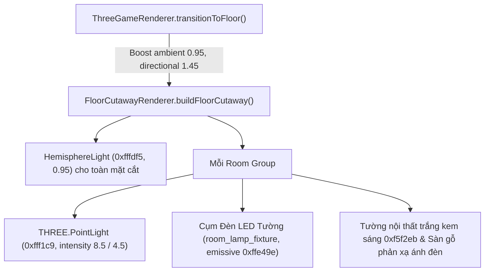

# Chiếu Sáng Đèn Điện Cho Mặt Cắt Phòng 3D Cutaway Implementation Plan

> **For agentic workers:** REQUIRED SUB-SKILL: Use superpowers:subagent-driven-development to implement this plan task-by-task. Steps use checkbox (`- [ ]`) syntax for tracking.

**Goal:** Làm sáng rõ không gian bên trong các phòng ở chế độ Mặt bằng Tầng 3D Cutaway (`FLOOR_3D`) với hiệu ứng ánh sáng đèn điện ấm áp (`THREE.PointLight` + cụm đèn LED phát sáng trực quan + `HemisphereLight` hắt trần + tường kem sáng `0xf5f2eb`).

**Architecture:** Mở rộng `FloorCutawayRenderer` (`packages/renderer-3d/src/cutaway/floorCutawayRenderer.ts`) để gắn 1 `THREE.HemisphereLight` vào `group` mặt cắt tầng và 1 `THREE.PointLight` + cụm đèn LED tường (`room_lamp_fixture`) vào mỗi `roomGroup`, đồng thời cập nhật `ThreeGameRenderer.ts` điều chỉnh độ sáng tổng thể khi chuyển vào/ra chế độ `FLOOR_3D` (`transitionToFloor` / `transitionToBuilding`).

**Architecture Diagram:**



**Tech Stack:** Three.js (`PointLight`, `HemisphereLight`, `MeshStandardMaterial`), TypeScript, Vitest, Playwright (Google Chrome).

**Spec:** [SPEC_ANH_SANG_DEN_DIEN_MAT_CAT_PHONG_3D.md](file:///Users/minhntv/Documents/Work/MinhNTV/TEAM_ORCA/4.Du_an/QLNT/01-quan-ly/SPEC_ANH_SANG_DEN_DIEN_MAT_CAT_PHONG_3D.md)

## Global Constraints

- **0% thay đổi trong `packages/shared-types` (`common`):** Tuyệt đối không chỉnh sửa `packages/shared-types`.
- **Bảo toàn unit tests hiện tại:** Không thay đổi giá trị mặc định trong `isometricLighting.ts` (`0xf5f3ef`, `0.6`), giữ màu sàn `0x8b5a2b` và màu hành lang `0xcbd5e1`.
- **Dọn dẹp tài nguyên:** Toàn bộ `PointLight`, `HemisphereLight` và geometry/material đèn phải nằm trong `FloorCutawayRenderer.group` để được giải phóng sạch sẽ khi `clear()`/`dispose()`.

---

### Task 1: Bổ sung Đèn Điện Phòng (`PointLight` + `room_lamp_fixture`) & `HemisphereLight` trong `FloorCutawayRenderer` và `ThreeGameRenderer` (`@qlnt/renderer-3d`)

**Files:**
- Modify: [floorCutawayRenderer.ts](file:///Users/minhntv/Documents/Work/MinhNTV/TEAM_ORCA/4.Du_an/QLNT/packages/renderer-3d/src/cutaway/floorCutawayRenderer.ts)
- Modify: [ThreeGameRenderer.ts](file:///Users/minhntv/Documents/Work/MinhNTV/TEAM_ORCA/4.Du_an/QLNT/packages/renderer-3d/src/ThreeGameRenderer.ts)
- Test: [floorCutawayRenderer.test.ts](file:///Users/minhntv/Documents/Work/MinhNTV/TEAM_ORCA/4.Du_an/QLNT/packages/renderer-3d/tests/floorCutawayRenderer.test.ts)

**Interfaces:**
- Produces inside `FloorCutawayRenderer.group`:
  - `THREE.HemisphereLight` (`name = 'CutawayHemisphereLight'`, `intensity = 0.95`)
  - Inside each `roomGroup`:
    - `THREE.PointLight` (`userData.type === 'room_electric_light'`, `color = 0xfff1c9`, `intensity = 8.5` for `OCCUPIED` / `4.5` for `VACANT`)
    - `THREE.Group` (`userData.type === 'room_lamp_fixture'`) containing metal base + glowing LED bulb (`emissive = 0xffe49e`)

- [ ] **Step 1: Viết unit test kiểm tra hệ thống đèn điện trong `floorCutawayRenderer.test.ts`**

Bổ sung test case mới trong [floorCutawayRenderer.test.ts](file:///Users/minhntv/Documents/Work/MinhNTV/TEAM_ORCA/4.Du_an/QLNT/packages/renderer-3d/tests/floorCutawayRenderer.test.ts) kiểm tra:
- `buildFloorCutaway` thêm `THREE.HemisphereLight` vào `group`.
- Mỗi phòng đều có `THREE.PointLight` (`userData.type === 'room_electric_light'`) với màu ấm `0xfff1c9` (phòng `OCCUPIED` sáng hơn phòng `VACANT`) và cụm đèn `room_lamp_fixture`.
- `ThreeGameRenderer.transitionToFloor` tăng `ambient.intensity` lên `0.95` và `transitionToBuilding` khôi phục về `0.6`.

- [ ] **Step 2: Chạy Vitest tại `packages/renderer-3d` xác nhận test mới FAIL**

Run: `pnpm --filter @qlnt/renderer-3d test`
Expected: FAIL vì chưa có `CutawayHemisphereLight`, `room_electric_light` và `room_lamp_fixture`.

- [ ] **Step 3: Implement đèn điện phòng & ánh sáng mặt cắt trong `floorCutawayRenderer.ts` và `ThreeGameRenderer.ts`**

1. Trong [floorCutawayRenderer.ts](file:///Users/minhntv/Documents/Work/MinhNTV/TEAM_ORCA/4.Du_an/QLNT/packages/renderer-3d/src/cutaway/floorCutawayRenderer.ts):
   - Thêm `THREE.HemisphereLight(0xfffdf5, 0xd6c7b2, 0.95)` vào `buildFloorCutaway()`.
   - Nâng `wallMat` lên `0xf5f2eb` (`roughness: 0.78`) và `floorMat` `roughness: 0.5` (giữ `color: 0x8b5a2b`).
   - Thêm `THREE.PointLight(0xfff1c9, isOccupied ? 8.5 : 4.5, 8.0, 1.35)` tại `(0, 1.85, 0)` và cụm đèn tường `room_lamp_fixture` trong `createRoomMeshGroup()`.
2. Trong [ThreeGameRenderer.ts](file:///Users/minhntv/Documents/Work/MinhNTV/TEAM_ORCA/4.Du_an/QLNT/packages/renderer-3d/src/ThreeGameRenderer.ts):
   - Trong `transitionToFloor()`: đặt `this.lighting.ambient.intensity = 0.95` và `this.lighting.directional.intensity = 1.45`.
   - Trong `transitionToBuilding()`: khôi phục `this.lighting.ambient.intensity = 0.6` và `this.lighting.directional.intensity = 1.2`.

- [ ] **Step 4: Chạy Vitest và Build tại `packages/renderer-3d`**

Run: `pnpm --filter @qlnt/renderer-3d test && pnpm --filter @qlnt/renderer-3d build`
Expected: PASS 100%.

- [ ] **Step 5: Commit Task 1**

```bash
git -C 4.Du_an/QLNT add packages/renderer-3d/src/cutaway/floorCutawayRenderer.ts packages/renderer-3d/src/ThreeGameRenderer.ts packages/renderer-3d/tests/floorCutawayRenderer.test.ts
git -C 4.Du_an/QLNT commit -m "feat(renderer-3d): bo sung anh sang den dien phong va tang do sang mat cat tang cutaway"
```

---

### Task 2: Kiểm Thử Toàn Diện & Chụp Ảnh Nghiệm Thu Mặt Bằng Tầng 3D Có Đèn Điện (`@qlnt/web` E2E)

**Files:**
- Modify: [p1-flows.spec.ts](file:///Users/minhntv/Documents/Work/MinhNTV/TEAM_ORCA/4.Du_an/QLNT/apps/web/e2e/p1-flows.spec.ts)

- [ ] **Step 1: Cập nhật Test 6 trong `apps/web/e2e/p1-flows.spec.ts` chụp ảnh nghiệm thu `22-3d-floor-cutaway-electric-lit-rooms.png`**

Trong Test 6 (`TC-P1-FLOOR-CUTAWAY`), sau khi chuyển sang chế độ Mặt bằng Tầng 2 3D Cutaway, lưu ảnh chụp `22-3d-floor-cutaway-electric-lit-rooms.png` (và copy sang `/Users/minhntv/.gemini/antigravity-cli/brain/b01f57a0-4d41-4d53-9533-2dd802b0fa85/22-3d-floor-cutaway-electric-lit-rooms.png`).

- [ ] **Step 2: Chạy toàn bộ Unit Tests, Build và Playwright Chrome E2E Suites**

Run:
```bash
cd 4.Du_an/QLNT && pnpm test && pnpm build
cd 4.Du_an/QLNT/apps/web && pnpm exec playwright test e2e/p1-flows.spec.ts
```
Expected: 100% Unit Tests PASS, 8/8 Playwright Chrome E2E Suites PASS.

- [ ] **Step 3: Kiểm tra trực quan ảnh chụp `22-3d-floor-cutaway-electric-lit-rooms.png`, commit & cập nhật `HANDOVER.md`**
