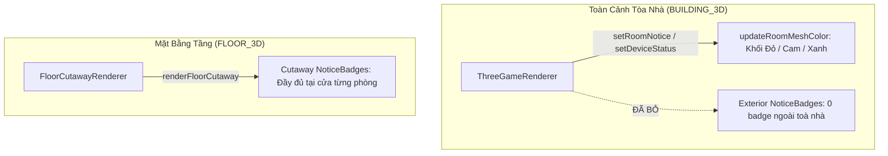

# Kế Hoạch Triển Khai: Bỏ Hoàn Toàn Icon Dấu Chấm Than Ở Khu Vực Bên Ngoài Tòa Nhà 3D

> **For agentic workers:** REQUIRED SUB-SKILL: Use superpowers:subagent-driven-development to implement this plan task-by-task. Steps use checkbox (`- [ ]`) syntax for tracking.

**Goal:** Bỏ hoàn toàn các icon dấu chấm than 3D lơ lửng ở khu vực bên ngoài tòa nhà, giữ hình khối tòa nhà tinh gọn, sạch sẽ, dựa vào màu sắc khối phòng (đỏ/cam/xanh) để nhận diện trạng thái, đồng thời bảo lưu 100% icon dấu chấm than trong mặt bằng tầng Cutaway.

**Architecture:** Trong `ThreeGameRenderer.ts`, gỡ bỏ việc khởi tạo và render `NoticeBadge` ra scene chính của toà nhà ngoài; `setRoomNotice()` và `setDeviceStatus()` chỉ quản lý cập nhật màu khối phòng `updateRoomMeshColor()`. Giữ nguyên 100% logic huy hiệu trong `FloorCutawayRenderer`.

**Architecture Diagram:**



**Tech Stack:** TypeScript, Three.js, Vitest, Playwright (Google Chrome).

**Spec:** [SPEC_BO_ICON_CHAM_THAN_BEN_NGOAI_TOA_NHA_3D.md](file:///Users/minhntv/Documents/Work/MinhNTV/TEAM_ORCA/4.Du_an/QLNT/01-quan-ly/SPEC_BO_ICON_CHAM_THAN_BEN_NGOAI_TOA_NHA_3D.md)

## Global Constraints

- **$0\%$ thay đổi `packages/shared-types` (`common`)**: Giữ nguyên toàn bộ interface và DTO dùng chung.
- **Local-First 100%**: Lưu trữ trên Dexie.js IndexedDB cục bộ.
- **Kiểm thử tự động**: $100\%$ unit tests và Playwright E2E suites PASS trên Google Chrome.

---

### Task 1: Gỡ Bỏ Icon Dấu Chấm Than Ngoài Tòa Nhà trong `ThreeGameRenderer`

**Files:**
- Modify: `4.Du_an/QLNT/packages/renderer-3d/src/threeGameRenderer.ts`
- Test: `4.Du_an/QLNT/packages/renderer-3d/tests/threeGameRenderer.test.ts`

- [x] **Step 1: Viết failing test xác nhận cảnh tòa nhà ngoài có 0 badge lơ lửng**

```typescript
// Trong packages/renderer-3d/tests/threeGameRenderer.test.ts
it('does not spawn exterior NoticeBadge in main scene for room notices or broken devices', async () => {
  const r = new ThreeGameRenderer({ canvas: document.createElement('canvas'), width: 800, height: 600 });
  await r.renderBuilding({
    propertyId: 'p-clean-test',
    totalFloors: 3,
    roomsPerFloor: 4,
    position: { x: 0, y: 0, z: 0 },
  });
  r.bindRoomIds([{ roomId: 'r-1', floorIndex: 0, roomIndex: 0 }]);
  r.setRoomNotice('r-1', 'PAYMENT_DUE');
  r.setDeviceStatus('r-1', 'd-1', 'BROKEN');

  // Kiểm tra scene chính không có bất kỳ NoticeBadge nào
  const exteriorBadges = r.scene.children.filter((c) => c.name.startsWith('NoticeBadge_'));
  expect(exteriorBadges.length).toBe(0);

  // Nhưng khối phòng vẫn đổi màu cảnh báo
  const mesh = (r as any).findRoomMesh('r-1');
  expect(mesh.material.color.getHex()).toBe(0xef4444);
});
```

- [x] **Step 2: Chạy test để xác nhận FAIL**
```bash
pnpm --filter @qlnt/renderer-3d test -- -t "does not spawn exterior NoticeBadge"
```

- [x] **Step 3: Triển khai gỡ bỏ badges ngoài tòa nhà trong `ThreeGameRenderer.ts`**
  - Trong `setRoomNotice(roomId, type)`:
    - Xóa logic thêm `NoticeBadge` vào `this.scene`.
    - Gọi `this.updateRoomMeshColor(roomId)`.
  - Trong `setDeviceStatus(roomId, deviceId, status)`:
    - Xóa logic thêm `NoticeBadge` vào `this.scene`.
    - Gọi `this.updateRoomMeshColor(roomId)`.
  - Xóa bỏ hoặc làm trống `this.badges` ngoài tòa nhà.
  - Đảm bảo `FloorCutawayRenderer` vẫn khởi tạo và hiển thị đầy đủ `NoticeBadge` khi vào chế độ `FLOOR_3D`.

- [x] **Step 4: Cập nhật các unit tests cũ và chạy lại toàn bộ tests**
```bash
pnpm --filter @qlnt/renderer-3d test
```
*Kỳ vọng: 100% tests PASS.*

- [x] **Step 5: Commit mã nguồn Task 1**
```bash
git -C 4.Du_an/QLNT add packages/renderer-3d/src/threeGameRenderer.ts packages/renderer-3d/tests/threeGameRenderer.test.ts
git -C 4.Du_an/QLNT commit -m "refactor(renderer-3d): bo hoan toan exterior notice badges ngoai toa nha 3D"
```

---

### Task 2: Kiểm Thử Tự Động Playwright E2E & Cập Nhật Ảnh Chụp Nghiệm Thu Thực Tế

**Files:**
- Modify: `4.Du_an/QLNT/apps/web/e2e/p1-flows.spec.ts`

- [x] **Step 1: Cập nhật kịch bản Playwright E2E xác nhận tòa nhà ngoài không còn badge**
  - Kiểm tra toàn cảnh tòa nhà bên ngoài sạch sẽ, chỉ có màu khối phòng.
  - Chụp lại ảnh nghiệm thu mới:
    * `10-building-block-preset-tower-2x2x6.png`
    * `11-building-block-preset-cube-3x3x3.png`
  - Kiểm tra mở Cutaway Tầng 2: Xác nhận các dấu chấm than bên trong tầng vẫn hiển thị đầy đủ tại cửa từng phòng và click mở được Sổ F04.
- [x] **Step 2: Chạy toàn bộ Playwright E2E test suites trên Google Chrome**
```bash
cd 4.Du_an/QLNT/apps/web && npx playwright test e2e/p1-flows.spec.ts
```
*Kỳ vọng: $100\%$ test suites PASS.*

- [x] **Step 3: Commit mã nguồn Task 2**
```bash
git -C 4.Du_an/QLNT add apps/web/e2e/p1-flows.spec.ts 04-van-hanh/
git -C 4.Du_an/QLNT commit -m "test(e2e): kiem thu toan bo toa nha ngoai khong con icon cham than, cutaway badges giu nguyen"
```
