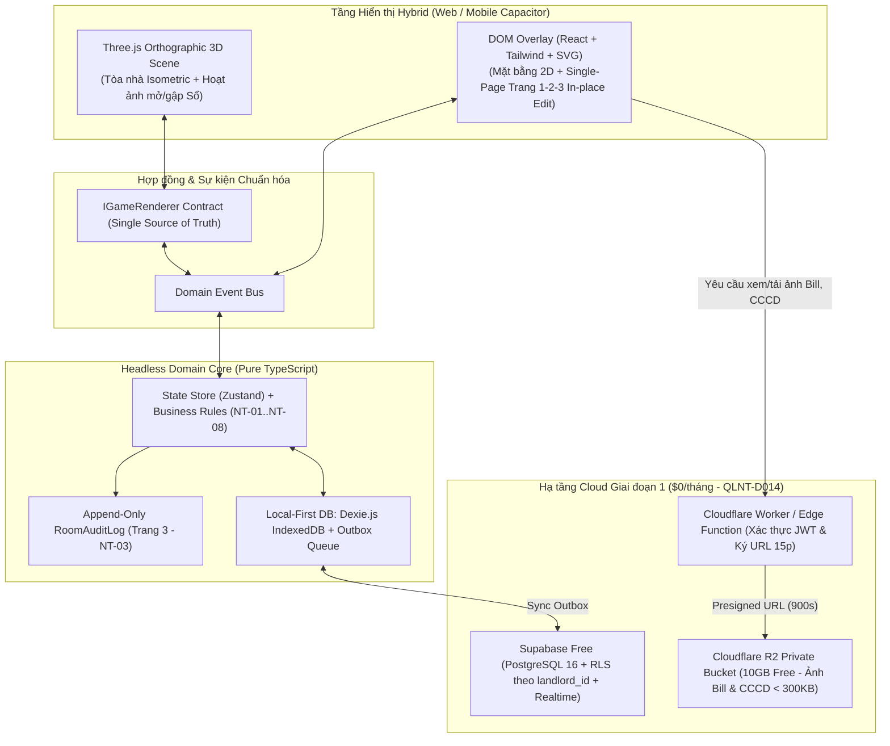

# Kế hoạch Triển khai: Chuẩn hóa Kỹ thuật & Cơ cấu Nhân sự Dự án QLNT

> **Tài liệu Kế hoạch Triển khai (Implementation Plan)**
> **Mã kế hoạch:** `PLAN-TECH-001`
> **Dự án:** Quản lý nhà trọ (QLNT)
> **Người lập:** Kỹ thuật chính dự án (Tech Lead / Mảng B)
> **Ngày lập:** 2026-11-12
> **Trạng thái:** `Đã hoàn thành 100% (TECH-STD-001)`

---

## 1. Mục tiêu & Định hướng Kiến trúc

**Mục tiêu:** Tạo tài liệu tổng hợp các điểm cải thiện kỹ thuật, điều chỉnh đồng bộ toàn bộ hồ sơ kiến trúc/dữ liệu/liên kết trong dự án `QLNT`, và thiết lập hồ sơ các vị trí nhân sự cần thiết để triển khai dự án theo đúng chuẩn vận hành.

**Kiến trúc giải pháp:** Tách biệt rõ tầng nghiệp vụ lõi (`Headless Domain Core` — TypeScript + Zustand + Dexie.js IndexedDB) với tầng hiển thị (`Hybrid Presentation`: `Three.js WebGL` cho cảnh 3D Isometric & hoạt ảnh mở sổ + `DOM Overlay` cho Mặt bằng tầng SVG & Tờ chi tiết Single-Page). Đồng bộ hóa mô hình dữ liệu 10 thực thể (`UUID v4`) giữa Local IndexedDB và Cloud (`Supabase Free` + `Cloudflare Worker` ký `Signed URL 15 phút` cho `Cloudflare R2 Free`) đảm bảo chi phí `$0/tháng` theo quyết định `QLNT-D014`.

### Sơ đồ Kiến trúc Tổng thể:

**Tech Stack:** TypeScript, React 19, Vite, Tailwind CSS, Zustand, Three.js, Dexie.js (IndexedDB), Capacitor, Supabase (PostgreSQL RLS), Cloudflare Pages / Workers / R2.

---

## 2. Nguyên tắc Ràng buộc Toàn cục (Global Constraints)

- Tuân thủ tuyệt đối `RULES_CORE.md` và các quyết định từ `QLNT-D001` đến `QLNT-D014`.
- Duy trì nguyên tắc `"$0 First"` (`QLNT-D014`): không đề xuất hoặc cài đặt các thành phần bắt buộc trả phí trong Giai đoạn 1.
- Không thay đổi quy tắc nghiệp vụ đã được Chủ dự án chốt; chỉ chuẩn hóa kỹ thuật, schema dữ liệu, hợp đồng giao tiếp và sửa lỗi liên kết.
- Mọi liên kết nội bộ trong repo `QLNT` phải dùng đường dẫn tương đối (relative paths), loại bỏ hoàn toàn các đường dẫn tuyệt đối hoặc link máy cá nhân (`/Users/uni/...`).

---

## 3. Các Gói Công việc Thực thi Chi tiết (Task Breakdown)

### Task 1: Tạo file tổng hợp 7 điểm cải thiện kỹ thuật & Cập nhật Nhật ký cải tiến

**Files:**
- Tạo mới: `03-ky-thuat/DANH_SACH_CAI_THIEN_VA_CHUAN_HOA_KY_THUAT.md`
- Chỉnh sửa: `04-van-hanh/IMPROVEMENTS.md`

**Nội dung thực hiện:**
- [x] **Step 1:** Tạo tài liệu `03-ky-thuat/DANH_SACH_CAI_THIEN_VA_CHUAN_HOA_KY_THUAT.md` trình bày chi tiết 7 điểm:
  1. Hợp nhất Contract `IGameRenderer` (Single Source of Truth).
  2. Kiến trúc Hybrid `WebGL 3D + DOM Overlay` cho Sổ F04 Single-Page.
  3. Chốt Stack Frontend (`React 19 + TypeScript + Vite + Tailwind + Zustand + Three.js`).
  4. Chuẩn hóa Schema 10 bảng dữ liệu bao phủ `REF-MKT-002` & `RoomAuditLog` (`NT-03`).
  5. Cơ chế đồng bộ `IndexedDB Outbox` $\leftrightarrow$ `Supabase Free Cloud Sync`.
  6. Kiến trúc `Cloudflare Worker / Edge Function` cấp `Signed URL 15 phút` cho `Cloudflare R2`.
  7. Cập nhật hiện trạng công cụ máy Kỹ thuật chính (`MinhNTV`) và chuẩn hóa relative links.
- [x] **Step 2:** Cập nhật bảng theo dõi trong `04-van-hanh/IMPROVEMENTS.md` ghi nhận đợt rà soát kỹ thuật ngày `2026-11-12`.
- [x] **Step 3:** Kiểm tra tính hợp lệ và cấu trúc định dạng Markdown.

---

### Task 2: Điều chỉnh đồng bộ các tài liệu kỹ thuật, nghiệp vụ và vận hành

**Files:**
- Chỉnh sửa: `03-ky-thuat/TECH_PROFILE.md`
- Chỉnh sửa: `02-nghiep-vu/DAC_TA_SO_QUAN_LY_AO_SINGLE_PAGE_VA_RENDERER.md`
- Chỉnh sửa: `02-nghiep-vu/SRS.md`
- Chỉnh sửa: `02-nghiep-vu/USE_CASES.md`
- Chỉnh sửa: `04-van-hanh/HA_TANG_VA_VAN_HANH_HE_THONG.md`

**Nội dung thực hiện:**
- [x] **Step 1:** Cập nhật `03-ky-thuat/TECH_PROFILE.md` và `02-nghiep-vu/DAC_TA_SO_QUAN_LY_AO_SINGLE_PAGE_VA_RENDERER.md` làm rõ phân tách giữa Three.js WebGL (cảnh 3D, mở/gập bìa sổ) và DOM Overlay (mặt bằng tầng 2D, tờ chi tiết Single-Page in-place edit); chốt cấu hình Tech Stack.
- [x] **Step 2:** Đồng bộ mục 3.1 của `02-nghiep-vu/SRS.md` và tên hàm trong `02-nghiep-vu/USE_CASES.md` khớp với `TECH_PROFILE.md` (`Vector3D`, `setDeviceStatus`, `setRoomNotice`, nhóm hàm Sổ F04); mở rộng mục 6 của `SRS.md` lên đủ 10 thực thể dữ liệu.
- [x] **Step 3:** Cập nhật `04-van-hanh/HA_TANG_VA_VAN_HANH_HE_THONG.md` bổ sung cơ chế đồng bộ `IndexedDB Outbox` kết hợp `Supabase Free Tier` và cổng ký `Presigned URL (15 phút)` qua Cloudflare Worker/Edge Function miễn phí.
- [x] **Step 4:** Kiểm tra tính nhất quán giữa các file đặc tả, loại bỏ triệt để các hàm/tọa độ cũ lệch chuẩn.

---

### Task 3: Sửa toàn bộ đường dẫn cứng `/Users/uni/...` sang đường dẫn tương đối & Cập nhật môi trường máy trạm

**Files:**
- Chỉnh sửa: `01-quan-ly/BAO_CAO_DANH_GIA_SAN_SANG_SPRINT_1.md`
- Chỉnh sửa: `01-quan-ly/HO_SO_DIEU_PHOI_SPRINT_1_VA_QUY_MO_HA_TANG.md`
- Chỉnh sửa: `02-nghiep-vu/REQUIREMENTS.md`
- Chỉnh sửa: `02-nghiep-vu/MA_TRAN_TRUY_VET_P1.md`
- Chỉnh sửa: `02-nghiep-vu/DAC_TA_SO_QUAN_LY_AO_SINGLE_PAGE_VA_RENDERER.md`
- Chỉnh sửa: `03-ky-thuat/TECH_PROFILE.md`
- Chỉnh sửa: `04-van-hanh/QUALITY_AND_RELEASE.md`
- Chỉnh sửa: `04-van-hanh/KHUNG_DANH_GIA_VA_NGHIEM_THU_SPRINT_1.md`

**Nội dung thực hiện:**
- [x] **Step 1:** Thay thế toàn bộ đường dẫn cứng `file:///Users/uni/Documents/AI/AI-Workspace/AI-Workspace/TEAM_ORCA/...` thành đường dẫn tương đối chuẩn Markdown.
- [x] **Step 2:** Cập nhật ghi chú môi trường máy trạm Kỹ thuật chính (`MinhNTV`) trong `01-quan-ly/BAO_CAO_DANH_GIA_SAN_SANG_SPRINT_1.md` và `04-van-hanh/KHUNG_DANH_GIA_VA_NGHIEM_THU_SPRINT_1.md` (Node.js v24, pnpm v12, Python 3.11, Docker v28 & Docker Compose v2.39).
- [x] **Step 3:** Chạy lệnh quét xác minh không còn bất kỳ đường dẫn cứng `/Users/uni/` nào trong thư mục dự án.

---

### Task 4: Thiết lập Hồ sơ Cơ cấu Vị trí Nhân sự thực hiện dự án QLNT

**Files:**
- Tạo mới: `01-quan-ly/CO_CAU_NHAN_SU_DU_AN.md`

**Nội dung thực hiện:**
- [x] **Step 1:** Soạn thảo tài liệu `01-quan-ly/CO_CAU_NHAN_SU_DU_AN.md` quy định rõ:
  1. Danh mục 9 vị trí chuyên môn phân theo 3 mảng A, B, C (Product Owner/PM, Tech Lead, Frontend 3D Dev, BA, UX Designer, 2D Artist, 3D Modeler, QA/QC, Marketing/Growth).
  2. Mô hình Tinh gọn kết hợp AI (`AI-Augmented Lean Team` — 2–3 nhân sự con người + 8 AI Subagents) cho giai đoạn P1 MVP để tối ưu chi phí `$0`.
  3. Lộ trình mở rộng nhân sự cho Giai đoạn P2 (3–4 người) và Giai đoạn P3 (5–7 người).
- [x] **Step 2:** Kiểm tra trạng thái Git trong `4.Du_an/QLNT` đảm bảo cây thư mục sạch sẽ, sẵn sàng nghiệm thu.
