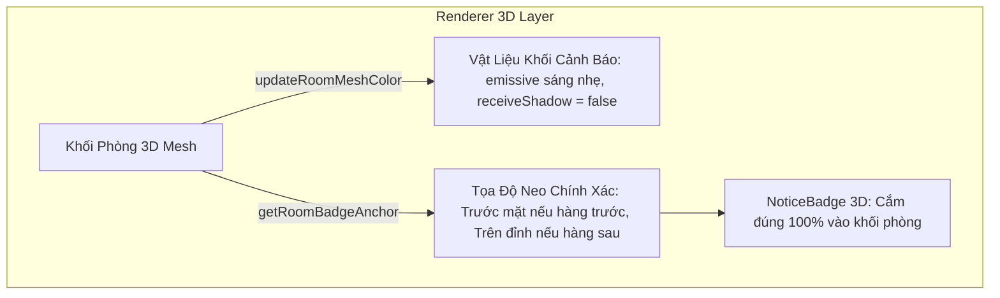

# Kế Hoạch Triển Khai: Điều Chỉnh Đổ Bóng Khối Màu & Đánh Dấu Chấm Than Chính Xác Vào Từng Khối 3D

> **For agentic workers:** REQUIRED SUB-SKILL: Use superpowers:subagent-driven-development to implement this plan task-by-task. Steps use checkbox (`- [ ]`) syntax for tracking.

**Goal:** Điều chỉnh hiệu ứng đổ bóng cho các khối toà nhà có màu khác mặc định (đỏ/cam cảnh báo) luôn tươi sáng rực rỡ không bị bóng râm làm xỉn màu, đồng thời tính toán vị trí neo dấu chấm than `NoticeBadge` cắm chính xác $100\%$ vào đúng khối phòng tương ứng trên mọi layout toà nhà 3D.

**Architecture:** Trong `ThreeGameRenderer.ts`, cập nhật hàm `updateRoomMeshColor()` thêm ánh sáng tự thân nhẹ `emissive` và tắt `receiveShadow` cho các khối cảnh báo để loại bỏ bóng râm đè tối; cập nhật `getRoomBadgeAnchor()` tính toán toạ độ neo 3D theo đúng hàng $Z$ và cột $X$ của phòng mục tiêu (neo mặt trước đối với phòng hàng trước, neo trên đỉnh nóc đối với phòng hàng sau/giữa).

**Architecture Diagram:**



**Tech Stack:** TypeScript, Three.js, Vitest, Playwright (Google Chrome).

**Spec:** [SPEC_DO_BONG_KHOI_MAU_VA_CHAM_THAN_CHINH_XAC_3D.md](file:///Users/minhntv/Documents/Work/MinhNTV/TEAM_ORCA/4.Du_an/QLNT/01-quan-ly/SPEC_DO_BONG_KHOI_MAU_VA_CHAM_THAN_CHINH_XAC_3D.md)

## Global Constraints

- **$0\%$ thay đổi `packages/shared-types` (`common`)**: Không chỉnh sửa package chung.
- **Local-First 100%**: Không gọi API bên ngoài.
- **Kiểm thử tự động**: $100\%$ unit tests và Playwright E2E suites PASS trên Google Chrome.

---

### Task 1: Điều Chỉnh Vật Liệu, Độ Sáng & Đổ Bóng Khối Cảnh Báo trong `ThreeGameRenderer`

**Files:**
- Modify: `4.Du_an/QLNT/packages/renderer-3d/src/threeGameRenderer.ts`
- Test: `4.Du_an/QLNT/packages/renderer-3d/tests/threeGameRenderer.test.ts`

- [x] **Step 1: Viết failing test kiểm tra vật liệu và đổ bóng của khối cảnh báo**

```typescript
// Trong packages/renderer-3d/tests/threeGameRenderer.test.ts
it('configures alert room meshes with vibrant emissive and disables receiveShadow', async () => {
  const r = new ThreeGameRenderer({ canvas: document.createElement('canvas'), width: 800, height: 600 });
  await r.renderBuilding({
    propertyId: 'p-shadow-test',
    totalFloors: 3,
    roomsPerFloor: 4,
    position: { x: 0, y: 0, z: 0 },
  });
  r.bindRoomIds([{ roomId: 'room-broken', floorIndex: 1, roomIndex: 1 }]);
  r.setDeviceStatus('room-broken', 'd1', 'BROKEN');

  const brokenMesh = (r as any).findRoomMesh('room-broken');
  expect(brokenMesh).toBeDefined();
  expect(brokenMesh.receiveShadow).toBe(false);
  expect(brokenMesh.castShadow).toBe(true);
  expect(brokenMesh.material.emissive.getHex()).toBeGreaterThan(0);
});
```

- [x] **Step 2: Chạy test xác nhận FAIL**
```bash
pnpm --filter @qlnt/renderer-3d test -- -t "configures alert room meshes"
```

- [x] **Step 3: Triển khai tinh chỉnh đổ bóng và vật liệu trong `updateRoomMeshColor()`**

Trong `packages/renderer-3d/src/threeGameRenderer.ts`:
- Khi `isBroken`:
  - `c.material.color.set(0xef4444);`
  - `c.material.emissive.setHex(0x3b0707);` (ánh đỏ tự thân dịu mắt)
  - `c.receiveShadow = false;` (không bị bóng tối của tầng trên đè xỉn màu)
- Khi `hasNotice`:
  - `c.material.color.set(0xf59e0b);`
  - `c.material.emissive.setHex(0x331a00);` (ánh vàng cam ấm áp)
  - `c.receiveShadow = false;`
- Khi bình thường (`NONE`):
  - `c.material.color.set(baseColor);`
  - `c.material.emissive.setHex(0x000000);`
  - `c.receiveShadow = true;`

- [x] **Step 4: Chạy lại test xác nhận PASS**
```bash
pnpm --filter @qlnt/renderer-3d test
```

- [x] **Step 5: Commit mã nguồn Task 1**
```bash
git -C 4.Du_an/QLNT add packages/renderer-3d/src/threeGameRenderer.ts packages/renderer-3d/tests/threeGameRenderer.test.ts
git -C 4.Du_an/QLNT commit -m "fix(renderer-3d): dieu chinh do bong va emissive cho cac khoi canh bao"
```

---

### Task 2: Định Vị Dấu Chấm Than `NoticeBadge` Chính Xác Tuyệt Đối Vào Từng Khối Phòng 3D

**Files:**
- Modify: `4.Du_an/QLNT/packages/renderer-3d/src/threeGameRenderer.ts`
- Test: `4.Du_an/QLNT/packages/renderer-3d/tests/threeGameRenderer.test.ts`

- [x] **Step 1: Viết failing test kiểm tra tọa độ neo `getRoomBadgeAnchor` cho phòng hàng sau và hàng trước**

```typescript
// Trong packages/renderer-3d/tests/threeGameRenderer.test.ts
it('anchors notice badges accurately to target room mesh without spilling into front rooms', async () => {
  const r = new ThreeGameRenderer({ canvas: document.createElement('canvas'), width: 800, height: 600 });
  await r.renderBuilding({
    propertyId: 'p-anchor-test',
    totalFloors: 3,
    roomsPerFloor: 4,
    position: { x: 0, y: 0, z: 0 },
    blockGrid: { cols: 2, rows: 2 },
  } as any);

  r.bindRoomIds([
    { roomId: 'room-back', floorIndex: 1, roomIndex: 0 }, // Row 0 (hàng sau)
    { roomId: 'room-front', floorIndex: 1, roomIndex: 2 }, // Row 1 (hàng trước)
  ]);

  const backAnchor = r.getRoomBadgeAnchor('room-back', 'ROOM_NOTICE');
  const backMesh = (r as any).findRoomMesh('room-back');
  // Anchor phòng hàng sau phải neo trên đỉnh/thân của chính nó, không vượt sang z của hàng trước
  expect(Math.abs(backAnchor.z - backMesh.position.z)).toBeLessThan(0.3);

  const frontAnchor = r.getRoomBadgeAnchor('room-front', 'ROOM_NOTICE');
  const frontMesh = (r as any).findRoomMesh('room-front');
  // Anchor phòng hàng trước neo ra mặt trước
  expect(frontAnchor.z).toBeGreaterThan(frontMesh.position.z);
});
```

- [x] **Step 2: Chạy test xác nhận FAIL**
```bash
pnpm --filter @qlnt/renderer-3d test -- -t "anchors notice badges accurately"
```

- [x] **Step 3: Triển khai neo chính xác trong `getRoomBadgeAnchor()`**

Trong `packages/renderer-3d/src/threeGameRenderer.ts`:
- Xác định `rowIdx = mesh.userData['rowIdx'] ?? 0;`
- Xác định `rows = mesh.userData['rows'] ?? 1;`
- Nếu là phòng hàng trước (`rowIdx === rows - 1`):
  - Neo ở mặt tiền phía trước:
    `x = mesh.position.x + (isDevice ? 0.18 : -0.18);`
    `y = mesh.position.y + 0.25;`
    `z = mesh.position.z + (sz / 2) + 0.18;`
- Nếu là phòng hàng sau hoặc giữa (`rowIdx < rows - 1`):
  - Neo ngay trên đỉnh nóc của chính khối phòng đó:
    `x = mesh.position.x + (isDevice ? 0.18 : -0.18);`
    `y = mesh.position.y + (sy / 2) + 0.28;`
    `z = mesh.position.z;`
- Đồng thời cập nhật lại vị trí của toàn bộ badges hiện có trong scene khi đổi layout toà nhà.

- [x] **Step 4: Chạy unit test xác nhận PASS**
```bash
pnpm --filter @qlnt/renderer-3d test
```

- [x] **Step 5: Commit mã nguồn Task 2**
```bash
git -C 4.Du_an/QLNT add packages/renderer-3d/src/threeGameRenderer.ts packages/renderer-3d/tests/threeGameRenderer.test.ts
git -C 4.Du_an/QLNT commit -m "fix(renderer-3d): dinh vi notice badge chinh xac vao tung khoi phong 3D"
```

---

### Task 3: Chạy Toàn Bộ Test Suites & Playwright E2E Chrome Xác Nhận Nghiệm Thu

**Files:**
- Modify: `4.Du_an/QLNT/apps/web/e2e/p1-flows.spec.ts`

- [x] **Step 1: Cập nhật kịch bản E2E kiểm tra dấu chấm than trên các preset layout**
  - Chạy Playwright E2E với Chrome.
  - Chụp ảnh mới nghiệm thu:
    * `10-building-block-preset-tower-2x2x6.png` (khối tháp 2x2x6 với đổ bóng sáng đẹp, dấu chấm than cắm đúng khối).
    * `11-building-block-preset-cube-3x3x3.png` (khối vuông 3x3x3 với dấu chấm than đỏ cắm ngay đỉnh khối phòng đỏ).
- [x] **Step 2: Chạy kiểm thử E2E trên Google Chrome**
```bash
cd 4.Du_an/QLNT/apps/web && npx playwright test e2e/p1-flows.spec.ts
```
*Kỳ vọng: 100% test suites PASS.*

- [x] **Step 3: Commit mã nguồn và cập nhật báo cáo kiểm thử**
```bash
git -C 4.Du_an/QLNT add apps/web/e2e/p1-flows.spec.ts 04-van-hanh/
git -C 4.Du_an/QLNT commit -m "test(e2e): nghiem thu Playwright Chrome do bong khoi mau va notice badges chinh xac"
```
