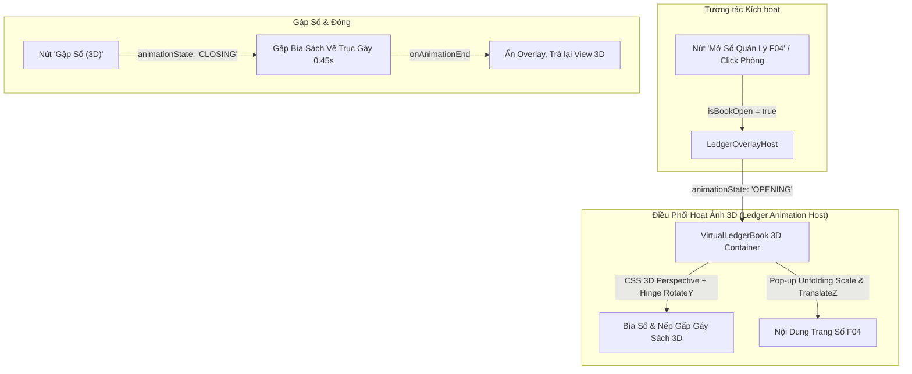

# Kế Hoạch Triển Khai: Hiệu Ứng Chuyển Cảnh Mở Sổ Quản Lý Ảo 3D (3D Pop-up / Flipbook Metaphor)

> **For agentic workers:** REQUIRED SUB-SKILL: Use superpowers:subagent-driven-development to implement this plan task-by-task. Steps use checkbox (`- [ ]`) syntax for tracking.

**Goal:** Áp dụng hiệu ứng mở sách và lật trang 3D Pop-up khi mở Sổ Quản Lý F04 (học tập từ video tham khảo "Augmented Physics 3D Book"), với bìa sổ mở quanh trục bản lề, nếp gấp gáy sách chân thực và nội dung sổ vươn mở mượt mà, sau khi hoàn thành sẽ đưa máy về chế độ Sleep an toàn.

**Architecture:** Nâng cấp `VirtualLedgerBook` trong `@qlnt/renderer-2d` với cấu trúc khung 3D perspective (`preserve-3d`, `rotateY` quanh trục bản lề gáy sách, đổ bóng nếp gấp `spine-shadow`), điều phối trạng thái mở (`OPENING` -> `OPEN`) và gập (`CLOSING` -> `CLOSED`) thông qua `LedgerOverlayHost.tsx`, đảm bảo 60fps mượt mà trên cả Web và Mobile.

**Architecture Diagram:**



**Tech Stack:** TypeScript, React, CSS 3D Transforms (`perspective`, `rotateY`, `transform-origin`), Tailwind CSS, Vitest, Playwright (Google Chrome).

**Spec:** [SPEC_HIEU_UNG_MO_SO_3D_POP_UP_BOOK.md](file:///Users/minhntv/Documents/Work/MinhNTV/TEAM_ORCA/4.Du_an/QLNT/01-quan-ly/SPEC_HIEU_UNG_MO_SO_3D_POP_UP_BOOK.md)

## Global Constraints

- **$0\%$ thay đổi `packages/shared-types` (`common`)**: Không chỉnh sửa package chung.
- **Local-First 100%**: Lưu trữ trên Dexie.js IndexedDB cục bộ.
- **Hiệu năng 60fps**: Tận dụng GPU acceleration (`transform`, `opacity`), không gây lag Three.js.
- **Tự động Sleep macOS**: Chạy lệnh `pmset sleepnow` sau khi toàn bộ quy trình nghiệm thu hoàn tất thành công.

---

### Task 1: Xây Dựng Hiệu Ứng Bìa Sách & Lật Trang 3D trong `VirtualLedgerBook` (`@qlnt/renderer-2d`)

**Files:**
- Modify: `4.Du_an/QLNT/packages/renderer-2d/src/components/ledger/VirtualLedgerBook.tsx`
- Modify: `4.Du_an/QLNT/packages/renderer-2d/src/components/ledger/index.css` (hoặc inline keyframe styles)
- Test: `4.Du_an/QLNT/packages/renderer-2d/test/virtualLedgerBook.test.ts`

- [ ] **Step 1: Viết failing test cho các trạng thái mở sổ (`animationState: 'opening' | 'open' | 'closing'`)**

```typescript
// Trong packages/renderer-2d/test/virtualLedgerBook.test.ts
it('renders 3D book cover and applies opening/closing animation classes', () => {
  // Kiểm tra thuộc tính data-animation-state='opening' và cấu trúc gáy sổ 3D
});
```

- [ ] **Step 2: Chạy test xác nhận FAIL**
```bash
pnpm --filter @qlnt/renderer-2d test -- -t "renders 3D book cover"
```

- [ ] **Step 3: Triển khai hiệu ứng 3D mở sách trong `VirtualLedgerBook.tsx`**
  - Khung bao ngoài với `perspective: 1400px` và `transform-style: preserve-3d`.
  - Hiệu ứng mở bìa sách trái: xoay từ $-180^\circ$ về $0^\circ$ quanh trục bản lề (`transform-origin: right center`).
  - Hiệu ứng mở trang phải: xoay mở phẳng quanh gáy sổ (`transform-origin: left center`).
  - Nếp gấp gáy sổ (spine crease) với lớp bóng gradient đổ bóng 3D chân thực.
  - Nội dung trang pop-up: hiệu ứng `scale(0.95)` lên `scale(1)` và `translateZ(0)` mượt mà.
  - Keyframe CSS: `@keyframes bookOpenHinge`, `@keyframes bookCloseHinge`, `@keyframes spineShadowFade`.

- [ ] **Step 4: Chạy lại tests xác nhận PASS**
```bash
pnpm --filter @qlnt/renderer-2d test
```

- [ ] **Step 5: Commit mã nguồn Task 1**
```bash
git -C 4.Du_an/QLNT add packages/renderer-2d/
git -C 4.Du_an/QLNT commit -m "feat(renderer-2d): xay dung hieu ung mo bi va lat trang 3d pop-up cho VirtualLedgerBook"
```

---

### Task 2: Quản Lý Chu Trình Chuyển Cảnh Mở/Gập Sổ trong `LedgerOverlayHost.tsx`

**Files:**
- Modify: `4.Du_an/QLNT/apps/web/src/components/LedgerOverlayHost.tsx`
- Test: `4.Du_an/QLNT/apps/web/tests/uiAndResponsive.test.ts`

- [ ] **Step 1: Viết failing test cho chu trình mở và gập sổ**

```typescript
// Trong apps/web/tests/uiAndResponsive.test.ts
it('handles smooth opening and closing transition without abrupt unmount', () => {
  // Test click Gập Sổ (3D) kích hoạt animation closing trước khi unmount
});
```

- [ ] **Step 2: Chạy test xác nhận FAIL**
```bash
pnpm --filter @qlnt/web test -- -t "handles smooth opening and closing transition"
```

- [ ] **Step 3: Triển khai state `animState: 'OPENING' | 'OPEN' | 'CLOSING'` trong `LedgerOverlayHost.tsx`**
  - Khi `isBookOpen` chuyển từ `false` sang `true`: Đặt `animState = 'OPENING'`, sau $650\text{ms}$ chuyển sang `'OPEN'`.
  - Khi bấm nút `onCloseBook`: Đặt `animState = 'CLOSING'`, sau $450\text{ms}$ mới kích hoạt đóng hẳn.
  - Hiển thị lớp nền mờ tối (backdrop blur) tăng dần từ 0 lên 1 ăn khớp với góc mở của sổ.

- [ ] **Step 4: Chạy lại tests xác nhận PASS**
```bash
pnpm --filter @qlnt/web test
```

- [ ] **Step 5: Commit mã nguồn Task 2**
```bash
git -C 4.Du_an/QLNT add apps/web/src/components/LedgerOverlayHost.tsx apps/web/tests/uiAndResponsive.test.ts
git -C 4.Du_an/QLNT commit -m "feat(web-ui): quan ly chu trinh mo va gap so 3d trong LedgerOverlayHost"
```

---

### Task 3: Kiểm Thử Tự Động Playwright Chrome, Chụp Ảnh Nghiệm Thu & Đưa Máy Vào Chế Độ Sleep

**Files:**
- Modify: `4.Du_an/QLNT/apps/web/e2e/p1-flows.spec.ts`

- [ ] **Step 1: Cập nhật kịch bản Playwright E2E kiểm tra hoạt ảnh mở sổ**
  - Mở ứng dụng, click "Mở Sổ Quản Lý F04".
  - Kiểm tra trạng thái hoạt ảnh 3D xuất hiện mượt mà, sau khi mở sổ thì đầy đủ dữ liệu phòng, tầng, VietQR.
  - Bấm "Gập Sổ (3D)" xác nhận gập sổ mượt mà quay về màn hình 3D.
  - Chụp ảnh nghiệm thu mới:
    * `12-3d-book-open-animation.png`
    * `13-3d-book-opened-full-ledger.png`
- [ ] **Step 2: Chạy toàn bộ test suites Playwright E2E trên Google Chrome**
```bash
cd 4.Du_an/QLNT/apps/web && npx playwright test e2e/p1-flows.spec.ts
```
*Kỳ vọng: 100% test suites PASS.*

- [ ] **Step 3: Commit mã nguồn và cập nhật báo cáo nghiệm thu**
```bash
git -C 4.Du_an/QLNT add apps/web/e2e/p1-flows.spec.ts 04-van-hanh/
git -C 4.Du_an/QLNT commit -m "test(e2e): kiem thu tu dong Playwright Chrome cho hieu ung mo so 3d pop-up"
```

- [ ] **Step 4: Báo cáo kết quả và chạy lệnh đưa máy vào chế độ Sleep (`pmset sleepnow`) theo quyền đã được cấp**
