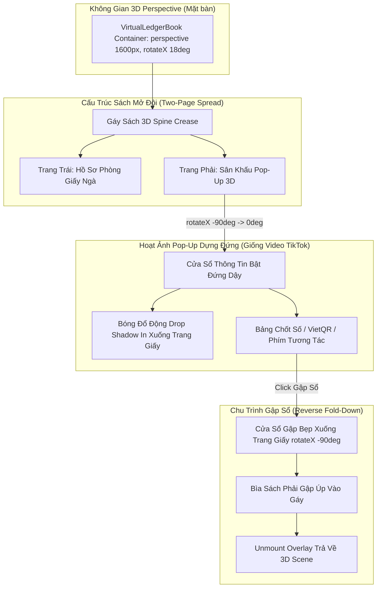

# KẾ HOẠCH TRIỂN KHAI: TÁI TẠO HOẠT ẢNH QUYỂN SÁCH POP-UP 3D CHUẨN XÁC THEO VIDEO TIKTOK

> **For agentic workers:** REQUIRED SUB-SKILL: Use superpowers:subagent-driven-development to implement this plan task-by-task. Steps use checkbox (`- [ ]`) syntax for tracking.

**Goal:** Tái tạo chính xác trải nghiệm thị giác của cuốn sách 3D Pop-up trong video TikTok: Cuốn sách nằm nghiêng phối cảnh 3D perspective, mở ra trang đôi (Trang trái: tài liệu hồ sơ giấy; Trang phải: cửa sổ thông tin/mặt bằng dựng đứng dậy khỏi mặt giấy `rotateX(-90deg) -> rotateX(0deg)` kèm bóng đổ chân thực).

**Architecture:** Nâng cấp cấu trúc `VirtualLedgerBook` (@qlnt/renderer-2d) thành mô hình 3D Two-Page Spread (Trang Trái & Trang Phải) kết hợp bản lề gáy sách ở giữa; hợp nhất `f04-interactive-panel` (@qlnt/web) thành cấu trúc Pop-Up đứng dậy trên trang phải theo hoạt ảnh vật lý `popUpStandUp`.

**Architecture Diagram:**

**Tech Stack:** React 19, TypeScript, CSS 3D Transforms (`perspective`, `transform-style: preserve-3d`, `transform-origin: bottom center`, `rotateX`, `rotateY`), Vitest, Playwright Chrome.

**Spec:** [SPEC_HIEU_UNG_SO_3D_POP_UP_THEO_VIDEO_TIKTOK.md](file:///Users/minhntv/Documents/Work/MinhNTV/TEAM_ORCA/4.Du_an/QLNT/01-quan-ly/SPEC_HIEU_UNG_SO_3D_POP_UP_THEO_VIDEO_TIKTOK.md)

## Global Constraints
- **0% thay đổi** trong `packages/shared-types` (`common`).
- Tất cả unit tests (181/181) và Playwright E2E suites (8/8) phải tiếp tục PASS 100%.
- Giữ nguyên toàn bộ `data-testid` hiện có (`f04-interactive-panel`, `room-detail-single-page`, `virtual-ledger-book`, `close-ledger-book-btn`...).
- Báo cáo và tài liệu bằng tiếng Việt.

---

## Bảng Đánh Giá Vùng Ảnh Hưởng (Impact Assessment)

| STT | Khu vực / Module | Tệp tin ảnh hưởng | Mức độ | Nội dung thay đổi | Biện pháp kiểm soát rủi ro |
|---|---|---|---|---|---|
| 1 | **Common (`packages/shared-types`)** | Không có | **0% (Không ảnh hưởng)** | Giữ nguyên 100% schema và types. | Tuyệt đối không chỉnh sửa `packages/shared-types`. |
| 2 | **Renderer 2D (`@qlnt/renderer-2d`)** | `VirtualLedgerBook.tsx`, `RoomDetailSinglePage.tsx` | Trung bình | Tái cấu trúc thành sách 3D mở đôi (Left Page: tài liệu giấy, Right Page: Pop-up stage). Hoạt ảnh `popUpStandUp` dựng đứng từ mặt giấy kèm bóng đổ động. | Hỗ trợ responsive linh hoạt cho desktop và mobile; unit tests xác minh cấu trúc 3D. |
| 3 | **Web UI Host (`@qlnt/web`)** | `LedgerOverlayHost.tsx` | Trung bình | Hợp nhất `f04-interactive-panel` đặt trên thẻ pop-up dựng đứng của trang phải; điều phối chu trình mở bìa $\rightarrow$ bật đứng pop-up $\rightarrow$ gập bẹp $\rightarrow$ đóng bìa. | Đảm bảo các tương tác nhập số, duyệt bill, QR không bị lệch layout. |
| 4 | **Unit Tests** | `virtualLedgerBook.test.ts`, `uiAndResponsive.test.ts` | Thấp | Cập nhật kiểm tra cấu trúc trang đôi và thuộc tính pop-up standup. | Chạy toàn bộ unit tests đảm bảo 100% pass. |
| 5 | **Playwright E2E Tests** | `p1-flows.spec.ts` | Thấp | Kiểm tra và chụp ảnh nghiệm thu: phối cảnh cuốn sách 3D mở đôi và thẻ pop-up dựng đứng vuông góc. | Chạy kiểm thử Chrome headless kiểm tra zero error. |

---

## Danh Sách Task Chi Tiết

### Task 1: Tái cấu trúc `VirtualLedgerBook` thành sách 3D mở đôi kèm cơ chế Pop-up dựng đứng (@qlnt/renderer-2d)
**Files:**
- Modify: `packages/renderer-2d/src/components/ledger/VirtualLedgerBook.tsx`
- Modify: `packages/renderer-2d/src/components/ledger/RoomDetailSinglePage.tsx`
- Test: `packages/renderer-2d/test/virtualLedgerBook.test.ts`

**Interfaces:**
- Cấu trúc:
  - `book-spread`: Phối cảnh `perspective: 1600px`, độ nghiêng góc nhìn `rotateX(16deg)`.
  - `book-page-left`: Trang tài liệu giấy in nét chữ mực (thông tin phòng, hợp đồng, chỉ số).
  - `book-page-right`: Trang bệ phóng có thẻ `popup-standup-card` dựng đứng `rotateX(-90deg) -> rotateX(0deg)` từ nếp gấp chân đế.

- [ ] **Step 1: Viết test cho cấu trúc trang đôi và hoạt ảnh dựng đứng pop-up**
- [ ] **Step 2: Chạy test xác nhận FAIL**
- [ ] **Step 3: Triển khai giao diện trang đôi và CSS `@keyframes popUpStandUp` + bóng đổ**
- [ ] **Step 4: Chạy test xác nhận PASS**
- [ ] **Step 5: Commit Git**

---

### Task 2: Hợp nhất Panel tương tác F04 vào thẻ Pop-up dựng đứng trong `LedgerOverlayHost` (@qlnt/web)
**Files:**
- Modify: `apps/web/src/components/LedgerOverlayHost.tsx`
- Test: `apps/web/tests/uiAndResponsive.test.ts`

- [ ] **Step 1: Viết test cho tích hợp pop-up trang phải trong `LedgerOverlayHost`**
- [ ] **Step 2: Chạy test xác nhận FAIL**
- [ ] **Step 3: Hiện thực hóa tích hợp điều phối gập/mở pop-up và panel tương tác**
- [ ] **Step 4: Chạy test xác nhận PASS**
- [ ] **Step 5: Commit Git**

---

### Task 3: Chạy toàn bộ Unit Tests & Build kiểm tra hồi quy
**Files:**
- Toàn bộ 5 packages

- [ ] **Step 1: Build toàn bộ 5 packages (`pnpm build`)**
- [ ] **Step 2: Chạy bộ unit tests (181/181 PASS)**
- [ ] **Step 3: Commit Git**

---

### Task 4: Kiểm thử Playwright Chrome E2E & Chụp ảnh nghiệm thu
**Files:**
- Modify: `apps/web/e2e/p1-flows.spec.ts`

- [ ] **Step 1: Cập nhật test case số 8 kiểm thử cuốn sách 3D mở đôi và pop-up dựng đứng**
- [ ] **Step 2: Chạy Playwright test suite trên Chrome**
- [ ] **Step 3: Chụp ảnh nghiệm thu:**
  - `16-3d-popup-book-isometric-spread.png`: Toàn cảnh cuốn sách 3D mở đôi nghiêng trên bàn.
  - `17-3d-popup-book-upright-standup.png`: Thẻ thông tin pop-up dựng đứng vuông góc kèm bóng đổ.
- [ ] **Step 4: Commit Git**
