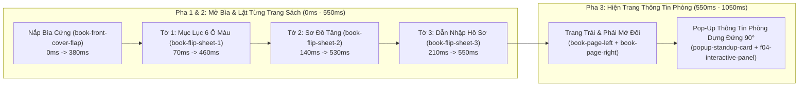

# Hoạt Ảnh Quyển Sách Mở Ra Từng Trang Sách Sau Đó Mới Tới Trang Thông Tin Phòng Implementation Plan

> **For agentic workers:** REQUIRED SUB-SKILL: Use superpowers:subagent-driven-development to implement this plan task-by-task. Steps use checkbox (`- [ ]`) syntax for tracking.

**Goal:** Tái tạo chuẩn xác hoạt ảnh quyển sách 3D mở nắp bìa và lật mở từng trang giấy nối tiếp nhau (`book-flip-sheet-1` → `book-flip-sheet-2` → `book-flip-sheet-3`, bao gồm trang Mục Lục `Contents` có 6 ô vuông màu như trong video TikTok gốc), sau khi các trang sách lật mở hoàn tất mới hiển thị và dựng đứng Trang Thông Tin Phòng.

**Architecture:** Mở rộng `VirtualLedgerBook` (`@qlnt/renderer-2d`) với hệ thống xếp chồng đa trang 3D (`book-flip-pages-stack`) gồm 3 tờ giấy hai mặt xoay lệch pha (`70ms`, `140ms`, `210ms`) quanh trục gáy sách cùng khối mép giấy trắng (`book-page-block-edges`), dây ruy-băng đánh dấu trang (`book-ribbon-bookmark`) và tờ lật chuyển trang nội bộ (`book-inner-turning-sheet`). Trong suốt pha lật mở từng trang sách (`0ms – 550ms`), `LedgerOverlayHost` (`@qlnt/web`) giữ `contentStage = 'hidden'` cho toàn bộ trang thông tin phòng và bảng tương tác; chỉ khi tờ giấy cuối cùng hạ phẳng (`550ms`) mới kích hoạt `contentStage = 'popping' -> 'visible'` để hiện và dựng đứng trang thông tin phòng.

**Architecture Diagram:**



**Tech Stack:** React 18, TypeScript, Tailwind CSS, CSS 3D Transforms (`perspective: 1600px`, `transform-style: preserve-3d`), Vitest, Playwright (Google Chrome).

**Spec:** [SPEC_HOAT_ANH_MO_SACH_TUNG_TRANG_DEN_THONG_TIN_PHONG.md](file:///Users/minhntv/Documents/Work/MinhNTV/TEAM_ORCA/4.Du_an/QLNT/01-quan-ly/SPEC_HOAT_ANH_MO_SACH_TUNG_TRANG_DEN_THONG_TIN_PHONG.md)

## Global Constraints

- **0% thay đổi trong `packages/shared-types` (`common`):** Tuyệt đối không chỉnh sửa bất kỳ file nào trong `packages/shared-types`.
- **Tương thích ngược 100%:** Giữ nguyên toàn bộ `data-testid`, chữ ký props và hành vi kiểm thử hiện có của `VirtualLedgerBook` và `LedgerOverlayHost`.
- **60fps Pure CSS 3D:** Toàn bộ hoạt ảnh lật từng trang giấy sử dụng GPU-accelerated `transform: perspective(...) rotateY(...)` và `opacity`, không phát sinh request mạng bên ngoài (`QLNT-D016`).
- **Touch Target:** Mọi nút bấm tương tác giữ nguyên `min-height: 44px`.

---

### Task 1: Thiết kế Hệ thống Lật Mở Từng Trang Sách (`book-flip-pages-stack`) & Chuyển Trang Nội Bộ trong `@qlnt/renderer-2d`

**Files:**
- Modify: [VirtualLedgerBook.tsx](file:///Users/minhntv/Documents/Work/MinhNTV/TEAM_ORCA/4.Du_an/QLNT/packages/renderer-2d/src/components/ledger/VirtualLedgerBook.tsx)
- Test: [virtualLedgerBook.test.ts](file:///Users/minhntv/Documents/Work/MinhNTV/TEAM_ORCA/4.Du_an/QLNT/packages/renderer-2d/test/virtualLedgerBook.test.ts)

**Interfaces:**
- Consumes: `VirtualLedgerBookProps` (`animationState?: 'opening' | 'open' | 'closing'`, `contentStage?: LedgerContentStage`, `isPageTurning?: boolean`)
- Produces:
  - `data-testid="book-flip-pages-stack"`: Container chứa 3 tờ trang sách lật mở tuần tự.
  - `data-testid="book-flip-sheet-1"`: Trang 1 — Mục lục Tòa nhà F04 (`Contents`) kèm 6 ô vuông màu sắc như video mẫu.
  - `data-testid="book-flip-sheet-2"`: Trang 2 — Sơ đồ tổng quan các tầng & định mức.
  - `data-testid="book-flip-sheet-3"`: Trang 3 — Hồ sơ dẫn nhập trước khi lộ ra Trang Thông Tin Phòng.
  - `data-testid="book-page-block-edges"`: Khối mép giấy trắng xếp chồng bên cạnh phải cuốn sách.
  - `data-testid="book-ribbon-bookmark"`: Dải ruy-băng đánh dấu trang màu xanh navy ở khe gáy sách.
  - `data-testid="book-inner-turning-sheet"`: Tờ giấy lật chuyển trang khi chọn phòng hoặc đổi tầng trong lúc sổ đang mở.

- [ ] **Step 1: Viết unit test kiểm tra hệ thống lật từng trang sách trong `virtualLedgerBook.test.ts`**

Bổ sung test case mới vào cuối [virtualLedgerBook.test.ts](file:///Users/minhntv/Documents/Work/MinhNTV/TEAM_ORCA/4.Du_an/QLNT/packages/renderer-2d/test/virtualLedgerBook.test.ts):

```typescript
  it('renders multi-page sequential flipping sheets (book-flip-sheet-1..3), page block edges, bookmark ribbon, and inner turning sheet', () => {
    const findNodeByTestId = (node: any, testId: string): any => {
      if (!node) return null;
      if (node.props && node.props['data-testid'] === testId) return node;
      if (node.props && node.props.children) {
        const children = Array.isArray(node.props.children)
          ? node.props.children
          : [node.props.children];
        for (const child of children) {
          const found = findNodeByTestId(child, testId);
          if (found) return found;
        }
      }
      return null;
    };

    // 1. Opening state: cover + 3 sequential sheets fan open with staggered delays before room info page appears
    const openingBook = VirtualLedgerBook({
      floorMap: mockFloorMap,
      roomDetail: mockRoomDetail,
      animationState: 'opening',
      contentStage: 'hidden',
    });

    const pagesStack = findNodeByTestId(openingBook, 'book-flip-pages-stack');
    expect(pagesStack).not.toBeNull();
    expect(pagesStack.props['data-animation-state']).toBe('opening');

    const sheet1 = findNodeByTestId(openingBook, 'book-flip-sheet-1');
    const sheet2 = findNodeByTestId(openingBook, 'book-flip-sheet-2');
    const sheet3 = findNodeByTestId(openingBook, 'book-flip-sheet-3');

    expect(sheet1).not.toBeNull();
    expect(sheet2).not.toBeNull();
    expect(sheet3).not.toBeNull();

    expect(sheet1.props.style?.transformOrigin).toBe('left center');
    expect(sheet2.props.style?.transformOrigin).toBe('left center');
    expect(sheet3.props.style?.transformOrigin).toBe('left center');

    expect(sheet1.props.style?.animation).toContain('pageSheetFlipOpen1');
    expect(sheet2.props.style?.animation).toContain('pageSheetFlipOpen2');
    expect(sheet3.props.style?.animation).toContain('pageSheetFlipOpen3');

    // Verify 6 colored squares in Sheet 1 (Contents page matching video)
    const colorSquaresGrid = findNodeByTestId(openingBook, 'contents-color-squares');
    expect(colorSquaresGrid).not.toBeNull();

    // Verify page block edges and navy ribbon bookmark
    const pageEdges = findNodeByTestId(openingBook, 'book-page-block-edges');
    expect(pageEdges).not.toBeNull();

    const ribbon = findNodeByTestId(openingBook, 'book-ribbon-bookmark');
    expect(ribbon).not.toBeNull();

    // 2. Closing state: sheets flip back in reverse order
    const closingBook = VirtualLedgerBook({
      floorMap: mockFloorMap,
      animationState: 'closing',
      contentStage: 'folding',
    });
    const closingSheet1 = findNodeByTestId(closingBook, 'book-flip-sheet-1');
    const closingSheet2 = findNodeByTestId(closingBook, 'book-flip-sheet-2');
    const closingSheet3 = findNodeByTestId(closingBook, 'book-flip-sheet-3');
    expect(closingSheet1.props.style?.animation).toContain('pageSheetFlipClose1');
    expect(closingSheet2.props.style?.animation).toContain('pageSheetFlipClose2');
    expect(closingSheet3.props.style?.animation).toContain('pageSheetFlipClose3');

    // 3. Inner page turning sheet when switching from floor map to room detail page
    const turningBook = VirtualLedgerBook({
      floorMap: mockFloorMap,
      roomDetail: mockRoomDetail,
      animationState: 'open',
      contentStage: 'visible',
      isPageTurning: true,
    });
    const innerTurnSheet = findNodeByTestId(turningBook, 'book-inner-turning-sheet');
    expect(innerTurnSheet).not.toBeNull();
    expect(innerTurnSheet.props['data-page-turning']).toBe('true');
    expect(innerTurnSheet.props.style?.animation).toContain('innerPageTurnFlip');
  });
```

- [ ] **Step 2: Chạy Vitest tại `packages/renderer-2d` để xác nhận test mới FAIL**

Run: `pnpm --filter @qlnt/renderer-2d test`
Expected: FAIL vì `book-flip-pages-stack`, `book-flip-sheet-1..3`, `book-page-block-edges`, `book-ribbon-bookmark`, `book-inner-turning-sheet` chưa được định nghĩa.

- [ ] **Step 3: Cập nhật `VirtualLedgerBook.tsx` bổ sung hệ thống lật từng trang sách nối tiếp nhau và tờ lật nội bộ**

Trong [VirtualLedgerBook.tsx](file:///Users/minhntv/Documents/Work/MinhNTV/TEAM_ORCA/4.Du_an/QLNT/packages/renderer-2d/src/components/ledger/VirtualLedgerBook.tsx):
1. Bổ sung prop tùy chọn `isPageTurning?: boolean` vào `VirtualLedgerBookProps`.
2. Thêm keyframes lật từng tờ giấy có độ trễ lệch pha và độ cong sáng tối tự nhiên:
   - `frontCoverFlapOpen` (`380ms cubic-bezier(0.22, 0.61, 0.36, 1) 0ms forwards`)
   - `pageSheetFlipOpen1` (`390ms cubic-bezier(0.22, 0.61, 0.36, 1) 70ms forwards`): Lật tờ Mục lục (`Contents` với 6 ô vuông màu sắc như video).
   - `pageSheetFlipOpen2` (`390ms cubic-bezier(0.22, 0.61, 0.36, 1) 140ms forwards`): Lật tờ Sơ đồ mặt bằng tầng.
   - `pageSheetFlipOpen3` (`340ms cubic-bezier(0.22, 0.61, 0.36, 1) 210ms forwards`): Lật tờ Dẫn nhập hồ sơ phòng (hoàn tất đúng mốc `550ms` để mở ra Trang Thông Tin Phòng).
   - `pageSheetFlipClose3`, `pageSheetFlipClose2`, `pageSheetFlipClose1`: Quạt gập ngược các trang sách khi đóng sổ.
   - `innerPageTurnFlip` (`420ms cubic-bezier(0.22, 0.61, 0.36, 1) forwards`): Lật trang giấy khi chuyển từ Sơ đồ tầng vào Trang Thông Tin Phòng.
3. Render `book-flip-pages-stack` gồm `book-flip-sheet-1`, `book-flip-sheet-2`, `book-flip-sheet-3`, kèm `book-page-block-edges`, `book-ribbon-bookmark` và `book-inner-turning-sheet`.

- [ ] **Step 4: Chạy lại Vitest tại `packages/renderer-2d` để xác nhận toàn bộ tests PASS**

Run: `pnpm --filter @qlnt/renderer-2d test`
Expected: PASS 100%.

- [ ] **Step 5: Commit Task 1**

```bash
git -C 4.Du_an/QLNT add packages/renderer-2d/src/components/ledger/VirtualLedgerBook.tsx packages/renderer-2d/test/virtualLedgerBook.test.ts
git -C 4.Du_an/QLNT commit -m "feat(renderer-2d): bo sung hoat anh quyen sach mo ra tung trang sach truoc khi toi trang thong tin phong"
```

---

### Task 2: Điều phối Chu Trình Mở Từng Trang Sách & Lật Chuyển Trang Thông Tin Phòng trong `LedgerOverlayHost` (`@qlnt/web`)

**Files:**
- Modify: [LedgerOverlayHost.tsx](file:///Users/minhntv/Documents/Work/MinhNTV/TEAM_ORCA/4.Du_an/QLNT/apps/web/src/components/LedgerOverlayHost.tsx)
- Test: [uiAndResponsive.test.ts](file:///Users/minhntv/Documents/Work/MinhNTV/TEAM_ORCA/4.Du_an/QLNT/apps/web/tests/uiAndResponsive.test.ts)

**Interfaces:**
- Consumes: `VirtualLedgerBook` với `isPageTurning` và `book-flip-pages-stack`
- Produces:
  - Khi mở sổ (`isBookOpen: true`): `0ms – 550ms` chạy hoạt ảnh mở bìa + lật từng trang sách (`book-flip-sheet-1..3`), giữ `contentStage = 'hidden'` cho trang thông tin phòng; từ `550ms – 1050ms` chuyển sang `contentStage = 'popping' -> 'visible'` hiển thị Trang Thông Tin Phòng.
  - Khi người dùng đang mở sổ và bấm chọn phòng (`onOpenRoomDetail`) hoặc đổi tầng (`onFlipFloor`), kích hoạt `isPageTurning = true` trong `420ms` để lật tờ giấy sang Trang Thông Tin Phòng.

- [ ] **Step 1: Bổ sung kiểm thử SSR/Unit cho các trang sách lật tuần tự trong `uiAndResponsive.test.ts`**

Trong [uiAndResponsive.test.ts](file:///Users/minhntv/Documents/Work/MinhNTV/TEAM_ORCA/4.Du_an/QLNT/apps/web/tests/uiAndResponsive.test.ts), cập nhật bài test `coordinates 2-stage transition in LedgerOverlayHost` để kiểm tra sự hiện diện của `book-flip-pages-stack`, `book-flip-sheet-1`, `book-flip-sheet-2`, `book-flip-sheet-3`, `contents-color-squares`, `book-page-block-edges`, và `book-ribbon-bookmark` trong giai đoạn `OPENING` (`contentStage = 'hidden'`).

- [ ] **Step 2: Cập nhật `LedgerOverlayHost.tsx` quản lý state `isPageTurning` khi chuyển sang trang thông tin phòng**

Trong [LedgerOverlayHost.tsx](file:///Users/minhntv/Documents/Work/MinhNTV/TEAM_ORCA/4.Du_an/QLNT/apps/web/src/components/LedgerOverlayHost.tsx):
- Thêm state `isPageTurning` kích hoạt trong `420ms` khi `roomDetail?.roomId` hoặc `currentFloor` thay đổi trong lúc sổ đã ở trạng thái `'OPEN'`, truyền `isPageTurning={isPageTurning}` xuống `<VirtualLedgerBook />`.

- [ ] **Step 3: Chạy Vitest tại `apps/web` để xác nhận toàn bộ tests PASS**

Run: `pnpm --filter @qlnt/web test`
Expected: PASS 100% (39/39 tests).

- [ ] **Step 4: Commit Task 2**

```bash
git -C 4.Du_an/QLNT add apps/web/src/components/LedgerOverlayHost.tsx apps/web/tests/uiAndResponsive.test.ts
git -C 4.Du_an/QLNT commit -m "feat(web-ui): dieu phoi chu trinh lat tung trang sach va chuyen sang trang thong tin phong"
```

---

### Task 3: Kiểm Thử Tự Động Playwright E2E Trên Google Chrome & Chụp Ảnh Nghiệm Thu Từng Giai Đoạn

**Files:**
- Modify: [p1-flows.spec.ts](file:///Users/minhntv/Documents/Work/MinhNTV/TEAM_ORCA/4.Du_an/QLNT/apps/web/e2e/p1-flows.spec.ts)

**Interfaces:**
- Verifies:
  1. Khi mở sổ phòng P101, tại `t ≈ 220ms`, nắp bìa và 3 tờ trang sách (`book-flip-sheet-1`, `book-flip-sheet-2`, `book-flip-sheet-3`) đang lật mở từng trang, trong khi trang thông tin phòng (`virtual-ledger-book-main` & `f04-interactive-panel`) vẫn ẩn (`opacity: 0`).
  2. Sau khi các trang sách lật xong (`t ≥ 850ms`), Trang Thông Tin Phòng P101 hiện ra đầy đủ hai trang mở đôi và thẻ Pop-up dựng đứng.
  3. Chụp ảnh nghiệm thu lưu vào thư mục Artifacts:
     - `18-3d-book-flipping-pages-sequence.png`: Khoảnh khắc quyển sách đang lật mở từng trang giấy (tờ Mục lục `Contents` 6 ô màu + các tờ tiếp theo đang quạt mở trên không).
     - `19-3d-book-room-info-page-revealed.png`: Khoảnh khắc các trang sách đã mở xong và hiển thị hoàn chỉnh Trang Thông Tin Phòng P101.

- [ ] **Step 1: Cập nhật `apps/web/e2e/p1-flows.spec.ts` kiểm tra `book-flip-sheet-1..3` và chụp ảnh nghiệm thu**

Bổ sung assertions kiểm tra `book-flip-pages-stack`, `book-flip-sheet-1`, `book-flip-sheet-2`, `book-flip-sheet-3`, `book-ribbon-bookmark` và chụp 2 ảnh nghiệm thu `18-3d-book-flipping-pages-sequence.png` + `19-3d-book-room-info-page-revealed.png`.

- [ ] **Step 2: Chạy toàn bộ Unit Tests và Playwright E2E Suites trên Google Chrome**

Run:
```bash
cd 4.Du_an/QLNT && pnpm test
cd 4.Du_an/QLNT/apps/web && pnpm exec playwright test e2e/p1-flows.spec.ts
```
Expected: 100% Unit Tests PASS, 8/8 Playwright E2E Suites PASS, 0 console error, 0 page error.

- [ ] **Step 3: Commit Task 3 & Cập nhật `3.DOC_AI/HANDOVER.md`**

```bash
git -C 4.Du_an/QLNT add apps/web/e2e/p1-flows.spec.ts 01-quan-ly/SPEC_HOAT_ANH_MO_SACH_TUNG_TRANG_DEN_THONG_TIN_PHONG.md 01-quan-ly/KE_HOACH_HOAT_ANH_MO_SACH_TUNG_TRANG_DEN_THONG_TIN_PHONG.md
git -C 4.Du_an/QLNT commit -m "test(e2e): nghiem thu hoat anh mo sach tung trang truoc khi hien trang thong tin phong"
```
