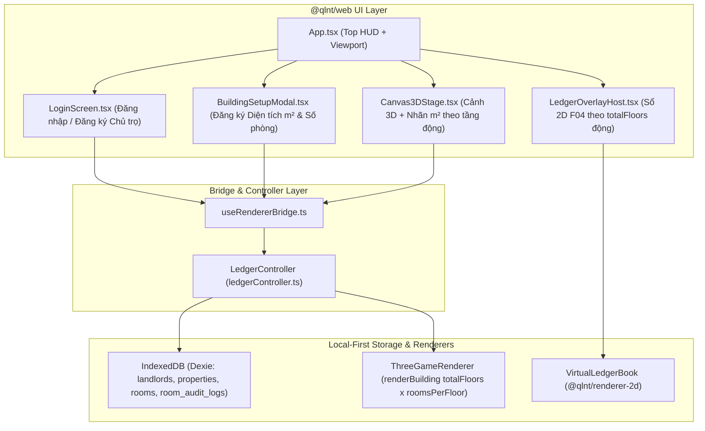

# Màn Hình Đăng Nhập & Chức Năng Đăng Ký Diện Tích, Số Phòng Tòa Nhà Implementation Plan

> **For agentic workers:** REQUIRED SUB-SKILL: Use superpowers:subagent-driven-development to implement this plan task-by-task. Steps use checkbox (`- [ ]`) syntax for tracking.

**Goal:** Xây dựng màn hình Đăng nhập/Đăng ký Chủ trọ (`LoginScreen.tsx`) và chức năng Đăng ký diện tích, số tầng, số phòng của tòa nhà (`BuildingSetupModal.tsx`) chạy 100% Local-First trên `IndexedDB` (`@qlnt/domain-core`) và đồng bộ tức thì với Cảnh 3D Isometric (`@qlnt/renderer-3d`) cùng Sổ Quản Lý 2D F04 (`@qlnt/renderer-2d`).

**Architecture:** Mở rộng `LedgerController` và `useRendererBridge` trong `@qlnt/web` để quản lý phiên đăng nhập Chủ trọ (`Landlord`) kết hợp `localStorage` + `IndexedDB`, đồng thời cung cấp bộ hàm khởi tạo/cập nhật quy mô tòa nhà (`Property` + `Room[]` với `area_sqm`, `total_floors`, `base_price`). Bổ sung 2 component UI độc lập (`LoginScreen.tsx` và `BuildingSetupModal.tsx`) và cập nhật `Canvas3DStage.tsx`, `LedgerOverlayHost.tsx`, `App.tsx` để render số tầng động (`1..totalFloors`) và hiển thị diện tích (`m²`) của từng phòng mà không chạm vào `packages/shared-types`.

**Architecture Diagram:**



**Tech Stack:** React 19, TypeScript 5.8 (Strict), Tailwind CSS v4, Dexie.js (`IndexedDB` + `fake-indexeddb`), Three.js (`@qlnt/renderer-3d`), `@qlnt/renderer-2d`, Vitest, Playwright Chrome E2E.

**Spec:** [SPEC_LOGIN_VA_DANG_KY_TOA_NHA.md](file:///Users/minhntv/Documents/Work/MinhNTV/TEAM_ORCA/4.Du_an/QLNT/01-quan-ly/SPEC_LOGIN_VA_DANG_KY_TOA_NHA.md)

## Global Constraints

- **Không sửa `common`:** Tuyệt đối không chỉnh sửa bất kỳ file nào trong `packages/shared-types`, `packages/domain-core`, `packages/renderer-2d`, `packages/renderer-3d`.
- **100% Offline / Local-First (`QLNT-D016`):** Không gọi API xác thực hay lưu trữ bên ngoài; toàn bộ tài khoản Chủ trọ, diện tích và danh sách phòng lưu trong `IndexedDB` + `localStorage`.
- **Chuẩn Mobile `390x844` & Touch Target:** Mọi nút bấm tương tác (`<button>`) phải có `style={{ minHeight: '44px' }}` (`MIN_TOUCH_TARGET_SIZE = 44`), không tràn ngang ở viewport `390x844`.
- **Tương thích ngược 100%:** Toàn bộ 122 unit tests hiện có và 3 bộ test Playwright E2E hiện có phải tiếp tục PASS, đồng thời bổ sung test mới cho Login & Đăng ký diện tích/số phòng.

---

### Task 1: Mở rộng `LedgerController` & `useRendererBridge` hỗ trợ Đăng nhập Chủ trọ và Đăng ký Diện tích, Số phòng Tòa nhà

**Files:**
- Modify: [ledgerController.ts](file:///Users/minhntv/Documents/Work/MinhNTV/TEAM_ORCA/4.Du_an/QLNT/apps/web/src/bridge/ledgerController.ts)
- Modify: [useRendererBridge.ts](file:///Users/minhntv/Documents/Work/MinhNTV/TEAM_ORCA/4.Du_an/QLNT/apps/web/src/bridge/useRendererBridge.ts)
- Test: [ledgerController.test.ts](file:///Users/minhntv/Documents/Work/MinhNTV/TEAM_ORCA/4.Du_an/QLNT/apps/web/tests/ledgerController.test.ts)

**Interfaces:**
- Consumes: `Landlord`, `Property`, `Room`, `RoomAuditLog` from `@qlnt/shared-types`; `db`, `generateUUID`, `recordRoomAuditLog` from `@qlnt/domain-core`.
- Produces:
  - `BUILDING_AREA_PRESETS`: Bộ 3 mẫu diện tích chuẩn (`20 m²`, `25 m²`, `35 m²`).
  - `generateRoomDrafts(totalFloors, roomsPerFloor, defaultAreaSqm, defaultBasePrice, existingRooms?)`: Sinh danh sách `RoomSetupDraft[]`.
  - `LedgerController.loginLandlord(phoneOrEmail, pin)`
  - `LedgerController.loginDemoLandlord()`
  - `LedgerController.registerLandlord(input: RegisterLandlordInput)`
  - `LedgerController.logoutLandlord()`
  - `LedgerController.registerOrUpdateBuilding(input: BuildingRegistrationInput)`
  - `RoomSummarySnapshot.totalAreaSqm: number` & `averageAreaSqm: number`

- [ ] **Step 1: Viết unit test kiểm thử Đăng nhập/Đăng ký Chủ trọ và Đăng ký Diện tích & Số phòng trong `apps/web/tests/ledgerController.test.ts`**

Bổ sung test case mới vào cuối `describe('LedgerController', ...)` trong [ledgerController.test.ts](file:///Users/minhntv/Documents/Work/MinhNTV/TEAM_ORCA/4.Du_an/QLNT/apps/web/tests/ledgerController.test.ts):

```ts
  it('supports Landlord local login, registration, logout, and Building area/room count setup', async () => {
    const { controller, renderer } = await setupController();

    // 1. Default demo login & invalid login check
    await expect(controller.loginLandlord('0988123456', 'wrong-pin')).rejects.toThrow(
      /Mã PIN không chính xác/
    );
    const demoLandlord = await controller.loginLandlord('0988123456', '123456');
    expect(demoLandlord.name).toBe('Nguyễn Minh Anh');
    expect(controller.isAuthenticated()).toBe(true);

    // 2. Register a new Landlord
    const newLandlord = await controller.registerLandlord({
      name: 'Trần Quốc Tuấn',
      phone: '0912345678',
      email: 'tuan.tran@qlnt.local',
      pin: '654321',
      packageTier: 'PRO',
    });
    expect(newLandlord.name).toBe('Trần Quốc Tuấn');
    expect(controller.getLandlord()?.id).toBe(newLandlord.id);
    expect(controller.isAuthenticated()).toBe(true);

    // 3. Register / Update Building with 4 floors x 3 rooms/floor = 12 rooms and custom area_sqm
    const drafts = controller.buildRoomSetupDrafts({
      totalFloors: 4,
      roomsPerFloor: 3,
      defaultAreaSqm: 25,
      defaultBasePrice: 4000000,
    });
    expect(drafts).toHaveLength(12);
    // Customize P101 to 30m2 and P403 to 35m2
    drafts[0]!.areaSqm = 30;
    drafts[0]!.basePrice = 4500000;
    drafts[11]!.areaSqm = 35;
    drafts[11]!.basePrice = 5200000;

    const updatedProperty = await controller.registerOrUpdateBuilding({
      propertyName: 'Chung cư Mini Tuấn Anh — Cầu Giấy',
      address: 'Số 88 Cầu Giấy, Hà Nội',
      totalFloors: 4,
      roomsPerFloor: 3,
      waterCalcMethod: 'PER_M3',
      electricUnitPrice: 4000,
      waterUnitPrice: 32000,
      serviceFee: 180000,
      roomsDraft: drafts,
    });

    expect(updatedProperty.total_floors).toBe(4);
    expect(updatedProperty.name).toBe('Chung cư Mini Tuấn Anh — Cầu Giấy');

    const rooms = controller.getRooms();
    expect(rooms).toHaveLength(12);
    const p101 = rooms.find((r) => r.room_number === 'P101')!;
    const p403 = rooms.find((r) => r.room_number === 'P403')!;
    expect(p101.area_sqm).toBe(30);
    expect(p101.base_price).toBe(4500000);
    expect(p403.floor_number).toBe(4);
    expect(p403.area_sqm).toBe(35);

    const summary = controller.getSummaryStats();
    // 10 rooms * 25m2 + 30m2 + 35m2 = 315m2
    expect(summary.totalRooms).toBe(12);
    expect(summary.totalAreaSqm).toBe(315);

    expect(renderer.renderBuilding).toHaveBeenLastCalledWith({
      propertyId: updatedProperty.id,
      totalFloors: 4,
      roomsPerFloor: 3,
      position: { x: 0, y: 0, z: 0 },
    });

    // 4. Logout & re-login with new Landlord credentials
    controller.logoutLandlord();
    expect(controller.isAuthenticated()).toBe(false);
    const relogged = await controller.loginLandlord('0912345678', '654321');
    expect(relogged.id).toBe(newLandlord.id);
    expect(controller.isAuthenticated()).toBe(true);
  });
```

- [ ] **Step 2: Chạy Vitest để xác nhận test mới FAIL**

Run: `cd /Users/minhntv/Documents/Work/MinhNTV/TEAM_ORCA/4.Du_an/QLNT && pnpm --filter @qlnt/web test`
Expected: FAIL với lỗi `controller.loginLandlord is not a function`.

- [ ] **Step 3: Triển khai các hàm Auth & Building Setup trong `ledgerController.ts` và `useRendererBridge.ts`**

Cập nhật [ledgerController.ts](file:///Users/minhntv/Documents/Work/MinhNTV/TEAM_ORCA/4.Du_an/QLNT/apps/web/src/bridge/ledgerController.ts):
- Bổ sung định nghĩa kiểu & hằng số mẫu diện tích:
  ```ts
  export interface BuildingAreaPreset {
    id: 'STANDARD_20' | 'MEZZANINE_25' | 'STUDIO_35';
    label: string;
    description: string;
    areaSqm: number;
    basePrice: number;
  }

  export const BUILDING_AREA_PRESETS: readonly BuildingAreaPreset[] = [
    {
      id: 'STANDARD_20',
      label: 'Phòng đơn (20 m²)',
      description: 'Phòng trọ khép kín tiêu chuẩn',
      areaSqm: 20,
      basePrice: 3200000,
    },
    {
      id: 'MEZZANINE_25',
      label: 'Gác lửng (25 m²)',
      description: 'Phòng có gác xép tối ưu không gian',
      areaSqm: 25,
      basePrice: 4000000,
    },
    {
      id: 'STUDIO_35',
      label: 'Studio CCMN (35 m²)',
      description: 'Căn hộ studio chung cư mini đủ nội thất',
      areaSqm: 35,
      basePrice: 5200000,
    },
  ] as const;

  export interface RegisterLandlordInput {
    name: string;
    phone: string;
    email?: string;
    pin: string;
    packageTier?: Landlord['package_tier'];
  }

  export interface RoomSetupDraft {
    roomNumber: string;
    floorNumber: number;
    areaSqm: number;
    basePrice: number;
    depositAmount?: number;
    status?: Room['status'];
  }

  export interface BuildingRegistrationInput {
    propertyName: string;
    address: string;
    totalFloors: number;
    roomsPerFloor: number;
    waterCalcMethod: Property['water_calc_method'];
    electricUnitPrice: number;
    waterUnitPrice: number;
    serviceFee: number;
    roomsDraft: RoomSetupDraft[];
  }
  ```
- Mở rộng `RoomSummarySnapshot`: thêm `totalAreaSqm: number` và `averageAreaSqm: number`.
- Cập nhật `syncAllToRenderer()` để tính động `roomsPerFloor`:
  ```ts
  const roomsPerFloor = Math.max(
    1,
    ...Array.from({ length: this.property.total_floors }, (_, idx) => {
      const floor = idx + 1;
      return this.rooms.filter((r) => r.floor_number === floor).length;
    })
  );
  ```
- Bổ sung các phương thức trên `LedgerController`:
  - `isAuthenticated(): boolean`
  - `loginLandlord(phoneOrEmail: string, pin: string): Promise<Landlord>`
  - `loginDemoLandlord(): Promise<Landlord>`
  - `registerLandlord(input: RegisterLandlordInput): Promise<Landlord>`
  - `logoutLandlord(): void`
  - `buildRoomSetupDrafts(params: { totalFloors: number; roomsPerFloor: number; defaultAreaSqm: number; defaultBasePrice: number }): RoomSetupDraft[]`
  - `registerOrUpdateBuilding(input: BuildingRegistrationInput): Promise<Property>`

Cập nhật [useRendererBridge.ts](file:///Users/minhntv/Documents/Work/MinhNTV/TEAM_ORCA/4.Du_an/QLNT/apps/web/src/bridge/useRendererBridge.ts) để expose:
- `isAuthenticated: boolean`, `landlord: Landlord | null`, `property: Property | null`, `totalFloors: number`, `roomsPerFloor: number`
- `loginLandlord`, `loginDemoLandlord`, `registerLandlord`, `logoutLandlord`, `buildRoomSetupDrafts`, `registerOrUpdateBuilding`.

- [ ] **Step 4: Chạy lại Vitest xác nhận Task 1 PASS**

Run: `cd /Users/minhntv/Documents/Work/MinhNTV/TEAM_ORCA/4.Du_an/QLNT && pnpm --filter @qlnt/web test`
Expected: PASS 100%.

---

### Task 2: Thiết kế Màn hình Đăng nhập Chủ trọ (`LoginScreen.tsx`) & Chức năng Đăng ký Diện tích, Số phòng Tòa nhà (`BuildingSetupModal.tsx`)

**Files:**
- Create: [LoginScreen.tsx](file:///Users/minhntv/Documents/Work/MinhNTV/TEAM_ORCA/4.Du_an/QLNT/apps/web/src/components/LoginScreen.tsx)
- Create: [BuildingSetupModal.tsx](file:///Users/minhntv/Documents/Work/MinhNTV/TEAM_ORCA/4.Du_an/QLNT/apps/web/src/components/BuildingSetupModal.tsx)
- Modify: [Canvas3DStage.tsx](file:///Users/minhntv/Documents/Work/MinhNTV/TEAM_ORCA/4.Du_an/QLNT/apps/web/src/components/Canvas3DStage.tsx)
- Modify: [LedgerOverlayHost.tsx](file:///Users/minhntv/Documents/Work/MinhNTV/TEAM_ORCA/4.Du_an/QLNT/apps/web/src/components/LedgerOverlayHost.tsx)
- Modify: [App.tsx](file:///Users/minhntv/Documents/Work/MinhNTV/TEAM_ORCA/4.Du_an/QLNT/apps/web/src/App.tsx)
- Test: [uiAndResponsive.test.ts](file:///Users/minhntv/Documents/Work/MinhNTV/TEAM_ORCA/4.Du_an/QLNT/apps/web/tests/uiAndResponsive.test.ts)

**Interfaces:**
- `LoginScreenProps`:
  - `isOpen: boolean`
  - `isMobileViewport?: boolean`
  - `onLogin: (phoneOrEmail: string, pin: string) => Promise<void>`
  - `onQuickDemoLogin: () => Promise<void>`
  - `onRegisterLandlord: (input: RegisterLandlordInput) => Promise<void>`
  - `onClose?: () => void`
- `BuildingSetupModalProps`:
  - `isOpen: boolean`
  - `property: Property | null`
  - `rooms: Room[]`
  - `isMobileViewport?: boolean`
  - `onSaveBuilding: (input: BuildingRegistrationInput) => Promise<void>`
  - `onClose: () => void`

- [ ] **Step 1: Viết unit test kiểm thử render `LoginScreen`, `BuildingSetupModal`, và hiển thị diện tích (`m²`) trên `App`**

Bổ sung vào [uiAndResponsive.test.ts](file:///Users/minhntv/Documents/Work/MinhNTV/TEAM_ORCA/4.Du_an/QLNT/apps/web/tests/uiAndResponsive.test.ts):

```ts
  it('renders LoginScreen and BuildingSetupModal with 44px touch targets and area presets', async () => {
    const controller = await createInitializedController();
    const noopAsync = vi.fn().mockResolvedValue(undefined);
    const noop = vi.fn();

    const loginHtml = renderToStaticMarkup(
      React.createElement(LoginScreen, {
        isOpen: true,
        isMobileViewport: true,
        onLogin: noopAsync,
        onQuickDemoLogin: noopAsync,
        onRegisterLandlord: noopAsync,
      })
    );
    expect(loginHtml).toContain('data-testid="login-screen"');
    expect(loginHtml).toContain('data-testid="btn-quick-demo-login"');
    expect(loginHtml).toContain('0988123456');
    for (const btnTag of extractButtonStyles(loginHtml)) {
      expect(btnTag).toContain(`min-height:${MIN_TOUCH_TARGET_SIZE}px`);
    }

    const setupHtml = renderToStaticMarkup(
      React.createElement(BuildingSetupModal, {
        isOpen: true,
        property: controller.getProperty(),
        rooms: controller.getRooms(),
        isMobileViewport: false,
        onSaveBuilding: noopAsync,
        onClose: noop,
      })
    );
    expect(setupHtml).toContain('data-testid="building-setup-modal"');
    expect(setupHtml).toContain('data-testid="preset-btn-STANDARD_20"');
    expect(setupHtml).toContain('data-testid="preset-btn-MEZZANINE_25"');
    expect(setupHtml).toContain('data-testid="preset-btn-STUDIO_35"');
    expect(setupHtml).toContain('data-testid="input-room-area-P101"');
    expect(setupHtml).toContain('data-testid="btn-save-building-setup"');
    for (const btnTag of extractButtonStyles(setupHtml)) {
      expect(btnTag).toContain(`min-height:${MIN_TOUCH_TARGET_SIZE}px`);
    }
  });
```

- [ ] **Step 2: Chạy Vitest để xác nhận test FAIL trước khi tạo component**

Run: `cd /Users/minhntv/Documents/Work/MinhNTV/TEAM_ORCA/4.Du_an/QLNT && pnpm --filter @qlnt/web test`
Expected: FAIL vì `LoginScreen` và `BuildingSetupModal` chưa tồn tại.

- [ ] **Step 3: Tạo `LoginScreen.tsx`, `BuildingSetupModal.tsx` và tích hợp vào `Canvas3DStage.tsx`, `LedgerOverlayHost.tsx`, `App.tsx`**

1. Tạo [LoginScreen.tsx](file:///Users/minhntv/Documents/Work/MinhNTV/TEAM_ORCA/4.Du_an/QLNT/apps/web/src/components/LoginScreen.tsx):
   - Hỗ trợ chuyển tab **Đăng nhập Chủ trọ** (`data-testid="tab-login-mode"`) và **Đăng ký Chủ trọ mới** (`data-testid="tab-register-mode"`).
   - Form Đăng nhập: `input-login-identity` (mặc định gợi ý `0988123456`), `input-login-pin` (mặc định gợi ý `123456`), nút `btn-submit-login` và nút `btn-quick-demo-login` (**"⚡ Đăng nhập nhanh Chủ trọ Demo Hà Nội (12 phòng)"**).
   - Form Đăng ký: `input-register-name`, `input-register-phone`, `input-register-email`, `input-register-pin`, chọn gói `FREE` / `PRO`, nút `btn-submit-register` (**"Tạo Tài Khoản & Thiết Lập Tòa Nhà"**).
   - Mọi `<button>` đều có `style={{ minHeight: `${MIN_TOUCH_TARGET_SIZE}px` }}`.

2. Tạo [BuildingSetupModal.tsx](file:///Users/minhntv/Documents/Work/MinhNTV/TEAM_ORCA/4.Du_an/QLNT/apps/web/src/components/BuildingSetupModal.tsx):
   - Cho phép nhập:
     - Tên tòa nhà (`data-testid="input-building-name"`)
     - Địa chỉ (`data-testid="input-building-address"`)
     - Số tầng (`data-testid="input-total-floors"`, `1`–`6`)
     - Số phòng mỗi tầng (`data-testid="input-rooms-per-floor"`, `1`–`8`)
     - Diện tích mặc định (`data-testid="input-default-area-sqm"`) & Giá thuê mặc định (`data-testid="input-default-base-price"`) + nút **"Áp dụng đồng loạt"** (`data-testid="btn-apply-bulk-area"`).
     - 3 nút chọn nhanh Preset diện tích: `preset-btn-STANDARD_20` (`20 m²`), `preset-btn-MEZZANINE_25` (`25 m²`), `preset-btn-STUDIO_35` (`35 m²`).
     - Đơn giá điện (`input-electric-unit-price`), Đơn giá nước (`input-water-unit-price`), Phí dịch vụ (`input-service-fee`).
   - Bảng danh sách phòng theo từng tầng:
     - Mỗi phòng có ô nhập **Diện tích (`m²`)** (`data-testid="input-room-area-${room.roomNumber}"`), ô nhập **Giá thuê (`đ/tháng`)** (`data-testid="input-room-price-${room.roomNumber}"`), và chọn trạng thái (`EMPTY` / `RENTED` / `MAINTENANCE`).
   - Thanh tổng kết (`data-testid="building-setup-summary"`):
     - Hiển thị Tổng số tầng, Tổng số phòng, **Tổng diện tích sàn (`totalAreaSqm m²`)**, Diện tích TB/phòng.
   - Nút **"Lưu & Dựng Tòa Nhà 3D/2D"** (`data-testid="btn-save-building-setup"`).

3. Cập nhật [Canvas3DStage.tsx](file:///Users/minhntv/Documents/Work/MinhNTV/TEAM_ORCA/4.Du_an/QLNT/apps/web/src/components/Canvas3DStage.tsx) và [LedgerOverlayHost.tsx](file:///Users/minhntv/Documents/Work/MinhNTV/TEAM_ORCA/4.Du_an/QLNT/apps/web/src/components/LedgerOverlayHost.tsx):
   - Nhận `totalFloors` động từ `bridge.totalFloors` thay vì cố định `3`.
   - Trên mỗi thẻ phòng ở `Canvas3DStage.tsx`, hiển thị thêm diện tích phòng: `{room.area_sqm} m²` (`data-testid="stage-room-area-${room.room_number}"`).
   - Trong `LedgerOverlayHost.tsx`, hiển thị thông tin diện tích & giá phòng (`{roomDetail.areaSqm} m² • {roomDetail.basePrice.toLocaleString('vi-VN')} đ/tháng`).

4. Cập nhật [App.tsx](file:///Users/minhntv/Documents/Work/MinhNTV/TEAM_ORCA/4.Du_an/QLNT/apps/web/src/App.tsx):
   - Hiển thị pill thống kê Tổng diện tích trên HUD: `Tổng DT: {bridge.summary.totalAreaSqm} m²` (`data-testid="hud-total-area"`).
   - Thêm nút **"Đăng ký Diện tích & Phòng"** (`data-testid="open-building-setup-btn"`) và nút **"Tài khoản / Đăng nhập"** (`data-testid="open-login-screen-btn"`) trên thanh HUD.
   - Render `LoginScreen` và `BuildingSetupModal` (khi người dùng đăng ký Chủ trọ mới trên `LoginScreen`, tự động chuyển sang mở `BuildingSetupModal` để đăng ký diện tích và số phòng tòa nhà).

- [ ] **Step 4: Chạy toàn bộ Unit Tests & Typecheck**

Run: `cd /Users/minhntv/Documents/Work/MinhNTV/TEAM_ORCA/4.Du_an/QLNT && pnpm turbo run typecheck test build`
Expected: 14/14 tasks PASS, 0 lỗi TypeScript.

---

### Task 3: Bổ sung Kiểm thử Trình duyệt Playwright E2E cho Màn hình Login & Đăng ký Diện tích, Số phòng Tòa nhà

**Files:**
- Modify: [p1-flows.spec.ts](file:///Users/minhntv/Documents/Work/MinhNTV/TEAM_ORCA/4.Du_an/QLNT/apps/web/e2e/p1-flows.spec.ts)

**Interfaces:**
- Kiểm thử E2E trên trình duyệt Chrome thật:
  1. Mở màn hình Đăng nhập (`open-login-screen-btn`), đăng ký Chủ trọ mới hoặc đăng nhập Chủ trọ.
  2. Mở màn hình **Đăng ký Diện tích & Số phòng của Tòa nhà (`building-setup-modal`)**.
  3. Chọn quy mô tòa nhà mới (VD: `4 tầng`, `3 phòng/tầng = 12 phòng`), chọn mẫu diện tích `25 m²` (`preset-btn-MEZZANINE_25`), tinh chỉnh riêng diện tích phòng `P101 = 30 m²` và `P403 = 35 m²`, bấm **Lưu & Dựng Tòa Nhà 3D/2D**.
  4. Xác minh Cảnh 3D Stage hiển thị Tầng 4 (`stage-floor-row-4`), thẻ phòng `P101` hiển thị `30 m²`, thẻ phòng `P403` hiển thị `35 m²`, thanh HUD hiển thị `Tổng DT: 315 m²`, và Sổ 2D F04 có tab `Tầng 4`.

- [ ] **Step 1: Bổ sung bộ test E2E thứ 4 vào `apps/web/e2e/p1-flows.spec.ts`**

```ts
  test('TC-P1-AUTH-BLD: Landlord Login/Register & Building Area (m²) + Room Count Registration -> 3D & 2D Sync', async ({
    page,
  }) => {
    await page.goto('/');
    await expect(page.getByTestId('qlnt-web-app')).toBeVisible();

    // 1. Open Login Screen from HUD and test Register Landlord -> auto-opens Building Setup Modal
    await page.getByTestId('open-login-screen-btn').click();
    await expect(page.getByTestId('login-screen')).toBeVisible();

    await page.getByTestId('tab-register-mode').click();
    await page.getByTestId('input-register-name').fill('Trần Quốc Tuấn');
    await page.getByTestId('input-register-phone').fill('0912345678');
    await page.getByTestId('input-register-email').fill('tuan.tran@qlnt.local');
    await page.getByTestId('input-register-pin').fill('654321');
    await page.getByTestId('btn-submit-register').click();

    // 2. Building Setup Modal opens automatically for the new Landlord
    await expect(page.getByTestId('building-setup-modal')).toBeVisible();

    await page.getByTestId('input-building-name').fill('Chung cư Mini Tuấn Anh — Cầu Giấy');
    await page.getByTestId('input-total-floors').fill('4');
    await page.getByTestId('input-rooms-per-floor').fill('3');

    // Select 25m² Mezzanine preset
    await page.getByTestId('preset-btn-MEZZANINE_25').click();

    // Customize P101 area to 30m² and P403 area to 35m²
    await page.getByTestId('input-room-area-P101').fill('30');
    await page.getByTestId('input-room-area-P403').fill('35');

    await page.screenshot({
      path: path.join(SCREENSHOT_DIR, '04-building-area-room-setup.png'),
      fullPage: true,
    });

    // Save Building Setup
    await page.getByTestId('btn-save-building-setup').click();
    await expect(page.getByTestId('building-setup-modal')).toHaveCount(0);

    // 3. Verify HUD, 3D Stage (Floor 4, P101 30m², P403 35m²), and 2D Book
    await expect(page.getByTestId('hud-total-area')).toContainText('315 m²');
    await expect(page.getByTestId('stage-floor-row-4')).toBeVisible();
    await expect(page.getByTestId('stage-room-area-P101')).toContainText('30 m²');
    await expect(page.getByTestId('stage-room-area-P403')).toContainText('35 m²');

    // Open F04 Book on Floor 4
    await page.getByTestId('stage-floor-btn-4').click();
    await expect(page.getByTestId('ledger-overlay-host')).toBeVisible();
    await expect(page.getByTestId('virtual-ledger-book')).toContainText('TẦNG 4');
  });
```

- [ ] **Step 2: Chạy Playwright E2E xác nhận toàn bộ 4/4 test suites PASS**

Run: `cd /Users/minhntv/Documents/Work/MinhNTV/TEAM_ORCA/4.Du_an/QLNT && pnpm --filter @qlnt/web test:e2e`
Expected: `4 passed` trên trình duyệt Chrome.

- [ ] **Step 3: Commit thay đổi sau khi toàn bộ bài kiểm thử đạt 100%**

```bash
git -C /Users/minhntv/Documents/Work/MinhNTV/TEAM_ORCA/4.Du_an/QLNT add 01-quan-ly/SPEC_LOGIN_VA_DANG_KY_TOA_NHA.md 01-quan-ly/KE_HOACH_LOGIN_VA_DANG_KY_TOA_NHA.md apps/web/
git -C /Users/minhntv/Documents/Work/MinhNTV/TEAM_ORCA/4.Du_an/QLNT commit -m "feat(web): them man hinh Login Chu tro va chuc nang dang ky dien tich, so phong toa nha"
```
