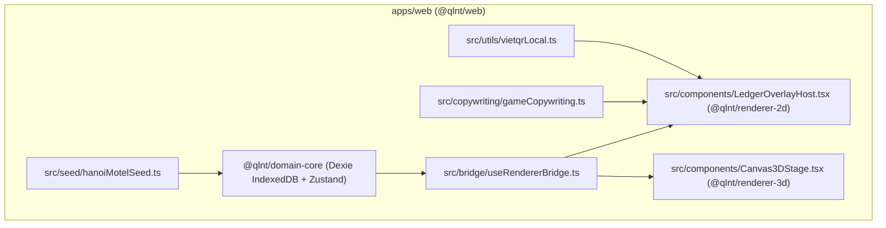

# Phase 4 (`@qlnt/web` — Host App, VietQR Offline & Sổ F04 Single-Page) Implementation Plan

> **For agentic workers:** REQUIRED SUB-SKILL: Use superpowers:subagent-driven-development to implement this plan task-by-task. Steps use checkbox (`- [ ]`) syntax for tracking.

**Goal:** Xây dựng ứng dụng Web Host `apps/web` (`@qlnt/web`) ghép nối `@qlnt/domain-core`, `@qlnt/renderer-2d`, và `@qlnt/renderer-3d` thành Prototype P1 chạy thực tế trên Desktop & Mobile (`390x844`), tích hợp Seed Data 12 phòng Hà Nội (`#56`), bộ Copywriting thân thiện (`#59`), mã VietQR EMVCo/NAPAS 247 cục bộ (`#64`), và luồng Sổ quản lý ảo F04 Single-Page 3 trang (`#60`, `#61`, `#62`, `#63`, `#64`).

**Architecture:** Kiến trúc Hybrid Presentation tách biệt hoàn toàn dữ liệu thật (`@qlnt/domain-core` + `IndexedDB`) và tầng hiển thị (`ThreeGameRenderer` WebGL ở `z-index: 10` kết hợp DOM Overlay Sổ F04 Single-Page ở `z-index: 20`). Mọi tương tác trên UI tuân thủ tách bạch `Preview State` (tính nháp trên form) và `Commit State` (ghi vào `IndexedDB` + phát lệnh đồng bộ sang `IGameRenderer`).

**Architecture Diagram:**

**Tech Stack:** React 19, TypeScript 5.7 (`strict: true`), Vite 6, Vitest 3, `@qlnt/shared-types`, `@qlnt/domain-core` (Dexie.js + Zustand), `@qlnt/renderer-2d`, `@qlnt/renderer-3d` (Three.js).

**Spec:** [`01-quan-ly/SPEC_PHA_4_WEB_UI_PROTOTYPE_P1.md`](SPEC_PHA_4_WEB_UI_PROTOTYPE_P1.md) (`SPEC-PHASE4-WEB-001`)

## Global Constraints

- **Tuyệt đối không sửa đổi `packages/shared-types`** (`common`).
- **100% Local-First & Offline (`QLNT-D014`, `QLNT-D016`):** Không gọi bất kỳ API bên thứ 3 nào (`img.vietqr.io`, Supabase Cloud, R2, Zalo); sinh VietQR chuẩn EMVCo/NAPAS 247 hoàn toàn bằng code cục bộ.
- **Không dùng đường dẫn cứng cá nhân (`/Users/...`)** trong bất kỳ file mã nguồn hay tài liệu nào.
- **Mobile-First (`390x844`):** Kích thước vùng chạm tối thiểu `44x44px` (`MIN_TOUCH_TARGET_SIZE = 44`).
- **Node >= 22.0.0, pnpm >= 12.0.0**, pass 100% `pnpm turbo run typecheck test build`.

---

### Task 1: Khởi tạo Khung Ứng dụng `apps/web` (`@qlnt/web`) & Cấu hình Build/Test (`S2-TECH-01` — `#54`)

**Files:**
- Create: `apps/web/package.json`
- Create: `apps/web/tsconfig.json`
- Create: `apps/web/vite.config.ts`
- Create: `apps/web/vitest.config.ts`
- Create: `apps/web/index.html`
- Create: `apps/web/src/main.tsx`
- Create: `apps/web/src/App.tsx`
- Test: `apps/web/tests/appBootstrap.test.ts`

**Interfaces:**
- Consumes: `@qlnt/shared-types`, `@qlnt/domain-core`, `@qlnt/renderer-2d`, `@qlnt/renderer-3d`
- Produces: Package `@qlnt/web` trong pnpm workspace, hàm `getAppMetadata()` và component gốc `App`

- [ ] **Step 1: Khởi tạo `apps/web/package.json`, `tsconfig.json`, `vite.config.ts`, `vitest.config.ts`, `index.html`**
  - Cấu hình `@qlnt/web` kết nối workspace dependencies (`@qlnt/shared-types`, `@qlnt/domain-core`, `@qlnt/renderer-2d`, `@qlnt/renderer-3d`).
  - Cấu hình scripts: `dev`, `build` (`tsc --noEmit && vite build`), `test` (`vitest run`), `typecheck` (`tsc --noEmit`).

- [ ] **Step 2: Viết unit test kiểm chứng khởi tạo `@qlnt/web` (`apps/web/tests/appBootstrap.test.ts`)**
  - Kiểm tra metadata ứng dụng, viewport cấu hình chuẩn Mobile `390x844` và kết nối 4 workspace packages.

- [ ] **Step 3: Cài đặt `apps/web/src/App.tsx` & `apps/web/src/main.tsx` tối thiểu và chạy test/build**
  - Run: `cd 4.Du_an/QLNT && pnpm install && pnpm --filter @qlnt/web test && pnpm --filter @qlnt/web typecheck`
  - Expected: PASS 100%.

---

### Task 2: Xây dựng Bộ Dữ liệu Mẫu Hà Nội 12 Phòng (`hanoiMotelSeed.ts`) & Bộ Văn bản Giao tiếp (`gameCopywriting.ts`) (`S2-BA-01` `#56`, `S2-MKT-01` `#59`)

**Files:**
- Create: `apps/web/src/seed/hanoiMotelSeed.ts`
- Create: `apps/web/src/copywriting/gameCopywriting.ts`
- Test: `apps/web/tests/seedAndCopywriting.test.ts`

**Interfaces:**
- Consumes: `Property`, `Room`, `Tenant`, `Contract`, `Billing`, `MeterReading`, `MaintenanceRequest`, `RoomAuditLog`, `FloorMapDTO`, `RoomDetailDTO` từ `@qlnt/shared-types`; `calculateBilling` từ `@qlnt/domain-core`
- Produces:
  - `HANOI_MOTEL_SEED`: Dữ liệu mẫu 1 tòa nhà Cầu Giấy (Hà Nội), 3 tầng, 12 phòng (`P101`–`P304`) đủ trạng thái (`OCCUPIED`, `VACANT`, `DEPOSIT_LOCKED`, `MAINTENANCE`), hóa đơn (`UNPAID`, `PENDING_VERIFY`, `PAID`) và thiết bị hỏng.
  - `seedDatabaseIfNeeded()`: Nạp dữ liệu mẫu vào `IndexedDB` (`db`) nếu CSDL đang trống.
  - `GAME_COPYWRITING`: Các hàm sinh thông điệp thân thiện cho nhắc tiền, chờ duyệt bill, duyệt bill cộng sao uy tín, báo hỏng và hoàn tất bảo trì.

- [ ] **Step 1: Viết failing test `apps/web/tests/seedAndCopywriting.test.ts`**
  - Kiểm chứng đủ 12 phòng chia đều 3 tầng (4 phòng/tầng), tổng tiền từng hóa đơn khớp 100% với `calculateBilling`, có phòng nợ tiền (`PAYMENT_DUE`), phòng chờ duyệt bill (`BILL_PENDING`), phòng có thiết bị hỏng (`isBroken = true`), và thông điệp copywriting đúng chuẩn tiếng Việt thân thiện.

- [ ] **Step 2: Chạy test để xác nhận FAIL**
  - Run: `pnpm --filter @qlnt/web test`

- [ ] **Step 3: Hiện thực hóa `hanoiMotelSeed.ts` và `gameCopywriting.ts`**

- [ ] **Step 4: Chạy lại test để xác nhận PASS**
  - Run: `pnpm --filter @qlnt/web test`

---

### Task 3: Xây dựng Bộ Sinh Mã VietQR Offline Chuẩn EMVCo / NAPAS 247 (`vietqrLocal.ts`) (`QLNT-D016`, `S2-TECH-05` `#64`)

**Files:**
- Create: `apps/web/src/utils/vietqrLocal.ts`
- Test: `apps/web/tests/vietqrLocal.test.ts`

**Interfaces:**
- Consumes: Không phụ thuộc API mạng ngoài (`0` network calls)
- Produces:
  - `computeCRC16CCITT(payload: string): string` (Chuẩn EMVCo CRC16-CCITT `0xFFFF`, polynomial `0x1021`)
  - `buildVietQRPayload(params: VietQRParams): string` (Chuỗi EMVCo/NAPAS 247 hợp lệ chứa GUID `A000000727`, `QRIBFTTA`, BIN ngân hàng, số tài khoản, số tiền `VND 704`, nội dung chuyển khoản và mã CRC16 cuối chuỗi `6304XXXX`)
  - `renderVietQRSvgString(params: VietQRParams): string` (Kết xuất mã QR SVG hoàn toàn cục bộ, không chứa bất kỳ URL bên ngoài nào như `http://` hay `https://`)

- [ ] **Step 1: Viết failing test `apps/web/tests/vietqrLocal.test.ts`**
  - Kiểm chứng thuật toán CRC16-CCITT chuẩn EMVCo, cấu trúc TLV (`000201010212...5303704...5802VN...6304`), số tiền chính xác, nội dung chuyển khoản phòng trọ, và chuỗi SVG trả về hợp lệ, `< 50KB`, không gọi URL ngoài.

- [ ] **Step 2: Chạy test để xác nhận FAIL**
  - Run: `pnpm --filter @qlnt/web test`

- [ ] **Step 3: Hiện thực hóa `apps/web/src/utils/vietqrLocal.ts`**

- [ ] **Step 4: Chạy lại test để xác nhận PASS**
  - Run: `pnpm --filter @qlnt/web test`

---

### Task 4: Xây dựng Cầu nối `useRendererBridge` & Bộ Điều phối Nghiệp vụ Sổ F04 (`Preview State` ↔ `Commit State`) (`S2-TECH-02` `#60`, `S2-TECH-03` `#61`, `S2-TECH-04` `#62`, `S2-TECH-05` `#64`)

**Files:**
- Create: `apps/web/src/bridge/ledgerController.ts`
- Create: `apps/web/src/bridge/useRendererBridge.ts`
- Test: `apps/web/tests/ledgerController.test.ts`

**Interfaces:**
- Consumes: `IGameRenderer`, `FloorMapDTO`, `RoomDetailDTO`, `RoomDetailTab` từ `@qlnt/shared-types`; `db`, `calculateBilling`, `calculateReputationDelta`, `recordAuditLog` từ `@qlnt/domain-core`
- Produces:
  - `LedgerController`: Lớp điều phối nghiệp vụ Local-First kết nối trực tiếp với `IGameRenderer`:
    - `openBookForFloor(floorNumber: number)`: Nạp `FloorMapDTO` từ state/seed và gọi `renderer.openLedgerBook` / `flipLedgerFloorPage`.
    - `openRoomDetail(roomId: string, tab?: RoomDetailTab)`: Nạp `RoomDetailDTO` và gọi `renderer.openRoomDetailSinglePage`.
    - `previewRoomBilling(roomId: string, newElectric: number, newWater: number)`: Tính toán nháp tiền điện/nước (`Preview State`) mà **không** ghi vào CSDL.
    - `commitRoomBillingReading(roomId: string, newElectric: number, newWater: number)`: Ghi chỉ số mới & tổng tiền vào `Commit State`, bật Chấm than vàng `PAYMENT_DUE` trên `IGameRenderer`, ghi `RoomAuditLog`.
    - `uploadLocalBillImage(roomId: string, dataUrl: string)`: Lưu ảnh bill DataURL cục bộ vào hóa đơn, chuyển trạng thái sang `PENDING_VERIFY`, cập nhật `setRoomNotice(roomId, 'BILL_PENDING')`.
    - `approveRoomBillOneTouch(roomId: string)`: Duyệt bill 1 chạm → chuyển hóa đơn sang `PAID`, cộng điểm sao uy tín (`PAYMENT_ON_TIME` `+2`), ghi `RoomAuditLog` (`BILL_PAID`), và gọi `renderer.setRoomNotice(roomId, 'NONE')` (tắt Chấm than vàng).
    - `reportDeviceBroken(roomId: string, deviceId: string)`: Đánh dấu thiết bị hỏng, gọi `renderer.setDeviceStatus(roomId, deviceId, 'BROKEN')` (bật Chấm than đỏ), ghi `RoomAuditLog`.
    - `resolveDeviceMaintenance(roomId: string, deviceId: string)`: Hoàn tất sửa chữa, gọi `renderer.setDeviceStatus(roomId, deviceId, 'NORMAL')` (tắt Chấm than đỏ khi hết thiết bị hỏng), ghi `RoomAuditLog`.

- [ ] **Step 1: Viết failing test `apps/web/tests/ledgerController.test.ts`**
  - Kiểm thử toàn bộ các luồng:
    1. Tách bạch `Preview State` (nhập nháp điện nước chưa làm đổi dữ liệu thật) vs `Commit State` (lưu thật).
    2. Luồng Thu tiền: Chốt điện nước → sinh VietQR offline → khách tải ảnh bill local (`PENDING_VERIFY`) → Chủ trọ bấm duyệt 1 chạm (`PAID`) → tắt Chấm than vàng trên `ThreeGameRenderer` & cộng `+2` điểm uy tín.
    3. Luồng Báo hỏng & Bảo trì: Báo hỏng thiết bị → bật Chấm than đỏ trên `ThreeGameRenderer` → Hoàn tất bảo trì → tắt Chấm than đỏ & ghi lịch sử Trang 3.
    4. Luồng Đóng 2 cấp: Đóng cấp 1 (về Mặt bằng tầng 2D) và Đóng cấp 2 (gập Sổ F04 về Cảnh 3D).

- [ ] **Step 2: Chạy test để xác nhận FAIL**
  - Run: `pnpm --filter @qlnt/web test`

- [ ] **Step 3: Hiện thực hóa `ledgerController.ts` và `useRendererBridge.ts`**

- [ ] **Step 4: Chạy lại test để xác nhận PASS**
  - Run: `pnpm --filter @qlnt/web test`

---

### Task 5: Xây dựng Giao diện `Canvas3DStage`, `LedgerOverlayHost` (Sổ F04 Single-Page 3 Trang) & Kiểm chứng Mobile `390x844` (`S2-TECH-04` `#62`, `S2-UX-01` `#63`)

**Files:**
- Create: `apps/web/src/components/Canvas3DStage.tsx`
- Create: `apps/web/src/components/LedgerOverlayHost.tsx`
- Modify: `apps/web/src/App.tsx`
- Test: `apps/web/tests/uiAndResponsive.test.ts`

**Interfaces:**
- Consumes: `ThreeGameRenderer` từ `@qlnt/renderer-3d`; `VirtualLedgerBook`, `MIN_TOUCH_TARGET_SIZE` từ `@qlnt/renderer-2d`; `LedgerController`, `renderVietQRSvgString`, `GAME_COPYWRITING`
- Produces:
  - Giao diện hoàn chỉnh của `@qlnt/web` gồm:
    - Thanh HUD trên cùng (hiển thị tên tòa nhà Hà Nội, thống kê nhanh số phòng đang ở / chờ thu tiền / báo hỏng, nút chuyển chế độ xem `Desktop` / `Mobile 390x844`, nút `Mở Sổ Quản Lý F04`).
    - Khung cảnh 3D Isometric (`Canvas3DStage`) kèm bảng chọn nhanh tầng/phòng và hiển thị trạng thái chấm than vàng/đỏ trực quan.
    - Giao diện Sổ Quản lý Ảo F04 Single-Page (`LedgerOverlayHost`) tích hợp Mặt bằng tầng 2D SVG (`@qlnt/renderer-2d`) và bảng điều khiển tương tác 3 trang (Trang 1: Chốt điện nước + VietQR SVG offline + Tải/Duyệt bill 1 chạm; Trang 2: Thiết bị phòng + Báo hỏng/Hoàn tất sửa chữa; Trang 3: Sao uy tín + Dòng thời gian `RoomAuditLog`).

- [ ] **Step 1: Viết failing test `apps/web/tests/uiAndResponsive.test.ts`**
  - Kiểm tra kết xuất SSR/HTML của `App` và `LedgerOverlayHost` ở cả chế độ Mặt bằng tầng 2D lẫn Tờ chi tiết phòng (Trang 1, Trang 2, Trang 3).
  - Kiểm chứng toàn bộ nút tương tác chính có `minHeight >= 44px` (`MIN_TOUCH_TARGET_SIZE`), hiển thị đúng mã VietQR SVG cục bộ, thông điệp copywriting thân thiện và hỗ trợ khung nhìn Mobile `390x844`.

- [ ] **Step 2: Chạy test để xác nhận FAIL**
  - Run: `pnpm --filter @qlnt/web test`

- [ ] **Step 3: Hiện thực hóa `Canvas3DStage.tsx`, `LedgerOverlayHost.tsx`, cập nhật `App.tsx`**

- [ ] **Step 4: Chạy toàn bộ test, typecheck và build trên toàn Monorepo**
  - Run: `cd 4.Du_an/QLNT && pnpm turbo run typecheck test build --force`
  - Expected: 100% tasks PASS (bao gồm `@qlnt/shared-types`, `@qlnt/domain-core`, `@qlnt/renderer-2d`, `@qlnt/renderer-3d`, và `@qlnt/web`), `vite build` xuất gói `apps/web/dist/` thành công.

- [ ] **Step 5: Cập nhật trạng thái Pha 4 trong `01-quan-ly/implementation_plan.md` và commit**
