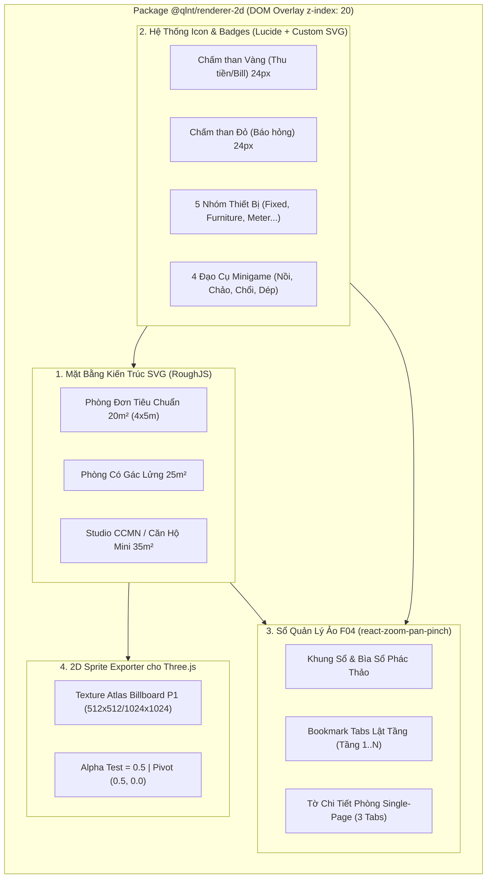

# Kế Hoạch Triển Khai Render Hình Ảnh 2D Bằng Thư Viện Đã Cài Đặt (@qlnt/renderer-2d)

> **Dành cho Agentic Workers:** REQUIRED SUB-SKILL: Sử dụng `superpowers:subagent-driven-development` để thực hiện từng task trong kế hoạch này. Các bước sử dụng cú pháp checkbox (`- [ ]`) để theo dõi tiến độ.

- **Mã kế hoạch:** `PLAN-2D-RENDER-001`
- **Dự án:** Quản lý nhà trọ (QLNT)
- **Tác giả:** Họa sĩ Thiết kế 2D (2D Visual / Game UI Artist) phối hợp Tech Lead & UX
- **Ngày ban hành:** 2026-11-13
- **Trạng thái:** `Đã hoàn thành và nghiệm thu (2026-11-13)` — Đạt 28/28 tests across 6 test suites, 0 lỗi typecheck/build.
- **Tài liệu căn cứ:**
  - `03-ky-thuat/QUY_CHUAN_2D_VA_BRIEF_ASSET_3D.md` (Quy chuẩn kích thước SVG < 50KB, vùng chạm >= 44x44px, Billboard 512x512/1024x1024, pivot 0.5, 0.0)
  - `02-nghiep-vu/DAC_TA_SO_QUAN_LY_AO_SINGLE_PAGE_VA_RENDERER.md` (Sổ quản lý F04, Mặt bằng 2D, Single-Page 3 trang)
  - `01-quan-ly/CO_CAU_NHAN_SU_DU_AN.md` (Định biên vai trò số 6: 2D Visual Artist)
  - `packages/shared-types/src/renderer/gameRenderer.ts` (Hợp đồng IGameRenderer)

---

## 1. Mục Tiêu & Kiến Trúc Tổng Thể

**Mục tiêu:** 
Khai thác toàn diện các thư viện đã cài đặt trong package `@qlnt/renderer-2d` (`roughjs`, `react-zoom-pan-pinch`, `lucide-react`, `svgo`) để kết xuất hoàn chỉnh hệ thống tài nguyên hình ảnh 2D cho dự án QLNT:
1. Hệ thống Mặt bằng Tầng 2D chi tiết bao phủ **3 cấu hình phòng trọ mẫu phổ biến tại Việt Nam** (Phòng đơn tiêu chuẩn, Phòng có gác lửng, Căn hộ mini/Studio CCMN).
2. Bộ biểu tượng 2D trực quan: **Icon Chấm than vàng & đỏ 24x24px**, **Icon 5 nhóm thiết bị phòng trọ**, **Icon đạo cụ minigame & huy hiệu uy tín**.
3. Khung hiển thị **Sổ Quản Lý Ảo F04 Single-Page DOM Overlay** (React 19 + SVG) hoàn chỉnh với Bookmark Tabs lật trang tầng.
4. Tiện ích **xuất Texture Atlas 2D** (Sprite Billboard $512\times 512\text{px}$, Alpha Test = 0.5, Pivot Bottom-Center) phục vụ tầng Three.js WebGL.

**Kiến trúc:** 
Tuân thủ kiến trúc Hybrid Presentation (`TECH-STD-001`): Tầng DOM Overlay (`z-index: 20`) chạy trên nền React 19 + SVG sạch + Tailwind CSS v4, áp dụng nét vẽ phác thảo sổ tay mộc mạc từ `roughjs` và hỗ trợ cảm ứng zoom/pan đa điểm qua `react-zoom-pan-pinch`. Mọi file SVG được nén qua `svgo` bảo đảm $< 50\text{ KB}$.

**Tech Stack:**
- React 19 + TypeScript 5.7+
- `roughjs` (v4.6.6) — Nét phác thảo blueprint/sketchnote
- `react-zoom-pan-pinch` (v3.7.0) — Cảm ứng pinch-to-zoom & pan mobile
- `lucide-react` (v1.16.0) — Bộ icon SVG chuẩn UI
- `svgo` (v3.3.2) — Tối ưu hóa kích thước chuỗi SVG `< 50 KB`
- `@qlnt/shared-types` — Interface dữ liệu chuẩn

---

## 2. Ràng Buộc Kỹ Thuật Bắt Buộc (Global Constraints)

1. **Kích thước file SVG:** Toàn bộ component / chuỗi SVG xuất ra phải đạt dung lượng **`< 50 KB`**.
2. **Vùng chạm cảm ứng di động:** Mọi phần tử có tương tác click/touch (ô phòng, tab tầng, nút zoom, nút đóng) phải có kích thước tối thiểu **`>= 44x44px`** (khuyến nghị `48x48px`).
3. **Mã màu chuẩn hóa 4 trạng thái phòng:**
   - `EMPTY` (Phòng trống): Nền `#DCFCE7`, viền `#22C55E`, chữ `#15803D`.
   - `OCCUPIED` (Đang ở ổn định): Nền `#FEFCE8`, viền `#A16207`, chữ `#854D0E`.
   - `PAYMENT_DUE` (Đến hạn thu tiền / Chờ duyệt bill): Nền `#FEF3C7`, viền `#F59E0B`, chữ `#B45309`, Icon Chấm than vàng `#F59E0B`.
   - `BROKEN` (Báo hỏng sự cố): Nền `#FEE2E2`, viền `#EF4444`, chữ `#B91C1C`, Icon Chấm than đỏ `#EF4444`.
4. **Quy chuẩn Sprite Atlas 2D dùng trong Three.js 3D (P1):**
   - Kích thước luỹ thừa 2 (`Power-of-Two`): `512x512px` hoặc `1024x1024px`.
   - Nền trong suốt (`transparent`), `Alpha Test = 0.5`.
   - Điểm neo (`Pivot / Origin`): Đặt tại `Bottom-Center` `(0.5, 0.0)`.
5. **Không sửa đổi hoặc phá vỡ interface trong `packages/shared-types`**.

---

## 3. Danh Sách Nhiệm Vụ Chi Tiết (Detailed Tasks)

### Task 1: Module Layout Mặt Bằng Kiến Trúc SVG cho 3 Cấu Hình Phòng Mẫu VN

**Mục tiêu:** 
Tạo các layout mặt bằng kiến trúc vector chi tiết bằng `roughjs` và SVG, thể hiện nội thất thực tế của 3 loại phòng trọ phổ biến tại Việt Nam.

**Files:**
- Tạo mới: `packages/renderer-2d/src/components/layouts/StandardSingleRoomLayout.tsx`
- Tạo mới: `packages/renderer-2d/src/components/layouts/MezzanineRoomLayout.tsx`
- Tạo mới: `packages/renderer-2d/src/components/layouts/StudioApartmentLayout.tsx`
- Tạo mới: `packages/renderer-2d/src/components/RoomBlueprintSVG.tsx`
- Test: `packages/renderer-2d/test/roomLayouts.test.ts`

**Interfaces:**
- Consumes: `FloorMapRoomDTO`, `RoomDisplayStatus` từ `types.ts`
- Produces: `RoomBlueprintSVGProps`, components `StandardSingleRoomLayout`, `MezzanineRoomLayout`, `StudioApartmentLayout`, `RoomBlueprintSVG`

- [x] **Step 1: Viết test kiểm tra 3 layouts và khả năng render nét phác thảo RoughJS**
  - Tạo file `packages/renderer-2d/test/roomLayouts.test.ts` kiểm thử:
    1. Render đúng 3 loại layout: `'STANDARD_SINGLE'`, `'MEZZANINE'`, `'STUDIO_MINI'`.
    2. Kích thước viewbox tối thiểu đảm bảo chạm $\ge 44\times 44\text{px}$.
    3. Chứa đúng các chi tiết kiến trúc (cửa mở arc, cửa sổ, giường, WC).
    4. Gắn đúng class và màu trạng thái tương ứng 4 trạng thái phòng.

- [x] **Step 2: Chạy test để xác nhận test FAIL**
  - Run: `cd /Users/minhntv/Documents/Work/MinhNTV/TEAM_ORCA/4.Du_an/QLNT && pnpm --filter @qlnt/renderer-2d test`
  - Kỳ vọng: FAIL do chưa có file layout.

- [x] **Step 3: Hiện thực hóa 3 Layouts và component `RoomBlueprintSVG`**
  - `StandardSingleRoomLayout.tsx`: Phòng $4.0\text{m}\times 5.0\text{m}$, cửa đi cung xoay $90^\circ$ (`rc.arc`), giường $1.6\times 2.0\text{m}$, bàn học, vách ngăn WC khép kín.
  - `MezzanineRoomLayout.tsx`: Phòng gác lửng $25\text{m}^2$, ký hiệu bậc thang gác lửng, khu bếp tầng 1, ban công/cửa sổ.
  - `StudioApartmentLayout.tsx`: Căn hộ mini $35\text{m}^2$, bếp chữ L riêng biệt, ban công máy giặt, giường ngủ và sofa.
  - `RoomBlueprintSVG.tsx`: Wrapper chọn layout tương ứng, tích hợp màu sắc trạng thái và badge cảnh báo.

- [x] **Step 4: Chạy test kiểm tra lại để đảm bảo PASS**
  - Run: `cd /Users/minhntv/Documents/Work/MinhNTV/TEAM_ORCA/4.Du_an/QLNT && pnpm --filter @qlnt/renderer-2d test`
  - Kỳ vọng: PASS 100%.

- [x] **Step 5: Commit mã nguồn Task 1**
  - Commit message: `feat(renderer-2d): implement 3 architectural room layouts with roughjs svg`

---

### Task 2: Hệ Thống Icon Cảnh Báo, 5 Nhóm Thiết Bị Phòng Trọ & Đạo Cụ Minigame

**Mục tiêu:**
Xây dựng bộ icon 2D chuẩn hóa sử dụng `lucide-react` kết hợp SVG vector tối ưu cho 5 nhóm danh mục thiết bị (`maintenance_requests.device_category`), 4 đạo cụ minigame và huy hiệu uy tín.

**Files:**
- Tạo mới: `packages/renderer-2d/src/components/icons/DeviceCategoryIconSVG.tsx`
- Tạo mới: `packages/renderer-2d/src/components/icons/MinigameToolIconSVG.tsx`
- Tạo mới: `packages/renderer-2d/src/components/icons/RewardBadgeSVG.tsx`
- Tạo mới: `packages/renderer-2d/src/components/icons/index.ts`
- Test: `packages/renderer-2d/test/deviceIcons.test.ts`

**Interfaces:**
- Consumes: `DeviceCategory` (`'FIXED' | 'FURNITURE' | 'ADDITIONAL' | 'SECURITY' | 'METER'`) từ `@qlnt/shared-types`
- Produces: `DeviceCategoryIconSVGProps`, `MinigameToolIconSVGProps`, `RewardBadgeSVGProps`

- [x] **Step 1: Viết test cho hệ thống Icon thiết bị và minigame**
  - Tạo file `packages/renderer-2d/test/deviceIcons.test.ts` kiểm thử:
    1. Hỗ trợ đủ 5 nhóm `DeviceCategory` với 3 trạng thái: `'NORMAL'`, `'BROKEN'` (viền đỏ nhấp nháy), `'IN_PROGRESS'` (cam/vàng).
    2. Hỗ trợ đủ 4 đạo cụ minigame: `'pot'`, `'pan'`, `'broom'`, `'slipper'`.
    3. Hỗ trợ huy hiệu `RewardBadgeSVG` hiển thị số sao uy tín ($1 - 5$ sao).
    4. Kích thước chuẩn mặc định $24\times 24\text{px}$ và có thể co giãn linh hoạt.

- [x] **Step 2: Chạy test để xác nhận test FAIL**
  - Run: `cd /Users/minhntv/Documents/Work/MinhNTV/TEAM_ORCA/4.Du_an/QLNT && pnpm --filter @qlnt/renderer-2d test`

- [x] **Step 3: Hiện thực hóa các Icon Components**
  - `DeviceCategoryIconSVG.tsx`: Map từng category sang biểu tượng Lucide tương ứng (AirVent/Flame cho FIXED, Bed/Armchair cho FURNITURE, Refrigerator/WashingMachine cho ADDITIONAL, Lock/Shield cho SECURITY, Gauge/Zap cho METER).
  - `MinigameToolIconSVG.tsx`: SVG vector sắc nét cho 4 vũ khí minigame.
  - `RewardBadgeSVG.tsx`: Huy hiệu sao uy tín tòa nhà/cư dân.

- [x] **Step 4: Chạy test kiểm tra lại để đảm bảo PASS**
  - Run: `cd /Users/minhntv/Documents/Work/MinhNTV/TEAM_ORCA/4.Du_an/QLNT && pnpm --filter @qlnt/renderer-2d test`

- [x] **Step 5: Commit mã nguồn Task 2**
  - Commit message: `feat(renderer-2d): add device category icons, minigame tools and reward badges`

---

### Task 3: Component Sổ Quản Lý Ảo F04 Hoàn Chỉnh (`VirtualLedgerBook`) & Tờ Chi Tiết Single-Page

**Mục tiêu:**
Hiện thực hóa component container Sổ Quản Lý Ảo F04 (`VirtualLedgerBook`) kết hợp khung phác thảo sổ da/giấy, thanh Bookmark Tabs chuyển tầng, Mặt Bằng Tầng 2D (tương tác `react-zoom-pan-pinch`), và Tờ Chi Tiết Phòng Single-Page 3 tabs theo chuẩn `QLNT-D013`.

**Files:**
- Tạo mới: `packages/renderer-2d/src/components/ledger/BookmarkFloorTabs.tsx`
- Tạo mới: `packages/renderer-2d/src/components/ledger/RoomDetailSinglePage.tsx`
- Tạo mới: `packages/renderer-2d/src/components/ledger/VirtualLedgerBook.tsx`
- Tạo mới: `packages/renderer-2d/src/components/ledger/index.ts`
- Test: `packages/renderer-2d/test/virtualLedgerBook.test.ts`

**Interfaces:**
- Consumes: `FloorMapDTO`, `RoomDetailDTO`, `RoomDetailTab` từ `@qlnt/shared-types`
- Produces: `VirtualLedgerBookProps`, `RoomDetailSinglePageProps`, `BookmarkFloorTabsProps`

- [x] **Step 1: Viết test cho `VirtualLedgerBook` và `RoomDetailSinglePage`**
  - Tạo file `packages/renderer-2d/test/virtualLedgerBook.test.ts`:
    1. Kiểm tra chuyển tầng qua Bookmark Tabs (`onFloorChange`).
    2. Kiểm tra click chọn phòng kích hoạt mở Tờ Chi Tiết Phòng Single-Page (`onOpenRoomDetail`).
    3. Kiểm tra chuyển giữa 3 tabs: `PAGE_1_BILLING`, `PAGE_2_DEVICES`, `PAGE_3_AUDIT`.
    4. Kiểm tra nút Đóng Tờ Chi Tiết (Cấp 1) và nút Đóng Sổ gập về 3D (Cấp 2).

- [x] **Step 2: Chạy test để xác nhận test FAIL**
  - Run: `cd /Users/minhntv/Documents/Work/MinhNTV/TEAM_ORCA/4.Du_an/QLNT && pnpm --filter @qlnt/renderer-2d test`

- [x] **Step 3: Hiện thực hóa các Ledger Components**
  - `BookmarkFloorTabs.tsx`: Thanh tab dọc mép sổ, mỗi tab kích thước tối thiểu $\ge 44\times 44\text{px}$, hiệu ứng lật trang.
  - `RoomDetailSinglePage.tsx`: Hiển thị 3 tabs với form số điện/nước in-place edit native, danh sách thiết bị kèm icon từ Task 2, và nút duyệt bill biên lai.
  - `VirtualLedgerBook.tsx`: Tích hợp toàn diện `FloorMapRenderer` (đã có zoom/pan), thanh gáy sổ phác thảo RoughJS, và chuyển cảnh mượt sang Tờ Chi Tiết Single-Page.

- [x] **Step 4: Chạy test kiểm tra lại để đảm bảo PASS**
  - Run: `cd /Users/minhntv/Documents/Work/MinhNTV/TEAM_ORCA/4.Du_an/QLNT && pnpm --filter @qlnt/renderer-2d test`

- [x] **Step 5: Commit mã nguồn Task 3**
  - Commit message: `feat(renderer-2d): implement virtual ledger book f04 single-page component`

---

### Task 4: Trình Xuất Sprite Atlas / Texture 2D cho Tầng Three.js (`spriteAtlasExporter`)

**Mục tiêu:**
Cung cấp tiện ích chuyển đổi các thành phần vector 2D (Chấm than vàng/đỏ, Avatar nhân vật 2D, Đạo cụ) sang dạng Texture Atlas tương thích trực tiếp với Three.js `THREE.Texture` / `THREE.SpriteMaterial` theo đúng quy chuẩn P1.

**Files:**
- Tạo mới: `packages/renderer-2d/src/utils/spriteAtlasExporter.ts`
- Test: `packages/renderer-2d/test/spriteAtlasExporter.test.ts`

**Interfaces:**
- Consumes: SVG elements / strings, cấu hình atlas
- Produces: `exportSvgToCanvas`, `createSpriteAtlasUrl`, `generateNoticeBillboardTexture`

- [x] **Step 1: Viết test cho tiện ích xuất Texture Atlas**
  - Tạo file `packages/renderer-2d/test/spriteAtlasExporter.test.ts`:
    1. Kiểm tra kích thước đầu ra là luỹ thừa của 2 ($512\times 512\text{px}$ hoặc $1024\times 1024\text{px}$).
    2. Kiểm tra tính năng định vị điểm neo (Bottom-Center: `0.5, 0.0`).
    3. Kiểm tra xuất DataURL / ImageData với nền trong suốt (Alpha Test = 0.5).

- [x] **Step 2: Chạy test để xác nhận test FAIL**
  - Run: `cd /Users/minhntv/Documents/Work/MinhNTV/TEAM_ORCA/4.Du_an/QLNT && pnpm --filter @qlnt/renderer-2d test`

- [x] **Step 3: Hiện thực hóa `spriteAtlasExporter.ts`**
  - Sử dụng Canvas API / HTMLImageElement để nạp chuỗi SVG đã tối ưu qua SVGO và vẽ vào lưới Atlas Power-of-Two.

- [x] **Step 4: Chạy test kiểm tra lại để đảm bảo PASS**
  - Run: `cd /Users/minhntv/Documents/Work/MinhNTV/TEAM_ORCA/4.Du_an/QLNT && pnpm --filter @qlnt/renderer-2d test`

- [x] **Step 5: Commit mã nguồn Task 4**
  - Commit message: `feat(renderer-2d): add sprite atlas exporter for threejs billboard integration`

---

### Task 5: Kiểm Thử Toàn Diện, Tối Ưu Hóa Dung Lượng `< 50 KB` & Đồng Bộ Xuất Bản Package

**Mục tiêu:**
Đo kiểm dung lượng tất cả các mẫu SVG qua SVGO, hoàn thiện toàn bộ export trong `index.ts`, và kiểm tra toàn diện monorepo (`turbo run typecheck` và `build`).

**Files:**
- Tạo mới: `packages/renderer-2d/src/utils/svgBudgetAuditor.ts`
- Sửa đổi: `packages/renderer-2d/src/index.ts`
- Test: `packages/renderer-2d/test/svgBudget.test.ts`

**Interfaces:**
- Produces: `auditSvgSizeBudget(svgString: string): { rawSize: number, optimizedSize: number, isUnderBudget: boolean }`
- Re-exports: Toàn bộ components, icons, layouts, và utilities từ các Task 1-4.

- [x] **Step 1: Viết test kiểm tra ngân sách dung lượng SVG**
  - Tạo file `packages/renderer-2d/test/svgBudget.test.ts`:
    1. Kiểm tra toàn bộ 3 mẫu mặt bằng tầng SVG sau khi sinh ra có kích thước $< 50\text{ KB}$.
    2. Kiểm tra các icon cảnh báo và thiết bị $< 5\text{ KB}$.

- [x] **Step 2: Hiện thực hóa `svgBudgetAuditor.ts` và hoàn tất xuất khẩu tại `index.ts`**
  - Tích hợp kiểm toán dung lượng tự động.
  - Cập nhật `src/index.ts` để export toàn bộ module mới.

- [x] **Step 3: Chạy toàn bộ test suites của package**
  - Run: `cd /Users/minhntv/Documents/Work/MinhNTV/TEAM_ORCA/4.Du_an/QLNT && pnpm --filter @qlnt/renderer-2d test`
  - Đảm bảo tất cả các test suites (`renderer2d.test.ts`, `roomLayouts.test.ts`, `deviceIcons.test.ts`, `virtualLedgerBook.test.ts`, `spriteAtlasExporter.test.ts`, `svgBudget.test.ts`) đều PASS.

- [x] **Step 4: Chạy build và typecheck toàn monorepo**
  - Run: `cd /Users/minhntv/Documents/Work/MinhNTV/TEAM_ORCA/4.Du_an/QLNT && pnpm turbo run typecheck build`
  - Đảm bảo 0 lỗi TypeScript và build ra `dist/` thành công.

- [x] **Step 5: Commit mã nguồn hoàn thiện**
  - Commit message: `feat(renderer-2d): complete 2d asset rendering suite, budget audit and exports`

---

## 4. Bảng Đánh Giá Mức Độ Ảnh Hưởng của Kế Hoạch

| Thành phần trong dự án | Mức độ ảnh hưởng | Chi tiết tác động | Biện pháp kiểm soát an toàn |
| :--- | :---: | :--- | :--- |
| `packages/renderer-2d` | **Mạnh (100% Tạo mới)** | Bổ sung 3 layout phòng mẫu, bộ icon 5 nhóm thiết bị, component `VirtualLedgerBook`, và exporter cho Three.js. | Đóng gói khép kín trong package, có Unit Test độc lập cho từng module. |
| `packages/shared-types` | **Zero (Không đổi)** | Tái sử dụng nguyên vẹn các types `FloorMapDTO`, `RoomDetailDTO`, `DeviceCategory`, `RoomDetailTab`. | Tuyệt đối không sửa đổi file trong shared-types. |
| `packages/renderer-3d` | **Tích cực (Cung cấp asset)** | Nhận Sprite Atlas (Texture DataURL) từ `spriteAtlasExporter` để gắn lên Billboard cửa phòng 3D. | Không can thiệp mã nguồn của renderer-3d; chỉ cung cấp tiện ích dùng chung. |
| Ngân sách tải trang | **An toàn tuyệt đối** | Kiểm toán tự động qua `svgo`, đảm bảo mỗi SVG $< 50\text{ KB}$ và Atlas $< 250\text{ KB}$. | Có unit test chặn lỗi nếu vượt quá budget. |
| Trải nghiệm di động | **Nâng cao** | Đảm bảo 100% touch target $\ge 44\times 44\text{px}$, thao tác pinch-to-zoom mượt mà. | Tuân thủ chuẩn WCAG AA và quy chuẩn UX mobile. |
