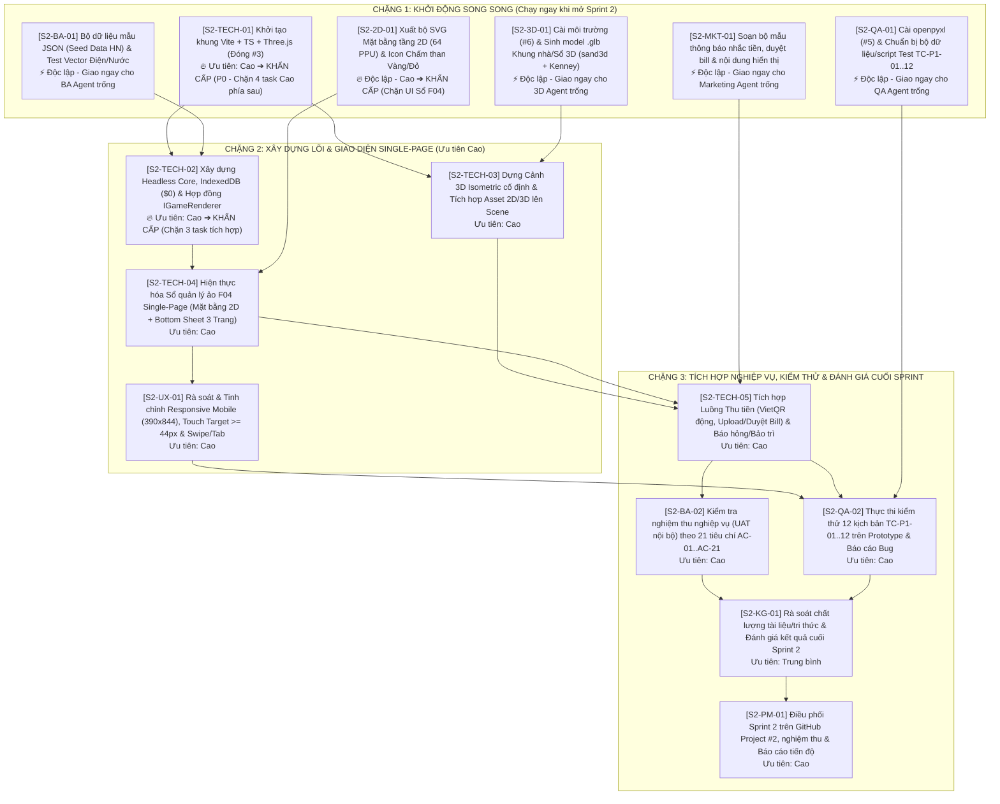

# Kế hoạch Sprint 2: Xây dựng Khung Codebase, Thế giới 3D Isometric & Prototype Sổ Quản lý Ảo F04 (P1)

- **Dự án:** Quản lý nhà trọ (QLNT)
- **Lập kế hoạch:** PM Lead phối hợp 8 Team Lead
- **Ngày trình duyệt:** `2026-11-13`
- **Trạng thái:** `Cổng G1 ĐÃ CHỐT (QLNT-D015) — Dự thảo Kế hoạch Sprint 2 đang chờ Chủ dự án phê duyệt để khởi tạo 15 Task trên repo theGonlyK/QLNT`
- **Repository quản lý Task & Code:** `theGonlyK/QLNT` (Đồng bộ 100% với GitHub Project `#2` theo `RULES_CORE.md` Mục 8)
- **Căn cứ lập kế hoạch:**
  - `3.DOC_AI/quan-tri/RULES_CORE.md` (Đặc biệt **Mục 8**: Quản lý 100% task trong repo `QLNT` & lưu vết hoàn thành; **Mục 10**: Điều phối theo độ ưu tiên, tự động nâng độ ưu tiên khi chặn task phía sau, và chạy song song các task độc lập khi có Agent trống).
  - `01-quan-ly/DECISIONS.md` (`QLNT-D001` $\rightarrow$ `QLNT-D015`, gồm Quyết định chốt Cổng G1 `QLNT-D015` và nguyên tắc **Ưu tiên phương án dễ & không mất phí `$0 First`** `QLNT-D014`).
  - `04-van-hanh/HA_TANG_VA_VAN_HANH_HE_THONG.md` & `04-van-hanh/QUALITY_AND_RELEASE.md` (Chuẩn vận hành & hạ tầng cho Dev bám theo).
  - Bộ hồ sơ thiết kế Sprint 1 đã hoàn thành 100% tại `02-nghiep-vu/` và `03-ky-thuat/`.

---

## 1. Mục tiêu Cốt lõi & 5 Đầu ra Đo lường được của Sprint 2

> **Mục tiêu Sprint 2:** Chuyển hóa toàn bộ thiết kế đã chốt ở Cổng G1 thành **Prototype P1 chạy thực tế trên trình duyệt Web & Mobile (`390x844`)** với chi phí hạ tầng **`$0` (`Local-First IndexedDB` + `Cloudflare Pages Free`)**, hiện thực hóa kiến trúc tách tầng **`Headless Core` $\leftrightarrow$ `IGameRenderer`**, khung cảnh **3D Isometric cố định** và luồng thao tác **Sổ quản lý ảo F04 chế độ `Single-Page`** (Thu tiền VietQR/Duyệt bill, Quản lý thiết bị/Báo hỏng chấm than đỏ, Lịch sử & Điểm thưởng).

### 5 Đầu ra Đo lường được (Measurable Deliverables):
1. **Khung Codebase & Môi trường Thực thi (`Tech` — giải quyết dứt điểm Issue `#3`):**
   - Khởi tạo cấu trúc mã nguồn chuẩn trong repo `4.Du_an/QLNT` (`Vite` + `TypeScript` + `Three.js` + `Tailwind CSS`), cấu hình build tự động không lỗi, đạt tốc độ tải nhanh và triển khai bản xem thử miễn phí (`$0`).
2. **Tầng Nghiệp vụ & Dữ liệu Local-First (`Tech` + `BA`):**
   - Hoàn thiện `Headless Core` và `IndexedDB Adapter` (`$0`, hoạt động 100% cả khi offline), tích hợp bộ dữ liệu mẫu (`Seed Data` 1 tòa nhà 3 tầng, 12 phòng tại Hà Nội), công thức tính tiền điện/nước bậc thang/đồng giá chuẩn xác 100%, và cơ chế tách bạch `Preview State` (hiệu ứng game) $\leftrightarrow$ `Commit State` (ghi dữ liệu thật).
3. **Cảnh 3D Isometric & Sổ Quản lý Ảo F04 `Single-Page` (`Tech` + `UX`):**
   - Hiện thực hóa đầy đủ 6 hàm trong hợp đồng `IGameRenderer`: hiển thị tòa nhà 3D góc nhìn Isometric cố định (`45°` azimuth, `35.264°` elevation) với các biểu tượng cảnh báo nổi (**Chấm than vàng** nhắc tiền, **Chấm than đỏ** báo hỏng) và **Sổ quản lý ảo F04 chế độ `Single-Page` trên Mobile**:
     - Chạm chọn tầng $\rightarrow$ xem **Mặt bằng tầng 2D (`SVG/Canvas 2x`)**.
     - Chạm chọn phòng $\rightarrow$ mở **`Bottom Sheet` Single-Page** chuyển mượt giữa 3 tab: **Trang 1 (Thu tiền, sinh VietQR động, tải ảnh bill, Chủ trọ duyệt 1 chạm)**, **Trang 2 (Thiết bị phòng, báo hỏng, cập nhật bảo trì)**, **Trang 3 (Lịch sử giao dịch/sự cố & Điểm thưởng)**.
4. **Bộ Tài nguyên Đồ họa 2D SVG & Mẫu 3D Đầu tiên (`2D Visual` + `3D Artist` — giải quyết Issue `#6`):**
   - Bàn giao trọn bộ file `.svg` mặt bằng tầng (`64 PPU`), bộ icon trạng thái/cảnh báo độ nét cao (`2x`), và xuất thành công các model `.glb` đầu tiên từ thư viện `sand3d` (khung nhà trọ cắt lớp, bìa sổ 3D) kết hợp mẫu nhân vật/nội thất `Kenney CC0`.
5. **Kiểm thử Thực tế & Nghiệm thu Prototype P1 (`QA` + `Knowledge Governance` — giải quyết Issue `#5`):**
   - Chạy kiểm thử toàn bộ 12 kịch bản `TC-P1-01..TC-P1-12` (bao phủ 21 tiêu chí `AC-01..AC-21`) trực tiếp trên bản Prototype bằng trình duyệt/Playwright, ghi nhận kết quả Pass/Fail thực tế và đánh giá chất lượng cuối Sprint 2.

---

## 2. Cơ chế Điều phối Sprint 2 theo Quy tắc Mới (`RULES_CORE.md` Mục 8 & Mục 10)

### 2.1. Sơ đồ Phụ thuộc & Tự động Nâng Độ ưu tiên (`Dynamic Priority Boost` — Rule 10.2)

Theo **Mục 10.2 của `RULES_CORE.md`**: *"Mức độ ưu tiên của một task sẽ tự động tăng lên khi phía sau task đó có task cùng độ ưu tiên đang phải chờ do phụ thuộc"*.

---

## 3. Danh sách Chi tiết 15 Task của Sprint 2 (Sắp xếp theo Độ ưu tiên & Khả năng Chạy Song song)

Ngay khi Chủ dự án phê duyệt Kế hoạch Sprint 2, PM Lead sẽ khởi tạo **15 GitHub Issues chính thức trong repository `theGonlyK/QLNT`** (tương ứng `#49` $\rightarrow$ `#63`) và đưa vào **GitHub Project `#2`** theo đúng cấu trúc dưới đây:

### Nhóm A — Các Task Độc lập (`Zero-Dependency`) & Task Chặn Đường găng (Khởi chạy đồng loạt ngay khi mở Sprint 2)

| Mã Kế hoạch | Tên Task (Sẽ tạo trong repo `theGonlyK/QLNT`) | Vai trò thực hiện | Phụ thuộc | Độ ưu tiên Gốc $\rightarrow$ Thực tế (`Rule 10`) | Đầu ra & Tiêu chí Hoàn thành (DoD) |
| :---: | :--- | :--- | :---: | :---: | :--- |
| **`S2-TECH-01`** | **[Tech] Khởi tạo khung mã nguồn `Vite + TypeScript + Three.js + Tailwind` & Đóng Issue `#3`** | `Tech Lead` & `Tech Contributor` | **Không (`0`)** | `Cao` $\rightarrow$ **`KHẨN CẤP (P0)`** *(Chặn `S2-TECH-02, 03, 04`)* | • Khởi tạo `package.json`, `tsconfig.json`, `vite.config.ts`, cấu trúc thư mục `src/core/`, `src/renderer/`, `src/ui/`, `src/assets/`. • Chạy `npm run build` thành công 100%, đóng Issue `#3`. |
| **`S2-2D-01`** | **[2D Visual] Thiết kế & Xuất bộ file SVG Mặt bằng tầng 2D (`64 PPU`) và Bộ Icon Cảnh báo (`2x`)** | `2D Visual Lead` & `2D Agent` | **Không (`0`)** | `Cao` $\rightarrow$ **`KHẨN CẤP (P0)`** *(Chặn `S2-TECH-04`)* | • Bộ file `.svg` trong `src/assets/2d/`: mặt bằng tầng mẫu (4–6 phòng/tầng), icon Chấm than vàng (`#F59E0B`), Chấm than đỏ (`#EF4444`), badge trạng thái phòng đúng chuẩn `QUY_CHUAN_2D_VA_BRIEF_ASSET_3D.md`. |
| **`S2-BA-01`** | **[BA] Xây dựng Bộ dữ liệu mẫu chuẩn Hà Nội (`Seed Data JSON`) & Bảng kiểm công thức Điện/Nước** | `BA Lead` & `BA Agent` | **Không (`0`)** | `Cao` $\rightarrow$ **`Cao (Chạy ngay khi Agent trống)`** | • File `src/core/seed/hanoi_motel_seed.json` (1 tòa nhà 3 tầng, 12 phòng, đủ các trạng thái: phòng trống, đang ở, nợ tiền, báo hỏng thiết bị, lịch sử giao dịch). • Bộ test vector kiểm chứng công thức tính tiền điện/nước bậc thang & đồng giá. |
| **`S2-3D-01`** | **[3D Artist] Thiết lập môi trường 3D (`#6`) & Sinh gói model `.glb` mẫu (`sand3d` + `Kenney CC0`)** | `3D Artist Lead` & `3D Agent` | **Không (`0`)** | `Trung bình` $\rightarrow$ **`Cao (Chạy ngay khi Agent trống)`** | • Xử lý Issue `#6` (kiểm tra/cài đặt công cụ hoặc xuất `.glb` chuẩn từ `sand3d`/procedural script & gói mẫu `Kenney CC0`). • Bàn giao model `.glb` nhẹ (`< 1.500–3.000 tris`) vào `public/models/` kèm báo cáo polycount. |
| **`S2-QA-01`** | **[QA] Xử lý công cụ đọc biểu mẫu (`#5`) & Chuẩn bị Bộ dữ liệu/Script Kiểm thử tự động `TC-P1-01..12`** | `QA Lead` & `QA Agent` | **Không (`0`)** | `Trung bình` $\rightarrow$ **`Trung bình (Chạy ngay khi Agent trống)`** | • Xử lý Issue `#5` (cài đặt `openpyxl` trong `.venv` hoặc script chuyển đổi chuẩn X02). • Tạo bộ kịch bản kiểm thử thực thi cho 12 Test Cases `TC-P1-01..12`. |
| **`S2-MKT-01`** | **[Marketing] Lập kế hoạch đăng ký & phát hành App (`#49` - đã mở) & Chuẩn hóa bộ văn bản giao tiếp trong Game** | `Marketing Lead` & `Marketing Agent` | **Không (`0`)** | `Trung bình` $\rightarrow$ **`Trung bình (Chạy ngay khi Agent trống)`** | • Hoàn thành `01-quan-ly/KE_HOACH_DANG_KY_VA_PHAT_HANH_APP.md` (xử lý Issue `#49`). • Bộ copywriting thân thiện, không gây áp lực tiêu cực cho khách thuê (nhắc tiền, duyệt bill, thông báo bảo trì) để nạp vào UI Sổ F04. |

---

### Nhóm B — Các Task Xây dựng Lõi Nghiệp vụ & Giao diện 3D / Single-Page (Chạy ngay khi `S2-TECH-01`, `S2-BA-01`, `S2-2D-01` hoàn tất)

| Mã Kế hoạch | Tên Task (Sẽ tạo trong repo `theGonlyK/QLNT`) | Vai trò thực hiện | Phụ thuộc | Độ ưu tiên Gốc $\rightarrow$ Thực tế (`Rule 10`) | Đầu ra & Tiêu chí Hoàn thành (DoD) |
| :---: | :--- | :--- | :---: | :---: | :--- |
| **`S2-TECH-02`** | **[Tech] Xây dựng `Headless Core`, Lưu trữ `IndexedDB` (`$0 First`) & Hợp đồng `IGameRenderer`** | `Tech Lead` & `Tech Contributor` | `S2-TECH-01`, `S2-BA-01` | `Cao` $\rightarrow$ **`KHẨN CẤP (P0)`** *(Chặn `S2-TECH-04, 05`)* | • Hoàn thiện State Store (`IndexedDB` persistence), tách bạch `Preview State` và `Commit State`. • Hiện thực hóa đầy đủ interface `IGameRenderer` (6 hàm điều khiển Sổ F04 + Event Bus 2 chiều) đúng `TECH_PROFILE.md`. |
| **`S2-TECH-03`** | **[Tech] Dựng Cảnh 3D Isometric Cố định (`Three.js`), Hệ tọa độ Phòng & Hiển thị Chấm than Vàng/Đỏ** | `Tech Contributor` | `S2-TECH-01`, `S2-3D-01` | `Cao` | • Camera Orthographic Isometric cố định (`45°`, `35.264°`), render tòa nhà nhiều tầng, hỗ trợ Raycasting chạm vào từng tầng/phòng và hiển thị icon cảnh báo nổi mượt mà ($\ge 30-60\text{fps}$). |
| **`S2-TECH-04`** | **[Tech] Hiện thực hóa Sổ Quản lý Ảo F04 Chế độ `Single-Page` (Mặt bằng 2D + `Bottom Sheet` 3 Trang)** | `Tech Lead` & `Tech Contributor` | `S2-TECH-02`, `S2-2D-01` | `Cao` $\rightarrow$ **`KHẨN CẤP (P0)`** *(Chặn `S2-TECH-05`, `S2-UX-01`)* | • Chạm vào Sổ F04 / Tầng $\rightarrow$ hiển thị Mặt bằng tầng 2D (`SVG/Canvas 2x`). • Chạm vào Phòng $\rightarrow$ mở `Bottom Sheet` Single-Page gồm 3 tab (*Trang 1: Thu tiền*, *Trang 2: Thiết bị*, *Trang 3: Lịch sử*) có nút `Lưu thay đổi` / `Hủy` rõ ràng. |
| **`S2-UX-01`** | **[UX] Kiểm tra & Tinh chỉnh Trải nghiệm Mobile (`390x844`), Vùng chạm $\ge 44\text{px}$ và Chuyển trang `Swipe/Tab`** | `UX Lead` & `UX Agent` | `S2-TECH-04` | `Cao` | • Đảm bảo trên màn hình dọc `390x844` không bị tràn chữ, vùng chạm phòng và nút bấm $\ge 44\times44\text{px}$, thao tác chuyển giữa Trang 1–2–3 mượt và rõ trạng thái dữ liệu thật vs hiệu ứng game. |

---

### Nhóm C — Các Task Tích hợp Nghiệp vụ Hoàn chỉnh, Kiểm thử Thực tế & Nghiệm thu Sprint 2

| Mã Kế hoạch | Tên Task (Sẽ tạo trong repo `theGonlyK/QLNT`) | Vai trò thực hiện | Phụ thuộc | Độ ưu tiên Gốc $\rightarrow$ Thực tế (`Rule 10`) | Đầu ra & Tiêu chí Hoàn thành (DoD) |
| :---: | :--- | :--- | :---: | :---: | :--- |
| **`S2-TECH-05`** | **[Tech] Tích hợp Luồng Thu tiền (`VietQR động`, Tải ảnh Bill, Duyệt 1 chạm) & Báo hỏng/Bảo trì trên Sổ F04** | `Tech Contributor` | `S2-TECH-03`, `S2-TECH-04`, `S2-MKT-01` | `Cao` | • Chạy thông suốt luồng: Chốt điện/nước $\rightarrow$ tính tổng tự động $\rightarrow$ sinh mã VietQR $\rightarrow$ tải ảnh chứng từ $\rightarrow$ Chủ trọ bấm duyệt $\rightarrow$ tắt Chấm than vàng & cộng điểm thưởng. • Báo hỏng thiết bị $\rightarrow$ bật Chấm than đỏ $\rightarrow$ hoàn tất bảo trì $\rightarrow$ tắt Chấm than đỏ & ghi lịch sử Trang 3. |
| **`S2-BA-02`** | **[BA] Kiểm tra Đối chiếu Nghiệp vụ trên Prototype P1 theo 21 Tiêu chí Nghiệm thu (`AC-01..AC-21`)** | `BA Lead` & `BA Agent` | `S2-TECH-05` | `Cao` | • Biên bản đối chiếu từng tiêu chí `AC-01` đến `AC-21` trong `MA_TRAN_TRUY_VET_P1.md` trên bản chạy thật; xác nhận không sai lệch công thức tiền trọ/cọc/điện nước. |
| **`S2-QA-02`** | **[QA] Thực thi Kiểm thử 12 Kịch bản `TC-P1-01..12` trên Trình duyệt Thật & Lập Báo cáo Kiểm thử Sprint 2** | `QA Lead` & `QA Agent` | `S2-TECH-05`, `S2-UX-01`, `S2-QA-01` | `Cao` | • Chạy kiểm thử toàn bộ `TC-P1-01..TC-P1-12` trên Prototype (gồm cả chế độ giả lập Mobile `390x844`), cập nhật kết quả `Pass/Fail` thực tế vào `04-van-hanh/` và kiểm tra điều kiện môi trường STG. |
| **`S2-KG-01`** | **[Knowledge Governance] Đánh giá Chất lượng Cuối Sprint 2, Cập nhật `IMPROVEMENTS.md` & Chuẩn bị Rà soát Tri thức Đợt 2** | `Knowledge Governance Lead` | `S2-BA-02`, `S2-QA-02` | `Trung bình` | • Báo cáo đánh giá kết quả Sprint 2 so với mục tiêu, cập nhật `04-van-hanh/IMPROVEMENTS.md` và chuẩn bị danh mục tri thức rút trích sau khi Prototype P1 chạy thực tế. |
| **`S2-PM-01`** | **[PM] Điều phối Tiến độ Sprint 2 trên Repo `theGonlyK/QLNT`, Kiểm soát Lưu vết Task & Báo cáo Nghiệm thu** | `PM Lead` & `PM Agent` | Toàn bộ Task S2 | `Cao` | • Đảm bảo 100% task trong repo `theGonlyK/QLNT` có đầy đủ nhật ký quá trình thực hiện & bằng chứng commit trước khi đóng; tổng hợp báo cáo hoàn thành Sprint 2 trình Chủ dự án. |

---

## 4. Nguyên tắc Hạ tầng & Chi phí Áp dụng Nghiêm ngặt trong Sprint 2 (`QLNT-D014`)

1. **Chi phí hạ tầng Sprint 2 = `$0` tuyệt đối:**
   - Toàn bộ quá trình phát triển và chạy thử Prototype P1 trong Sprint 2 sử dụng **`IndexedDB` (Local-First ngay trên trình duyệt)** kết hợp **`Cloudflare Pages Free`** (hoặc chạy trực tiếp qua Vite Dev/Preview Server), không phát sinh bất kỳ chi phí thuê VPS hay Database trả phí nào.
   - Issue `#10` (`Cài đặt Docker / OrbStack`) được giữ ở mức **Tùy chọn (`Optional / Low Priority`)**, không bắt buộc cài đặt trong Sprint 2 để ưu tiên phương án nhẹ nhất, dễ chạy nhất trên máy trạm của Chủ dự án.
2. **Mọi đề xuất thay đổi làm tăng/giảm chi phí:**
   - Phải thực hiện đánh giá lại đồng thời 2 chiều (**Cấu trúc hạ tầng** + **Phạm vi triển khai**) tại `04-van-hanh/` và trình Chủ dự án phê duyệt trước khi áp dụng.
