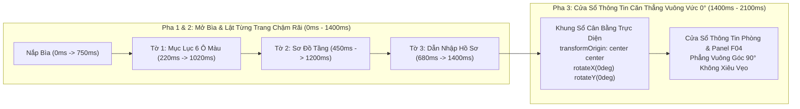

# Làm Chậm Hoạt Ảnh Lật Từng Trang Sách & Căn Thẳng Vuông Vức Cửa Sổ Thông Tin Phòng Implementation Plan

> **For agentic workers:** REQUIRED SUB-SKILL: Use superpowers:subagent-driven-development to implement this plan task-by-task. Steps use checkbox (`- [ ]`) syntax for tracking.

**Goal:** Làm chậm hoạt ảnh mở bìa và lật từng trang sách từ `550ms` lên `1400ms` (tổng chu trình mở `2100ms`) để người dùng quan sát rõ từng trang giấy lật qua gáy sách, đồng thời loại bỏ góc xoay lệch `rotateX(16deg) rotateY(-2deg)` (`transformOrigin: 'left top'`) để cửa sổ thông tin phòng sau khi mở hiển thị thẳng, phẳng, vuông vức tuyệt đối (`rotateX(0deg) rotateY(0deg)`, `transformOrigin: 'center center'`).

**Architecture:** Cập nhật `VirtualLedgerBook` (`@qlnt/renderer-2d`) đặt `transformOrigin: 'center center'` và `transform: 'rotateX(0deg) rotateY(0deg)'` ở trạng thái `open`; kéo giãn keyframes mở sách (`bookOpenHinge: 1400ms`), mở bìa (`frontCoverFlapOpen: 750ms`), và 3 tờ trang lật tuần tự (`pageSheetFlipOpen1: 800ms delay 220ms`, `pageSheetFlipOpen2: 750ms delay 450ms`, `pageSheetFlipOpen3: 720ms delay 680ms`), cùng hoạt ảnh hiện cửa sổ thông tin (`popUpStandUp / popUpContentRise: 700ms`). Cập nhật `LedgerOverlayHost` (`@qlnt/web`) đồng bộ bộ hẹn giờ `1400ms` (hết pha lật trang) và `2100ms` (hoàn tất mở thẳng cửa sổ thông tin).

**Architecture Diagram:**



**Tech Stack:** React 18, TypeScript, Tailwind CSS, CSS 3D Transforms, Vitest, Playwright (Google Chrome).

**Spec:** [SPEC_TINH_CHINH_TOC_DO_LAT_TRANG_VA_CAN_THANG_CUA_SO_THONG_TIN.md](file:///Users/minhntv/Documents/Work/MinhNTV/TEAM_ORCA/4.Du_an/QLNT/01-quan-ly/SPEC_TINH_CHINH_TOC_DO_LAT_TRANG_VA_CAN_THANG_CUA_SO_THONG_TIN.md)

## Global Constraints

- **0% thay đổi trong `packages/shared-types` (`common`):** Tuyệt đối không chỉnh sửa bất kỳ file nào trong `packages/shared-types`.
- **Không hiển thị xiêu vẹo:** Khi `animationState === 'open'`, `VirtualLedgerBook` bắt buộc có `transformOrigin: 'center center'` và `transform: 'rotateX(0deg) rotateY(0deg)'`; không còn bất kỳ góc lệch `rotateY(-2deg)` hay `rotateX(16deg)` nào làm méo hình thang.
- **Hoạt ảnh chậm, rõ từng trang:** Pha lật trang kéo dài `1400ms` (`0ms – 1400ms`), pha hiện cửa sổ thông tin kéo dài `700ms` (`1400ms – 2100ms`), lật trang nội bộ `750ms`.

---

### Task 1: Tinh chỉnh Tốc Độ Lật Trang Chậm (`1400ms`) & Căn Thẳng Khung Sổ `0deg` trong `VirtualLedgerBook.tsx` (`@qlnt/renderer-2d`)

**Files:**
- Modify: [VirtualLedgerBook.tsx](file:///Users/minhntv/Documents/Work/MinhNTV/TEAM_ORCA/4.Du_an/QLNT/packages/renderer-2d/src/components/ledger/VirtualLedgerBook.tsx)
- Test: [virtualLedgerBook.test.ts](file:///Users/minhntv/Documents/Work/MinhNTV/TEAM_ORCA/4.Du_an/QLNT/packages/renderer-2d/test/virtualLedgerBook.test.ts)

**Interfaces:**
- Consumes: `VirtualLedgerBookProps`
- Produces:
  - Khi `animationState === 'open'`: `style.transformOrigin === 'center center'`, `style.transform === 'rotateX(0deg) rotateY(0deg)'`.
  - Khi `animationState === 'opening'`:
    - `bookOpenHinge`: `1400ms cubic-bezier(0.22, 0.61, 0.36, 1) forwards` (bắt đầu từ `rotateX(10deg) rotateY(0deg) scale(0.96)` và kết thúc phẳng tuyệt đối tại `rotateX(0deg) rotateY(0deg) scale(1)`).
    - `frontCoverFlapOpen`: `750ms cubic-bezier(0.22, 0.61, 0.36, 1) 0ms forwards`.
    - `book-flip-sheet-1`: `pageSheetFlipOpen1 800ms cubic-bezier(0.22, 0.61, 0.36, 1) 220ms forwards`.
    - `book-flip-sheet-2`: `pageSheetFlipOpen2 750ms cubic-bezier(0.22, 0.61, 0.36, 1) 450ms forwards`.
    - `book-flip-sheet-3`: `pageSheetFlipOpen3 720ms cubic-bezier(0.22, 0.61, 0.36, 1) 680ms forwards`.
  - Khi `contentStage === 'popping'`:
    - `popUpContentRise`: `700ms cubic-bezier(0.16, 1, 0.3, 1) forwards`.
    - `popUpStandUp`: `700ms cubic-bezier(0.16, 1, 0.3, 1) forwards`.
  - Khi `isPageTurning === true`:
    - `innerPageTurnFlip`: `750ms cubic-bezier(0.22, 0.61, 0.36, 1) forwards`.

- [ ] **Step 1: Cập nhật unit test trong `virtualLedgerBook.test.ts` kiểm tra căn thẳng `rotateX(0deg) rotateY(0deg)` (`center center`) và thời lượng chậm**

Trong [virtualLedgerBook.test.ts](file:///Users/minhntv/Documents/Work/MinhNTV/TEAM_ORCA/4.Du_an/QLNT/packages/renderer-2d/test/virtualLedgerBook.test.ts):
- Cập nhật kỳ vọng `defaultBook.props.style?.transformOrigin` là `'center center'` và `defaultBook.props.style?.transform` là `'rotateX(0deg) rotateY(0deg)'`.
- Kiểm tra thời lượng mới trên `sheet1` (`800ms`, delay `220ms`), `sheet2` (`750ms`, delay `450ms`), `sheet3` (`720ms`, delay `680ms`), và `innerTurnSheet` (`750ms`).

- [ ] **Step 2: Chạy Vitest tại `packages/renderer-2d` để xác nhận test FAIL**

Run: `pnpm --filter @qlnt/renderer-2d test`
Expected: FAIL tại assertion kiểm tra `transformOrigin: 'center center'`, `transform: 'rotateX(0deg) rotateY(0deg)'` và các thông số thời lượng mới.

- [ ] **Step 3: Cập nhật `VirtualLedgerBook.tsx` theo đúng thông số căn thẳng 0° và hoạt ảnh chậm**

Trong [VirtualLedgerBook.tsx](file:///Users/minhntv/Documents/Work/MinhNTV/TEAM_ORCA/4.Du_an/QLNT/packages/renderer-2d/src/components/ledger/VirtualLedgerBook.tsx):
1. Đổi `transformOrigin: 'center center'` và `transform: animationState === 'open' ? 'rotateX(0deg) rotateY(0deg)' : undefined`.
2. Cập nhật `@keyframes bookOpenHinge` chạy trong `1400ms` từ `perspective(1600px) rotateX(10deg) rotateY(0deg) scale(0.96)` về `perspective(1600px) rotateX(0deg) rotateY(0deg) scale(1)` (loại bỏ hoàn toàn độ lệch trục Y làm xiêu vẹo khung sổ).
3. Cập nhật thời lượng `frontCoverFlapOpen` (`750ms`), `pageSheetFlipOpen1` (`800ms` delay `220ms`), `pageSheetFlipOpen2` (`750ms` delay `450ms`), `pageSheetFlipOpen3` (`720ms` delay `680ms`), `popUpStandUp` (`700ms`), `popUpContentRise` (`700ms`), `innerPageTurnFlip` (`750ms`).

- [ ] **Step 4: Chạy lại Vitest và Build tại `packages/renderer-2d`**

Run: `pnpm --filter @qlnt/renderer-2d test && pnpm --filter @qlnt/renderer-2d build`
Expected: PASS 100%.

- [ ] **Step 5: Commit Task 1**

```bash
git -C 4.Du_an/QLNT add packages/renderer-2d/src/components/ledger/VirtualLedgerBook.tsx packages/renderer-2d/test/virtualLedgerBook.test.ts
git -C 4.Du_an/QLNT commit -m "feat(renderer-2d): lam cham hoat anh lat tung trang sach 1400ms va can thang cua so thong tin 0deg"
```

---

### Task 2: Đồng bộ Nhịp Định Thời Mở Chậm (`1400ms` / `2100ms`) & Căn Thẳng Panel trong `LedgerOverlayHost.tsx` (`@qlnt/web`)

**Files:**
- Modify: [LedgerOverlayHost.tsx](file:///Users/minhntv/Documents/Work/MinhNTV/TEAM_ORCA/4.Du_an/QLNT/apps/web/src/components/LedgerOverlayHost.tsx)
- Test: [uiAndResponsive.test.ts](file:///Users/minhntv/Documents/Work/MinhNTV/TEAM_ORCA/4.Du_an/QLNT/apps/web/tests/uiAndResponsive.test.ts)

**Interfaces:**
- Consumes: `VirtualLedgerBook`
- Produces:
  - `openTimer1Ref`: `1400ms` (chờ nắp bìa và 3 tờ trang sách lật xong hoàn toàn mới chuyển sang `OPEN` + `popping`).
  - `openTimer2Ref`: `2100ms` (`1400ms + 700ms`, chuyển sang `visible`).
  - `pageTurnTimerRef`: `750ms` khi đổi phòng hoặc đổi tầng trong sổ.
  - `f04-interactive-panel`: Khi `contentStage === 'popping'` chạy `popUpStandUp 700ms cubic-bezier(0.16, 1, 0.3, 1) forwards`; khi `'visible'` đạt `rotateX(0deg) scale(1)` thẳng vuông vức 100%.

- [ ] **Step 1: Cập nhật `LedgerOverlayHost.tsx` và `uiAndResponsive.test.ts`**

1. Trong [LedgerOverlayHost.tsx](file:///Users/minhntv/Documents/Work/MinhNTV/TEAM_ORCA/4.Du_an/QLNT/apps/web/src/components/LedgerOverlayHost.tsx):
   - Tăng `openTimer1Ref` từ `550` lên `1400`.
   - Tăng `openTimer2Ref` từ `1050` lên `2100`.
   - Tăng `pageTurnTimerRef` từ `420` lên `750`.
   - Tăng thời lượng `popUpStandUp` trong `getPanelStageStyle()` lên `700ms`.
2. Trong [uiAndResponsive.test.ts](file:///Users/minhntv/Documents/Work/MinhNTV/TEAM_ORCA/4.Du_an/QLNT/apps/web/tests/uiAndResponsive.test.ts):
   - Bổ sung kiểm tra `virtual-ledger-book` ở trạng thái `OPEN` có `rotateX(0deg) rotateY(0deg)` và `transform-origin:center center` (không còn `rotateX(16deg) rotateY(-2deg)`).

- [ ] **Step 2: Chạy Vitest tại `apps/web`**

Run: `pnpm --filter @qlnt/web test`
Expected: PASS 100% (39/39 tests).

- [ ] **Step 3: Commit Task 2**

```bash
git -C 4.Du_an/QLNT add apps/web/src/components/LedgerOverlayHost.tsx apps/web/tests/uiAndResponsive.test.ts
git -C 4.Du_an/QLNT commit -m "feat(web-ui): dong bo chu trinh mo sach cham 1400ms-2100ms trong LedgerOverlayHost"
```

---

### Task 3: Kiểm Thử Tự Động Playwright E2E Trên Google Chrome & Chụp Ảnh Nghiệm Thu

**Files:**
- Modify: [p1-flows.spec.ts](file:///Users/minhntv/Documents/Work/MinhNTV/TEAM_ORCA/4.Du_an/QLNT/apps/web/e2e/p1-flows.spec.ts)

**Interfaces:**
- Verifies:
  1. Tại `t = 550ms` (giữa pha mở chậm `0ms – 1400ms`), quyển sách vẫn đang trong trạng thái `OPENING` (`contentStage = 'hidden'`), các tờ `book-flip-sheet-1..3` đang lật qua gáy sách và cửa sổ thông tin phòng vẫn ẩn hoàn toàn (`opacity: 0`).
  2. Sau khi mở hoàn tất (`t ≥ 2100ms`), cuốn sổ và cửa sổ thông tin phòng ở trạng thái `OPEN` / `visible` với góc `rotateX(0deg) rotateY(0deg)` thẳng ngay ngắn, không bị xiêu vẹo.
  3. Chụp và kiểm tra trực quan 2 ảnh nghiệm thu mới:
     - `20-3d-book-slow-page-flip-midway.png`
     - `21-3d-book-opened-straight-aligned-room-info.png`

- [ ] **Step 1: Cập nhật Test 8 trong `apps/web/e2e/p1-flows.spec.ts`**

Cập nhật mốc kiểm tra giữa pha lật trang chậm (`waitForTimeout(550)`), tăng timeout chờ sang trạng thái `OPEN`/`visible` (`timeout: 4500`), kiểm tra `transform` của `virtualBook` ở trạng thái `open` không chứa `rotateY(-2deg)`, và lưu 2 ảnh nghiệm thu `20-3d-book-slow-page-flip-midway.png` & `21-3d-book-opened-straight-aligned-room-info.png` (đồng thời cập nhật `18-...` và `19-...`).

- [ ] **Step 2: Chạy toàn bộ Unit Tests và Playwright E2E Suites trên Google Chrome**

Run:
```bash
cd 4.Du_an/QLNT && pnpm test
cd 4.Du_an/QLNT/apps/web && pnpm exec playwright test e2e/p1-flows.spec.ts
```
Expected: 100% Unit Tests PASS, 8/8 Playwright Chrome E2E Suites PASS.

- [ ] **Step 3: Commit Task 3 & Cập nhật `3.DOC_AI/HANDOVER.md`**

```bash
git -C 4.Du_an/QLNT add apps/web/e2e/p1-flows.spec.ts 01-quan-ly/SPEC_TINH_CHINH_TOC_DO_LAT_TRANG_VA_CAN_THANG_CUA_SO_THONG_TIN.md 01-quan-ly/KE_HOACH_TINH_CHINH_TOC_DO_LAT_TRANG_VA_CAN_THANG_CUA_SO_THONG_TIN.md
git -C 4.Du_an/QLNT commit -m "test(e2e): nghiem thu hoat anh lat trang cham 1400ms va cua so thong tin can thang 0deg"
```
