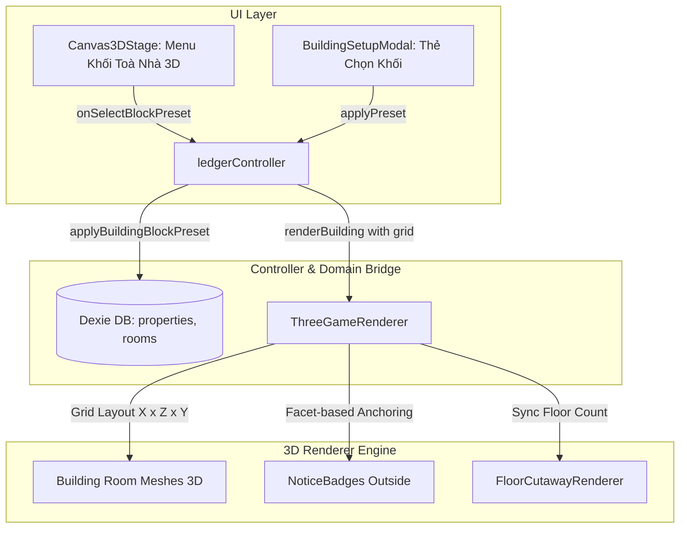

# Kế Hoạch Triển Khai: Tùy Chọn Khối Tòa Nhà 3D Bên Ngoài (Block Shape Presets)

> **For agentic workers:** REQUIRED SUB-SKILL: Use superpowers:subagent-driven-development to implement this plan task-by-task. Steps use checkbox (`- [ ]`) syntax for tracking.

**Goal:** Thêm chức năng tùy chọn và hiển thị các khối toà nhà 3D đa chiều bên ngoài (như khối tháp 2x2x6, khối vuông 3x3x3, khối tiêu chuẩn 3x2x4...) kèm bộ tỉ lệ kiến trúc tính toán khoa học, đồng bộ tức thì trên thanh HUD 3D, Modal cấu hình toà nhà và CSDL Local-First Dexie.

**Architecture:** Mở rộng `ThreeGameRenderer.renderBuilding()` từ bố cục 1 hàng ngang phẳng thành lưới không gian 3D đa chiều $\text{Cols}(X) \times \text{Rows}(Z) \times \text{Floors}(Y)$ với khe hở thông gió trung tâm $0.25\text{m}$ và neo huy hiệu `NoticeBadge` chuẩn xác. `ledgerController` quản lý danh mục `BUILDING_BLOCK_PRESETS`, điều phối cập nhật số tầng/phòng vào CSDL Dexie, đồng bộ với bộ chọn HUD trên `Canvas3DStage` và `BuildingSetupModal`.

**Architecture Diagram:**



**Tech Stack:** TypeScript, React, Three.js, Dexie.js (IndexedDB Local-First), Vitest, Playwright (Google Chrome).

**Spec:** [SPEC_TUY_CHON_KHOI_TOA_NHA_3D_BEN_NGOAI.md](file:///Users/minhntv/Documents/Work/MinhNTV/TEAM_ORCA/4.Du_an/QLNT/01-quan-ly/SPEC_TUY_CHON_KHOI_TOA_NHA_3D_BEN_NGOAI.md)

## Global Constraints

- **$0\%$ thay đổi `packages/shared-types` (`common`)**: Giữ nguyên toàn bộ interface và DTO dùng chung.
- **Local-First 100%**: Lưu trữ trên Dexie.js IndexedDB cục bộ, không gọi API server bên ngoài.
- **Touch-target tối thiểu**: $\ge 44\text{px}$ cho tất cả nút bấm và dropdown item theo chuẩn WCAG/Android.
- **Tương thích ngược**: Preset mặc định là `COMPACT_2x2x3` (12 phòng, 3 tầng, 4 phòng/tầng) trùng khớp với seed dữ liệu mẫu ban đầu.
- **Kiểm thử tự động**: $100\%$ unit tests pass và Playwright E2E chạy thành công trên Google Chrome, lưu ảnh chụp nghiệm thu.

---

### Task 1: Mở Rộng Bố Cục Lưới 3D Đa Chiều ($X \times Z \times Y$) & Neo Huy Hiệu trong `ThreeGameRenderer`

**Files:**
- Modify: `4.Du_an/QLNT/packages/renderer-3d/src/threeGameRenderer.ts`
- Test: `4.Du_an/QLNT/packages/renderer-3d/tests/threeGameRenderer.test.ts`

**Interfaces:**
- `renderBuilding(buildingData: BuildingRenderDTO & { blockGrid?: { cols: number; rows: number } }): Promise<void>`
- `setBuildingBlockShape(cols: number, rows: number): void`
- `getRoomBadgeAnchor(roomId: string, slot?: number): THREE.Vector3 | null`

- [x] **Step 1: Viết failing test cho renderBuilding với bố cục lưới 3D**

```typescript
// Trong packages/renderer-3d/tests/threeGameRenderer.test.ts
it('renderBuilding arranges rooms in 3D grid along both X and Z axes when blockGrid is provided', async () => {
  const r = new ThreeGameRenderer({ canvas: document.createElement('canvas'), width: 800, height: 600 });
  await r.renderBuilding({
    propertyId: 'p-grid-test',
    totalFloors: 3,
    roomsPerFloor: 4,
    position: { x: 0, y: 0, z: 0 },
    blockGrid: { cols: 2, rows: 2 },
  } as any);

  const meshes = (r as any).buildingMeshes;
  expect(meshes.length).toBe(12);

  // Kiểm tra có ít nhất 2 giá trị z khác nhau (thể hiện 2 hàng phòng theo chiều sâu)
  const zPositions = new Set(meshes.map((m: any) => Math.round(m.position.z * 100) / 100));
  expect(zPositions.size).toBeGreaterThanOrEqual(2);
});
```

- [x] **Step 2: Chạy test để xác nhận test FAIL**

```bash
pnpm --filter @qlnt/renderer-3d test -- -t "renderBuilding arranges rooms in 3D grid"
```
*Kỳ vọng: FAIL vì hiện tại tất cả phòng đều có $z = 0$.*

- [x] **Step 3: Triển khai bố cục lưới 3D và neo Badge trong `ThreeGameRenderer`**

Trong `packages/renderer-3d/src/threeGameRenderer.ts`:
- Bổ sung `currentBlockGrid: { cols: number; rows: number } = { cols: 2, rows: 2 };`
- Trong `renderBuilding(buildingData)`:
  - Xác định `cols = buildingData.blockGrid?.cols ?? Math.ceil(roomsPerFloor / 2);`
  - Xác định `rows = buildingData.blockGrid?.rows ?? (roomsPerFloor > cols ? Math.ceil(roomsPerFloor / cols) : 1);`
  - Tính tọa độ phòng thứ $r$ trên tầng $f$:
    - `colIdx = r % cols;`
    - `rowIdx = Math.floor(r / cols);`
    - Chiều ngang $X$: Căn giữa quanh $x = 0$ với bước nhảy $(sx + gapX)$.
    - Chiều sâu $Z$: Căn giữa quanh $z = 0$ với bước nhảy $(sz + gapZ)$ (khe hành lang $gapZ = 0.25$).
    - Chiều cao $Y$: Tầng $f \times (sy + gapY)$.
  - Cập nhật `getRoomBadgeAnchor()`: Neo huy hiệu ra mặt ngoài phía trước đối với các phòng hàng trước, hoặc mặt trên/mặt hông dễ quan sát nhất.

- [x] **Step 4: Chạy lại tests để xác nhận PASS**

```bash
pnpm --filter @qlnt/renderer-3d test
```
*Kỳ vọng: Toàn bộ 95+ tests PASS.*

- [x] **Step 5: Commit mã nguồn Task 1**

```bash
git -C 4.Du_an/QLNT add packages/renderer-3d/src/threeGameRenderer.ts packages/renderer-3d/tests/threeGameRenderer.test.ts
git -C 4.Du_an/QLNT commit -m "feat(renderer-3d): bo cuc luoi 3D da chieu X x Z x Y cho renderBuilding"
```

---

### Task 2: Quản Lý Presets Khối Toà Nhà & Đồng Bộ CSDL Dexie trong `ledgerController`

**Files:**
- Modify: `4.Du_an/QLNT/apps/web/src/bridge/ledgerController.ts`
- Test: `4.Du_an/QLNT/apps/web/tests/ledgerController.test.ts`

**Interfaces:**
- `BUILDING_BLOCK_PRESETS: readonly BuildingBlockPreset[]`
- `applyBuildingBlockPreset(presetId: string, customConfig?: { cols: number; rows: number; floors: number }): Promise<void>`
- `currentBlockPresetId: string`

- [x] **Step 1: Viết failing test cho `applyBuildingBlockPreset`**

```typescript
// Trong apps/web/tests/ledgerController.test.ts
it('applyBuildingBlockPreset updates totalFloors and room count to match preset', async () => {
  const controller = new LedgerController();
  await controller.initialize();
  
  await controller.applyBuildingBlockPreset('TOWER_2x2x6');
  expect(controller.property?.total_floors).toBe(6);
  expect(controller.rooms.length).toBe(24);
  expect(controller.getRoomsPerFloor()).toBe(4);
});
```

- [x] **Step 2: Chạy test để xác nhận FAIL**

```bash
pnpm --filter @qlnt/web test -- -t "applyBuildingBlockPreset"
```
*Kỳ vọng: FAIL vì `applyBuildingBlockPreset` chưa được định nghĩa.*

- [x] **Step 3: Triển khai danh mục Presets và `applyBuildingBlockPreset` trong `ledgerController.ts`**

- Định nghĩa `BUILDING_BLOCK_PRESETS`:
  - `TOWER_2x2x6` ($2 \times 2 \times 6 = 24$ phòng, $4$ phòng/tầng)
  - `CCMN_3x2x4` ($3 \times 2 \times 4 = 24$ phòng, $6$ phòng/tầng)
  - `CUBE_3x3x3` ($3 \times 3 \times 3 = 27$ phòng, $9$ phòng/tầng)
  - `COMPACT_2x2x3` ($2 \times 2 \times 3 = 12$ phòng, $4$ phòng/tầng)
  - `LONG_4x2x2` ($4 \times 2 \times 2 = 16$ phòng, $8$ phòng/tầng)
  - `CUSTOM` (người dùng tự chọn)
- Trong `applyBuildingBlockPreset()`:
  - Cập nhật `property.total_floors` trong Dexie DB.
  - Tự động điều chỉnh danh sách `rooms`: Bảo lưu phòng hiện có nếu phòng đó còn trong phạm vi mới; tạo mới các phòng bổ sung với diện tích chuẩn $25\text{m}^2$, giá $4.000.000$đ; lưu vào bảng `rooms` trong Dexie DB.
  - Lưu mã preset hiện tại vào LocalStorage hoặc property metadata.
  - Gọi `syncAllToRenderer()` truyền đúng `blockGrid: { cols, rows }`.

- [x] **Step 4: Chạy test xác nhận PASS**

```bash
pnpm --filter @qlnt/web test -- -t "applyBuildingBlockPreset"
```
*Kỳ vọng: PASS.*

- [x] **Step 5: Commit mã nguồn Task 2**

```bash
git -C 4.Du_an/QLNT add apps/web/src/bridge/ledgerController.ts apps/web/tests/ledgerController.test.ts
git -C 4.Du_an/QLNT commit -m "feat(ledger): them BUILDING_BLOCK_PRESETS va applyBuildingBlockPreset"
```

---

### Task 3: Bộ Chọn Preset Khối Toà Nhà Trên Thanh Công Cụ HUD Canvas 3D

**Files:**
- Modify: `4.Du_an/QLNT/apps/web/src/components/Canvas3DStage.tsx`
- Modify: `4.Du_an/QLNT/apps/web/src/bridge/useRendererBridge.ts`
- Test: `4.Du_an/QLNT/apps/web/tests/uiAndResponsive.test.ts`

- [x] **Step 1: Viết test UI cho menu chọn khối toà nhà trên 3D Stage**

```typescript
it('renders building block shape selector button on 3D stage HUD in BUILDING_3D mode', () => {
  // Test kiểm tra có nút '🏛️ Khối toà nhà' hoặc dropdown tương ứng
  // và khi click sẽ hiển thị danh sách presets: 2x2x6, 3x2x4, 3x3x3, 2x2x3...
});
```

- [x] **Step 2: Chạy test xác nhận FAIL**

```bash
pnpm --filter @qlnt/web test -- -t "building block shape selector"
```

- [x] **Step 3: Triển khai UI selector trên HUD `Canvas3DStage.tsx`**

- Chỉ hiển thị bộ chọn khi ở chế độ `viewMode === 'BUILDING_3D'`.
- Nút bấm chính: `🏛️ Khối toà nhà: [Tên Preset] ▾` với touch target $\ge 44\text{px}$, hiệu ứng hover đẹp mắt.
- Dropdown menu danh sách 5 presets có nhãn chi tiết (kích thước, số tầng, số phòng) + nút tùy chọn Custom.
- Khi người dùng click chọn 1 preset: gọi `onSelectBlockPreset(presetId)`.

- [x] **Step 4: Chạy test UI xác nhận PASS**

```bash
pnpm --filter @qlnt/web test
```

- [x] **Step 5: Commit mã nguồn Task 3**

```bash
git -C 4.Du_an/QLNT add apps/web/src/components/Canvas3DStage.tsx apps/web/src/bridge/useRendererBridge.ts apps/web/tests/uiAndResponsive.test.ts
git -C 4.Du_an/QLNT commit -m "feat(web-ui): tich hop menu chon khoi toa nha tren thanh cong cu HUD 3D"
```

---

### Task 4: Tích Hợp Chọn Khối Kiến Trúc Trong `BuildingSetupModal`

**Files:**
- Modify: `4.Du_an/QLNT/apps/web/src/components/BuildingSetupModal.tsx`
- Test: `4.Du_an/QLNT/apps/web/tests/uiAndResponsive.test.ts`

- [x] **Step 1: Thêm thẻ chọn Preset hình khối trong Modal Đăng ký Tòa nhà**
- Hiển thị danh sách các thẻ Preset hình khối (Tháp 2x2x6, CCMN 3x2x4, Khối vuông 3x3x3, Nhà phố 2x2x3, Dãy ngang 4x2x2).
- Khi click chọn một thẻ Preset: Tự động cập nhật số tầng `totalFloors` và số phòng/tầng `roomsPerFloor` tương ứng trong form, tính lại danh sách phòng xem trước.
- [x] **Step 2: Chạy unit tests xác nhận tính năng hoạt động trơn tru**
```bash
pnpm --filter @qlnt/web test
```
- [x] **Step 3: Commit mã nguồn Task 4**

```bash
git -C 4.Du_an/QLNT add apps/web/src/components/BuildingSetupModal.tsx
git -C 4.Du_an/QLNT commit -m "feat(web-ui): tich hop chon Preset khoi toa nha vao BuildingSetupModal"
```

---

### Task 5: Kiểm Thử Tự Động Playwright E2E Trên Google Chrome & Nghiệm Thu Trực Quan

**Files:**
- Modify: `4.Du_an/QLNT/apps/web/e2e/p1-flows.spec.ts`

- [x] **Step 1: Viết kịch bản kiểm thử E2E Playwright trên Google Chrome**
  - Mở ứng dụng, xác nhận toà nhà ban đầu ở dạng mặc định.
  - Click mở menu `🏛️ Khối toà nhà`, chọn preset `TOWER_2x2x6` (Tháp nhà ống cao tầng $2\times2\times6$).
  - Xác nhận toà nhà cập nhật $6$ tầng, thanh chọn tầng hiển thị đủ từ Tầng 1 đến Tầng 6.
  - Chụp ảnh màn hình: `10-building-block-preset-tower-2x2x6.png`.
  - Chọn preset `CUBE_3x3x3` (Khối vuông lập phương $3\times3\times3$).
  - Xác nhận toà nhà cập nhật $3$ tầng, mỗi tầng $9$ phòng, tổng $27$ phòng.
  - Chụp ảnh màn hình: `11-building-block-preset-cube-3x3x3.png`.
  - Mở thử mặt bằng Tầng 2 Cutaway, kiểm tra phòng và góc nhìn 45° vẫn hoạt động chính xác.
- [x] **Step 2: Chạy toàn bộ test suites Playwright E2E bằng Chrome**
```bash
cd 4.Du_an/QLNT/apps/web && npx playwright test e2e/p1-flows.spec.ts
```
*Kỳ vọng: $100\%$ test suites PASS.*
- [x] **Step 3: Commit mã nguồn và cập nhật báo cáo kiểm thử**

```bash
git -C 4.Du_an/QLNT add apps/web/e2e/p1-flows.spec.ts 04-van-hanh/
git -C 4.Du_an/QLNT commit -m "test(e2e): kiem thu tu dong Playwright Chrome cho tinh nang tuy chon khoi toa nha 3D"
```
