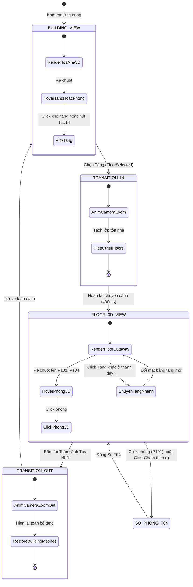

# Đặc tả Kỹ thuật (Spec): Chuyển Cảnh Mặt Bằng Tầng 3D Isometric & Tương Tác Căn Phòng

- **Mã tính năng:** `QLNT-FEAT-3D-FLOOR-CUTAWAY`
- **Phiên bản:** `1.0`
- **Ngày lập:** `2026-11-15`
- **Trạng thái:** `Dự thảo — Chờ Chủ dự án duyệt trước khi triển khai`
- **Tham chiếu ý tưởng:** Mô hình trực quan "Văn phòng 3D AI Agent" (Kiên Trần | 9X AI Branding — video TikTok `@kientran_brand`) kết hợp kiến trúc Game-like Isometric của QLNT.

---

## 1. Mục tiêu Nghiệp vụ & Trải nghiệm Người dùng (UX/UI Goal)

1. **Từ Toàn cảnh Tòa nhà sang Chi tiết Mặt bằng Tầng 3D:**
   - Khi Chủ trọ đang quan sát mô hình Tòa nhà 3D Isometric tổng thể, Chủ trọ có thể **chọn một tầng cụ thể** (bằng cách click trực tiếp vào khối tầng trên Tòa nhà 3D, hoặc chọn nút tầng `T1, T2, T3...` trên thanh điều hướng).
   - Hệ thống thực hiện **hoạt cảnh chuyển cảnh mượt mà (Transition & Zoom In)**: Tòa nhà tách lớp/mờ dần, camera di chuyển tập trung vào mặt bằng của tầng đã chọn.
2. **Hiển thị Mặt bằng Tầng 3D Cutaway (Lấy cảm hứng từ video TikTok):**
   - Không gian tầng được bày ra theo dạng **Isometric Cutaway 3D** với góc nhìn 45°:
     - **Vách ngăn & Tường:** Tường thấp hoặc vách kính viền khung hiện đại (Plex/Studio Style) giúp nhìn xuyên suốt không gian bên trong mà không bị che khuất.
     - **Căn phòng chi tiết:** Mỗi phòng có mã phòng (`P101`, `P102`...), cửa ra vào, sàn gạch/gỗ, diện tích (`20 m²`, `25 m²`, `35 m²`).
     - **Nội thất mô hình 3D:** Giường ngủ (`bedSingle`), bàn học/làm việc (`desk`), ghế xoay (`chair`), tủ đồ, điều hòa... được bố trí chuẩn theo diện tích phòng.
     - **Nhân vật sống động (Avatars):** Khách thuê trong phòng có avatar 3D (`character-a`, `character-b`) ở các tư thế: ngồi làm việc, đứng thư giãn, hoặc biểu tượng ngủ gật (`Z Z`) khi vắng nhà/ban đêm.
     - **Hành lang & Tiện ích tầng:** Khu hành lang kết nối giữa các phòng, cửa thang máy/lối thoát hiểm.
     - **Ghim nhãn & Chấm than trạng thái:** Nhãn phòng và các biểu tượng trạng thái (`!` Vàng chưa thu tiền, `!` Đỏ hỏng thiết bị) ghim trực tiếp trên từng căn phòng.
3. **Thao tác & Điều khiển:**
   - **Tương tác click phòng:** Rê chuột vào phòng sẽ làm sáng phòng (hover glow); click vào phòng sẽ mở ngay **Sổ Quản Lý Phòng F04** (Trang 1 Hóa đơn hoặc Trang 2 Thiết bị) của chính phòng đó.
   - **Thanh chuyển nhanh tầng ở đáy màn hình:** Dãy nút bấm `[Tầng 1] [Tầng 2] [Tầng 3]...` (chuẩn touch target $\ge 44$px) phong cách tương tự thanh phân khu của video TikTok.
   - **Nút quay lại:** Nút `◀ Toàn cảnh Tòa Nhà` giúp chuyển cảnh zoom out mượt mà trở lại mô hình Tòa nhà ban đầu.

---

## 2. Bảng Đánh Giá Mức Độ Ảnh Hưởng (Impact Assessment)

| Thành phần / Module | Mức độ thay đổi | Chi tiết ảnh hưởng | Đánh giá an toàn |
| :--- | :---: | :--- | :--- |
| **`packages/shared-types` (common)** | **0% (KHÔNG ĐỔI)** | Toàn bộ DTO (`BuildingRenderDTO`, `FloorMapDTO`, `RoomDetailDTO`, `RoomNoticeType`) và hợp đồng `IGameRenderer` đã có sẵn. | **Tuyệt đối an toàn**, không phá vỡ bất kỳ interface hay schema dữ liệu nào. |
| **`packages/renderer-3d`** | **Mở rộng** | Bổ sung module `FloorCutawayRenderer` hoặc các phương thức `renderFloorCutaway()`, `transitionToFloor()`, `transitionToBuilding()`, `pickFloorRoom()` trong `ThreeGameRenderer`. | Tận dụng sẵn Three.js, camera isometric, asset loader và notice badges đã có; bổ sung unit tests đầy đủ. |
| **`apps/web (Controller & Bridge)`** | **Mở rộng** | Bổ sung trạng thái `viewMode: 'BUILDING' | 'FLOOR_3D'`, `activeFloorIndex: number` và các action chuyển đổi trong `ledgerController.ts` & `useRendererBridge.ts`. | Sử dụng state reactive hiện tại, đồng bộ 100% với dữ liệu IndexedDB local-first. |
| **`apps/web (UI Component)`** | **Mở rộng** | Cập nhật `Canvas3DStage.tsx`: thanh chuyển tầng ở đáy, nút quay lại, camera transition HUD, tooltip chi tiết từng phòng trên mặt bằng 3D. | Kế thừa hệ thống nút chuẩn Touch target $\ge 44$px, tương thích responsive Desktop & Mobile. |
| **Kiểm thử & E2E** | **Bổ sung** | Bổ sung kịch bản kiểm thử tự động Playwright E2E (`p1-flows.spec.ts`) cho luồng chọn tầng $\to$ chuyển cảnh 3D $\to$ click phòng mở Sổ F04. | Chạy toàn bộ unit test + E2E trên Chrome thật trước khi nghiệm thu. |

---

## 3. Kiến trúc Luồng Dữ liệu & Chuyển Đổi Trạng Thái

---

## 4. Chi tiết Thiết Kế Cảnh 3D Mặt Bằng Tầng (`FloorCutaway3D`)

1. **Khung sàn & Vách tường Cutaway:**
   - Kích thước mặt bằng: Dựa trên số phòng của tầng (`roomsPerFloor`) và diện tích trung bình.
   - Chiều cao tường: $1.2$m (tường lửng/cutaway) với vật liệu sơn sáng màu (`#e0ded8`), viền khung kim loại tối màu (`#1e293b`), giúp không gian thoáng đãng và không che khuất góc nhìn camera 45°.
   - Sàn: Sàn gỗ ấm áp (`#8b5a2b`) cho phòng ngủ, sàn gạch men xám nhạt (`#cbd5e1`) cho hành lang đi lại.
2. **Nội thất Căn phòng (Kenney CC0 & Procedural Geometry):**
   - Giường ngủ đơn (`bedSingle.glb` hoặc procedural box với nệm xanh `#2563eb`).
   - Bàn làm việc (`desk.glb` hoặc procedural table với mặt gỗ `#92400e`).
   - Ghế xoay (`chair.glb` hoặc procedural `#f97316`).
   - Đèn chiếu sáng ấm & cửa kính viền đen.
3. **Avatars Khách thuê & Trạng thái Hoạt động:**
   - Phòng có khách thuê (`OCCUPIED`): Hiển thị avatar 3D (`character-a` hoặc procedural avatar) ở tư thế ngồi học hoặc đứng bên bàn.
   - Phòng có cảnh báo chưa nộp tiền: Chấm than vàng (`!`) bay nhẹ phía trên đầu phòng.
   - Phòng có thiết bị hỏng: Chấm than đỏ (`!`) bay phía trên thiết bị kèm đổi màu nền phòng.
   - Trạng thái ban đêm hoặc phòng trống: Biểu tượng `Z Z` nổi thư giãn.
4. **Thanh Chuyển Tầng & Công cụ HUD:**
   - Dãy nút chọn tầng nổi ở đáy màn hình: `[Tầng 1] [Tầng 2] [Tầng 3]...`, có viền sáng cho tầng đang xem.
   - Nút `◀ Toàn Cảnh Tòa Nhà` ở góc trên-trái của Stage 3D.
   - Nút công cụ camera: `+` Phóng to, `-` Thu nhỏ, `Góc 45°` Chuẩn.

---

## 5. Tiêu Chí Nghiệm Thu (Acceptance Criteria)

1. **AC-1:** Khi ở chế độ Toàn cảnh Tòa nhà, người dùng click vào một tầng bất kỳ (hoặc bấm nút chọn tầng trên HUD) thì hệ thống chuyển cảnh sang mặt bằng 3D của đúng tầng đó.
2. **AC-2:** Mặt bằng 3D hiển thị đầy đủ các phòng của tầng (tường cutaway, sàn, nội thất, avatar khách thuê, nhãn phòng, chấm than trạng thái).
3. **AC-3:** Rê chuột vào bất kỳ phòng nào trên mặt bằng 3D sẽ phát sáng viền phòng (glow) và hiện tooltip thông tin phòng.
4. **AC-4:** Click vào phòng trên mặt bằng 3D sẽ mở ngay Sổ Quản Lý Phòng F04 của đúng phòng đó. Click vào chấm than vàng/đỏ mở đúng Trang 1 Hóa đơn hoặc Trang 2 Thiết bị.
5. **AC-5:** Nhấn nút `◀ Toàn cảnh Tòa Nhà` sẽ chuyển cảnh zoom out mượt mà quay về Tòa nhà ban đầu.
6. **AC-6:** 100% unit tests và Playwright Chrome E2E tests PASS; 0% sửa đổi `packages/shared-types`.
