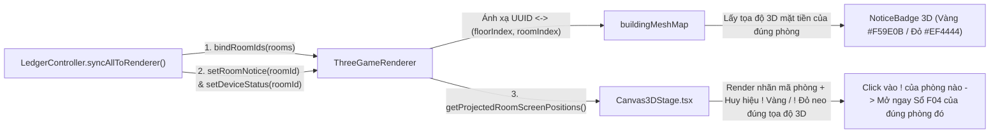

# ĐẶC TẢ KỸ THUẬT (SPEC): ĐỊNH VỊ CHÍNH XÁC BIỂU TƯỢNG TRẠNG THÁI (CHẤM THAN VÀNG / ĐỎ) TRÊN TỪNG PHÒNG CỦA TÒA NHÀ 3D

- **Mã tài liệu:** `QLNT-SPEC-P4-3D-ROOM-BADGES`
- **Ngày lập:** `2026-11-14`
- **Người lập:** BA Lead / Kiến trúc sư (Antigravity)
- **Phạm vi gói:** `packages/renderer-3d` (`@qlnt/renderer-3d`) & `apps/web` (`@qlnt/web`)
- **Trạng thái:** `Chờ chủ dự án duyệt (Confirmation Gate)`

---

## 1. Phân tích Nguyên nhân Gốc rễ (Root Cause Analysis)

Qua kiểm tra ảnh chụp thực tế [05-3d-stage-drawer-collapsed.png](file:///Users/minhntv/Documents/Work/MinhNTV/TEAM_ORCA/4.Du_an/QLNT/apps/web/e2e-results/screenshots/05-3d-stage-drawer-collapsed.png) và mã nguồn [threeGameRenderer.ts](file:///Users/minhntv/Documents/Work/MinhNTV/TEAM_ORCA/4.Du_an/QLNT/packages/renderer-3d/src/threeGameRenderer.ts#L180-L322), có **3 nguyên nhân kỹ thuật** khiến biểu tượng chấm than (`!`) bị gom chung vào 1 điểm duy nhất trên đỉnh tòa nhà thay vì nằm ở đúng từng phòng đang có vấn đề:

1. **Lệch định danh `roomId` giữa `LedgerController` và `ThreeGameRenderer`:**
   - Trong `ThreeGameRenderer.renderBuilding()`, các khối phòng 3D được gán `mesh.userData['roomId'] = 'room-1'..'room-12'`.
   - Trong khi đó, `LedgerController` gọi `renderer.setRoomNotice(room.id, notice)` và `renderer.setDeviceStatus(room.id, deviceId, 'BROKEN')` với `room.id` là UUID thực trong `IndexedDB` (`33333333-0000-4000-8000-000000000001`...).
   - Hệ quả: `ThreeGameRenderer` không tìm thấy khối phòng tương ứng với UUID đó.
2. **Tọa độ `NoticeBadge` đang bị hardcode cố định tại `{ x: 0, y: 2.2, z: 0 }` và `{ x: 0, y: 2.5, z: 0 }`:**
   - Tại dòng 286 (`setDeviceStatus`) và dòng 316 (`setRoomNotice`) của `threeGameRenderer.ts`, mọi `NoticeBadge` đều được khởi tạo tại tọa độ cố định `x = 0, z = 0` nên toàn bộ chấm than của 7 phòng đè chồng lên nhau tại duy nhất 1 vị trí.
3. **Hiện tượng khuất tầng (Vertical Occlusion) trong tòa nhà nhiều tầng:**
   - Nếu đặt chấm than phía trên nóc của phòng Tầng 1 (`y + 0.6, z = 0`), khối phòng của Tầng 2 nằm ngay phía trên sẽ che khuất chấm than của Tầng 1. Do đó, tọa độ neo (`Anchor Position`) của chấm than phải được đặt **nhô ra phía mặt tiền Isometric (`z = mesh.position.z + sz/2 + 0.42`)** của đúng khối phòng đó, đồng thời tách nhẹ trục `x` khi 1 phòng có cả 2 cảnh báo (Vàng + Đỏ).

---

## 2. Giải pháp Thiết kế Kỹ thuật & Trực quan

### 2.1. Tại `@qlnt/renderer-3d` (`threeGameRenderer.ts`)
1. **Ánh xạ danh sách phòng thực tế (`bindRoomIds`):**
   - Bổ sung phương thức `bindRoomIds(mappings: Array<{ roomId: string; floorIndex: number; roomIndex: number; roomNumber?: string }>): void`.
   - Khi `bindRoomIds` được gọi, mỗi `mesh` tại `(floorIndex, roomIndex)` được cập nhật `mesh.userData['roomId'] = roomId`, `mesh.userData['roomNumber'] = roomNumber`, đồng thời vẫn giữ `mesh.userData['legacyRoomId'] = 'room-...'` để tương thích 100% với các bài test cũ.
2. **Định vị chính xác `NoticeBadge` 3D tại mặt tiền từng phòng (`getRoomBadgeAnchor`):**
   - Tìm đúng `mesh` của `roomId`.
   - Tính tọa độ mặt tiền không bị tầng trên che khuất:
     - Với chấm than Vàng (`PAYMENT_DUE` / `BILL_PENDING`): `{ x: mesh.position.x - 0.16, y: mesh.position.y + 0.12, z: mesh.position.z + sz / 2 + 0.42 }`
     - Với chấm than Đỏ (`BROKEN`): `{ x: mesh.position.x + 0.16, y: mesh.position.y + 0.12, z: mesh.position.z + sz / 2 + 0.42 }`
   - Đổi màu vật liệu khối phòng tương ứng (`#ef4444` khi có thiết bị hỏng, `#f59e0b` khi chờ thu/chờ duyệt bill, và trả về `baseColor` của tầng khi đã xử lý xong).
   - Khi `renderBuilding` chạy lại hoặc trạng thái thay đổi, tự động cập nhật lại vị trí neo của toàn bộ `badges`.
3. **Chiếu tọa độ 3D của từng phòng ra màn hình 2D (`getProjectedRoomPositions`):**
   - Cung cấp hàm `getProjectedRoomPositions(viewportWidth: number, viewportHeight: number)` sử dụng `THREE.Vector3.project(this.camera)` để trả về tọa độ `(x, y)` chính xác trên `<canvas>` của từng phòng (tự động cập nhật khi người dùng kéo xoay `orbitCamera` hoặc `zoomCamera`).

### 2.2. Tại `@qlnt/web` (`ledgerController.ts` & `Canvas3DStage.tsx`)
1. **Đồng bộ ánh xạ phòng trong `LedgerController.syncAllToRenderer()`:**
   - Sau khi gọi `this.renderer.renderBuilding(...)`, nếu `this.renderer` có phương thức `bindRoomIds` (kiểm tra duck-typing an toàn mà không cần sửa `IGameRenderer` trong `@qlnt/shared-types`), truyền danh sách `{ roomId: room.id, floorIndex: room.floor_number - 1, roomIndex, roomNumber: room.room_number }` trước khi gọi `setRoomNotice` và `setDeviceStatus`.
2. **Hiển thị Huy hiệu Trạng thái (`!`) neo trực tiếp trên từng phòng 3D tại `Canvas3DStage.tsx`:**
   - Kết hợp cả **NoticeBadge 3D trong WebGL** và **Lớp Huy hiệu 3D Pin sắc nét (`data-testid="building-3d-pin-${roomNumber}"`)** neo theo tọa độ chiếu 3D của từng phòng:
     - Hiển thị nhãn mã phòng nhỏ (`P101`..`P304`) trên từng khối phòng 3D.
     - Với phòng đang có vấn đề thanh toán (`PAYMENT_DUE` / `BILL_PENDING`): hiện huy hiệu chấm than vàng **`!`** (`data-testid="building-3d-yellow-badge-${roomNumber}"`) nhấp nháy ngay tại phòng đó; bấm vào sẽ mở **Sổ F04 — Trang 1 (Hóa đơn & Thu chi)** của đúng phòng đó.
     - Với phòng đang có thiết bị báo hỏng (`BROKEN`): hiện huy hiệu chấm than đỏ **`!`** (`data-testid="building-3d-red-badge-${roomNumber}"`) ngay tại phòng đó; bấm vào sẽ mở **Sổ F04 — Trang 2 (Thiết bị & Bảo trì)** của đúng phòng đó.
     - Khi chủ trọ duyệt bill hoặc hoàn tất sửa chữa thiết bị trong Sổ F04, chấm than tại phòng đó trên tòa nhà 3D **tự động biến mất ngay lập tức**.

---

## 3. Bảng Đánh giá Tác động (Impact Assessment Table)

> [!IMPORTANT]
> **0% thay đổi trong `packages/shared-types` (`common`)**, `packages/domain-core`, và `packages/renderer-2d`.

| STT | Hạng mục / File bị ảnh hưởng | Loại thay đổi | Mức độ ảnh hưởng | Chi tiết tác động |
| :--- | :--- | :---: | :---: | :--- |
| 1 | `packages/shared-types/**` (`common`) | **Không sửa** | `0%` | Giữ nguyên 100%. |
| 2 | `packages/renderer-3d/src/threeGameRenderer.ts` | **Cập nhật** | Thấp | Thêm `bindRoomIds()`, `getRoomBadgeAnchor()`, `getProjectedRoomPositions()`, sửa `setRoomNotice()` & `setDeviceStatus()` để đặt `NoticeBadge` vào đúng tọa độ 3D của từng phòng thay vì `(0, 2.5, 0)`. |
| 3 | `apps/web/src/bridge/ledgerController.ts` | **Cập nhật** | Thấp | Trong `syncAllToRenderer()`, gọi `bindRoomIds` để ánh xạ UUID của `this.rooms` vào đúng `(floorIndex, roomIndex)` trên mô hình 3D. |
| 4 | `apps/web/src/components/Canvas3DStage.tsx` | **Cập nhật** | Trung bình | Neo trực tiếp các huy hiệu trạng thái (`building-3d-pin-${roomNumber}`, `building-3d-yellow-badge-${roomNumber}`, `building-3d-red-badge-${roomNumber}`) tại đúng vị trí từng phòng trên tòa nhà 3D (tự cập nhật khi xoay/zoom camera) và mở đúng trang Sổ F04 khi click. |
| 5 | `packages/renderer-3d/tests/threeGameRenderer.test.ts`, `apps/web/tests/uiAndResponsive.test.ts`, `apps/web/e2e/p1-flows.spec.ts` | **Bổ sung** | Thấp | Kiểm thử tọa độ `NoticeBadge` của từng phòng khác nhau (`P101 !== P204 !== P302`), và kiểm thử E2E click trực tiếp vào chấm than trên từng phòng 3D để mở đúng Sổ F04. |
