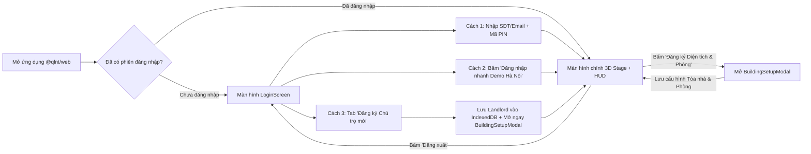

# ĐẶC TẢ KỸ THUẬT & NGHIỆP VỤ (SPEC): MÀN HÌNH ĐĂNG NHẬP & CHỨC NĂNG ĐĂNG KÝ DIỆN TÍCH, SỐ PHÒNG TÒA NHÀ (`@qlnt/web`)

- **Mã tài liệu:** `QLNT-SPEC-P4-AUTH-BUILDING`
- **Ngày lập:** `2026-11-14`
- **Người lập:** BA Lead / Kiến trúc sư (Antigravity)
- **Phạm vi gói:** `apps/web` (`@qlnt/web` — kết nối `@qlnt/domain-core`, `@qlnt/renderer-2d`, `@qlnt/renderer-3d`)
- **Trạng thái:** `Chờ chủ dự án duyệt (Confirmation Gate)`
- **Căn cứ truy nguồn:**
  - `02-nghiep-vu/THIET_KE_UX_FLOW_VA_MOBILE_P1.md` (Mục 1.1: Wizard Khởi tạo Tòa nhà & Mẫu diện tích phòng `20m² / 25m² / 35m²`, `TC-P1-01`).
  - `01-quan-ly/SO_QUYET_DINH.md` (`QLNT-D014` `$0 First`, `QLNT-D015` `Single-Page 3 trang`, `QLNT-D016` `100% Thư viện cục bộ / Offline-First`).
  - `packages/shared-types/src/entities/{landlord.ts,property.ts,room.ts}`.

---

## 1. Mục tiêu (Goals)

Bổ sung vào ứng dụng `@qlnt/web` hai cụm tính năng cốt lõi phục vụ luồng Onboarding & Quản lý Tòa nhà của Chủ trọ:

1. **Màn hình Đăng nhập & Đăng ký Chủ trọ (`LoginScreen.tsx`):**
   - Cho phép Chủ trọ đăng nhập bằng **Số điện thoại / Email + Mã PIN cục bộ** (đối chiếu 100% trên `IndexedDB` + lưu phiên tại `localStorage`, không gọi API bên thứ ba theo `QLNT-D016`).
   - Hỗ trợ nút **"⚡ Đăng nhập nhanh Chủ trọ Demo Hà Nội (12 phòng)"** chỉ với 1 chạm để phục vụ kiểm thử nhanh.
   - Hỗ trợ tab **"Đăng ký Chủ trọ mới"** (Họ tên, SĐT chuẩn VN, Email, Mã PIN, Gói `FREE`/`PRO`) — sau khi tạo tài khoản sẽ mở thẳng sang bước **Đăng ký Diện tích & Số phòng của Tòa nhà**.
   - Hỗ trợ nút **"Đăng xuất / Đổi tài khoản"** ngay trên thanh HUD chính.

2. **Chức năng Đăng ký Diện tích & Số phòng của Tòa nhà (`BuildingSetupModal.tsx`):**
   - Cho phép Chủ trọ khởi tạo mới hoặc cấu hình lại tòa nhà hiện tại:
     - **Thông tin Tòa nhà (`Property`):** Tên tòa nhà, Địa chỉ, Đơn giá điện (`đ/kWh`), Đơn giá nước (`đ/m³` hoặc `đ/người`), Phương thức tính nước (`PER_M3` | `PER_PERSON`), Phí dịch vụ chung (`đ/tháng`).
     - **Quy mô Số tầng & Số phòng:**
       - Chọn **Số tầng (`total_floors`)**: từ `1` đến `6` tầng.
       - Chọn **Số phòng mỗi tầng (`roomsPerFloor`)**: từ `1` đến `8` phòng/tầng (tự động sinh mã phòng `P101..P{tầng}0{số}`).
     - **Đăng ký Diện tích phòng (`area_sqm`) & Giá thuê cơ bản (`base_price`):**
       - **Chọn nhanh 3 mẫu diện tích chuẩn Việt Nam (`Preset` theo Mục 1.1 tài liệu UX P1):**
         1. **Phòng đơn tiêu chuẩn:** `20 m²` — Giá gợi ý `3.200.000 đ/tháng`
         2. **Phòng Gác lửng:** `25 m²` — Giá gợi ý `4.000.000 đ/tháng`
         3. **Studio Chung cư mini (CCMN):** `35 m²` — Giá gợi ý `5.200.000 đ/tháng`
       - **Nhập diện tích & giá thuê mặc định tùy chỉnh** và bấm **"Áp dụng cho toàn bộ phòng"** hoặc **"Áp dụng theo từng tầng"**.
       - **Bảng tinh chỉnh chi tiết từng phòng:** Cho phép sửa riêng diện tích (`area_sqm` từ `10` đến `150 m²`), giá thuê (`base_price`), tiền cọc (`deposit_amount`) và trạng thái (`EMPTY` | `RENTED` | `MAINTENANCE`) của từng phòng cụ thể.
       - **Thẻ tổng hợp quy mô tòa nhà theo thời gian thực:**
         - Tổng số tầng (`totalFloors`)
         - Tổng số phòng (`totalRooms`)
         - **Tổng diện tích sàn cho thuê (`totalAreaSqm = Σ area_sqm`)** & diện tích trung bình/phòng
         - Tổng doanh thu cơ bản dự kiến/tháng (`Σ base_price`)
   - **Đồng bộ tức thì xuống IndexedDB, Cảnh 3D Isometric & Sổ 2D F04:**
     - Lưu `Property` + danh sách `Room[]` + bản ghi `RoomAuditLog` vào `IndexedDB` (`@qlnt/domain-core`).
     - Tự động gọi `ThreeGameRenderer.renderBuilding({ propertyId, totalFloors, roomsPerFloor })` để dựng lại khối tòa nhà 3D đúng số tầng & số phòng vừa đăng ký.
     - Hiển thị rõ **diện tích (`XX m²`)** và **giá phòng** trên từng ô phòng ở Cảnh 3D Stage (`Canvas3DStage.tsx`) và trong Sổ Quản Lý F04 (`LedgerOverlayHost.tsx`).

---

## 2. Bảng Đánh giá Tác động (Impact Assessment Table)

> [!IMPORTANT]
> Cam kết tuân thủ quy tắc `user_global`: **Không sửa đổi bất kỳ dòng code nào trong `packages/shared-types` (`common`)**, `packages/domain-core`, `packages/renderer-2d`, và `packages/renderer-3d`. Toàn bộ thay đổi chỉ nằm trong phạm vi `apps/web`.

| STT | Hạng mục / File bị ảnh hưởng | Loại thay đổi | Mức độ ảnh hưởng | Chi tiết tác động & Lý do |
| :--- | :--- | :---: | :---: | :--- |
| 1 | `packages/shared-types/**` (`common`) | **Không sửa** | `0%` (An toàn tuyệt đối) | Các entity `Landlord`, `Property`, `Room` (`area_sqm`, `total_floors`, `base_price`...) đã đáp ứng 100% nhu cầu nghiệp vụ. |
| 2 | `packages/domain-core/**` | **Không sửa** | `0%` | Bảng `db.landlords`, `db.properties`, `db.rooms`, `db.room_audit_logs` trong `Dexie.js` đã hỗ trợ đầy đủ CRUD giao dịch cục bộ. |
| 3 | `packages/renderer-2d/**` & `packages/renderer-3d/**` | **Không sửa** | `0%` | `VirtualLedgerBook` đã nhận prop `totalFloors: number`, `ThreeGameRenderer.renderBuilding` đã nhận `totalFloors` và `roomsPerFloor`. |
| 4 | `apps/web/src/components/LoginScreen.tsx` | **Tạo mới** | Thấp (Độc lập) | Giao diện Đăng nhập Chủ trọ, Đăng nhập nhanh Demo Hà Nội (1 chạm) và Đăng ký Chủ trọ mới (Local-First). |
| 5 | `apps/web/src/components/BuildingSetupModal.tsx` | **Tạo mới** | Thấp (Độc lập) | Giao diện Wizard/Modal Đăng ký tòa nhà, cấu hình số tầng, số phòng, chọn mẫu diện tích (`20m²/25m²/35m²`) và chỉnh diện tích từng phòng. |
| 6 | `apps/web/src/bridge/ledgerController.ts` | **Cập nhật** | Trung bình | Thêm các hàm `loginLandlord`, `loginDemoLandlord`, `registerLandlord`, `logoutLandlord`, `registerOrUpdateBuilding`, và bỏ hardcode `roomsPerFloor: 4` trong `syncAllToRenderer()`. |
| 7 | `apps/web/src/bridge/useRendererBridge.ts` | **Cập nhật** | Trung bình | Expose trạng thái phiên đăng nhập (`currentLandlord`, `isAuthenticated`), thông tin `property` (`totalFloors`, `totalAreaSqm`), và các hàm điều khiển Login / Building Setup. |
| 8 | `apps/web/src/components/Canvas3DStage.tsx` & `LedgerOverlayHost.tsx` | **Cập nhật** | Thấp | Bỏ hardcode `floors = [3, 2, 1]` và `totalFloors={3}` sang dùng `totalFloors` động từ `Property`; hiển thị thêm nhãn diện tích (`{room.area_sqm} m²`) trên thẻ phòng. |
| 9 | `apps/web/src/App.tsx` | **Cập nhật** | Trung bình | Tích hợp `LoginScreen`, `BuildingSetupModal`, thêm thống kê Tổng diện tích (`m²`) và nút **"Đăng ký Diện tích & Phòng"** / **"Đăng xuất"** trên thanh HUD. |
| 10 | `apps/web/tests/*.test.ts` & `apps/web/e2e/p1-flows.spec.ts` | **Cập nhật & Bổ sung** | Thấp | Giữ nguyên 100% các test hiện hữu và bổ sung bộ Unit Test + Playwright E2E cho luồng Đăng nhập & Đăng ký diện tích/số phòng tòa nhà. |

---

## 3. Thiết kế Chi tiết Luồng Nghiệp vụ & Dữ liệu

### 3.1. Luồng Đăng nhập & Quản lý Phiên Chủ trọ (`LoginScreen.tsx`)



- **Quy tắc lưu trữ phiên cục bộ (`Local-First Auth`):**
  - Kho khóa `localStorage`:
    - `qlnt_auth_session_v1`: JSON `{ landlordId: string, loggedInAt: string }`
    - `qlnt_landlord_pins_v1`: JSON `Record<string, string>` ánh xạ `landlordId -> pin` (mặc định tài khoản Seed `SEED_LANDLORD_ID` có SĐT `0988123456`, Email `minhanh.nhatro@qlnt.local`, PIN `123456`).
  - Ràng buộc kiểm tra hợp lệ (Validation):
    - Họ tên chủ trọ: tối thiểu `2` ký tự.
    - Số điện thoại: định dạng SĐT Việt Nam (`/^0\d{9}$/`, 10 chữ số bắt đầu bằng `0`).
    - Mã PIN: `4`–`8` ký tự.

### 3.2. Luồng Đăng ký Diện tích & Số phòng của Tòa nhà (`BuildingSetupModal.tsx`)

- **Cấu trúc dữ liệu đầu vào (`BuildingRegistrationInput`):**
  ```ts
  export interface RoomSetupDraft {
    roomNumber: string;
    floorNumber: number;
    areaSqm: number;
    basePrice: number;
    depositAmount?: number;
    status?: Room['status'];
  }

  export interface BuildingRegistrationInput {
    propertyName: string;
    address: string;
    totalFloors: number;
    roomsPerFloor: number;
    waterCalcMethod: 'PER_M3' | 'PER_PERSON';
    electricUnitPrice: number;
    waterUnitPrice: number;
    serviceFee: number;
    roomsDraft: RoomSetupDraft[];
  }
  ```
- **Bộ Mẫu diện tích chuẩn (`BUILDING_AREA_PRESETS`):**
  1. `STANDARD_20`: `{ id: 'STANDARD_20', label: 'Phòng đơn tiêu chuẩn (20 m²)', areaSqm: 20, basePrice: 3200000 }`
  2. `MEZZANINE_25`: `{ id: 'MEZZANINE_25', label: 'Phòng có gác lửng (25 m²)', areaSqm: 25, basePrice: 4000000 }`
  3. `STUDIO_35`: `{ id: 'STUDIO_35', label: 'Studio CCMN (35 m²)', areaSqm: 35, basePrice: 5200000 }`
- **Quy tắc sinh & bảo toàn dữ liệu phòng khi cập nhật tòa nhà:**
  - Tự động sinh danh sách phòng theo `totalFloors` (1..6) × `roomsPerFloor` (1..8) với mã phòng chuẩn `P{tầng}{số thứ tự 2 chữ số}` (VD: Tầng 1 có 5 phòng -> `P101`..`P105`; Tầng 2 -> `P201`..`P205`).
  - Nếu phòng trùng `room_number` với phòng đã có trong tòa nhà hiện tại, hệ thống giữ nguyên `id` phòng (và các hợp đồng/hóa đơn/khách thuê gắn với phòng đó) đồng thời cập nhật `area_sqm`, `base_price`, `floor_number` mới; nếu là phòng mới thì khởi tạo `Room` mới cùng bộ 5 thiết bị tiêu chuẩn (`Điều hòa Inverter`, `Bình nóng lạnh`, `Giường gỗ 1m6`, `Tủ quần áo 2 cánh`, `Công tơ điện nước`).
  - Ghi nhận sự kiện vào `room_audit_logs` với nội dung rõ ràng: `"Cập nhật cấu hình tòa nhà: {totalFloors} tầng, {totalRooms} phòng, tổng diện tích {totalAreaSqm} m²"`.

---

## 4. Tiêu chí Nghiệm thu (Acceptance Criteria)

- **AC-AUTH-01:** Người dùng có thể đăng nhập bằng SĐT `0988123456` + PIN `123456`, hoặc bấm **"⚡ Đăng nhập nhanh Chủ trọ Demo Hà Nội"**, hoặc đăng ký Chủ trọ mới hoàn toàn offline (`0` request mạng ngoài).
- **AC-AUTH-02:** Người dùng có thể bấm **"Đăng xuất"** trên thanh HUD để quay về màn hình `LoginScreen`, và đăng nhập lại bất kỳ lúc nào.
- **AC-BLD-01:** Người dùng mở **"Đăng ký Diện tích & Phòng"**, chọn số tầng (VD: `4` tầng), số phòng/tầng (VD: `3` phòng/tầng = `12` phòng), chọn mẫu diện tích (`25 m²` hoặc sửa riêng từng phòng như `P101 = 28 m²`, `P102 = 32 m²`), bấm Lưu -> Dữ liệu được lưu vào `IndexedDB`.
- **AC-BLD-02:** Ngay sau khi Lưu cấu hình tòa nhà, Cảnh 3D Stage (`Canvas3DStage`) và Sổ Quản Lý F04 (`VirtualLedgerBook`) tự động cập nhật đúng số tầng, số phòng và hiển thị đúng diện tích (`m²`) của từng phòng vừa đăng ký.
- **AC-QA-01:** Toàn bộ nút bấm trong `LoginScreen` và `BuildingSetupModal` có `min-height >= 44px`, hiển thị tốt trên cả Desktop và Mobile `390x844` (không tràn ngang), vượt qua 100% Unit Tests (Vitest) và E2E Tests (Playwright Chrome).
