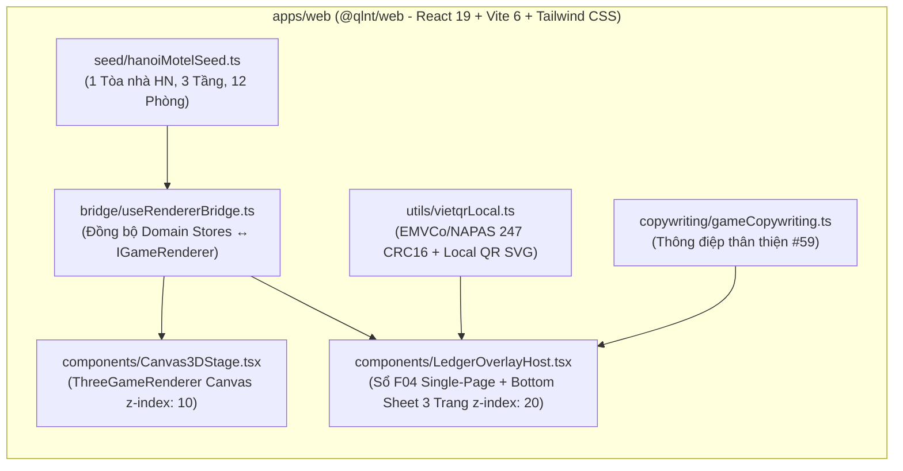

# Đặc tả Kỹ thuật & Nghiệp vụ Pha 4: Ứng dụng Web Host (`@qlnt/web`), VietQR Offline & Sổ Quản lý Ảo F04 Single-Page (Prototype P1)

- **Mã tài liệu:** `SPEC-PHASE4-WEB-001`
- **Dự án:** Quản lý nhà trọ (QLNT)
- **Phạm vi:** Pha 4 (`apps/web`) — Tích hợp các Issues Sprint 2: `#54`, `#56`, `#59`, `#60`, `#61`, `#62`, `#63`, `#64`
- **Ngày lập:** `2026-11-14`
- **Trạng thái:** `Dự thảo — Chờ Chủ dự án phê duyệt (Confirmation Gate)`
- **Căn cứ tham chiếu:**
  - Quyết định kiến trúc & hạ tầng: [`DECISIONS.md`](DECISIONS.md) (`QLNT-D008` → `QLNT-D016`, đặc biệt `QLNT-D014` `$0 First` và `QLNT-D016` `100% Thư viện cục bộ / VietQR offline`)
  - Kế hoạch Sprint 2: [`KE_HOACH_SPRINT_2_PROTOTYPE_P1.md`](KE_HOACH_SPRINT_2_PROTOTYPE_P1.md)
  - Kế hoạch tổng thể: [`implementation_plan.md`](implementation_plan.md)
  - Đặc tả Sổ quản lý ảo & Renderer: [`../02-nghiep-vu/DAC_TA_SO_QUAN_LY_AO_SINGLE_PAGE_VA_RENDERER.md`](../02-nghiep-vu/DAC_TA_SO_QUAN_LY_AO_SINGLE_PAGE_VA_RENDERER.md)
  - Thiết kế UX Flow & Mobile P1: [`../02-nghiep-vu/THIET_KE_UX_FLOW_VA_MOBILE_P1.md`](../02-nghiep-vu/THIET_KE_UX_FLOW_VA_MOBILE_P1.md)
  - Ma trận truy vết 21 AC: [`../02-nghiep-vu/MA_TRAN_TRUY_VET_P1.md`](../02-nghiep-vu/MA_TRAN_TRUY_VET_P1.md)

---

## 1. Mục tiêu & Phạm vi Đặc tả

Xây dựng ứng dụng **`apps/web` (`@qlnt/web`)** đóng vai trò **Host Orchestrator** ghép nối 4 package đã hoàn thành ở Pha 1–3 (`@qlnt/shared-types`, `@qlnt/domain-core`, `@qlnt/renderer-2d`, `@qlnt/renderer-3d`) thành bản **Prototype P1 hoàn chỉnh chạy thực tế trên trình duyệt Desktop & Mobile (`390x844`)**.

### Ràng buộc Cứng (`Hard Constraints`):
1. **Không sửa đổi `common` (`@qlnt/shared-types`):** Giữ nguyên 100% các Entity Interfaces, DTOs và hợp đồng `IGameRenderer`.
2. **100% Local-First & Không kết nối Bên thứ 3 (`QLNT-D014`, `QLNT-D016`):**
   - Toàn bộ dữ liệu lưu trữ trong `IndexedDB` (`Dexie.js`) trên trình duyệt người dùng.
   - Mã **VietQR chuẩn EMVCo / NAPAS 247** được sinh hoàn toàn bằng thuật toán cục bộ (TLV payload + CRC16-CCITT `0xFFFF` polynomial `0x1021`) và render thành SVG ngay trên client — tuyệt đối không gọi `img.vietqr.io` hay bất kỳ API ngân hàng/đám mây nào.
   - Ảnh chụp chứng từ chuyển khoản (bill) được chuyển thành DataURL/Blob cục bộ và lưu trực tiếp trong `IndexedDB`.
3. **Chuẩn Hiển thị Hybrid & Mobile-First (`390x844`):**
   - Tầng đáy (`z-index: 10`): Canvas WebGL chạy `ThreeGameRenderer` (góc nhìn Orthographic Isometric cố định `45°` azimuth, `35.264°` elevation) hiển thị tòa nhà 3 tầng, nhân vật và các biểu tượng cảnh báo nổi (**Chấm than vàng `#F59E0B`** nhắc tiền/chờ duyệt bill, **Chấm than đỏ `#EF4444`** báo hỏng thiết bị).
   - Tầng trên (`z-index: 20`): DOM Overlay hiển thị thanh HUD, bộ lọc trạng thái và **Sổ Quản lý Ảo F04 chế độ `Single-Page`** (Mặt bằng tầng 2D SVG + Tờ chi tiết phòng 3 trang).
   - Mọi nút bấm và ô phòng tương tác đạt kích thước vùng chạm tối thiểu **`44x44px`**.

---

## 2. Kiến trúc Thành phần trong `apps/web`

---

## 3. Đặc tả Chi tiết Các Phân hệ Nghiệp vụ

### 3.1. Bộ Dữ liệu Mẫu Chuẩn Hà Nội (`hanoiMotelSeed.ts` — Issue `#56`)
- **Tòa nhà mẫu:** `"Nhà trọ Hạnh Phúc — Ngõ 133 Xuân Thủy, Cầu Giấy, Hà Nội"`, gồm **3 tầng, 12 phòng (`P101`–`P104`, `P201`–`P204`, `P301`–`P304`)**.
- **Phân bổ trạng thái thực tế để kiểm thử đủ 21 AC:**
  - **8 phòng đang ở (`OCCUPIED`):** Có hợp đồng hiệu lực, khách thuê (sinh viên/người đi làm), chỉ số điện/nước tháng `2026-11`:
    - 3 phòng đang chờ thu tiền (`UNPAID` → hiển thị **Chấm than vàng `PAYMENT_DUE`**).
    - 2 phòng khách đã tải ảnh bill chờ chủ trọ duyệt (`PENDING_VERIFY` → hiển thị **Chấm than vàng `BILL_PENDING`**).
    - 3 phòng đã thanh toán đủ (`PAID` → không có cảnh báo tiền).
  - **2 phòng có thiết bị báo hỏng (`MAINTENANCE` / `BROKEN`):** Có yêu cầu sửa chữa điều hòa/bình nóng lạnh chưa hoàn tất → hiển thị **Chấm than đỏ**.
  - **1 phòng đang giữ cọc (`DEPOSIT_LOCKED`):** Có thông tin khách đặt cọc chờ ngày vào ở.
  - **1 phòng trống (`VACANT`):** Sẵn sàng đón khách mới.
- **Đơn giá mẫu chuẩn Hà Nội:** Điện `3.800 đ/kWh`, Nước `30.000 đ/m³` (hoặc `100.000 đ/người/tháng`), Dịch vụ chung (rác, mạng, vệ sinh) `150.000 đ/phòng`.

### 3.2. Bộ Sinh Mã VietQR Offline Cục bộ (`vietqrLocal.ts` — `QLNT-D016`, Issue `#64`)
- Đóng gói chuỗi payload chuẩn **EMVCo / NAPAS 247**:
  - `ID 00`: Payload Format Indicator (`01`)
  - `ID 01`: Point of Initiation Method (`12` - Dynamic QR)
  - `ID 38`: Merchant Account Information (GUID `A000000727`, mã BIN ngân hàng nhận, số tài khoản, dịch vụ `QRIBFTTA`)
  - `ID 53`: Transaction Currency (`704` - VND)
  - `ID 54`: Transaction Amount (số tiền chính xác từ hóa đơn)
  - `ID 58`: Country Code (`VN`)
  - `ID 62`: Additional Data Field Template (nội dung chuyển khoản: `QLNT P101 T11`)
  - `ID 63`: CRC16-CCITT (`0xFFFF`, đa thức `0x1021`, 4 ký tự Hex in hoa).
- Kết xuất trực tiếp chuỗi EMVCo thành hình ảnh **SVG QR Code sắc nét ngay trong trình duyệt** bằng ma trận QR cục bộ (không gọi mạng ngoài).

### 3.3. Bộ Văn bản Giao tiếp Thân thiện trong Game (`gameCopywriting.ts` — Issue `#59`)
- Chuẩn hóa ngôn từ ấm áp, tôn trọng khách thuê, mang âm hưởng trò chơi mô phỏng quản lý:
  - **Nhắc tiền phòng (`PAYMENT_DUE`):** *"Ting! Hóa đơn tháng 11 của phòng {room} đã sẵn sàng ({amount} đ). Nhờ bạn kiểm tra chỉ số điện nước và quét mã VietQR khi thuận tiện nhé!"*
  - **Chờ duyệt bill (`BILL_PENDING`):** *"Khách phòng {room} vừa gửi ảnh biên lai chuyển khoản. Chủ nhà kiểm tra và xác nhận 1 chạm để tặng điểm uy tín nhé!"*
  - **Duyệt bill thành công (`PAID`):** *"Tuyệt vời! Đã xác nhận thanh toán phòng {room}. Khách thuê nhận +2 điểm Sao Uy Tín!"*
  - **Báo hỏng & Bảo trì (`BROKEN` / `RESOLVED`):** Thông điệp ghi nhận sự cố tức thì và thông báo hoàn tất sửa chữa thiết bị.

### 3.4. Sổ Quản lý Ảo F04 Chế độ `Single-Page` & Luồng Tương tác 2 Cấp (`#60`, `#62`, `#63`, `#64`)
- **Tách bạch `Preview State` (Hiệu ứng/Form đang nhập) và `Commit State` (Dữ liệu thật trong `IndexedDB`):**
  - Khi người dùng đang nhập chỉ số điện/nước mới trên Trang 1, hệ thống tính toán tự động tổng tiền (`Preview State`) nhưng chưa ghi đè CSDL cho đến khi bấm **`Lưu chốt số & Tạo hóa đơn`** (`Commit State`).
- **Luồng 3 Trang trong Tờ Chi tiết Phòng (`RoomDetailSinglePage` & `InteractiveRoomDrawer`):**
  - **Trang 1 (`PAGE_1_BILLING` — Thu tiền & Điện nước):**
    - Nhập/cập nhật chỉ số điện mới, nước mới → tự động tính tổng tiền qua `calculateBilling`.
    - Hiển thị mã **VietQR SVG offline** kèm thông tin chuyển khoản.
    - Nút **`Tải ảnh Bill (Local)`** (chuyển file ảnh/giả lập biên lai thành DataURL lưu cục bộ, chuyển trạng thái sang `PENDING_VERIFY`).
    - Nút **`Duyệt Bill 1 Chạm`** dành cho Chủ trọ → gọi `verifyPayment`, chuyển hóa đơn sang `PAID`, ghi `RoomAuditLog` (`BILL_PAID`), cộng điểm uy tín qua `calculateReputationDelta` và **tắt ngay Chấm than vàng trên cả Mặt bằng 2D lẫn Cảnh 3D**.
  - **Trang 2 (`PAGE_2_DEVICES` — Thiết bị & Bảo trì):**
    - Hiển thị danh mục thiết bị trong phòng (Điều hòa, Bình nóng lạnh, Giường, Tủ, Công tơ...).
    - Nút **`Báo hỏng`** → chuyển thiết bị sang `isBroken = true`, bật **Chấm than đỏ** trên phòng, ghi `RoomAuditLog`.
    - Nút **`Hoàn tất sửa chữa`** → chuyển thiết bị về bình thường, **tắt Chấm than đỏ**, ghi lịch sử bảo trì.
  - **Trang 3 (`PAGE_3_AUDIT` — Lịch sử Biến động & Sao Uy Tín):**
    - Hiển thị điểm **Sao Uy Tín** hiện tại của khách thuê kèm huy hiệu `RewardBadgeSVG`.
    - Hiển thị dòng thời gian bất biến (`RoomAuditLog` append-only) của phòng theo thứ tự mới nhất lên đầu.
- **Cơ chế Đóng 2 Cấp (`QLNT-D012`):**
  - **Đóng cấp 1 (`×` trên tờ chi tiết phòng):** Đóng tờ chi tiết phòng, quay về **Mặt bằng tầng 2D** của tầng hiện tại.
  - **Đóng cấp 2 (`Gập Sổ (3D)`):** Gập cuốn Sổ F04, đưa camera trở về toàn cảnh **Tòa nhà 3D Isometric**.
