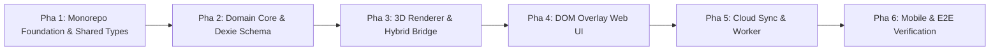

# Kế hoạch Triển khai Chi tiết Kiến trúc & Hạ tầng QLNT (Implementation Plan)

> **Kế hoạch Thực thi Kỹ thuật & Hạ tầng (Technical Implementation Plan)**  
> **Mã kế hoạch:** `PLAN-IMPL-001`  
> **Dự án:** Quản lý nhà trọ (QLNT)  
> **Phiên bản:** `1.0.0`  
> **Tài liệu đặc tả cơ sở:** [`spec.md`](spec.md) (`SPEC-ARCH-DEPLOY-001`)  
> **Quy trình áp dụng:** Tuân thủ nghiêm ngặt `/superpowers:writing-plans` và `/superpowers:subagent-driven-development`  
> **Ngày lập:** 2026-11-13  
> **Trạng thái:** **`Đang thực thi — Pha 1, Pha 2, Pha 3 & Pha 4 (@qlnt/web Prototype P1) đã hoàn thành 100% (PASS)`**  
> **Căn cứ tham chiếu:**
> - Quy tắc cốt lõi: [`../../../3.DOC_AI/quan-tri/RULES_CORE.md`](../../../3.DOC_AI/quan-tri/RULES_CORE.md)
> - Các quyết định phê duyệt: [`DECISIONS.md`](DECISIONS.md) (`QLNT-D001` .. `QLNT-D014`)
> - Chuẩn hóa kỹ thuật: [`../03-ky-thuat/DANH_SACH_CAI_THIEN_VA_CHUAN_HOA_KY_THUAT.md`](../03-ky-thuat/DANH_SACH_CAI_THIEN_VA_CHUAN_HOA_KY_THUAT.md) (`TECH-STD-001`)
> - Hồ sơ kỹ thuật hệ thống: [`../03-ky-thuat/TECH_PROFILE.md`](../03-ky-thuat/TECH_PROFILE.md)
> - Đặc tả kiến trúc monorepo: [`../03-ky-thuat/KIEN_TRUC_MONOREPO_CODEBASE.md`](../03-ky-thuat/KIEN_TRUC_MONOREPO_CODEBASE.md) (`TECH-ARCH-001`)
> - Thiết kế hạ tầng & pipeline $0/tháng: [`../04-van-hanh/HA_TANG_VA_DEPLOYMENT_PIPELINE.md`](../04-van-hanh/HA_TANG_VA_DEPLOYMENT_PIPELINE.md)
> - Hồ sơ hạ tầng & vận hành: [`../04-van-hanh/HA_TANG_VA_VAN_HANH_HE_THONG.md`](../04-van-hanh/HA_TANG_VA_VAN_HANH_HE_THONG.md) (`QLNT-D014`)

---

## 1. Mục tiêu & Tổng quan Kiến trúc Kế hoạch (Goal & Architecture Overview)

Kế hoạch này vạch ra lộ trình thực thi từng bước nhằm thiết lập toàn bộ cấu trúc Monorepo, mã nguồn cốt lõi và hạ tầng triển khai 3 môi trường cho dự án QLNT. 

### 1.1. Mục tiêu Cốt lõi
1. Xây dựng nền móng Monorepo chuẩn mực (`pnpm workspaces` + `Turborepo` + `TypeScript Project References`).
2. Hiện thực hóa kiến trúc phân tầng Clean Architecture theo nguyên tắc `NT-01` (Tách rời Lớp Game và Lớp Dữ liệu Thật).
3. Triển khai kiến trúc hiển thị `Hybrid WebGL 3D + DOM Overlay` cho Sổ Quản lý Ảo F04 Single-Page (`QLNT-D010` .. `QLNT-D013`).
4. Thiết lập hệ thống lưu trữ Local-First với Dexie.js (IndexedDB) và hàng đợi Outbox Mutation đồng bộ ngầm lên Supabase Free PostgreSQL 16 có Row-Level Security.
5. Triển khai giải pháp bảo mật dữ liệu nhạy cảm qua Cloudflare Worker Edge Function cấp Signed URL 15 phút cho Private Bucket Cloudflare R2 ($0 băng thông egress theo `QLNT-D014`).
6. Đóng gói ứng dụng di động native Android / iOS từ cùng một codebase thông qua Capacitor 6.

### 1.2. Rà soát Lịch sử Git (Git History Audit)
Theo quy tắc bắt buộc: *"Luôn rà soát lịch sử git xem những thay đổi trước đó đã được thực hiện hay chưa"*:
- Kết quả kiểm tra lịch sử Git gần nhất tại repo `4.Du_an/QLNT` (commit `df2c1d4`, `c9f6080`, `f6e4d43`, `0beaf49`, `c09eef1`, `1af06da`):
  - Toàn bộ các tài liệu đặc tả nghiệp vụ (`02-nghiep-vu/`), hồ sơ quyết định kiến trúc (`01-quan-ly/DECISIONS.md`), hồ sơ chuẩn hóa kỹ thuật (`03-ky-thuat/TECH-STD-001`), và quy chế vận hành hạ tầng $0/tháng (`04-van-hanh/QLNT-D014`) đã được hoàn tất và commit đầy đủ.
  - Mã nguồn thực thi (codebase) chưa được khởi tạo. Kế hoạch này là bước khởi đầu trực tiếp để chuyển đổi từ tài liệu thiết kế sang mã nguồn phần mềm.

---

## 2. Bảng Đánh giá Tác động Toàn diện (User Rule Impact Assessment Table)

Tuân thủ nghiêm ngặt quy tắc: *"Trước khi xử lý một request, đánh giá xem những thay đổi trong plan sẽ ảnh hưởng tới những phần nào, và lập bảng đánh giá cho từng mục"*:

| Phân hệ / Khu vực | Hiện trạng | Thay đổi đề xuất trong Plan | Mức độ Tác động | Biện pháp Cô lập & Giảm thiểu Rủi ro |
| :--- | :--- | :--- | :--- | :--- |
| **Phần dùng chung (`common` / `@qlnt/shared-types`)** | Chưa có mã nguồn; chỉ có đặc tả trong `TECH-STD-001`. | Khởi tạo package `@qlnt/shared-types` chứa 10 Entity Interfaces, Vector3D, DTOs và Hợp đồng `IGameRenderer`. | **Cao** *(Toàn bộ hệ thống phụ thuộc vào types này)* | **Tuân thủ quy tắc Hạn chế sửa common:** Đóng gói `@qlnt/shared-types` là Pure TypeScript, **0 dependencies**. Mọi thay đổi trường dữ liệu sau khi khởi tạo đều phải có biên bản đề xuất xác nhận trước khi sửa. |
| **Nghiệp vụ Lõi (`@qlnt/domain-core`)** | Chưa có mã nguồn. | Cài đặt Dexie.js Schema 10 bảng + `outbox_mutations`, Zustand Stores, công cụ tính tiền phòng/điện nước, ghi nhật ký bất biến `RoomAuditLog` (`NT-03`). | **Trung bình** *(Chỉ phụ thuộc `shared-types`)* | Tách biệt hoàn toàn với UI và Three.js canvas. Toàn bộ logic được kiểm thử tự động 100% bằng Vitest độc lập với trình duyệt. |
| **Renderer 3D (`@qlnt/renderer-3d`)** | Chưa có mã nguồn. | Cài đặt Three.js Scene, Camera Orthographic Isometric cố định, hình khối MVP P1, mesh Sổ F04 và hoạt ảnh mở/gập bìa sổ, icon chấm than vàng/đỏ. | **Thấp** *(Độc lập, chỉ implement `IGameRenderer`)* | Chỉ phụ thuộc `@qlnt/shared-types`. Không được phép import `domain-core` hay logic CSDL. |
| **Giao diện Web (`apps/web`)** | Chưa có mã nguồn. | Cài đặt React 19 + Vite 6 + Tailwind v4, Mặt bằng tầng 2D SVG, Sổ F04 Single-Page 3 trang, Form in-place edit tiếng Việt, `useRendererBridge`. | **Trung bình** *(Tầng Host Orchestrator)* | Sử dụng React 19 Actions và Component phân rã nhỏ; DOM Overlay đặt trên canvas (`z-index: 20`) không can thiệp luồng vẽ WebGL. |
| **Vỏ bọc Di động (`apps/mobile`)** | Chưa có mã nguồn. | Cài đặt Capacitor 6, cấu hình quyền Camera native và Network status watcher, kết nối trực tiếp bản build `apps/web/dist`. | **Thấp** *(Vỏ bọc đóng gói)* | 1 codebase duy nhất, không nhân bản mã nguồn; cấu hình Android/iOS tuân thủ nghiêm ngặt bảo mật quyền riêng tư. |
| **Hạ tầng Cục bộ (`infra/docker`)** | Chưa có cấu hình. | Thiết lập `docker-compose.local.yml` chạy Postgres 16 Alpine và MinIO S3 API mock Private Bucket. | **Thấp** *(Chỉ dùng cho Local Dev)* | Cô lập hoàn toàn trên máy trạm cá nhân, không mở cổng công khai ra internet. |
| **Hạ tầng Đám mây & CI/CD (`infra/` & `.github/`)** | Chưa có cấu hình. | Thiết lập GitHub Actions CI/CD staging, Supabase SQL migrations (10 bảng + RLS `landlord_id`), Edge Worker Presigner 15 phút cho Cloudflare R2. | **Cao** *(Ràng buộc bảo mật & chi phí $0)* | 100% tài nguyên dùng Free Tier; bắt buộc RLS ở 100% bảng; Worker giới hạn ký URL đúng 900 giây; Private Bucket R2 100%. |

---

## 3. 🛑 ĐIỂM DỪNG BẮT BUỘC (HARD GATE - WAITING FOR USER CONFIRMATION)

> [!CAUTION]
> ### 🛑 ĐIỂM DỪNG XÁC NHẬN BẮT BUỘC (MANDATORY USER CONFIRMATION GATE)
> Căn cứ quy tắc cốt lõi: **`Quy trình xử lý request: Tiếp nhận và phân tích yêu cầu -> viết spec -> viết plan -> DỪNG LẠI ĐỢI NGƯỜI DÙNG CONFIRM PLAN -> triển khai plan vừa tạo.`**
> 
> **Kế hoạch này DỪNG TẠI ĐÂY.**  
> Tuyệt đối **KHÔNG** tự ý thực thi các lệnh tạo repo, cài đặt thư viện (`pnpm install`), viết mã nguồn, hoặc thay đổi bất kỳ trạng thái nào của dự án cho đến khi nhận được xác nhận chính thức từ **Người dùng (Chủ dự án)**.
> 
> Sau khi Người dùng duyệt và gửi lệnh xác nhận (confirm), tiến trình triển khai sẽ được kích hoạt theo đúng 6 pha bên dưới thông qua mô hình Subagent-Driven Development.

---

## 4. Lộ trình Triển khai Phân kỳ 6 Pha (Phased Roadmap)



- **Pha 1: Monorepo Foundation & Shared Types:** Khởi tạo gốc dự án, pnpm workspace, Turborepo, tsconfig base, và package `@qlnt/shared-types` chứa 10 Entity Schemas, Vector3D, DTOs và Hợp đồng `IGameRenderer`.
- **Pha 2: Domain Core & Dexie Schema:** Khởi tạo `@qlnt/domain-core`, thiết lập Dexie.js Schema 10 bảng + `outbox_mutations`, Zustand Stores, các bộ tính toán nghiệp vụ và ghi vết `RoomAuditLog` (`NT-03`).
- **Pha 3: 3D Renderer & Hybrid Bridge:** Khởi tạo `@qlnt/renderer-3d`, Three.js Canvas, Camera Orthographic Isometric, mô hình hình khối MVP P1, mesh Sổ F04 3D và hoạt ảnh lật bìa sổ, icon chấm than vàng/đỏ.
- **Pha 4: DOM Overlay Web UI:** Khởi tạo `apps/web` (React 19 + Vite 6 + Tailwind v4), Mặt bằng tầng 2D tương tác SVG, Sổ F04 Single-Page 3 trang, Form in-place edit tiếng Việt native, và hook điều phối `useRendererBridge`.
- **Pha 5: Cloud Sync & Worker:** Thiết lập `infra/docker` (Postgres 16 + MinIO), `infra/supabase` (SQL Migrations 10 bảng, RLS `landlord_id`, `batch_sync` RPC), `infra/cloudflare-workers/media-signer` (Ký URL 15 phút), và SyncWorker nền trong `domain-core`.
- **Pha 6: Mobile & E2E Verification:** Cấu hình `apps/mobile` Capacitor 6, native plugins Camera (`R-05`/CCCD) và Network status watcher, thiết lập CI/CD GitHub Actions staging preview và build Android APK, nghiệm thu toàn diện theo Checklist `X02`.

---

## 5. Chi tiết Phân rã Từng Task, Kết quả Bàn giao & Lệnh Kiểm chứng

### Pha 1: Monorepo Foundation & Shared Types `[ĐÃ HOÀN THÀNH 100% - PASS]`

#### Task 1.1: Khởi tạo Root Monorepo, pnpm Workspaces & Turborepo `[HOÀN TẤT]`
- **Mục tiêu:** Thiết lập khung sườn quản trị monorepo tiêu chuẩn cao.
- **File tạo mới:**
  - `package.json`
  - `pnpm-workspace.yaml`
  - `turbo.json`
  - `tsconfig.base.json`
  - `.editorconfig`, `.gitignore`
- **Nội dung chính:**
  - Khai báo workspaces: `apps/*`, `packages/*`, `infra/cloudflare-workers/*`.
  - Cấu hình Turborepo task pipeline (`build`, `test`, `lint`, `typecheck`).
  - Cấu hình TypeScript cơ sở với `strict: true`, `composite: true`.
- **Lệnh kiểm chứng:**
  ```bash
  cd 4.Du_an/QLNT
  pnpm install
  pnpm turbo run build --filter=@qlnt/*
  ```

#### Task 1.2: Xây dựng Package `@qlnt/shared-types` `[HOÀN TẤT]`
- **Mục tiêu:** Thiết lập nguồn định nghĩa kiểu duy nhất (Single Source of Truth) cho toàn bộ hệ thống.
- **File tạo mới:**
  - `packages/shared-types/package.json`
  - `packages/shared-types/tsconfig.json`
  - `packages/shared-types/src/entities/*.ts` (10 thực thể: `landlord`, `property`, `room`, `tenant`, `contract`, `billing`, `paymentRecord`, `meterReading`, `roomAuditLog`, `maintenanceRequest`)
  - `packages/shared-types/src/renderer/vector3d.ts` (`Vector3D = { x, y, z }`)
  - `packages/shared-types/src/renderer/gameRenderer.ts` (Interface `IGameRenderer`)
  - `packages/shared-types/src/renderer/rendererDtos.ts` (`BuildingRenderDTO`, `FloorMapDTO`, `RoomDetailDTO`, `AvatarSkinDTO`)
  - `packages/shared-types/src/sync/outbox.ts` (`OutboxMutation`, `SyncStatus`)
  - `packages/shared-types/src/index.ts`
- **Quy tắc ranh giới:** Pure TypeScript, zero external dependencies.
- **Lệnh kiểm chứng:**
  ```bash
  pnpm --filter @qlnt/shared-types build
  pnpm --filter @qlnt/shared-types typecheck
  ```

---

### Pha 2: Domain Core & Dexie Schema `[ĐÃ HOÀN THÀNH 100% - PASS]`

#### Task 2.1: Cấu hình Local Database Dexie.js 10 Bảng + Outbox `[HOÀN TẤT]`
- **Mục tiêu:** Thiết lập cơ sở dữ liệu local-first phía Client hỗ trợ hoạt động offline hoàn hảo.
- **File tạo mới:**
  - `packages/domain-core/package.json`
  - `packages/domain-core/tsconfig.json`
  - `packages/domain-core/src/db/appDatabase.ts`
- **Nội dung chính:**
  - Định nghĩa 10 bảng nghiệp vụ theo chuẩn `TECH-STD-001`.
  - Bảng thứ 11 `outbox_mutations` lưu trữ hàng đợi thay đổi với các chỉ mục `[sync_status+client_timestamp]`.
- **Lệnh kiểm chứng:**
  ```bash
  pnpm --filter @qlnt/domain-core build
  ```

#### Task 2.2: Cài đặt Zustand Stores & Business Calculators `[HOÀN TẤT]`
- **Mục tiêu:** Đóng gói toàn bộ logic nghiệp vụ độc lập theo nguyên tắc `NT-01`.
- **File tạo mới:**
  - `packages/domain-core/src/stores/roomStore.ts`
  - `packages/domain-core/src/stores/billingStore.ts`
  - `packages/domain-core/src/stores/ledgerStore.ts`
  - `packages/domain-core/src/business/billingCalculator.ts` (Tính tiền điện nước theo chỉ số và khoán người `REF-MKT-002`)
  - `packages/domain-core/src/business/reputationCalculator.ts` (Tính biến động sao uy tín)
  - `packages/domain-core/src/business/auditLogRecorder.ts` (Tự động tạo bản ghi `RoomAuditLog` Append-Only theo `NT-03`)
- **Lệnh kiểm chứng:**
  ```bash
  pnpm --filter @qlnt/domain-core test
  ```

---

### Pha 3: 3D Renderer & Hybrid Bridge `[ĐÃ HOÀN THÀNH 100% - PASS]`

#### Task 3.1: Dựng Cảnh 3D Isometric & Camera Orthographic
- **Mục tiêu:** Thiết lập engine đồ họa 3D Three.js hiện thực hóa `IGameRenderer`.
- **File tạo mới:**
  - `packages/renderer-3d/package.json`
  - `packages/renderer-3d/tsconfig.json`
  - `packages/renderer-3d/src/core/sceneManager.ts`
  - `packages/renderer-3d/src/core/cameraManager.ts` (Camera Orthographic góc nhìn isometric $45^\circ$ cố định)
  - `packages/renderer-3d/src/objects/buildingMesh.ts` (Hình khối MVP P1)
  - `packages/renderer-3d/src/objects/avatarMesh.ts` (Nhân vật di chuyển)
- **Lệnh kiểm chứng:**
  ```bash
  pnpm --filter @qlnt/renderer-3d build
  ```

#### Task 3.2: Hoạt ảnh 3D Sổ F04 & Hệ thống Icon Cảnh báo
- **Mục tiêu:** Hoàn thiện nhóm phương thức Sổ Quản lý Ảo và cảnh báo 3D của `IGameRenderer`.
- **File tạo mới:**
  - `packages/renderer-3d/src/objects/ledgerBookMesh.ts` (Mesh cuốn sổ 3D)
  - `packages/renderer-3d/src/animation/bookTween.ts` (Hoạt ảnh mở/gập bìa sổ và zoom camera)
  - `packages/renderer-3d/src/objects/alertBadges.ts` (Chấm than vàng nộp tiền & chấm than đỏ hỏng hóc)
  - `packages/renderer-3d/src/ThreeGameRenderer.ts` (Class chính implements `IGameRenderer`)
- **Lệnh kiểm chứng:**
  ```bash
  pnpm --filter @qlnt/renderer-3d test
  ```

---

### Pha 4: DOM Overlay Web UI `[ĐÃ HOÀN THÀNH 100% - PASS]`

#### Task 4.1: Khởi tạo Host App Web (React 19 + Vite 6 + Tailwind v4) `[HOÀN TẤT]`
- **Mục tiêu:** Xây dựng ứng dụng Web Single-Page đóng vai trò Host Shell.
- **File tạo mới:**
  - `apps/web/package.json`
  - `apps/web/vite.config.ts`
  - `apps/web/tsconfig.json`
  - `apps/web/src/styles/globals.css` (Tailwind v4 `@theme`)
  - `apps/web/src/bridge/CanvasContainer.tsx` (Canvas Three.js ở tầng đáy)
  - `apps/web/src/bridge/useRendererBridge.ts` (Cầu nối đồng bộ trạng thái)
- **Lệnh kiểm chứng:**
  ```bash
  pnpm --filter @qlnt/web build
  ```

#### Task 4.2: Phát triển Tầng Hiển thị DOM Overlay cho Sổ F04 Single-Page `[HOÀN TẤT]`
- **Mục tiêu:** Hiện thực hóa giao diện tương tác native theo quyết định `QLNT-D010` .. `QLNT-D013`.
- **File tạo mới:**
  - `apps/web/src/overlays/floor-map/FloorMapSvg.tsx` (Mặt bằng 2D tầng SVG tương tác)
  - `apps/web/src/overlays/floor-map/RoomCellNode.tsx`
  - `apps/web/src/overlays/ledger-single-page/LedgerBookContainer.tsx`
  - `apps/web/src/overlays/ledger-single-page/Page1BillingAndRent.tsx` (Form in-place edit tiền phòng, điện nước, modal xem ảnh bill `R-05`)
  - `apps/web/src/overlays/ledger-single-page/Page2DeviceInventory.tsx` (10 nhóm thiết bị, báo hỏng F02)
  - `apps/web/src/overlays/ledger-single-page/Page3RoomAuditTimeline.tsx` (Dòng thời gian biến động phòng `NT-03`)
- **Lệnh kiểm chứng:**
  ```bash
  pnpm --filter @qlnt/web typecheck
  pnpm --filter @qlnt/web test
  ```

---

### Pha 5: Cloud Sync & Worker

#### Task 5.1: Thiết lập Hạ tầng Cục bộ & PostgreSQL Migrations
- **Mục tiêu:** Cung cấp môi trường dev offline và lược đồ cơ sở dữ liệu cloud chuẩn hóa.
- **File tạo mới:**
  - `infra/docker/docker-compose.local.yml` (Postgres 16 Alpine + MinIO mock R2)
  - `infra/supabase/migrations/00001_create_core_tables.sql`
  - `infra/supabase/migrations/00002_create_financial_tables.sql`
  - `infra/supabase/migrations/00003_create_audit_tables.sql`
  - `infra/supabase/migrations/00004_setup_rls_policies.sql` (100% bảng bật RLS theo `landlord_id`)
  - `infra/supabase/functions/batch_sync.sql` (RPC nhận mẻ mutation)
- **Lệnh kiểm chứng:**
  ```bash
  docker compose -f infra/docker/docker-compose.local.yml up -d
  docker compose -f infra/docker/docker-compose.local.yml ps
  docker compose -f infra/docker/docker-compose.local.yml down
  ```

#### Task 5.2: Triển khai Cloudflare Worker Ký Presigned URL 15 Phút
- **Mục tiêu:** Bảo vệ dữ liệu hình ảnh nhạy cảm theo tiêu chuẩn `NT-05`, `NT-06` và `QLNT-D014`.
- **File tạo mới:**
  - `infra/cloudflare-workers/media-signer/wrangler.toml` (Binding R2 Private Bucket, `URL_EXPIRATION_SECONDS = "900"`)
  - `infra/cloudflare-workers/media-signer/src/index.ts` (Xác thực JWT Supabase & Ký URL qua AWS S3 Presigner)
- **Lệnh kiểm chứng:**
  ```bash
  cd infra/cloudflare-workers/media-signer
  pnpm test
  ```

#### Task 5.3: Cài đặt Outbox Sync Worker Phía Client
- **Mục tiêu:** Kết nối tầng Local-First Dexie.js với Supabase Cloud.
- **File tạo mới:**
  - `packages/domain-core/src/sync/outboxManager.ts`
  - `packages/domain-core/src/sync/syncWorker.ts` (Batch sync khi online, retry exponential backoff)
  - `packages/domain-core/src/sync/conflictResolver.ts` (Giải quyết xung đột Last-Write-Wins)
- **Lệnh kiểm chứng:**
  ```bash
  pnpm --filter @qlnt/domain-core test
  ```

---

### Pha 6: Mobile & E2E Verification

#### Task 6.1: Cấu hình Vỏ bọc Di động Capacitor 6 (`apps/mobile`)
- **Mục tiêu:** Đóng gói Web app thành native app Android và iOS với native plugins.
- **File tạo mới:**
  - `apps/mobile/capacitor.config.ts` (`appId: 'vn.qlnt.app'`)
  - `apps/mobile/package.json`
  - `apps/mobile/src/plugins/cameraService.ts` (Chụp ảnh bill `R-05`, CCCD và tự động nén WebP `< 300KB`)
  - `apps/mobile/src/plugins/networkWatcher.ts` (Báo trạng thái mạng cho SyncWorker)
- **Lệnh kiểm chứng:**
  ```bash
  pnpm --filter @qlnt/web build
  pnpm --filter @qlnt/mobile cap:sync
  ```

#### Task 6.2: Thiết lập CI/CD Staging & Tự động Build APK Android
- **Mục tiêu:** Tự động hóa kiểm thử per Pull Request và xuất bản APK cho thử nghiệm Pilot.
- **File tạo mới:**
  - `.github/workflows/ci-staging.yml` (Lint, Typecheck, Test, Build, Deploy Preview Cloudflare Pages)
  - `.github/workflows/build-mobile-android.yml` (Build Android Debug APK từ Ubuntu runner)
- **Lệnh kiểm chứng:**
  ```bash
  pnpm lint
  pnpm typecheck
  pnpm test
  pnpm build
  ```

#### Task 6.3: Nghiệm thu Toàn diện Môi trường theo Checklist `X02`
- **Mục tiêu:** Đảm bảo hệ thống thỏa mãn 100% điều kiện trước khi đưa vào vận hành thử nghiệm.
- **Hồ sơ nghiệm thu:** Đối chiếu với checklist kiểm thử môi trường trước khi build.

---

## 6. Phân công Nhân sự & Chiến lược Phối hợp Subagents

Tuân thủ quy trình `/superpowers:subagent-driven-development`, sau khi Kế hoạch này được Người dùng phê duyệt, các subagent sẽ được phân công phụ trách từng phần việc độc lập:

| Vai trò / Subagent | Nhiệm vụ Phụ trách | Phạm vi File / Workspace | Tiêu chí Hoàn thành (DoD) |
| :--- | :--- | :--- | :--- |
| **`arch-lead`** | Thiết lập cấu trúc gốc Monorepo, cấu hình build và `@qlnt/shared-types`. | `package.json`, `pnpm-workspace.yaml`, `turbo.json`, `packages/shared-types/` | `pnpm typecheck` và `pnpm build` thành công 100%. |
| **`core-dev`** | Triển khai Headless Domain Core, Dexie.js Schema, Zustand Stores, Business Calculators và Outbox Worker. | `packages/domain-core/` | 100% unit tests Vitest vượt qua, không phụ thuộc UI. |
| **`frontend-lead`** | Triển khai Three.js Renderer 3D (`packages/renderer-3d`), Hybrid Bridge và DOM Overlay Web UI (`apps/web`). | `packages/renderer-3d/`, `apps/web/` | Hiển thị mượt mà 60 FPS, form tiếng Việt native, mở/gập sổ F04 chuẩn. |
| **`infra-devops`** | Cài đặt Docker Compose local, Supabase SQL migrations (RLS), Cloudflare Worker Presigner, Capacitor 6 và GitHub Actions. | `infra/`, `apps/mobile/`, `.github/` | Docker Compose khởi chạy thành công; Worker ký URL hạn 900s; CI/CD build sạch. |
| **`verifier` / `qa-lead`** | Kiểm chứng độc lập tính tuân thủ quy tắc, bảo mật RLS, chi phí $0/tháng và nghiệm thu theo Checklist `X02`. | Toàn bộ workspace | Báo cáo nghiệm thu PASS 100% các tiêu chí kiểm thử. |

---

## 7. Tiêu chuẩn Hoàn thành Tổng thể (Definition of Done)

1. Cấu trúc Monorepo hoạt động trơn tru với lệnh `pnpm dev`, `pnpm build`, `pnpm test`, `pnpm typecheck`.
2. Không có lỗi biên dịch TypeScript (`0 typecheck errors`) với chế độ `strict: true`.
3. 100% các bảng dữ liệu được bảo vệ bằng Row-Level Security (RLS) theo `landlord_id`.
4. Không có bất kỳ link cứng cá nhân nào trong tài liệu và mã nguồn (100% relative links).
5. Chi phí vận hành cam kết duy trì ở mức **$0 / tháng** trong toàn bộ giai đoạn thử nghiệm Pilot.
