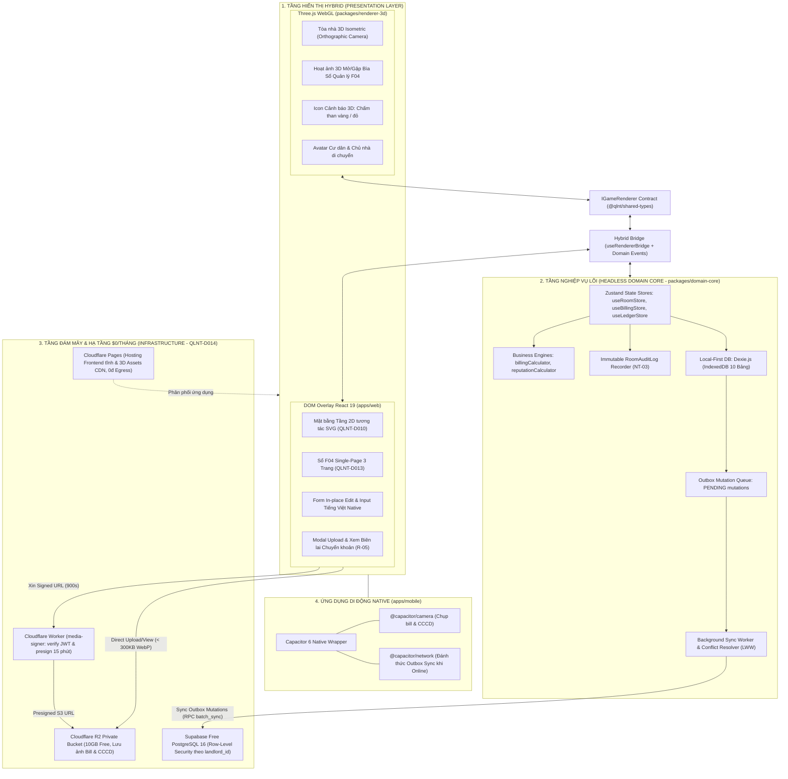

# Đặc tả Kiến trúc Toàn diện & Mô hình Triển khai Hệ thống QLNT (Architectural Specification)

> **Tài liệu Đặc tả Kiến trúc & Vận hành (System Architecture & Deployment Specification)**  
> **Mã hồ sơ:** `SPEC-ARCH-DEPLOY-001`  
> **Dự án:** Quản lý nhà trọ (QLNT)  
> **Phiên bản:** `1.0.0`  
> **Đơn vị ban hành:** Ban Kế hoạch & Điều phối Kiến trúc (Planner phối hợp Arch Lead & Infra DevOps)  
> **Ngày ban hành:** 2026-11-13  
> **Trạng thái:** `Đã phê duyệt thiết kế — Sẵn sàng chuyển giao lập kế hoạch thực thi`  
> **Căn cứ tham chiếu:**
> - Quy tắc cốt lõi: [`../../../3.DOC_AI/quan-tri/RULES_CORE.md`](../../../3.DOC_AI/quan-tri/RULES_CORE.md)
> - Các quyết định phê duyệt: [`DECISIONS.md`](DECISIONS.md) (`QLNT-D001` .. `QLNT-D014`)
> - Hồ sơ chuẩn hóa kỹ thuật: [`../03-ky-thuat/DANH_SACH_CAI_THIEN_VA_CHUAN_HOA_KY_THUAT.md`](../03-ky-thuat/DANH_SACH_CAI_THIEN_VA_CHUAN_HOA_KY_THUAT.md) (`TECH-STD-001`)
> - Hồ sơ kỹ thuật hệ thống: [`../03-ky-thuat/TECH_PROFILE.md`](../03-ky-thuat/TECH_PROFILE.md)
> - Đặc tả kiến trúc monorepo: [`../03-ky-thuat/KIEN_TRUC_MONOREPO_CODEBASE.md`](../03-ky-thuat/KIEN_TRUC_MONOREPO_CODEBASE.md) (`TECH-ARCH-001`)
> - Thiết kế hạ tầng & pipeline: [`../04-van-hanh/HA_TANG_VA_DEPLOYMENT_PIPELINE.md`](../04-van-hanh/HA_TANG_VA_DEPLOYMENT_PIPELINE.md)
> - Hồ sơ hạ tầng & vận hành $0/tháng: [`../04-van-hanh/HA_TANG_VA_VAN_HANH_HE_THONG.md`](../04-van-hanh/HA_TANG_VA_VAN_HANH_HE_THONG.md) (`QLNT-D014`)
> - Đặc tả Sổ quản lý ảo F04 & Renderer: [`../02-nghiep-vu/DAC_TA_SO_QUAN_LY_AO_SINGLE_PAGE_VA_RENDERER.md`](../02-nghiep-vu/DAC_TA_SO_QUAN_LY_AO_SINGLE_PAGE_VA_RENDERER.md) (`QLNT-D010` .. `QLNT-D013`)

---

## 1. Mục tiêu & Tổng quan Kiến trúc (Goal & Architecture Overview)

### 1.1. Bối cảnh & Mục tiêu Hệ thống
Dự án **Quản lý Nhà trọ (QLNT)** là nền tảng SaaS Multi-tenant thế hệ mới dành cho các chủ nhà trọ tại thị trường Việt Nam (tập trung thí điểm tại Hà Nội), kết hợp độc đáo giữa:
1. **Mô phỏng 3D trực quan & Gamification:** Góc nhìn tòa nhà isometric 3D, avatar cư dân/chủ nhà đi lại, minigame dọn dẹp, điểm thưởng tích lũy và sao uy tín.
2. **Sổ Quản lý Ảo F04 Single-Page chuyên nghiệp (`QLNT-D010` .. `QLNT-D013`):** Giải quyết triệt để bài toán tính tiền phòng, chốt chỉ số điện nước, kiểm kê thiết bị và đối chiếu biên lai chuyển khoản (`R-05`) với trải nghiệm nhập liệu native mượt mà.
3. **Mô hình Vận hành Siêu tinh gọn ($0/tháng First — `QLNT-D014`):** Đảm bảo giai đoạn thử nghiệm Pilot cho 1 đến 50 chủ trọ vận hành hoàn toàn trên hạn mức miễn phí (Free Tier) của các dịch vụ đám mây tiên tiến mà không tốn chi phí máy chủ hàng tháng.

### 1.2. 4 Trụ cột Kiến trúc Cốt lõi
Hệ thống được thiết kế theo các nguyên tắc kỹ thuật chuẩn hóa quốc tế:

1. **Nguyên tắc `NT-01` (Tách rời Lớp Game và Lớp Dữ liệu Thật):**
   - Nghiệp vụ cốt lõi, dữ liệu tài chính, hợp đồng và khách thuê được đóng gói độc lập trong **Headless Domain Core** (`packages/domain-core`).
   - Đồ họa 3D (`packages/renderer-3d`) chỉ là một tầng hiển thị cắm rút (pluggable presentation layer) giao tiếp thông qua hợp đồng chuẩn hóa duy nhất: **Interface `IGameRenderer`**. Khi cần nâng cấp engine đồ họa từ hình khối MVP sang mô hình 3D phức tạp hoặc engine khác, 100% logic nghiệp vụ giữ nguyên không đổi.

2. **Kiến trúc Hiển thị Hybrid WebGL 3D + DOM Overlay (`QLNT-D013`):**
   - **Tầng Đáy (Background Canvas):** Three.js WebGL kết xuất không gian 3D isometric với camera Orthographic cố định và hoạt ảnh 3D mở/gập bìa sổ quản lý F04.
   - **Tầng Đè Lên (DOM Overlay Layer):** React 19 + SVG vector + Tailwind CSS v4 nằm đè lên Canvas, thể hiện Mặt bằng tầng 2D tương tác SVG và Tờ chi tiết phòng Single-Page 3 trang. Giải pháp này cho phép tận dụng trọn vẹn bàn phím ảo, bộ gõ tiếng Việt (IME), công cụ Accessibility và cuộn trang mượt mà trên mobile mà không tốn VRAM như khi vẽ chữ trực tiếp trên Canvas 3D.

3. **Cấu trúc Monorepo Đơn nhất (Single Codebase Monorepo):**
   - Quản trị bằng **pnpm workspaces (v12.4.0)** kết hợp **Turborepo (v2.4.0)** và **TypeScript Project References (`tsc -b`)**.
   - Một codebase duy nhất phục vụ Web và đóng gói trực tiếp thành Native App Android / iOS thông qua **Capacitor 6**, chia sẻ 100% types và logic nghiệp vụ.

4. **Kiến trúc Local-First & Vận hành $0/tháng (`QLNT-D014`):**
   - Dữ liệu phía Client được lưu trữ tại chỗ qua **Dexie.js (IndexedDB)**. Mọi thao tác ghi nhận vào hàng đợi **Outbox Mutation Queue**, giao diện phản hồi tức thì (Optimistic UI).
   - Khi có kết nối mạng, worker nền tự động đồng bộ hàng loạt (Batch Sync) lên **Supabase Free Tier (PostgreSQL 16)** với cơ chế bảo mật **Row-Level Security (RLS)** phân vùng theo `landlord_id`.
   - Lưu trữ hình ảnh chứng từ nhạy cảm (biên lai thu tiền, CCCD) trên **Cloudflare R2 Private Bucket** ($0 băng thông egress) thông qua **Cloudflare Worker Edge Function** cấp Presigned URL có thời hạn sống đúng **15 phút (900 giây)**.

---

## 2. Sơ đồ Kiến trúc Phân tầng & Luồng Dữ liệu Tổng thể



---

## 3. Đặc tả 10 Bảng Dữ liệu & Hợp đồng Kỹ thuật Chuẩn hóa (`TECH-STD-001`)

### 3.1. Danh mục 10 Thực thể Nghiệp vụ Cốt lõi
Hệ thống sử dụng khóa chính `UUID v4` trên 100% thực thể, bắt buộc có trường `landlord_id` để phân vùng Multi-tenant qua Row-Level Security:

1. **`landlords` (Tài khoản Chủ trọ / Quản trị):** `id`, `name`, `phone` (unique), `email` (unique), `reputation_stars` (default 5), `package_tier` ('FREE' | 'PRO'), `created_at`, `updated_at`.
2. **`properties` (Khu trọ / Tòa nhà):** `id`, `landlord_id`, `name`, `address`, `total_floors`, `coordinates_3d` (`{ x, y, z }`), `is_public_on_map`, `water_calc_method` ('PER_M3' | 'PER_PERSON'), `water_unit_price`, `electric_unit_price`, `service_fee`, `created_at`, `updated_at`.
3. **`rooms` (Phòng trọ):** `id`, `landlord_id`, `property_id`, `floor_number`, `room_number`, `area_sqm`, `base_price`, `deposit_amount`, `status` ('EMPTY' | 'RENTED' | 'MAINTENANCE'), `created_at`, `updated_at`.
4. **`tenants` (Khách thuê & Người ở ghép):** `id`, `landlord_id`, `room_id`, `full_name`, `phone`, `id_card_number` (mã hóa), `id_card_front_url`, `id_card_back_url`, `birth_year`, `hometown`, `vehicle_plate`, `role` ('REPRESENTATIVE' | 'ROOMMATE'), `temp_residence_status` ('DECLARED' | 'NOT_DECLARED'), `reward_points`, `avatar_skin_config`, `created_at`, `updated_at`.
5. **`contracts` (Hợp đồng thuê phòng):** `id`, `landlord_id`, `room_id`, `tenant_id`, `start_date`, `end_date`, `duration_months`, `monthly_rent`, `deposit_paid`, `payment_cycle_day`, `status` ('ACTIVE' | 'EXPIRED' | 'TERMINATED'), `contract_file_url`, `created_at`, `updated_at`.
6. **`billings` (Hóa đơn kỳ thu tiền phòng hàng tháng):** `id`, `landlord_id`, `room_id`, `contract_id`, `month_period` (`YYYY-MM`), `room_charge`, `electric_charge`, `water_charge`, `service_charge`, `vehicle_charge`, `previous_debt`, `total_amount`, `status` ('UNPAID' | 'PENDING_APPROVAL' | 'PAID'), `bill_image_url`, `created_at`, `updated_at`.
7. **`payment_records` (Phiếu thu & Giao dịch thanh toán):** `id`, `landlord_id`, `billing_id`, `room_id`, `amount_paid`, `payment_method` ('BANK_TRANSFER_MANUAL' | 'VIETQR_AUTO' | 'CASH'), `payment_date`, `verified_by`, `note`, `created_at`.
8. **`meter_readings` (Chỉ số công tơ điện nước):** `id`, `landlord_id`, `room_id`, `billing_id`, `month_period`, `old_electric`, `new_electric`, `electric_consumed` (stored generated), `old_water`, `new_water`, `water_consumed` (stored generated), `meter_photo_url`, `recorded_by`, `recorded_at`.
9. **`room_audit_logs` (Nhật ký biến động phòng Append-Only theo `NT-03`):** `id`, `landlord_id`, `room_id`, `actor_id`, `actor_role`, `action_type`, `change_summary`, `old_data` (JSONB), `new_data` (JSONB), `created_at` (Bất biến, cấm sửa/xóa).
10. **`maintenance_requests` (Yêu cầu báo hỏng & Sửa chữa thiết bị theo F02):** `id`, `landlord_id`, `room_id`, `tenant_id`, `device_name`, `device_category` ('FIXED' | 'FURNITURE' | 'ADDITIONAL' | 'SECURITY' | 'METER'), `issue_description`, `photo_url`, `status` ('PENDING_ALERT' | 'IN_PROGRESS' | 'RESOLVED'), `repair_cost`, `reported_at`, `resolved_at`, `resolved_by`.

Bảng thứ 11 phía Client Dexie.js:
- **`outbox_mutations`:** `mutation_id` (PK, UUID), `table_name`, `operation` ('INSERT' | 'UPDATE' | 'DELETE'), `record_id`, `payload` (JSON), `client_timestamp`, `sync_status` ('PENDING' | 'RETRYING' | 'SYNCED' | 'FAILED'), `retry_count`, `error_message`.

### 3.2. Hợp đồng `IGameRenderer` Chuẩn hóa (Single Source of Truth)
Nằm tại `packages/shared-types/src/renderer/`:

```typescript
export interface Vector3D {
  x: number;
  y: number;
  z: number;
}

export type DeviceStatus = 'NORMAL' | 'BROKEN';
export type RoomNoticeType = 'NONE' | 'PAYMENT_DUE' | 'BILL_PENDING';
export type RoomDetailTab = 'PAGE_1_BILLING' | 'PAGE_2_DEVICES' | 'PAGE_3_AUDIT';

export interface IGameRenderer {
  // === Khối 1: Cảnh 3D Tòa nhà & Nhân vật ===
  renderBuilding(buildingData: BuildingRenderDTO): Promise<void>;
  spawnAvatar(avatarId: string, roomPosition: Vector3D, skinConfig: AvatarSkinDTO): void;
  moveAvatar(avatarId: string, targetPosition: Vector3D, onComplete?: () => void): void;
  setDeviceStatus(roomId: string, deviceId: string, status: DeviceStatus): void;
  setRoomNotice(roomId: string, type: RoomNoticeType): void;
  playMinigameAction(actionType: string, toolSkin?: string): Promise<void>;

  // === Khối 2: Điều khiển Sổ Quản lý Ảo F04 (Single-Page & Mặt bằng tầng) ===
  openLedgerBook(monthKey: string, initialFloorIndex: number, floorMapData: FloorMapDTO): Promise<void>;
  flipLedgerFloorPage(targetFloorIndex: number, floorMapData: FloorMapDTO): Promise<void>;
  openRoomDetailSinglePage(roomId: string, activeTab: RoomDetailTab, roomDetailData: RoomDetailDTO): Promise<void>;
  switchRoomDetailPageTab(roomId: string, targetTab: RoomDetailTab, roomDetailData: RoomDetailDTO): Promise<void>;
  refreshRoomDetailView(roomId: string, updatedDetailData: RoomDetailDTO): void;
  closeRoomDetailToFloorMap(updatedFloorMapData: FloorMapDTO): Promise<void>;
  closeLedgerBookTo3DScene(): Promise<void>;
}
```

---

## 4. Đặc tả 3 Môi trường Triển khai & Ràng buộc Chi phí $0/tháng (`QLNT-D014`)

| Thuộc tính | 1. Local Dev (`local`) | 2. Staging (`stg`) | 3. Production Giai đoạn 1 (`prod`) |
| :--- | :--- | :--- | :--- |
| **Mục đích** | Lập trình tính năng, unit tests, chạy offline hoàn toàn | CI/CD per PR, QA kiểm thử theo checklist `X02` | Thử nghiệm thực tế Pilot 1 – 50 chủ trọ Hà Nội |
| **Chi phí hạ tầng** | **$0** (máy trạm của Dev) | **$0** (Free Tier managed cloud) | **$0 / tháng** (Cam kết duy trì tối đa) |
| **Frontend & 3D CDN** | Vite 6 dev server (`localhost:5173`) | Cloudflare Pages Preview URL (`https://pr-*.qlnt.pages.dev`) | Cloudflare Pages PROD (`https://app.qlnt.vn`), CDN Edge |
| **Cơ sở dữ liệu** | Docker Compose PostgreSQL 16 Alpine | Supabase Free Tier STG (100% Mock seed data) | Supabase Free Tier PROD (PostgreSQL 16 RLS, Singapore) |
| **Lưu trữ nhạy cảm** | MinIO S3 API Mock (`localhost:9000`) | Cloudflare R2 STG Private Bucket | Cloudflare R2 PROD Private Bucket (10GB Free, 0đ Egress) |
| **Cơ chế Ký Media** | Mock signer local | Cloudflare Worker Preview | Cloudflare Worker Media Signer (Ký URL 15 phút — `900s`) |
| **Ứng dụng Di động** | Capacitor Android Simulator / Dev build | APK Debug tự động build từ GitHub Actions | Capacitor 6 Android APK / iOS build qua GitHub Actions |

> [!IMPORTANT]
> **Cơ chế Bảo vệ Chi phí $0/tháng:** Nếu tài nguyên hệ thống chạm ngưỡng 80% hạn mức Free Tier, nhóm kỹ thuật **bắt buộc thực hiện đánh giá lại cấu trúc hạ tầng & phạm vi triển khai** theo quy định tại [`../04-van-hanh/HA_TANG_VA_VAN_HANH_HE_THONG.md`](../04-van-hanh/HA_TANG_VA_VAN_HANH_HE_THONG.md) Mục 1.3 trước khi trình Chủ dự án duyệt bất kỳ quyết định chi ngân sách nào.

---

## 5. Ranh giới Kiến trúc Codebase (Dependency Boundaries)

Hệ thống tuân thủ mô hình đồ thị có hướng không chu trình (Directed Acyclic Graph):

```
packages/shared-types (Pure TS, 0 deps, 10 entities, IGameRenderer, Vector3D)
       ▲                             ▲
       │                             │
packages/domain-core           packages/renderer-3d
(Headless Core, Zustand,       (Three.js WebGL,
Dexie.js, Outbox Worker)       implements IGameRenderer)
       ▲                             ▲
       │                             │
       └──────────────┬──────────────┘
                      │
                   apps/web (Host Shell, DOM Overlay React 19, Bridge)
                      │
                   apps/mobile (Capacitor 6 wrapper, Native Plugins)
```

- **Quy tắc 1:** `shared-types` không phụ thuộc bất kỳ package nào trong hoặc ngoài repo.
- **Quy tắc 2:** `domain-core` và `renderer-3d` độc lập hoàn toàn, nghiêm cấm import lẫn nhau.
- **Quy tắc 3:** `apps/web` là nơi duy nhất import đồng thời cả hai để làm cầu nối giao tiếp.
- **Quy tắc 4:** `apps/mobile` chỉ đóng gói kết quả build tĩnh của `apps/web` (`dist/`).

---

## 6. Tiêu chí Nghiệm thu & Chuyển giao Kỹ thuật (Definition of Ready for Implementation)

Tài liệu đặc tả kiến trúc `SPEC-ARCH-DEPLOY-001` được phê duyệt làm cơ sở cho kế hoạch thực thi chi tiết [`implementation_plan.md`](implementation_plan.md). Mọi thành viên kỹ thuật và subagent tham gia triển khai phải tuân thủ nghiêm ngặt các ranh giới và chuẩn mực đã quy định.
