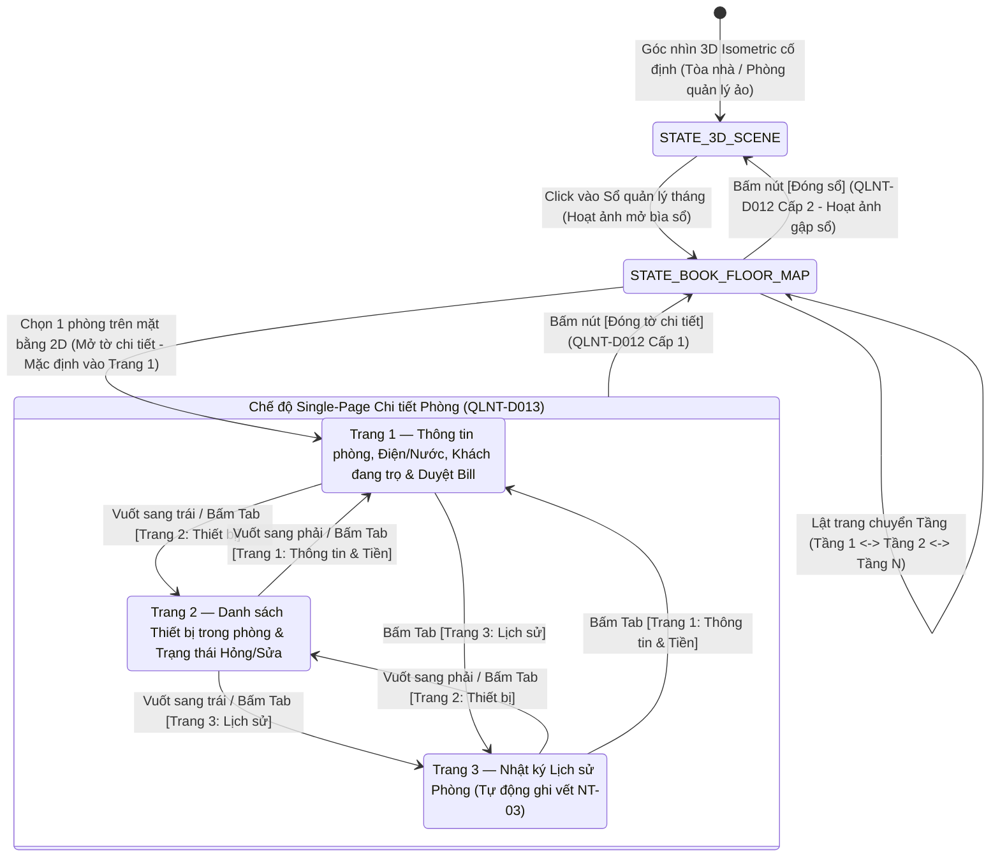

# Đặc tả Quy trình Thực hiện, Hiển thị Single-Page & Hợp đồng Giao tiếp `IGameRenderer` cho Sổ Quản lý Ảo F04

- **Dự án:** Quản lý nhà trọ (QLNT)
- **Tác giả:** BA Lead phối hợp Chủ dự án & Tech Lead (xử lý Issue `#2` / `ISS-02` và Issue `#4` / `ISS-04`)
- **Ngày lập:** 2026-11-12
- **Trạng thái:** `Dự thảo trình Chủ dự án xác nhận` (Phần chế độ `Single-Page` đã được Chủ dự án chốt tại `QLNT-D013`)
- **Căn cứ tham chiếu:**
  - Quyết định `QLNT-D010`, `QLNT-D011`, `QLNT-D012`, `QLNT-D013` tại [DECISIONS.md](file:///Users/uni/Documents/AI/AI-Workspace/AI-Workspace/TEAM_ORCA/4.Du_an/QLNT/01-quan-ly/DECISIONS.md)
  - Tài liệu tham khảo nghiệp vụ [REF_SO_QUAN_LY_AO_3D.md](file:///Users/uni/Documents/AI/AI-Workspace/AI-Workspace/TEAM_ORCA/2.Tai_lieu_tham_khao/3.Tai_lieu_nghiep_vu/REF_SO_QUAN_LY_AO_3D.md) (mẫu học hỏi từ `DiogoNeves/graphics-pop-up-book`, `shiarauzo/book-flip`, `DevGurav/3d-book-reader`, `MONOGRID`)
  - Hồ sơ kỹ thuật [TECH_PROFILE.md](file:///Users/uni/Documents/AI/AI-Workspace/AI-Workspace/TEAM_ORCA/4.Du_an/QLNT/03-ky-thuat/TECH_PROFILE.md) (Nguyên tắc `NT-01` tách biệt Headless Core và Renderer)

---

## 1. Quy trình Thực hiện & Hiển thị Chế độ Single-Page cho Bộ 3 Trang Chi tiết Phòng (`QLNT-D013` — Đã chốt)

### 1.1. Sơ đồ máy trạng thái hiển thị & điều hướng Sổ quản lý ảo F04



### 1.2. Đặc tả chi tiết quy trình thực hiện và bố cục hiển thị từng cấp

#### Bước 1: Mở Sổ quản lý tháng & Xem Mặt bằng tầng 2D (`STATE_BOOK_FLOOR_MAP`)
- **Hành động kích hoạt:** Chủ nhà bấm vào biểu tượng/vật thể **Sổ quản lý** trên bàn làm việc tại Phòng quản lý ảo (hoặc nút mở Sổ F04).
- **Hoạt ảnh & Góc nhìn (Học hỏi từ `DiogoNeves/graphics-pop-up-book` & `MONOGRID`):**
  - Nhân vật chủ nhà thực hiện hoạt ảnh mở cuốn sổ quản lý của tháng hiện tại (có thể chọn đổi tháng ở gáy sổ).
  - Camera chuyển mượt từ góc Isometric sang góc nhìn trực diện mặt sổ (Top-down / Orthographic).
- **Hiển thị trên Trang Mặt bằng tầng 2D:**
  - Mỗi trang sổ tương ứng với **01 tầng** của tòa nhà (có thanh đánh dấu tầng `Tầng 1`, `Tầng 2`, `Tầng 3`... ở mép trang để bấm chuyển tầng hoặc vuốt lật trang).
  - Trên mặt bằng 2D vẽ sơ đồ các phòng của tầng đó với 4 trạng thái trực quan:
    1. **Phòng trống:** Nền màu trung tính / xanh nhạt, ghi mã phòng (VD: `P.101 - Trống`).
    2. **Phòng đang trọ (Bình thường):** Nền màu ấm, hiển thị tên đại diện khách hoặc số người đang ở.
    3. **Cảnh báo Tiền trọ (`Chấm than vàng`):** Hiển thị icon chấm than vàng nổi bật ở góc ô phòng khi đến kỳ thu tiền hoặc khi khách đã nộp ảnh bill chờ chủ nhà duyệt.
    4. **Cảnh báo Sự cố (`Chấm than đỏ`):** Hiển thị icon chấm than đỏ nhấp nháy ở góc ô phòng khi có thiết bị trong phòng đang ở trạng thái báo hỏng chưa sửa xong.

#### Bước 2: Mở Tờ Chi tiết Phòng ở Chế độ `Single-Page` (`QLNT-D013`)
- **Hành động kích hoạt:** Chủ nhà chạm/click vào một ô phòng cụ thể trên trang mặt bằng 2D.
- **Quy tắc hiển thị `Single-Page` (Áp dụng thống nhất trên Mobile & Web):**
  - Thay vì dàn trải 2–3 trang giấy cạnh nhau gây nhỏ chữ, hệ thống mở ra **01 tờ giấy đơn (Single-Page)** chiếm trọn vùng nhìn chính diện màn hình.
  - Phía trên tờ giấy có **Thanh Đầu Trang (Header & Bookmark Tabs)** cố định gồm:
    - Tiêu đề: `Phòng [Mã phòng] - Tầng [Số tầng] - Sổ tháng [MM/YYYY]`.
    - **03 Bookmark Tab chuyển trang nhanh:** `[1. Thông tin & Tiền trọ]` | `[2. Thiết bị (Số lượng)]` | `[3. Lịch sử]`.
    - Nút **`[X Đóng tờ chi tiết]`** ở góc trên bên phải (kích thước vùng chạm tối thiểu `44x44px`).
  - Phía dưới tờ giấy có điều hướng chân trang: `< Trang trước` | `Trang [1/3]` | `Trang sau >` (hỗ trợ cả thao tác vuốt ngang `Swipe Left/Right` kèm hiệu ứng lật giấy `shiarauzo/book-flip`).

#### Bước 3: Quy trình thao tác & `In-place Edit` trên từng trang đơn (`QLNT-D011`)
1. **Khi ở `Trang 1 — Thông tin phòng & Thu tiền` (Trang mặc định khi vừa chọn phòng):**
   - **Khối A (Thông tin chung & Trạng thái phòng):** Hiển thị Giá thuê, Diện tích, Trạng thái (`Trống` / `Đang thuê`). Chủ nhà chạm trực tiếp vào trường để sửa (`in-place edit`).
   - **Khối B (Chỉ số Điện & Nước tháng hiện tại):** Hiển thị `Số điện cũ`, `Số điện mới`, `Đơn giá điện`, `Số nước cũ`, `Số nước mới`, `Đơn giá nước` $\rightarrow$ Tự động tính `Thành tiền`. Chủ nhà chạm vào ô `Số mới` để nhập trực tiếp trên mặt giấy.
   - **Khối C (Danh sách cá nhân người đang trọ):** Danh sách Họ tên, SĐT, CCCD, Ngày vào ở. Có nút `[+ Thêm người trọ]` hoặc chạm vào từng dòng để sửa/xóa trực tiếp.
   - **Khối D (Tình trạng tiền trọ & Duyệt Bill):**
     - Hiển thị Tổng tiền phải thu tháng này và trạng thái (`Chưa đóng` / `Chờ duyệt bill` / `Đã thu đủ`).
     - Nếu khách đã gửi ảnh chụp màn hình chuyển khoản, hiển thị ảnh thu nhỏ (bấm vào để phóng to kiểm tra) và nút **`[Xác nhận đã nhận đủ tiền]`**.
     - Ngay khi chủ nhà bấm **`[Xác nhận đã nhận đủ tiền]`**: Trạng thái đổi sang `Đã thu đủ`, tắt **chấm than vàng** của phòng đó trên mặt bằng tầng 2D và ngoài cảnh 3D, cộng điểm thưởng cho khách (nếu đúng hạn) và tự động ghi 1 dòng log vào Trang 3.
2. **Khi chuyển sang `Trang 2 — Danh sách Thiết bị & Trạng thái`:**
   - Hiển thị bảng danh sách thiết bị gắn với phòng (Điều hòa, Bình nóng lạnh, Giường, Tủ, Bóng đèn...) kèm trạng thái hiện tại (`Bình thường` / `Đang hỏng - Chấm than đỏ` / `Đang sửa`).
   - **Thao tác In-place Edit:** Chủ nhà có thể thêm thiết bị mới, đổi trạng thái từ `Đang hỏng` sang `Bình thường` (sau khi đã sửa xong $\rightarrow$ hệ thống tự động tắt **chấm than đỏ** trên mặt bằng 2D và trên vật thể 3D trong phòng), hoặc ghi chú chi phí sửa chữa. Mọi thay đổi tự động ghi vết sang Trang 3.
3. **Khi chuyển sang `Trang 3 — Nhật ký Lịch sử Phòng` (`Read-only Audit Log` theo `NT-03`):**
   - Hiển thị danh sách dòng thời gian (Timeline) từ mới nhất đến cũ nhất của phòng đó: lịch sử đổi giá/chỉ số điện nước, lịch sử khách vào/ra, lịch sử nộp & duyệt tiền, lịch sử báo hỏng & hoàn tất sửa thiết bị.
   - Mỗi bản ghi gồm: `[Thời gian DD/MM/YYYY HH:mm]` - `[Người thực hiện]` - `[Loại sự kiện]` - `[Giá trị cũ -> Giá trị mới]`. Trang này **chỉ đọc (Read-only)**, không cho phép xóa hay sửa lùi lịch sử.

#### Bước 4: Quy trình Đóng 2 cấp (`QLNT-D012`)
- **Cấp 1 — Đóng tờ chi tiết về Sổ:** Khi đang ở bất kỳ trang nào trong 3 trang chi tiết (Trang 1, 2 hoặc 3), bấm nút **`[Đóng tờ chi tiết]`** (hoặc phím `Back`/`Esc`) $\rightarrow$ Hệ thống kiểm tra nếu có dữ liệu `in-place edit` đang gõ dở thì tự động lưu (hoặc hỏi xác nhận nếu lỗi validation), sau đó thu tờ chi tiết lại và **quay trở về đúng Trang Mặt bằng 2D của tầng đang xem trong cuốn sổ**.
- **Cấp 2 — Đóng Sổ ra ngoài không gian 3D:** Khi đang ở Trang Mặt bằng 2D của tầng trong sổ, bấm nút **`[Đóng sổ]`** $\rightarrow$ Kích hoạt hoạt ảnh gập bìa sổ lại và camera lùi về góc nhìn 3D Isometric cố định ban đầu.

---

## 2. Đặc tả Bổ sung Hợp đồng `IGameRenderer` & `Event Bus` cho Sổ Quản lý Ảo F04 (Xử lý Issue `#2` / `ISS-02`)

### 2.1. Các bài học kỹ thuật rút ra từ Tài liệu Tham khảo (`REF-BIZ-001`)
Qua đối chiếu 4 dự án mẫu trong `2.Tai_lieu_tham_khao/3.Tai_lieu_nghiep_vu/REF_SO_QUAN_LY_AO_3D.md`:
1. Từ **`DevGurav/3d-book-reader` & `shiarauzo/book-flip`:** Cuốn sổ 3D và hiệu ứng uốn trang (`Vertex Shader`) chỉ nên đóng vai trò **khung hình học và hoạt ảnh chuyển trang**, còn nội dung chữ/ô nhập liệu (`in-place edit`) khi tờ giấy đã mở phẳng ở chế độ **Single-Page (`QLNT-D013`)** cần được ánh xạ qua lớp **DOM/HTML Overlay đồng bộ tọa độ (hoặc High-DPI Canvas)** để bàn phím ảo trên điện thoại hoạt động mượt mà 100%, không bị mờ chữ và không làm rớt khung hình WebGL.
2. Từ **`DiogoNeves/graphics-pop-up-book` & `MONOGRID`:** Mọi chuyển động mở bìa sổ, lật tầng và phóng to vào tờ chi tiết phòng đều được điều khiển qua một **Trạng thái Camera & Animation State Machine** rõ ràng, nhận lệnh từ tầng nghiệp vụ (Headless Core) chứ không để 3D scene tự ý thay đổi dữ liệu.

### 2.2. Đặc tả Mở rộng Giao diện `IGameRenderer` (TypeScript Contract)

Bổ sung vào mục 2 của `03-ky-thuat/TECH_PROFILE.md` nhóm phương thức điều khiển phân hệ Sổ quản lý ảo F04:

```typescript
export type LedgerDetailTab = 'TAB_1_INFO_PAYMENT' | 'TAB_2_DEVICES' | 'TAB_3_HISTORY';

export interface IGameRenderer {
  // --- Nhóm 1: Điều khiển Cảnh 3D Tòa nhà & Avatar (Đã có) ---
  renderBuilding(buildingData: BuildingViewModel): void;
  spawnAvatar(avatarId: string, roomPosition: Vector3D, skinConfig: AvatarSkin): void;
  moveAvatar(avatarId: string, targetPosition: Vector3D, onComplete?: () => void): void;
  setDeviceStatus(roomId: string, deviceId: string, status: 'NORMAL' | 'BROKEN'): void; // Bật/tắt chấm than đỏ
  setRoomNotice(roomId: string, type: 'NONE' | 'PAYMENT_DUE' | 'BILL_PENDING'): void;   // Bật/tắt chấm than vàng
  playMinigameAction(actionType: string, toolSkin: string): void;

  // --- Nhóm 2: Điều khiển Sổ Quản lý Ảo F04 (Bổ sung theo QLNT-D010..D013) ---
  /**
   * Kích hoạt hoạt ảnh chủ nhà mở Sổ quản lý tháng và chuyển camera vào mặt bằng tầng 2D
   */
  openLedgerBook(monthKey: string, initialFloorIndex: number, floorMapData: FloorLedgerViewModel): Promise<void>;

  /**
   * Lật trang sổ sang tầng khác (hiệu ứng book-flip) và vẽ lại mặt bằng 2D của tầng đó
   */
  flipLedgerFloorPage(targetFloorIndex: number, floorMapData: FloorLedgerViewModel): Promise<void>;

  /**
   * Mở tờ chi tiết của 1 phòng ở chế độ Single-Page (QLNT-D013), mặc định mở TAB_1_INFO_PAYMENT
   */
  openRoomDetailSinglePage(roomId: string, activeTab: LedgerDetailTab, roomDetailData: RoomDetailViewModel): Promise<void>;

  /**
   * Chuyển qua lại giữa Trang 1 (Thông tin & Tiền), Trang 2 (Thiết bị), Trang 3 (Lịch sử) ở chế độ Single-Page
   */
  switchRoomDetailPageTab(roomId: string, targetTab: LedgerDetailTab, roomDetailData: RoomDetailViewModel): Promise<void>;

  /**
   * Đồng bộ lại dữ liệu hiển thị trên trang đơn hiện tại sau khi Headless Core xử lý xong In-place Edit (QLNT-D011)
   * hoặc sau khi duyệt bill/sửa thiết bị (cập nhật tức thì trạng thái chấm than vàng/đỏ)
   */
  refreshRoomDetailView(roomId: string, updatedDetailData: RoomDetailViewModel): void;

  /**
   * Đóng cấp 1 (QLNT-D012): Đóng tờ chi tiết phòng, quay về trang mặt bằng 2D của tầng hiện tại trong sổ
   */
  closeRoomDetailToFloorMap(updatedFloorMapData: FloorLedgerViewModel): Promise<void>;

  /**
   * Đóng cấp 2 (QLNT-D012): Gập cuốn sổ quản lý lại và trả camera về góc nhìn không gian 3D Isometric
   */
  closeLedgerBookTo3DScene(): Promise<void>;
}
```

### 2.3. Đặc tả Sự kiện hai chiều (`Event Bus`) giữa Sổ Ảo F04 và `Headless Domain Core`

Để đảm bảo nguyên tắc `NT-01` (Renderer không tự sửa dữ liệu thật) và `NT-03` (Mọi thay đổi đều lưu vết lịch sử Trang 3):

| Hướng sự kiện | Mã Sự kiện (`Event Name`) | Payload dữ liệu truyền đi | Quy trình xử lý tại Headless Core / Renderer |
| :--- | :--- | :--- | :--- |
| **UI/Renderer $\rightarrow$ Core** | `CMD_OPEN_LEDGER_BOOK` | `{ monthKey, floorIndex }` | Core truy vấn dữ liệu tầng/phòng và trạng thái cảnh báo (vàng/đỏ) $\rightarrow$ gọi `renderer.openLedgerBook(...)`. |
| **UI/Renderer $\rightarrow$ Core** | `CMD_SELECT_ROOM_ON_FLOOR_MAP` | `{ roomId }` | Core nạp dữ liệu 3 trang của phòng đó $\rightarrow$ gọi `renderer.openRoomDetailSinglePage(roomId, 'TAB_1_INFO_PAYMENT', data)`. |
| **UI/Renderer $\rightarrow$ Core** | `CMD_SWITCH_DETAIL_TAB` | `{ roomId, targetTab }` | Core cung cấp dữ liệu tab tương ứng $\rightarrow$ gọi `renderer.switchRoomDetailPageTab(...)`. |
| **UI/Renderer $\rightarrow$ Core** | `CMD_UPDATE_ROOM_FIELD_IN_PLACE` | `{ roomId, pageTab, fieldName, oldValue, newValue, actorId }` | **Luồng In-place Edit (`QLNT-D011`):**<br>1. Core kiểm tra tính hợp lệ (VD: chỉ số điện mới $\ge$ chỉ số cũ).<br>2. Lưu giá trị mới vào State/DB.<br>3. Tự động sinh bản ghi Audit Log vào **Trang 3 (Lịch sử)**.<br>4. Phát sự kiện `EVT_ROOM_DATA_COMMITTED` để gọi `renderer.refreshRoomDetailView(...)`. |
| **UI/Renderer $\rightarrow$ Core** | `CMD_APPROVE_ROOM_BILL` | `{ roomId, billId, actorId }` | Core đổi trạng thái hóa đơn sang `PAID`, tính điểm thưởng cho khách, ghi log vào Trang 3, sau đó gọi `renderer.setRoomNotice(roomId, 'NONE')` (tắt chấm than vàng cả trong sổ và ngoài 3D). |
| **UI/Renderer $\rightarrow$ Core** | `CMD_UPDATE_DEVICE_STATUS` | `{ roomId, deviceId, newStatus, note }` | Core cập nhật trạng thái thiết bị, ghi log vào Trang 3, kiểm tra nếu toàn bộ thiết bị trong phòng đã hết lỗi thì gọi `renderer.setDeviceStatus(..., 'NORMAL')` (tắt chấm than đỏ). |
| **UI/Renderer $\rightarrow$ Core** | `CMD_CLOSE_ROOM_DETAIL` | `{ roomId }` | Core kiểm tra không còn thay đổi treo $\rightarrow$ gọi `renderer.closeRoomDetailToFloorMap(...)`. |
| **UI/Renderer $\rightarrow$ Core** | `CMD_CLOSE_LEDGER_BOOK` | `{}` | Core chuyển trạng thái phiên làm việc về cảnh 3D $\rightarrow$ gọi `renderer.closeLedgerBookTo3DScene()`. |
