# SƠ ĐỒ PHÂN RÃ CHỨC NĂNG VÀ MA TRẬN PHÂN QUYỀN (FUNCTIONAL DECOMPOSITION & RBAC)
## Dự án: QLNT — Nền tảng Quản lý Nhà trọ & Cư dân phong cách Game hóa

---

## 1. Quản lý cập nhật phiên bản (Document Change Log)

| Phiên bản | Ngày | Người thực hiện | Vai trò | Tóm tắt nội dung điều chỉnh | Trạng thái |
|---|---|---|---|---|---|
| **1.0** | 2026-11-07 | Agent BA | Senior BA | Khởi tạo tài liệu phân rã chức năng và phân quyền RBAC: - Vẽ sơ đồ phân rã chức năng (FDD) dạng Mermaid gồm 9 nhóm phân hệ cấp 1 và 35 chức năng cấp 2. - Định nghĩa chi tiết danh mục 6 tác nhân con người và 2 tác nhân hệ thống. - Xây dựng ma trận phân quyền RBAC chi tiết (CRUD + Approve) cho từng chức năng. | Đã duyệt |

---

## 2. Sơ đồ phân rã chức năng (Functional Decomposition Diagram — FDD)

```mermaid
graph TD
    SYS["HỆ THỐNG QLNT"]
    
    %% Các phân hệ cấp 1
    SYS --> M1["F01. Quản lý Không gian & Tòa nhà"]
    SYS --> M2["F02. Quản lý Cư dân & Thẻ nhân vật"]
    SYS --> M3["F03. Quản lý Thiết bị & Báo hỏng"]
    SYS --> M4["F04. Thu chi & Thanh toán Tiền trọ"]
    SYS --> M5["F05. Gamification & Minigame"]
    SYS --> M6["F06. Quản lý Mạng lưới Sale trọ"]
    SYS --> M7["F07. Khách vãng lai & Bản đồ tìm trọ"]
    SYS --> M8["F08. Cổng Dịch vụ công & Tiện ích QR"]
    SYS --> M9["F09. Quản trị Nền tảng SaaS"]

    %% Phân rã M1
    M1 --> F01_1["F01.1 Cấu hình Tầng / Phòng / Khuôn viên"]
    M1 --> F01_2["F01.2 Phòng Quản lý Ảo Tập trung"]
    M1 --> F01_3["F01.3 Chế độ Xem Bảng Danh sách Dự phòng"]

    %% Phân rã M2
    M2 --> F02_1["F02.1 Tiếp nhận Khách & Cấp Avatar"]
    M2 --> F02_2["F02.2 Quản lý Thẻ Nhân vật & Hồ sơ CCCD"]
    M2 --> F02_3["F02.3 Thanh lý Hợp đồng & Lưu trữ Lịch sử"]

    %% Phân rã M3
    M3 --> F03_1["F03.1 Bàn giao Danh mục Thiết bị Cố định/Bổ sung"]
    M3 --> F03_2["F03.2 Báo hỏng & Bật Chấm than Đỏ"]
    M3 --> F03_3["F03.3 Nghiệm thu Sửa chữa & Tắt Chấm than Đỏ"]
    M3 --> F03_4["F03.4 Tùy biến Vị trí & Skin Đồ đạc trong Phòng"]

    %% Phân rã M4
    M4 --> F04_1["F04.1 Tạo Hóa đơn & Bật Chấm than Vàng"]
    M4 --> F04_2["F04.2 Hoạt ảnh Chủ nhà Gõ cửa Nhắc tiền"]
    M4 --> F04_3["F04.3 Nộp Bill ảnh Chuyển khoản & Avatar Giao tiền"]
    M4 --> F04_4["F04.4 Chủ nhà Duyệt Bill & Tắt Chấm than Vàng"]
    M4 --> F04_5["F04.5 Đối soát Tự động qua VietQR Động"]

    %% Phân rã M5
    M5 --> F05_1["F05.1 Cơ chế Tích/Trừ Điểm Thưởng Nhiệm vụ"]
    M5 --> F05_2["F05.2 Cửa hàng Đổi Quà / Skin / Voucher"]
    M5 --> F05_3["F05.3 Mua Sao Tặng Chủ trọ Tích lũy Uy tín"]
    M5 --> F05_4["F05.4 Minigame Săn Chuột / Gián bằng Nồi chổi dép"]
    M5 --> F05_5["F05.5 Chế độ Xả giận & NPC Lao công Dọn dẹp"]

    %% Phân rã M6
    M6 --> F06_1["F06.1 Cấp Tài khoản / Avatar Sale có Thời hạn"]
    M6 --> F06_2["F06.2 Tham quan Khuôn viên & Xem Phòng Trống"]
    M6 --> F06_3["F06.3 Gắn Link Bài đăng Tiếp thị Phòng"]
    M6 --> F06_4["F06.4 Khóa Cứng Phòng có Khách Bảo vệ Riêng tư"]

    %% Phân rã M7
    M7 --> F07_1["F07.1 Dạo chơi Bản đồ Khu phố Ảo Hà Nội"]
    M7 --> F07_2["F07.2 Lọc Phòng Trống theo Giá / Khu vực / Tiện ích"]
    M7 --> F07_3["F07.3 Đặt lịch Xem phòng & Hẹn gặp Chủ trọ"]
    M7 --> F07_4["F07.4 Tự động Nâng cấp Khách vãng lai thành Khách trọ"]

    %% Phân rã M8
    M8 --> F08_1["F08.1 Cổng QR Tủ Điện/Nước Ghi Chỉ số Công tơ"]
    M8 --> F08_2["F08.2 Tự động Tính Tiêu thụ & Đẩy vào Hóa đơn"]
    M8 --> F08_3["F08.3 Cổng QR An ninh Tra cứu Cư trú Cảnh sát"]
    M8 --> F08_4["F08.4 Biên bản PCCC & Đăng Thông báo An ninh"]

    %% Phân rã M9
    M9 --> F09_1["F09.1 Quản trị Tenant Chủ trọ & Gói Dịch vụ"]
    M9 --> F09_2["F09.2 Kiểm duyệt Tin đăng Bản đồ Khu phố"]
    M9 --> F09_3["F09.3 Quản trị Danh mục Quà tặng & Voucher Toàn sàn"]
```

---

## 3. Danh mục Tác nhân (Actors) & Mô tả vai trò

| Tác nhân (Actor) | Loại | Mô tả vai trò & Phạm vi trách nhiệm |
|---|---|---|
| **1. Chủ nhà trọ (`Landlord`)** | Con người | Người sở hữu hoặc quản lý tòa nhà trọ. Có toàn quyền quản trị cơ sở phòng trọ của mình: thiết lập tòa nhà, quản lý thiết bị, duyệt bill thu tiền trọ, cấp quyền Sale trọ, tiếp nhận khách thuê. |
| **2. Khách trọ (`Tenant`)** | Con người | Cư dân đang có hợp đồng thuê phòng hợp lệ. Có avatar đại diện sống trong phòng, thực hiện nhiệm vụ đóng tiền trọ, báo hỏng thiết bị, tích lũy điểm thưởng đổi quà, chơi minigame xả giận/bắt chuột và mua sao tặng chủ trọ. |
| **3. Sale trọ (`Broker`)** | Con người | Cộng tác viên môi giới phòng được chủ nhà cấp quyền có thời hạn. Sử dụng avatar Sale đi dạo khuôn viên và bước vào các **phòng còn trống** để xem thông số (ảnh, diện tích, thiết bị, giá) đi mời chào khách; được gắn bài đăng tiếp thị; **tuyệt đối bị cấm vào phòng có khách**. |
| **4. Khách vãng lai (`Guest`)** | Con người | Người tìm phòng thuê chưa có hợp đồng. Truy cập không cần mật khẩu qua quét mã QR hoặc bản đồ khu phố; dạo xem phòng trống, xem sao uy tín chủ trọ và đặt lịch hẹn xem phòng. Tự động chuyển đổi thành Khách trọ khi ký hợp đồng. |
| **5. Cán bộ Điện/Nước (`Utility Officer`)** | Con người | Nhân viên ngành điện lực hoặc cấp thoát nước địa phương. Tương tác tức thì qua việc quét mã QR gắn tại tủ công tơ để nhập số điện/nước hàng tháng mà không cần tài khoản thường trực. |
| **6. Cảnh sát khu vực (`Local Police`)** | Con người | Công an khu vực, cán bộ kiểm tra PCCC. Tương tác qua quét mã QR an ninh tại cổng nhà trọ (kèm mã công tác bảo mật) để tra cứu danh sách nhân khẩu thực tế phục vụ rà soát tạm trú/VNeID, kiểm tra an toàn PCCC và đăng thông báo an ninh. |
| **7. Quản trị hệ thống (`System Admin`)** | Con người | Đội ngũ quản trị nền tảng SaaS QLNT. Quản lý tài khoản các chủ nhà trọ, kiểm duyệt tin đăng trên bản đồ khu phố, xử lý phản ánh gian lận và cấu hình toàn sàn. |
| **8. Bộ diễn hoạt Game (`Game Renderer`)** | Hệ thống | Engine đồ họa (2D Canvas ở P1 / Three.js ở P2) chịu trách nhiệm diễn hoạt mọi hành động (gõ cửa, giao tiền, nhặt dép bắt chuột, đập phá, bật tắt chấm than đỏ/vàng) theo sự kiện từ tầng Core. |
| **9. Bộ lập lịch tự động (`System Scheduler`)** | Hệ thống | Tiến trình chạy ngầm định kỳ kích hoạt chu kỳ thu tiền hàng tháng, tính toán hạn nộp, trừ điểm trễ hạn và gửi thông báo nhắc nợ. |

---

## 4. Danh sách chức năng chuẩn hóa

### Phân hệ F01: Quản lý Không gian & Tòa nhà
- **F01.1 — Cấu hình Tầng / Phòng / Khuôn viên:** Thiết lập số tầng, số phòng mỗi tầng, giá phòng cơ sở, diện tích m², vị trí cửa ra vào, khu để xe, lối thoát hiểm.
- **F01.2 — Phòng Quản lý Ảo Tập trung:** Giao diện trung tâm cho chủ nhà, hiển thị trực quan toàn bộ trạng thái các phòng (Đang ở, Trống, Đang sửa, Chờ nộp tiền) tại 1 màn hình duy nhất.
- **F01.3 — Chế độ Xem Bảng Danh sách Dự phòng (`R-16`):** Nút chuyển đổi nhanh hiển thị dữ liệu dạng bảng Excel/Table truyền thống cho người dùng không quen thao tác game.

### Phân hệ F02: Quản lý Cư dân & Thẻ nhân vật
- **F02.1 — Tiếp nhận Khách & Cấp Avatar:** Gắn khách thuê vào phòng, tự động sinh avatar cư dân xuất hiện trong phòng.
- **F02.2 — Quản lý Thẻ Nhân vật & Hồ sơ CCCD:** Lưu trữ thông tin cá nhân khách (CCCD, SĐT, ngày sinh, quê quán, số tiền cọc, ngày bắt đầu thuê). Chỉ chủ trọ và chính khách trọ đó được xem.
- **F02.3 — Thanh lý Hợp đồng & Lưu trữ Lịch sử:** Kết thúc hợp đồng thuê, đưa phòng về trạng thái trống, avatar khách rời đi; lưu trữ hồ sơ cư trú vào lịch sử phòng.

### Phân hệ F03: Quản lý Thiết bị & Báo hỏng
- **F03.1 — Bàn giao Danh mục Thiết bị:** Thiết lập thiết bị mặc định (cố định) và tiện nghi bổ sung (tủ lạnh, giường, tủ, máy lạnh...) trong biên bản bàn giao phòng.
- **F03.2 — Báo hỏng & Bật Chấm than Đỏ (`R-18`, `NT-08`):** Khách/chủ báo hỏng thiết bị, hệ thống lập tức gắn icon **chấm than đỏ** nhấp nháy trên thiết bị đó trong không gian 2D phòng trọ.
- **F03.3 — Nghiệm thu Sửa chữa & Tắt Chấm than Đỏ:** Chủ nhà bấm xác nhận đã sửa xong → Chấm than đỏ biến mất, tự động ghi nhật ký sửa chữa và chi phí.
- **F03.4 — Tùy biến Vị trí & Skin Đồ đạc:** Cho phép khách trọ sắp xếp lại vị trí giường/tủ hoặc đổi skin hiển thị đồ vật nhưng không được làm thiếu số lượng tài sản.

### Phân hệ F04: Thu chi & Thanh toán Tiền trọ
- **F04.1 — Tạo Hóa đơn & Bật Chấm than Vàng (`R-05`, `NT-08`):** Đến kỳ thu tiền, hệ thống sinh hóa đơn và hiển thị icon **chấm than vàng** trước cửa phòng trọ.
- **F04.2 — Hoạt ảnh Chủ nhà Gõ cửa Nhắc tiền:** Avatar chủ nhà tự động bước đến cửa phòng khách gõ cửa kèm lời nhắc lịch sự.
- **F04.3 — Nộp Bill ảnh Chuyển khoản & Avatar Giao tiền:** Khách trọ nộp ảnh chụp màn hình chuyển khoản ngân hàng; avatar khách tự động đi đến phòng chủ nhà giao tiền.
- **F04.4 — Chủ nhà Duyệt Bill & Tắt Chấm than Vàng:** Chủ nhà kiểm tra bill, bấm nút "Xác nhận đã nhận đủ tiền" → Hóa đơn chuyển trạng thái ĐÃ_THANH_TOÁN, **chấm than vàng biến mất**, kích hoạt cộng điểm thưởng.
- **F04.5 — Đối soát Tự động qua VietQR Động (`R-05b`):** (Bản Trả phí) Sinh mã VietQR động riêng cho từng phòng, tích hợp Webhook ngân hàng tự động khớp lệnh khi tiền về.

### Phân hệ F05: Gamification, Điểm thưởng & Minigame
- **F05.1 — Cơ chế Tích/Trừ Điểm Thưởng Nhiệm vụ:** Nộp tiền sớm (+100 điểm), nộp đúng hạn (+50 điểm), nộp trễ hạn (-10 điểm/ngày).
- **F05.2 — Cửa hàng Đổi Quà / Skin / Voucher (`R-21`):** Cư dân dùng điểm thưởng đổi đồ trang trí phòng, skin thiết bị, skin vũ khí hoặc voucher giảm trừ tiền thuê kỳ sau.
- **F05.3 — Mua Sao Tặng Chủ trọ Tích lũy Uy tín (`R-21`):** Khách dùng điểm mua Sao tặng chủ nhà; số sao tích lũy thành điểm uy tín của cơ sở trọ hiển thị trên bản đồ công khai.
- **F05.4 — Minigame Săn Chuột / Gián bằng Nồi chảo chổi dép (`R-19`):** Chuột/gián xuất hiện ngẫu nhiên; avatar trang bị đồ gia dụng để săn bắt giải trí, nhận điểm thưởng nhỏ; không ảnh hưởng dữ liệu thật.
- **F05.5 — Chế độ Xả giận & NPC Lao công Dọn dẹp (`R-07`, `R-08`):** Cho phép người dùng đập phá đồ đạc trong phòng riêng; avatar khác đứng ngoài "hóng chuyện" (`NT-04`); kết thúc thì NPC lao công xuất hiện dọn dẹp khôi phục nguyên trạng.

### Phân hệ F06: Quản lý Mạng lưới Sale trọ Nội bộ
- **F06.1 — Cấp Tài khoản / Avatar Sale có Thời hạn (`R-20`):** Chủ nhà tạo tài khoản Sale, sinh avatar riêng và thiết lập hạn sử dụng (ví dụ 30 ngày).
- **F06.2 — Tham quan Khuôn viên & Xem Phòng Trống:** Avatar Sale được đi lại ở sân chung và bước vào phòng đang trống để xem thông số (ảnh thật, diện tích, thiết bị, giá thuê).
- **F06.3 — Gắn Link Bài đăng Tiếp thị Phòng:** Sale dán link bài viết/bài đăng quảng bá phòng lên hệ thống để chủ nhà kiểm soát truyền thông.
- **F06.4 — Khóa Cứng Phòng có Khách Bảo vệ Riêng tư (`NT-07`):** Chặn tuyệt đối avatar Sale bước vào hoặc xem thông tin của phòng đang có người ở.

### Phân hệ F07: Khách vãng lai & Bản đồ Tìm trọ
- **F07.1 — Dạo chơi Bản đồ Khu phố Ảo Hà Nội (`R-09`):** Bản đồ tương tác hiển thị các tòa nhà trọ đang có phòng trống tại các quận nội thành Hà Nội.
- **F07.2 — Lọc Phòng Trống Công khai (`NT-06`):** Lọc theo khoảng giá, vị trí quận, tiện ích; chỉ hiển thị phòng trống và thông tin liên hệ chủ nhà, không lộ phòng đang ở.
- **F07.3 — Đặt lịch Xem phòng & Hẹn gặp Chủ trọ:** Người tìm trọ gửi thông tin hẹn lịch xem phòng trực tiếp tới chủ trọ hoặc Sale trọ phụ trách.
- **F07.4 — Tự động Nâng cấp Khách vãng lai thành Khách trọ:** Khi chủ nhà tạo hợp đồng thành công, tài khoản khách vãng lai tự chuyển đổi thành Khách trọ chính thức.

### Phân hệ F08: Cổng Dịch vụ công & Tiện ích QR
- **F08.1 — Cổng QR Tủ Điện/Nước Ghi Chỉ số Công tơ:** Cán bộ quét mã QR tại tủ điện/nước để mở nhanh web-app nhập số điện nước và chụp ảnh công tơ.
- **F08.2 — Tự động Tính Tiêu thụ & Đẩy vào Hóa đơn:** Hệ thống tự trừ số cũ, nhân đơn giá và tự động điền tiền điện nước vào hóa đơn từng phòng.
- **F08.3 — Cổng QR An ninh Tra cứu Cư trú Cảnh sát:** Cảnh sát khu vực quét QR cổng trọ kèm mã công tác để tra cứu nhanh danh sách cư trú thực tế phục vụ VNeID/tạm trú.
- **F08.4 — Biên bản PCCC & Đăng Thông báo An ninh:** Cán bộ kiểm tra ghi nhận an toàn PCCC và đăng thông báo an ninh trật tự trực tiếp tới cư dân.

### Phân hệ F09: Quản trị Nền tảng SaaS
- **F09.1 — Quản trị Tenant Chủ trọ & Gói Dịch vụ:** Quản lý đăng ký tài khoản chủ trọ, kích hoạt gói Miễn phí / Trả phí.
- **F09.2 — Kiểm duyệt Tin đăng Bản đồ Khu phố:** Kiểm duyệt vị trí tòa nhà và thông tin đăng phòng tránh tin ảo/lừa đảo (`R-12`).
- **F09.3 — Quản trị Danh mục Quà tặng & Voucher Toàn sàn:** Cấu hình danh mục đồ trang trí và tỷ lệ quy đổi điểm thưởng chung.

---

## 5. Ma trận phân quyền hạn sử dụng (RBAC Matrix)

**Quy ước ký hiệu quyền hạn:**
- **C** (Create): Tạo mới dữ liệu.
- **R** (Read): Xem / Tra cứu thông tin.
- **U** (Update): Chỉnh sửa thông tin.
- **D** (Delete): Xóa / Hủy dữ liệu.
- **A** (Approve / Execute): Duyệt / Xác nhận / Thực thi hành động đặc quyền.
- **—** : Không có quyền truy cập.

| Mã Chức năng | Tên Chức năng | Chủ nhà (`Landlord`) | Khách trọ (`Tenant`) | Sale trọ (`Broker`) | Khách vãng lai (`Guest`) | Cán bộ Điện/Nước | Cảnh sát Khu vực | Quản trị SaaS (`Admin`) |
|---|---|:---:|:---:|:---:|:---:|:---:|:---:|:---:|
| **F01.1** | Cấu hình Tầng / Phòng / Tòa nhà | **CRUD** | — | — | — | — | — | **R** |
| **F01.2** | Phòng Quản lý Ảo Tập trung | **R, U** | — | — | — | — | — | — |
| **F01.3** | Chế độ Xem Bảng Danh sách | **R** | **R** *(riêng phòng)* | **R** *(phòng trống)* | — | — | — | **R** |
| **F02.1** | Tiếp nhận Khách & Cấp Avatar | **C, R, U** | — | — | — | — | — | — |
| **F02.2** | Quản lý Thẻ Nhân vật & CCCD | **CRUD** | **R** *(riêng mình)* | — | — | — | **R** *(kiểm tra)* | **R** |
| **F02.3** | Thanh lý Hợp đồng & Lưu trữ | **U, D, A** | — | — | — | — | — | — |
| **F03.1** | Bàn giao Danh mục Thiết bị | **CRUD** | **R** *(riêng phòng)* | **R** *(phòng trống)* | — | — | — | — |
| **F03.2** | Báo hỏng (Bật chấm than đỏ) | **C, R** | **C, R** *(riêng phòng)* | — | — | — | — | — |
| **F03.3** | Nghiệm thu Sửa (Tắt chấm than đỏ) | **U, A** | **R** | — | — | — | — | — |
| **F03.4** | Tùy biến Vị trí & Skin Đồ đạc | **R** | **U** *(riêng phòng)* | — | — | — | — | — |
| **F04.1** | Tạo Hóa đơn (Bật chấm than vàng) | **C, R, U** | **R** *(riêng phòng)* | — | — | — | — | — |
| **F04.2** | Hoạt ảnh Gõ cửa Nhắc tiền | **A** | **R** *(bị nhắc)* | — | — | — | — | — |
| **F04.3** | Nộp Bill ảnh Chuyển khoản | **R** | **C, R, U** | — | — | — | — | — |
| **F04.4** | Duyệt Bill (Tắt chấm than vàng) | **A** | **R** | — | — | — | — | — |
| **F04.5** | Đối soát Tự động qua VietQR | **R, A** | **R** | — | — | — | — | **R** |
| **F05.1** | Tích / Trừ Điểm Thưởng | **R** | **R** | — | — | — | — | **R, U** |
| **F05.2** | Cửa hàng Đổi Quà / Skin / Voucher | **A** *(duyệt voucher)*| **C, R, U** | — | — | — | — | **CRUD** *(kho sàn)*|
| **F05.3** | Mua Sao Tặng Chủ trọ Uy tín | **R** *(nhận sao)* | **C, R** *(tặng)* | — | — | — | — | **R** |
| **F05.4** | Minigame Săn Chuột / Gián | **C, R, A** | **C, R, A** | — | — | — | — | — |
| **F05.5** | Chế độ Xả giận & NPC Lao công | **C, R, A** | **C, R, A** | — | — | — | — | — |
| **F06.1** | Cấp Tài khoản / Avatar Sale | **CRUD, A** | — | — | — | — | — | — |
| **F06.2** | Tham quan Phòng Trống | — | — | **R, A** | — | — | — | — |
| **F06.3** | Gắn Link Bài đăng Tiếp thị | **R, A** *(duyệt)* | — | **C, R, U** | — | — | — | — |
| **F06.4** | Khóa Cứng Phòng có Khách | **Hệ thống khóa** | **Hệ thống khóa** | **BỊ CẤM** | **BỊ CẤM** | — | — | — |
| **F07.1** | Dạo chơi Bản đồ Khu phố Hà Nội | **R** | **R** | **R** | **R** | — | — | **CRUD** |
| **F07.2** | Lọc Phòng Trống Công khai | **R** | **R** | **R** | **R** | — | — | **R** |
| **F07.3** | Đặt lịch Xem phòng Trống | **R, A** *(tiếp nhận)*| — | **R** *(hỗ trợ)* | **C, R** | — | — | — |
| **F07.4** | Chuyển đổi Khách vãng lai → Khách trọ| **A** *(ký HĐ)* | — | — | **R** *(chấp nhận)* | — | — | — |
| **F08.1** | Quét QR Nhập Chỉ số Điện/Nước | **R** | **R** | — | — | **C, R, U** | — | — |
| **F08.2** | Tự động Tính Điện Nước vào Hóa đơn| **R** | **R** | — | — | **A** | — | — |
| **F08.3** | Quét QR Tra cứu Cư trú Cảnh sát | **R** | — | — | — | — | **R, A** *(xác thực)*| — |
| **F08.4** | Biên bản PCCC & Đăng Tin An ninh | **R** | **R** | — | — | — | **C, R, A** | **R** |
| **F09.1** | Quản trị Tenant Chủ trọ | **R** *(riêng mình)* | — | — | — | — | — | **CRUD** |
| **F09.2** | Kiểm duyệt Tin đăng Bản đồ | **R** | — | — | — | — | — | **A, D** |
| **F09.3** | Quản trị Kho Quà / Cấu hình Sàn | — | — | — | — | — | — | **CRUD** |
