# Sơ đồ Phân rã 6 Cấp & Mạng lưới Chuyển vùng Điều hướng Hệ thống (Navigation & State Transition Network)

- **Dự án:** Quản lý nhà trọ (QLNT)
- **Mã tài liệu:** `BA-NAV-TREE-001`
- **Tác giả:** BA Lead (Phân tích Nghiệp vụ)
- **Ngày ban hành:** 2026-11-16
- **Trạng thái:** `Chính thức — Áp dụng từ Sprint 1 & Định kỳ mở rộng qua các Sprint kế tiếp`
- **Căn cứ tham chiếu:**
  - `02-nghiep-vu/FUNCTIONAL_BREAKDOWN_AND_RBAC.md` (Phân rã chức năng cấp cao & ma trận phân quyền)
  - `02-nghiep-vu/DAC_TA_SO_QUAN_LY_AO_SINGLE_PAGE_VA_RENDERER.md` (Đặc tả Sổ Quản lý Ảo F04 & Hybrid Presentation)
  - `02-nghiep-vu/THIET_KE_UX_FLOW_VA_MOBILE_P1.md` (Luồng trải nghiệm di động & Viewport Mobile)
  - `01-quan-ly/DECISIONS.md` (`QLNT-D010` đến `QLNT-D016`)

---

## PHẦN 1. CÂY SƠ ĐỒ PHÂN RÃ HỆ THỐNG 6 CẤP (HIERARCHICAL DECOMPOSITION TREE)

> Cấu trúc phân rã chuẩn tắc tuân thủ 6 cấp độ từ vĩ mô đến vi mô:  
> **`[CẤP 1: MODULE]`** $\rightarrow$ **`[CẤP 2: CHỨC NĂNG]`** $\rightarrow$ **`[CẤP 3: MÀN HÌNH (SCREEN)]`** $\rightarrow$ **`[CẤP 4: MODAL / DIALOG / POPUP / DRAWER]`** $\rightarrow$ **`[CẤP 5: TÍNH NĂNG (FEATURE)]`** $\rightarrow$ **`[CẤP 6: THAO TÁC (INTERACTION / ACTION)]`**.

```mermaid
graph TD
    classDef mod fill:#1e3a8a,stroke:#3b82f6,stroke-width:2px,color:#fff;
    classDef fn fill:#065f46,stroke:#10b981,stroke-width:2px,color:#fff;
    classDef scr fill:#854d0e,stroke:#f59e0b,stroke-width:2px,color:#fff;
    classDef pop fill:#831843,stroke:#ec4899,stroke-width:2px,color:#fff;
    classDef feat fill:#4c1d95,stroke:#8b5cf6,stroke-width:2px,color:#fff;
    classDef act fill:#334155,stroke:#94a3b8,stroke-width:1px,color:#fff;

    %% CẤP 1: MODULE
    ROOT["HỆ THỐNG QLNT"]:::mod
    ROOT --> M1["M1. Quản lý Không gian & Tòa nhà 3D"]:::mod
    ROOT --> M2["M2. Sổ Quản lý Ảo F04 & Local-First"]:::mod
    ROOT --> M3["M3. Thiết bị, Báo hỏng & Dịch vụ"]:::mod
    ROOT --> M4["M4. Thu chi, Hóa đơn & VietQR Offline"]:::mod
    ROOT --> M5["M5. Gamification & Điểm Uy Tín"]:::mod

    %% CẤP 2: CHỨC NĂNG
    M1 --> F01["F01. Cấu hình & Trực quan hóa Tòa nhà 3D"]:::fn
    M1 --> F02["F02. Mặt bằng Tầng 3D Cutaway"]:::fn
    M2 --> F03["F03. Sổ Quản lý Ảo Pop-Up Book 3D"]:::fn
    M3 --> F04["F04. Quản lý Tài sản & Xử lý Báo hỏng"]:::fn
    M4 --> F05["F05. Lập Biểu phí & Thu tiền 1 Chạm"]:::fn
    M5 --> F06["F06. Đánh giá Uy tín & Nhật ký Bất biến"]:::fn

    %% CẤP 3: MÀN HÌNH
    F01 --> SCR_LOGIN["Màn hình Đăng nhập & Xác thực [SCR_LOGIN]"]:::scr
    F01 --> SCR_3D_BLD["Sân khấu Toàn cảnh 3D Tòa nhà [SCR_3D_BUILDING]"]:::scr
    F02 --> SCR_3D_FLOOR["Mặt bằng Tầng 3D Cutaway [SCR_3D_FLOOR_CUTAWAY]"]:::scr
    F03 --> SCR_LEDGER["Lớp phủ Sổ Quản lý Ảo [SCR_LEDGER_OVERLAY]"]:::scr

    %% CẤP 4: MODAL / POPUP / DRAWER / DIALOG
    SCR_LOGIN --> MODAL_SETUP["Modal Thiết lập Tòa nhà Ban đầu [MODAL_BUILDING_SETUP]"]:::pop
    SCR_3D_BLD --> DRAWER_ROOMS["Drawer Danh sách Tầng/Phòng [DRAWER_ROOM_LIST]"]:::pop
    SCR_3D_BLD --> HUD_PRESET["Dropdown Preset Khối Kiến trúc [HUD_PRESET_DROPDOWN]"]:::pop
    SCR_3D_FLOOR --> POPUP_BOOK["3D Pop-Up Book Mở Đôi [POPUP_3D_BOOK]"]:::pop
    SCR_LEDGER --> DIALOG_METER["Dialog Xác nhận Chốt Điện Nước [DIALOG_CONFIRM_METER]"]:::pop
    SCR_LEDGER --> MODAL_BILL["Modal Phóng to Bill Chuyển khoản [MODAL_BILL_PREVIEW]"]:::pop

    %% CẤP 5: TÍNH NĂNG
    MODAL_SETUP --> FEAT_CONFIG["Tính năng: Thiết lập Số tầng, Số phòng & m² từng phòng"]:::feat
    HUD_PRESET --> FEAT_PRESET["Tính năng: Đổi hình thái Nhà ống 2x2x6 / Khối vuông 3x3x3"]:::feat
    SCR_3D_FLOOR --> FEAT_CUTAWAY["Tính năng: Góc nhìn 45° Isometric tâm hành lang & Tường 1.2m"]:::feat
    POPUP_BOOK --> FEAT_FLIP["Tính năng: Lật 3 trang chậm 1400ms & Cân phẳng góc 0° tại 2100ms"]:::feat
    SCR_LEDGER --> FEAT_PAGE1["Tính năng: Hồ sơ khách, Chốt điện nước & VietQR Local"]:::feat
    SCR_LEDGER --> FEAT_PAGE2["Tính năng: Bàn giao đồ đạc & Nút Báo hỏng thiết bị"]:::feat
    SCR_LEDGER --> FEAT_PAGE3["Tính năng: Nhật ký Audit Log Read-only & Điểm Sao Uy Tín"]:::feat

    %% CẤP 6: THAO TÁC (INTERACTION)
    FEAT_CONFIG --> ACT_01["Thao tác: Nhập số tầng, áp dụng preset 25m², bấm Lưu"]:::act
    FEAT_PRESET --> ACT_02["Thao tác: Chọn dropdown HUD, cập nhật 3D tức thì"]:::act
    FEAT_CUTAWAY --> ACT_03["Thao tác: Rê chuột xem tooltip, click chấm than/bảng thông tin tường"]:::act
    FEAT_FLIP --> ACT_04["Thao tác: Chuyển tab Trang 1-2-3, bấm Gập Sổ (3D)"]:::act
    FEAT_PAGE1 --> ACT_05["Thao tác: Nhập điện mới (Preview), bấm Lưu chốt số, bấm Duyệt 1 Chạm"]:::act
    FEAT_PAGE2 --> ACT_06["Thao tác: Bấm Báo hỏng (Bật chấm đỏ), Bấm Hoàn tất (Tắt chấm đỏ)"]:::act
    FEAT_PAGE3 --> ACT_07["Thao tác: Cuộn xem lịch sử bất biến (0 nút sửa/xóa), xem điểm sao"]:::act
```



---

## PHẦN 2. SƠ ĐỒ MẠNG LƯỚI CHUYỂN VÙNG & LUỒNG DI CHUYỂN (NAVIGATION & STATE TRANSITION NETWORK)

Sơ đồ thể hiện rõ **mối quan hệ không gian**, **điều kiện kích hoạt (Event Trigger)** và **luồng di chuyển qua lại** giữa các màn hình, modal, popup và drawer.

```mermaid
flowchart TD
    %% Định nghĩa các Node trạng thái
    START(("BẮT ĐẦU"))
    
    SCR_LOGIN["1. Màn hình Đăng nhập<br><code>SCR_LOGIN</code>"]
    MODAL_SETUP["2. Modal Cấu hình Tòa nhà<br><code>MODAL_BUILDING_SETUP</code>"]
    
    SCR_3D_BLD["3. Sân khấu Toàn cảnh Tòa nhà 3D<br><code>SCR_3D_BUILDING</code>"]
    DRAWER_ROOMS["4. Drawer Danh sách Phòng<br><code>DRAWER_ROOM_LIST</code>"]
    HUD_PRESET["5. HUD Chọn Khối Preset<br><code>HUD_PRESET_DROPDOWN</code>"]
    
    SCR_3D_FLOOR["6. Mặt bằng Tầng 3D Cutaway<br><code>SCR_3D_FLOOR_CUTAWAY</code>"]
    
    POPUP_3D_BOOK["7. Pop-Up Book 3D Lật Trang<br><code>POPUP_3D_BOOK</code> (0ms-1400ms)"]
    
    SCR_LEDGER_P1["8. Sổ Ảo Trang 1: Thu Tiền & VietQR<br><code>SCR_LEDGER_PAGE_1</code>"]
    SCR_LEDGER_P2["9. Sổ Ảo Trang 2: Thiết Bị & Hỏng Hóc<br><code>SCR_LEDGER_PAGE_2</code>"]
    SCR_LEDGER_P3["10. Sổ Ảo Trang 3: Nhật Ký & Uy Tín<br><code>SCR_LEDGER_PAGE_3</code>"]
    
    MODAL_BILL["11. Modal Chi Tiết Hóa Đơn VietQR<br><code>MODAL_BILL_PREVIEW</code>"]
    
    %% Luồng di chuyển (Transitions)
    START -->|Khởi động App| SCR_LOGIN
    
    SCR_LOGIN -->|Đăng nhập tài khoản cũ thành công| SCR_3D_BLD
    SCR_LOGIN -->|Đăng ký tài khoản mới| MODAL_SETUP
    
    MODAL_SETUP -->|Lưu cấu hình số tầng & m²| SCR_3D_BLD
    MODAL_SETUP -->|Hủy bỏ / Quay lại| SCR_LOGIN
    
    %% Tương tác tại màn hình Tòa nhà 3D
    SCR_3D_BLD <-->|Bấm nút Toggle Drawer <code>toggle-room-drawer-btn</code>| DRAWER_ROOMS
    SCR_3D_BLD <-->|Chọn dropdown HUD Tháp 2x2x6 / Khối 3x3x3| HUD_PRESET
    
    %% Chuyển cảnh từ Tòa nhà vào Tầng Cutaway 3D
    SCR_3D_BLD -->|Click trực tiếp Tầng trên 3D Canvas| SCR_3D_FLOOR
    DRAWER_ROOMS -->|Chọn Tầng từ Drawer| SCR_3D_FLOOR
    
    SCR_3D_FLOOR -->|Bấm ◀ QUAY LẠI TOÀN CẢNH (Đóng cấp 2)| SCR_3D_BLD
    SCR_3D_FLOOR <-->|Bấm nút Góc chuẩn 45°| SCR_3D_FLOOR
    
    %% Mở Sổ Quản lý Ảo F04
    SCR_3D_FLOOR -->|Click Bảng Thông Tin Tường / Click Chấm than Cửa| POPUP_3D_BOOK
    DRAWER_ROOMS -->|Click thẻ phòng từ Drawer| POPUP_3D_BOOK
    
    POPUP_3D_BOOK -->|Hoàn tất lật trang 1400ms - Cân phẳng 0°| SCR_LEDGER_P1
    
    %% Chuyển đổi qua lại giữa 3 Trang của Sổ F04
    SCR_LEDGER_P1 <-->|Bấm Bookmark Tab 2 hoặc Vuốt Mobile| SCR_LEDGER_P2
    SCR_LEDGER_P2 <-->|Bấm Bookmark Tab 3 hoặc Vuốt Mobile| SCR_LEDGER_P3
    SCR_LEDGER_P1 <-->|Bấm Bookmark Tab 3| SCR_LEDGER_P3
    
    %% Thao tác trên Trang 1
    SCR_LEDGER_P1 <-->|Bấm Xem Bill / VietQR Local SVG| MODAL_BILL
    SCR_LEDGER_P1 -->|Bấm Duyệt Bill 1 Chạm| SCR_LEDGER_P1
    
    %% Thao tác trên Trang 2
    SCR_LEDGER_P2 -->|Bấm Báo Hỏng / Hoàn tất Sửa chữa| SCR_LEDGER_P2
    
    %% Đóng Sổ (Thoát cấp 1)
    SCR_LEDGER_P1 -->|Bấm Gập Sổ 3D / Đóng cấp 1| SCR_3D_FLOOR
    SCR_LEDGER_P2 -->|Bấm Gập Sổ 3D / Đóng cấp 1| SCR_3D_FLOOR
    SCR_LEDGER_P3 -->|Bấm Gập Sổ 3D / Đóng cấp 1| SCR_3D_FLOOR
```

---

## PHẦN 3. MA TRẬN MỐI QUAN HỆ & RÀNG BUỘC CHUYỂN VÙNG (TRANSITION MATRIX)

| Vùng Xuất Phát (Source State) | Vùng Đích (Target State) | Loại Chuyển Vùng | Hành Động Kích Hoạt (Trigger Event) | Dữ Liệu Chuyển Giao (Payload / Context) | Ràng Buộc Kiểm Tra (Guards / Conditions) |
| :--- | :--- | :---: | :--- | :--- | :--- |
| `SCR_LOGIN` | `SCR_3D_BUILDING` | Thay thế (Replace) | Đăng nhập tài khoản hiện hữu thành công | `landlordId`, `propertyId` | Xác thực SĐT/Mật khẩu hợp lệ trong IndexedDB. |
| `SCR_LOGIN` | `MODAL_BUILDING_SETUP` | Mở Modal (Modal Open) | Bấm nút `Tạo tài khoản Chủ trọ` | `newLandlordProfile` | Form đăng ký điền đầy đủ họ tên, mật khẩu $\ge 6$ ký tự. |
| `MODAL_BUILDING_SETUP` | `SCR_3D_BUILDING` | Đóng Modal & Chuyển cảnh | Bấm `Lưu cấu hình Tòa nhà` | `buildingConfig`: Số tầng (1-10), số phòng (1-50), m² từng phòng | Tổng diện tích $> 0\text{m}²$, đã khởi tạo danh sách phòng vào Dexie. |
| `SCR_3D_BUILDING` | `DRAWER_ROOM_LIST` | Slide In/Out | Bấm nút thu gọn/mở rộng Drawer | None (Toggle UI state) | Không che khuất điều hướng HUD chính. |
| `SCR_3D_BUILDING` | `SCR_3D_FLOOR_CUTAWAY` | Zoom In & Transform Scene | Click trực tiếp vào Tầng trên Canvas 3D | `selectedFloor` (vd: Floor 2) | Tầng được chọn thuộc phạm vi tòa nhà; camera tween về Yaw 45°, Zoom 1.215. |
| `SCR_3D_FLOOR_CUTAWAY`| `SCR_3D_BUILDING` | Zoom Out & Restore Scene | Bấm `◀ QUAY LẠI TOÀN CẢNH TÒA NHÀ` | None | Khôi phục toàn bộ mesh tòa nhà (`visible = true`), khôi phục lighting mặc định. |
| `SCR_3D_FLOOR_CUTAWAY`| `POPUP_3D_BOOK` | Overlay Transition | Click Chấm than vàng/đỏ hoặc Bảng thông tin tường | `roomId`, `initialTab` (Chấm vàng $\rightarrow$ Tab 1, Chấm đỏ $\rightarrow$ Tab 2) | Phòng tồn tại trong CSDL. Khóa tương tác nền 3D trong 1400ms lật sách. |
| `POPUP_3D_BOOK` | `SCR_LEDGER_PAGE_1` | Auto Resolve | Hết hoạt ảnh 1400ms lật 3 trang | `roomId`, `tenantRecord`, `billingRecord` | Sách mở đôi hoàn tất, panel thông tin fade-in và căn phẳng 0°. |
| `SCR_LEDGER_PAGE_x` | `SCR_LEDGER_PAGE_y` | Tab Switch / Mobile Swipe | Bấm Tab Bookmark hoặc vuốt ngang trên Mobile | `targetPage` (1, 2, 3) | Dữ liệu nháp (Preview State) nếu chưa lưu sẽ hiển thị cảnh báo hoặc tự động giữ draft. |
| `SCR_LEDGER_PAGE_x` | `SCR_3D_FLOOR_CUTAWAY` | Đóng Sổ Cấp 1 | Bấm nút `Gập Sổ (3D)` hoặc nút Đóng (X) | `updatedRoomStatus` | Thu mờ panel trong 300ms, quạt gập ngược trang sách, cập nhật lại trạng thái chấm than trên Cảnh 3D. |

---

## PHẦN 4. KẾ HOẠCH ĐIỀU CHỈNH & MỞ RỘNG CÂY SƠ ĐỒ QUA CÁC SPRINT KẾ TIẾP

| Giai Đoạn (Milestone) | Phạm Vi Mở Rộng Của Cây Sơ Đồ | Các Màn Hình / Modal Mới Sẽ Bổ Sung | Tương Tác Chuyển Vùng Mới (New Transitions) |
| :--- | :--- | :--- | :--- |
| **Sprint 1 (Hiện tại)** | • Cốt lõi Quản lý Ảo F04 Local-First.<br>• Toàn cảnh 3D Tòa nhà $\leftrightarrow$ Mặt bằng Tầng Cutaway $\leftrightarrow$ Sổ 3 Trang. | `SCR_LOGIN`, `MODAL_BUILDING_SETUP`, `SCR_3D_BUILDING`, `SCR_3D_FLOOR_CUTAWAY`, `SCR_LEDGER_OVERLAY`. | • Đóng mở sổ 2 cấp.<br>• Preset khối HUD.<br>• Chốt số điện nước & Duyệt 1 chạm. |
| **Sprint 2 (P2 Pilot - Cloud & Multi-tenant)** | • Đồng bộ Outbox Sync lên Supabase.<br>• Phân quyền Đa người dùng (Chủ trọ, Nhân viên Sale, Khách thuê).<br>• Quản lý hợp đồng & quyết toán trả cọc. | • `MODAL_TENANT_INVITE` (Mời khách thuê qua QR/Link).<br>• `MODAL_DEPOSIT_SETTLEMENT` (Quyết toán thanh lý cọc).<br>• `SCR_SALE_MANAGEMENT` (Giao diện phân quyền cho Sale trọ). | • Từ Trang 1 Sổ F04 $\rightarrow$ Mở Modal quyết toán cọc $\rightarrow$ Đổi trạng thái phòng thành `CLEANING`.<br>• Cảnh báo xung đột đồng bộ (Conflict Modal). |
| **Sprint 3 (P3 Commercial SaaS & Gamification)** | • Minigame diệt chuột/gián bằng dép/chổi.<br>• Cửa hàng đổi quà / Mua Sao uy tín tòa nhà (F07).<br>• Bản đồ công khai tìm phòng trọ cho khách vãng lai (F06). | • `SCR_MINIGAME_ARENA` (Sân khấu minigame 3D).<br>• `MODAL_REWARD_SHOP` (Cửa hàng đổi quà/voucher).<br>• `SCR_PUBLIC_SEARCH_MAP` (Bản đồ tìm phòng công khai có che mờ danh tính). | • Từ HUD 3D $\rightarrow$ Bấm nút Minigame $\rightarrow$ Mở `SCR_MINIGAME_ARENA`.<br>• Từ Trang 3 Sổ F04 $\rightarrow$ Bấm Đổi quà $\rightarrow$ Mở `MODAL_REWARD_SHOP`. |
