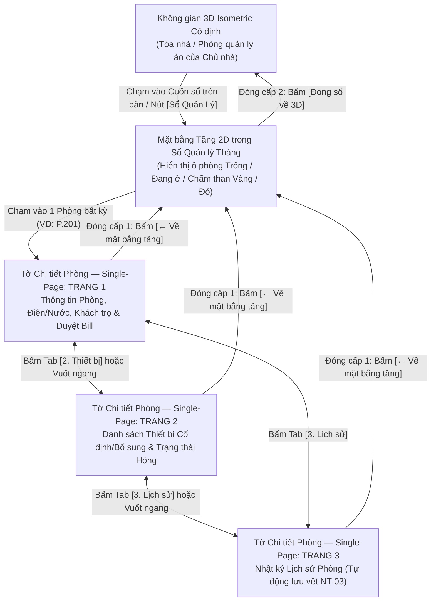

# Thiết kế Luồng Trải nghiệm (UX Flows), Tương tác Sổ Quản lý Ảo Single-Page & Chuẩn Mobile P1 — QLNT

- **Dự án:** Quản lý nhà trọ (QLNT)
- **Thực hiện:** UX Lead & UX Agent (Hoàn thành các task Sprint 1 của UX)
- **Ngày ban hành:** 2026-11-12
- **Trạng thái:** `Hoàn thành trong Sprint 1`
- **Căn cứ tham chiếu:**
  - `01-quan-ly/DECISIONS.md` (`QLNT-D005..D014`)
  - `02-nghiep-vu/DAC_TA_SO_QUAN_LY_AO_SINGLE_PAGE_VA_RENDERER.md`
  - `2.Tai_lieu_tham_khao/3.Tai_lieu_nghiep_vu/BO_BIEU_MAU_HOP_DONG_BAN_GIAO_HOA_DON_VN.md` (`REF-MKT-002`)
  - `04-van-hanh/HA_TANG_VA_VAN_HANH_HE_THONG.md`

---

## 1. Luồng UX 1: Quản lý Phòng, Tầng & Khách trọ qua Sổ Quản lý Ảo F04 (`QLNT-D010..D013`)

### 1.1. Sơ đồ Luồng Điều hướng Phân cấp 2 Cấp (`QLNT-D012` & `QLNT-D013`)



### 1.2. Wireframe Chi tiết Chế độ Single-Page trên Màn hình Dọc Mobile (`360x800px` – `430x932px`)

```
+-------------------------------------------------------+
| [← Về mặt bằng tầng]   SỔ THÁNG 11/2026      [Đóng X] |  <- Thanh điều hướng Cấp 1 & Cấp 2 (Cao 56px)
+-------------------------------------------------------+
| PHÒNG P.201 - TẦNG 2          Trạng thái: [Đang ở ▾]  |  <- Header cố định của phòng (In-place dropdown)
+-------------------------------------------------------+
| [ 1. Thông tin & Tiền ] [ 2. Thiết bị ] [ 3. Lịch sử ]|  <- Thanh Bookmark Tab 3 trang đơn (Cao 48px)
+=======================================================+
| (VÙNG NỘI DUNG SINGLE-PAGE CUỘN DỌC ĐỘC LẬP)          |
|                                                       |
| ▸ A. CHỈ SỐ ĐIỆN & NƯỚC THÁNG 11/2026                 |
|   • Điện (3.800đ): Cũ 1240 -> Mới [ 1315 ✎] = 285.000đ|  <- Chạm vào ô [1315] mở bàn phím số sửa ngay
|   • Nước (25.000đ): Cũ 085 -> Mới [  091 ✎] = 150.000đ|
|   • Tiền phòng + Dịch vụ:                   3.750.000đ|
|   --------------------------------------------------- |
|   TỔNG PHẢI THU:                            4.185.000đ|
|   Trạng thái Bill: [!] Khách đã nộp ảnh Bill lúc 09:15|
|   [ Xem ảnh Bill chuyển khoản ]  [ ✓ DUYỆT ĐÃ NHẬN ]  |  <- Nút hành động chính (Cao 48px, dễ bấm 1 ngón)
|                                                       |
| ▸ B. DANH SÁCH NGƯỜI ĐANG TRỌ (02 người)   [+ Thêm]   |
|   1. Nguyễn Văn A (Đại diện) | 0987.xxx.xxx    [Sửa ✎]|
|      CCCD: 001099xxxxxx | Xe: 29B1-123.45             |
|   2. Trần Văn B (Ở ghép)     | 0912.xxx.xxx    [Sửa ✎]|
+=======================================================+
| [< Trang trước]      Trang 1 / 3       [Trang sau >]  |  <- Footer lật trang đơn (Cao 52px)
+-------------------------------------------------------+
```

---

## 2. Luồng UX 2: Thu tiền Thủ công (`R-05`) & Báo hỏng Thiết bị (`R-04`)

### 2.1. Luồng Thu tiền Thủ công & Duyệt Bill Chuyển khoản (`QLNT-D005`, `QLNT-D006`)
1. **Bước 1 — Chủ nhà phát thông báo thu tiền:**
   - Chủ nhà nhập chỉ số điện/nước mới tại **Trang 1 (Sổ F04)** và bấm `[Phát thông báo thu tiền]`.
   - Hệ thống kích hoạt hoạt ảnh Avatar chủ nhà đi gõ cửa phòng và bật **Chấm than vàng (`!`)** trước cửa phòng 3D cũng như trên ô phòng của Mặt bằng tầng 2D.
2. **Bước 2 — Khách thuê làm nhiệm vụ nộp ảnh Bill:**
   - Khách thuê mở App trên điện thoại $\rightarrow$ thấy nhiệm vụ *"Đóng tiền phòng tháng 11 (`4.185.000đ`)"* $\rightarrow$ chuyển khoản ngân hàng và bấm `[Chụp / Tải lên ảnh Bill]`.
   - Ảnh được nén tự động phía Client (`< 300KB`) và tải lên `Private Bucket`. Hoạt ảnh Avatar khách mang phong bì tiền đến phòng quản lý của chủ nhà.
3. **Bước 3 — Chủ nhà kiểm tra & xác nhận đã nhận đủ tiền:**
   - Chủ nhà mở **Trang 1 (Sổ F04)** của phòng có chấm than vàng $\rightarrow$ bấm `[Xem ảnh Bill]` (mở qua `Signed URL 15 phút`) $\rightarrow$ bấm **`[✓ Xác nhận đã nhận đủ tiền]`**.
   - **Kết quả tức thì:** Đóng nhiệm vụ, tắt chấm than vàng, cộng điểm thưởng đúng hạn cho khách thuê (hoặc trừ điểm nếu quá hạn) và tự động ghi 1 dòng nhật ký vào **Trang 3 (Lịch sử phòng)**.

### 2.2. Luồng Báo hỏng Thiết bị & Sửa chữa (`R-04`)
1. **Khách báo hỏng:** Khách chạm vào thiết bị trong phòng 3D (hoặc danh sách thiết bị) $\rightarrow$ chọn thiết bị (VD: *Điều hòa*) $\rightarrow$ nhập mô tả ngắn (*"Không mát, chảy nước"*) $\rightarrow$ gửi báo cáo.
2. **Hiển thị cảnh báo:** Thiết bị và cửa phòng hiện **Chấm than đỏ (`!`)** nhấp nháy liên tục trên cả cảnh 3D và Mặt bằng tầng 2D trong Sổ F04.
3. **Chủ nhà xử lý:** Chủ nhà mở **Trang 2 (Thiết bị — Sổ F04)** $\rightarrow$ sau khi thợ sửa xong, chủ nhà chạm vào trạng thái thiết bị chuyển từ `Đang hỏng (!)` về `Bình thường`. Chấm than đỏ tắt ngay lập tức và Trang 3 tự động lưu vết lịch sử sửa chữa.

---

## 3. Đặc tả Trạng thái Tương tác & Tiêu chuẩn Mobile (`Mobile-First Ergonomics`)

| Hạng mục tương tác | Tiêu chuẩn UX bắt buộc cho Dev & 2D/3D Artist |
| :--- | :--- |
| **Kích thước vùng chạm tối thiểu (`Touch Target`)** | Mọi ô phòng trên mặt bằng tầng 2D, các tab chuyển trang (1-2-3), nút sửa `in-place edit` và nút duyệt bill phải có diện tích vùng chạm tối thiểu **`44x44px`** (khuyến nghị `48x48px`). |
| **Trạng thái ô chỉnh sửa trực tiếp (`In-place Edit States`)** | • **Mặc định (`Read-only`):** Chữ màu mực xanh/đen trên nền giấy vàng kem, có biểu tượng bút chì mờ `✎` bên phải.<br>• **Đang sửa (`Editing`):** Viền xanh dương đậm `2px`, tự động bật bàn phím số (`inputmode="numeric"`) đối với ô điện/nước/tiền.<br>• **Đã lưu (`Saved`):** Nháy nền xanh lá nhạt trong `600ms` kèm toast nhỏ *"Đã lưu & ghi lịch sử Trang 3"*.<br>• **Lỗi dữ liệu (`Error`):** Viền đỏ + thông báo ngay dưới ô (VD: *"Chỉ số điện mới không được nhỏ hơn chỉ số cũ 1240"*). |
| **Chế độ dự phòng 2D & Tự động hạ cấp (`R-16` & `QLNT-D014`)** | • Luôn có nút chuyển nhanh **`[Chế độ Sổ 2D / 3D]`** ở góc trên màn hình.<br>• Khi thiết bị có `FPS < 30` hoặc `RAM < 3GB`, tự động chuyển hiệu ứng lật trang sang **2D Slide-Card ngang** mượt nhẹ mà không làm gián đoạn thao tác nhập liệu của chủ nhà. |
