# Đánh giá Hạ tầng Triển khai Máy chủ, Cloud & Vận hành (DevOps) — QLNT

- **Dự án:** Quản lý nhà trọ (QLNT)
- **Tác giả:** Tech Lead (Kiến trúc & Hạ tầng) phối hợp Mảng C (Quản lý vận hành) & PM Lead
- **Ngày lập:** 2026-11-12
- **Trạng thái:** `Đề xuất đánh giá kỹ thuật & hạ tầng (Chờ Chủ dự án phê duyệt)`
- **Căn cứ tham chiếu:**
  - `03-ky-thuat/TECH_PROFILE.md` (Mô hình SaaS Multi-tenant, Offline-first cho gói Miễn phí, WebGL/Three.js + Asset 3D `.glb`, lưu trữ ảnh bill chuyển khoản)
  - `02-nghiep-vu/REQUIREMENTS.md` & `MA_TRAN_TRUY_VET_P1.md` (R-05 duyệt bill, R-15 gói miễn phí/trả phí, QLNT-D010..D012 Sổ quản lý ảo F04)
  - `1.Bieu_Mau/1. Test cases/3. Checklist/X02_Checklist_Check Enviroment (STG) Before build.xlsx` (Tiêu chuẩn kiểm tra môi trường STG trước khi build/release)

---

## 1. Hiện trạng kiểm tra công cụ & hạ tầng trên máy trạm (Observed State)

Qua kiểm tra thực tế trên môi trường làm việc hiện tại (`2026-11-12`):
1. **Công cụ Container & Ảo hóa cục bộ:**
   - `docker`, `docker-compose`: **Chưa cài đặt (`NOT INSTALLED`)**.
2. **Công cụ CLI Cloud & BaaS / PaaS:**
   - `supabase`, `vercel`, `wrangler` (Cloudflare), `railway`, `flyctl`, `aws`, `gcloud`, `az`: **Chưa cài đặt (`NOT INSTALLED`)**.
3. **Hồ sơ vận hành & phát hành (`04-van-hanh/QUALITY_AND_RELEASE.md`):**
   - Toàn bộ các mục (Cách phát hành/triển khai, Kế hoạch rollback, Người chịu trách nhiệm vận hành, Môi trường STG/PROD) đang ở trạng thái `[Cần xác nhận]`.
4. **Hồ sơ kỹ thuật (`03-ky-thuat/TECH_PROFILE.md`):**
   - Mới chỉ liệt kê lựa chọn mở (*"PostgreSQL + Node.js (Fastify/NestJS) hoặc Supabase"*, *"MinIO / Cloudflare R2 / Supabase Storage"*), chưa có bảng phân tích đánh đổi (trade-off), chi phí, vị trí đặt máy chủ (Region gần Việt Nam) và kiến trúc mạng triển khai thực tế.

---

## 2. Yêu cầu đặc thù của dự án QLNT đối với Hạ tầng Máy chủ & Cloud

Hệ thống QLNT không phải một web app CRUD thông thường mà có **5 đặc thù kỹ thuật cốt lõi** quyết định việc chọn hạ tầng:

| STT | Đặc thù nghiệp vụ / kỹ thuật | Yêu cầu hạ tầng máy chủ & Cloud tương ứng |
| :--- | :--- | :--- |
| **1** | **Tải Asset 3D (`.glb`), Texture Sổ quản lý ảo F04 & WebBundle trên Mobile** | Cần **CDN (Content Delivery Network)** có PoP tại Việt Nam / Singapore, hỗ trợ nén `Brotli`/`Gzip` và `HTTP/3` để tải file `.glb` và mặt bằng 2D dưới `1.5s` trên mạng 4G. |
| **2** | **SaaS Multi-tenant & Phân quyền nghiêm ngặt (`landlord_id`, Chủ trọ - Khách - Sale)** | Cần **PostgreSQL** có hỗ trợ **Row-Level Security (RLS)** hoặc cơ chế cách ly tenant ở tầng API/DB để tuyệt đối không lộ thông tin cá nhân khách thuê (CCCD, SĐT, tiền phòng) giữa các nhà trọ. |
| **3** | **Tương tác thời gian thực (Realtime): Khách nộp bill $\rightarrow$ Sổ F04 hiện chấm than vàng; Khách báo hỏng $\rightarrow$ Hiện chấm than đỏ** | Cần hạ tầng **WebSocket / Realtime Pub-Sub** ổn định, chịu được kết nối đồng thời từ điện thoại của chủ trọ và khách thuê mà không tốn tài nguyên polling. |
| **4** | **Lưu trữ ảnh chụp Bill chuyển khoản (`R-05`), ảnh CCCD/Hợp đồng & ảnh phòng của Sale** | Cần **S3-compatible Object Storage** có cơ chế **Private Bucket + Signed URL** (chỉ chủ trọ và khách của phòng đó mới xem được ảnh bill/CCCD) và **Zero/Low Egress Fee** (không tính phí băng thông đắt đỏ khi chủ trọ mở Sổ F04 xem lại ảnh nhiều lần). |
| **5** | **Mô hình Freemium: Gói Miễn phí (Local/Offline) $\leftrightarrow$ Gói Trả phí (Cloud Sync)** | Cần kiến trúc **Hybrid Local-First**: Bản miễn phí chạy trực tiếp trên trình duyệt/App qua `IndexedDB (Dexie.js)` không tốn tài nguyên server; chỉ khi đăng ký gói trả phí hoặc đồng bộ đa thiết bị mới gọi API/Database trên Cloud. |

---

## 3. Phân tích & So sánh 03 Phương án Hạ tầng Triển khai (Server / Cloud Options)

### Phương án 1 (Khuyên dùng cho P1 - MVP & Pilot): **Managed Cloud & Serverless BaaS (Cloudflare + Supabase)**
- **Kiến trúc thành phần:**
  - **Frontend & 3D Asset Hosting + CDN:** **Cloudflare Pages** (hoặc Vercel) — miễn phí băng thông tĩnh, mạng lưới CDN ngay tại Hà Nội/TP.HCM giúp tải scene 3D Three.js cực nhanh.
  - **Backend, Auth, Database & Realtime:** **Supabase (Region: Singapore `ap-southeast-1`)** — cung cấp sẵn PostgreSQL, Auth (SĐT/Email/OAuth), Row-Level Security (RLS) cho Multi-tenant, và Realtime WebSocket đồng bộ trạng thái chấm than vàng/đỏ ngay khi DB thay đổi.
  - **Object Storage (Ảnh bill, CCCD, Asset 3D động):** **Cloudflare R2** hoặc **Supabase Storage** (Private Bucket + Signed URL, miễn phí băng thông tải ra - Zero Egress).
- **Ưu điểm:**
  - Thời gian dựng môi trường `STG` gần như tức thì (1–2 giờ), không tốn công quản trị hệ điều hành máy chủ (Zero-Ops).
  - Chi phí giai đoạn P1 / Pilot: **$0 – $25/tháng** (nằm trong gói Free/Pro cơ bản).
  - Có sẵn `supabase` CLI chạy qua Docker ở local để dev/QA kiểm thử độc lập trước khi đẩy lên STG.
- **Nhược điểm / Giới hạn:**
  - Phụ thuộc vào cấu trúc BaaS của Supabase nếu viết quá nhiều logic trong Database Trigger (Giải pháp khắc phục: Giữ toàn bộ logic tính toán trong **Headless Domain Core** bằng TypeScript theo đúng `NT-01`, chỉ dùng Supabase làm tầng lưu trữ, Auth và truyền tin Realtime).

### Phương án 2 (Tối ưu khi mở rộng P2/P3 hoặc tự chủ hoàn toàn): **VPS / Cloud VM + Docker Compose (Self-hosted tại VN/Singapore)**
- **Kiến trúc thành phần:**
  - **Máy chủ:** 01–02 Cloud VPS tại Việt Nam (Viettel IDC, VNG Cloud,FPT, Vietnix, GreenNode) hoặc Singapore (DigitalOcean, Hetzner, AWS Lightsail) cấu hình khởi điểm `2–4 vCPU, 4–8GB RAM, NVMe SSD`.
  - **Đóng gói vận hành:** Chạy **Docker Compose** gồm: `Caddy/Nginx` (Reverse Proxy + Auto SSL) + `Node.js (Fastify/NestJS)` (API & Socket.IO) + `PostgreSQL 16` + `Redis` (Cache/PubSub) + `MinIO` ( hoặc kết nối Cloudflare R2).
  - **CDN:** Đặt **Cloudflare Free/Pro** phía trước để cache toàn bộ file tĩnh và `.glb`.
- **Ưu điểm:**
  - Toàn quyền kiểm soát máy chủ, dữ liệu đặt vật lý tại Việt Nam (thuận lợi tuyệt đối về pháp lý bảo vệ dữ liệu cá nhân Nghị định 13/2023/NĐ-CP).
  - Chi phí cố định, dễ dự toán (**~200.000đ – 500.000đ/tháng** cho 1 cụm STG/Pilot).
- **Nhược điểm / Giới hạn:**
  - Cần người/role phụ trách cài đặt Docker, cấu hình tường lửa (UFW), thiết lập cronjob sao lưu (backup) PostgreSQL tự động ra ngoài server, và giám sát uptime.

### Phương án 3 (Enterprise Cloud): **AWS / Google Cloud Platform (ECS/Cloud Run + RDS + S3 + CloudFront)**
- **Đánh giá:** Độ ổn định cao nhất nhưng chi phí khởi điểm cao (**$50 – $150+/tháng** do phí NAT Gateway, RDS instance, Egress bandwidth của S3/CloudFront) và cấu hình IAM/Terraform phức tạp, **không phù hợp** cho giai đoạn P1 MVP.

---

## 4. Kiến trúc Môi trường 3 Tầng (Local Dev $\rightarrow$ Staging $\rightarrow$ Production)

Để đáp ứng cổng chất lượng **G3 (Sẵn sàng phát hành)** trong `MO_HINH_VAN_HANH.md` và biểu mẫu `X02_Checklist_Check Enviroment (STG) Before build.xlsx`, dự án cần chuẩn hóa 3 môi trường:

```mermaid
flowchart LR
    subgraph LOCAL ["1. Môi trường Local Dev (Máy trạm)"]
        L1["Vite + Three.js Dev Server"]
        L2["IndexedDB (Dexie.js - Offline Mode)"]
        L3["Docker Compose: Local Postgres / Supabase CLI + MinIO"]
    end

    subgraph STG ["2. Môi trường Staging (STG - Kiểm thử & UAT)"]
        S1["GitHub Actions CI/CD (Auto-deploy từ nhánh staging)"]
        S2["Cloudflare Pages / Preview URL (HTTPS)"]
        S3["Staging DB (Mock Data an toàn, không chứa CCCD thật)"]
        S4["Staging Storage (Ảnh bill test)"]
    end

    subgraph PROD ["3. Môi trường Production (PROD - Pilot)"]
        P1["Cloudflare CDN + Web/Capacitor App"]
        P2["Production DB (Multi-tenant RLS + Daily Encrypted Backup)"]
        P3["Private Object Storage (Signed URL cho ảnh Bill & CCCD)"]
    end

    LOCAL -->|"PR & Review (Tech Lead)"| STG
    STG -->|"QA Pass X02 Checklist + Chủ dự án duyệt Cổng G3"| PROD
```

---

## 5. Rủi ro Hạ tầng & Vận hành phát hiện thêm

1. **Rủi ro bảo mật dữ liệu nhạy cảm (`Cao`):** Trong Sổ quản lý ảo F04 (Trang 1), chủ nhà lưu thông tin cá nhân người đang trọ (Họ tên, SĐT, CCCD) và ảnh bill chuyển khoản. Nếu Object Storage để ở chế độ `Public Bucket` hoặc Database không bật `Row-Level Security` theo `landlord_id`, người dùng có thể đoán URL để xem trộm thông tin phòng/nhà trọ khác.
2. **Rủi ro thiếu môi trường giả lập Server cục bộ (`Trung bình`):** Máy trạm hiện chưa cài `Docker Desktop` (hoặc `OrbStack`) và chưa có file `docker-compose.yml`, khiến việc phát triển và kiểm thử tích hợp Backend/DB ở local chưa thể chạy độc lập.
3. **Rủi ro thiếu quy trình CI/CD & STG Checklist (`Trung bình`):** Repo `4.Du_an/QLNT` chưa có cấu hình `.github/workflows/` để tự động kiểm tra lint/typecheck/build và tự động đẩy bản xem trước (Preview/Staging URL) cho Chủ dự án và QA nghiệm thu trên điện thoại thật.

---

## 6. Đề xuất Hành động & Các Task/Issue bổ sung trên Orca

### 6.1. Kiến nghị Chủ dự án chốt quyết định hạ tầng (`QLNT-D013` - Dự thảo chờ duyệt):
- **Môi trường Local Dev:** Dùng **Docker Compose** (hoặc `OrbStack` nhẹ cho macOS) chạy PostgreSQL + Storage cục bộ, kết hợp `IndexedDB` cho chế độ Offline.
- **Môi trường Staging (STG) & Pilot P1:** Chọn **Phương án 1 (Cloudflare Pages + Supabase Singapore + Cloudflare R2/Supabase Private Storage)** để có ngay HTTPS URL kiểm thử trên điện thoại di động với chi phí $0, hoặc **Phương án 2 (VPS Việt Nam chạy Docker Compose + Cloudflare CDN)** nếu Chủ dự án đã có sẵn máy chủ VPS.

### 6.2. Các hạng mục Task & Issue bổ sung lên hệ thống Orca (`theGonlyK/QLNT` & GitHub Project #2):
1. **Subtask mới cho Tech (`[Sprint 1][Subtask][Tech Contributor]`):** *Đánh giá và đề xuất kiến trúc hạ tầng máy chủ, Cloud, lưu trữ và CI/CD (Local/STG/PROD)*.
2. **Issue `ISS-09` (`[Tech Lead]`):** *Chưa chốt phương án hạ tầng máy chủ/Cloud (BaaS vs VPS Docker) và kiến trúc bảo mật lưu trữ ảnh bill/CCCD cho môi trường STG & PROD*.
3. **Issue `ISS-10` (`[Tech Contributor]` / `[QA Lead]`):** *Máy trạm chưa cài đặt Docker (OrbStack/Docker Desktop), Cloud CLI và chưa thiết lập CI/CD + STG Environment Checklist theo chuẩn X02*.
