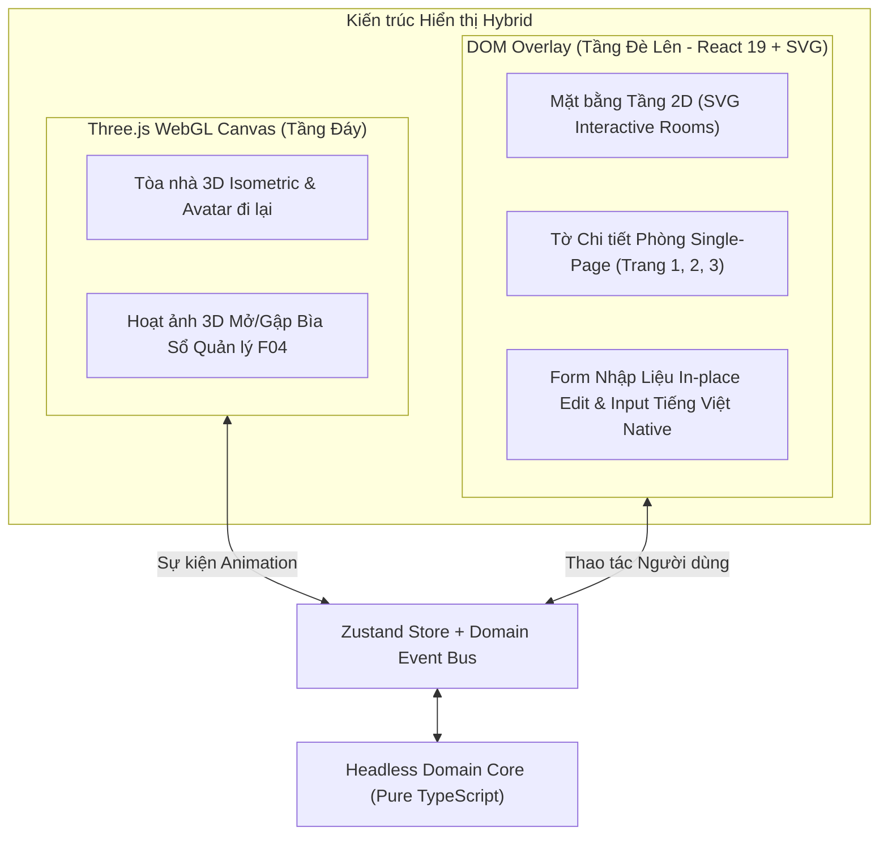
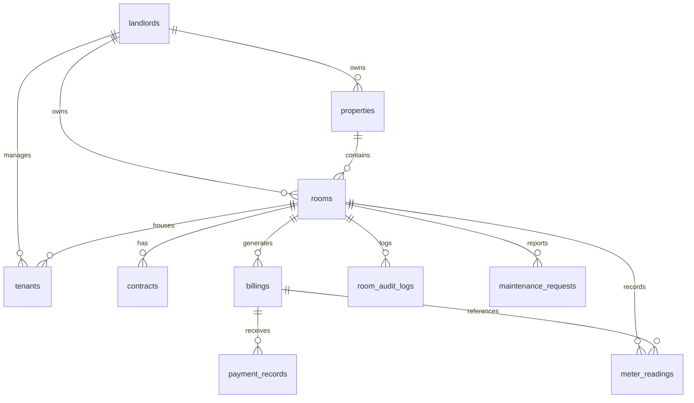
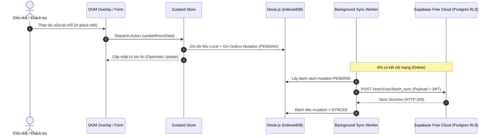
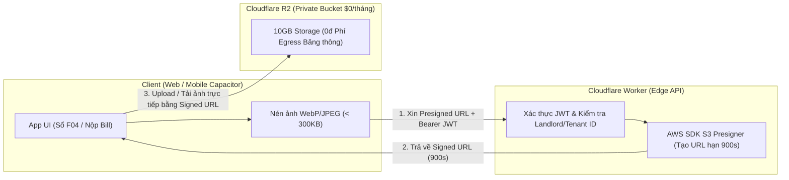

# Danh sách Cải thiện và Chuẩn hóa Kỹ thuật Dự án QLNT

> **Tài liệu Kỹ thuật Chuẩn hóa (Technical Standardization Document)**  
> **Mã hồ sơ:** `TECH-STD-001`  
> **Dự án:** Quản lý nhà trọ (QLNT)  
> **Hồ sơ lịch sử liên quan:** [`PLAN-TECH-001`](../04-van-hanh/lich-su/ho-so-thuc-thi-chi-tiet/KE_HOACH_CHUAN_HOA_KY_THUAT_VA_NHAN_SU.md)
> **Người lập:** Kỹ thuật chính dự án (Tech Lead / Mảng B)  
> **Ngày ban hành:** 2026-11-12  
> **Trạng thái:** `Đã phê duyệt — Chuẩn bắt buộc áp dụng`

---

## 1. Tổng quan & Bối cảnh Chuẩn hóa

Trong quá trình chuẩn bị Sprint 1 và rà soát hệ thống tài liệu kiến trúc, mảng Kỹ thuật đã tổng hợp 7 điểm cần hoàn thiện và chuẩn hóa kỹ thuật nhằm:
1. Đảm bảo tính nhất quán tuyệt đối giữa hợp đồng giao tiếp đồ họa (`IGameRenderer`), đặc tả nghiệp vụ (`SRS.md`, `USE_CASES.md`, `DAC_TA_SO_QUAN_LY_AO_SINGLE_PAGE_VA_RENDERER.md`) và mã nguồn thực thi.
2. Thiết lập kiến trúc hiển thị `Hybrid WebGL 3D + DOM Overlay` tối ưu cho nghiệp vụ Sổ quản lý ảo F04 Single-Page (`QLNT-D013`), giải quyết triệt để bài toán hiệu năng và trải nghiệm nhập liệu form trên thiết bị di động.
3. Chốt cấu hình công nghệ (`Tech Stack`) dứt khoát, loại bỏ các phương án lấp lửng.
4. Mở rộng và chuẩn hóa toàn diện lược đồ 10 bảng dữ liệu bao phủ đầy đủ các trường thực tế đời thực từ `REF-MKT-002` và cơ chế nhật ký bất biến `RoomAuditLog` (`NT-03`).
5. Xây dựng cơ chế đồng bộ Local-First `IndexedDB Outbox` $\leftrightarrow$ `Supabase Free Cloud Sync` bảo đảm dữ liệu ngoại tuyến mượt mà.
6. Thiết lập giải pháp an ninh lưu trữ ảnh chứng từ nhạy cảm qua `Cloudflare Worker Edge Function` cấp `Signed URL 15 phút` cho `Cloudflare R2 Free Tier`.
7. Chuẩn hóa môi trường máy trạm Kỹ thuật chính (`MinhNTV`) và loại bỏ triệt để các liên kết cứng cá nhân, chuyển sang liên kết tương đối chuẩn Markdown.

---

## 2. Chi tiết 7 Điểm Cải thiện & Chuẩn hóa Kỹ thuật

### Điểm 1: Hợp nhất Contract `IGameRenderer` (Single Source of Truth)

Trước đây, tên hàm và tham số giữa `TECH_PROFILE.md`, `SRS.md`, `USE_CASES.md` và `DAC_TA_SO_QUAN_LY_AO_SINGLE_PAGE_VA_RENDERER.md` có sự không đồng nhất về kiểu tọa độ (`Vector3` vs `Vector3D`), thiếu các hàm điều khiển Sổ ảo F04 cấp độ Single-Page, hoặc chưa phân định rõ ranh giới trách nhiệm giữa Game Scene và Virtual Ledger Book.

**Nội dung chuẩn hóa:**
- Xác lập kiểu dữ liệu tọa độ 3D chuẩn hóa toàn dự án: `Vector3D = { x: number, y: number, z: number }`.
- Phân nhóm hợp đồng `IGameRenderer` thành 2 khối chức năng rõ ràng:
  1. *Khối Cảnh 3D Tòa nhà & Nhân vật (3D Scene & Avatar):* Render isometric tòa nhà, sinh/di chuyển avatar, gắn icon cảnh báo chấm than đỏ (thiết bị hỏng `setDeviceStatus`) và chấm than vàng (thu tiền/chờ duyệt bill `setRoomNotice`).
  2. *Khối Điều khiển Sổ Quản lý Ảo F04 (Virtual Ledger Book):* Mở sổ theo tháng, lật trang mặt bằng tầng 2D, mở tờ chi tiết phòng Single-Page 3 trang, chuyển tab, làm mới giao diện sau khi sửa tại chỗ (`in-place edit`), đóng tờ chi tiết về mặt bằng tầng (Đóng cấp 1) và gập sổ quay về không gian 3D (Đóng cấp 2).

```typescript
// packages/contracts/src/renderer.ts

export interface Vector3D {
  x: number;
  y: number;
  z: number;
}

export type DeviceStatus = 'NORMAL' | 'BROKEN';
export type RoomNoticeType = 'NONE' | 'PAYMENT_DUE' | 'BILL_PENDING';
export type RoomDetailTab = 'PAGE_1_BILLING' | 'PAGE_2_DEVICES' | 'PAGE_3_AUDIT';

export interface IGameRenderer {
  // === Khối Cảnh 3D Tòa nhà & Nhân vật ===
  renderBuilding(buildingData: BuildingRenderDTO): Promise<void>;
  spawnAvatar(avatarId: string, roomPosition: Vector3D, skinConfig: AvatarSkinDTO): void;
  moveAvatar(avatarId: string, targetPosition: Vector3D, onComplete?: () => void): void;
  setDeviceStatus(roomId: string, deviceId: string, status: DeviceStatus): void;
  setRoomNotice(roomId: string, type: RoomNoticeType): void;
  playMinigameAction(actionType: string, toolSkin?: string): Promise<void>;

  // === Khối Điều khiển Sổ Quản lý Ảo F04 (Single-Page & Mặt bằng tầng) ===
  openLedgerBook(monthKey: string, initialFloorIndex: number, floorMapData: FloorMapDTO): Promise<void>;
  flipLedgerFloorPage(targetFloorIndex: number, floorMapData: FloorMapDTO): Promise<void>;
  openRoomDetailSinglePage(roomId: string, activeTab: RoomDetailTab, roomDetailData: RoomDetailDTO): Promise<void>;
  switchRoomDetailPageTab(roomId: string, targetTab: RoomDetailTab, roomDetailData: RoomDetailDTO): Promise<void>;
  refreshRoomDetailView(roomId: string, updatedDetailData: RoomDetailDTO): void;
  closeRoomDetailToFloorMap(updatedFloorMapData: FloorMapDTO): Promise<void>;
  closeLedgerBookTo3DScene(): Promise<void>;
}
```

---

### Điểm 2: Kiến trúc Hybrid `WebGL 3D + DOM Overlay` cho Sổ F04 Single-Page

**Vấn đề kỹ thuật:** Việc dựng toàn bộ giao diện bảng biểu, form nhập liệu điện/nước, danh sách người thuê, hình ảnh hóa đơn và bàn phím ảo trực tiếp trên WebGL Canvas (Three.js 3D Mesh) gây ra:
- Chi phí xử lý bộ nhớ cao (Text texture atlas rất tốn VRAM trên mobile).
- Khả năng xử lý input form tiếng Việt (IME, unikey) trên Canvas rất phức tạp và dễ phát sinh lỗi hiển thị.
- Trải nghiệm chạm/cuộn (Touch scroll, accessibility) kém tự nhiên so với thành phần gốc của trình duyệt.

**Giải pháp kiến trúc Hybrid:**
- **Three.js WebGL Canvas:** Đảm nhận kết xuất không gian 3D Isometric cố định (tòa nhà, đường phố, avatar) và hoạt ảnh mở/gập bìa sổ quản lý 3D khi chủ nhà mở/đóng sổ F04.
- **DOM Overlay (React 19 + Tailwind CSS + SVG):** Nằm đè lên Canvas, hiển thị mặt bằng 2D tầng (vector SVG tương tác cao) và bộ 3 Trang Chi tiết Phòng Single-Page (`QLNT-D013`). Toàn bộ việc nhập chỉ số điện nước, chỉnh sửa thông tin người thuê (`in-place edit`), xem ảnh chứng từ được thực hiện tự nhiên qua DOM.
- **Cầu nối đồng bộ (Bridge):** Trạng thái mở/đóng được điều phối thông qua `Domain Event Bus` và `Zustand Store`. Khi hoạt ảnh Three.js mở sổ hoàn tất, DOM Overlay kích hoạt hiển thị với hiệu ứng chuyển trang mượt mà.



---

### Điểm 3: Chốt Cấu hình Tech Stack Frontend & Đóng gói Mobile

Trong tài liệu sơ khởi, phần Frontend đề cập dạng lựa chọn `"Vue 3 / React (Vite)"` gây mơ hồ cho đội ngũ phát triển. Đợt chuẩn hóa này chốt dứt khoát 1 cấu hình duy nhất:

| Thành phần | Công nghệ được chốt | Vai trò & Lý do lựa chọn |
|---|---|---|
| **Frontend Framework** | **React 19 + TypeScript** | Phiên bản React mới nhất với Actions, `useActionState`, tối ưu render form, hệ sinh thái linh kiện lớn nhất. |
| **Build Tool & HMR** | **Vite 6** | Tốc độ khởi động máy chủ phát triển và Hot Module Replacement (HMR) tính bằng mili-giây, tối ưu build tĩnh cho Cloudflare Pages. |
| **CSS Framework** | **Tailwind CSS v4** | Xây dựng giao diện DOM Overlay, mặt bằng 2D, Single-Page Ledger và mobile responsive cực nhanh, dung lượng CSS tối thiểu. |
| **State Management** | **Zustand** | Quản lý trạng thái Headless Domain Core độc lập, cực nhẹ (< 1KB), zero boilerplate, dễ dàng đồng bộ với IndexedDB. |
| **3D Graphic Engine** | **Three.js** | Thư viện tiêu chuẩn cho WebGL, tải model `.glb` nhẹ (Draco/Meshopt), camera Orthographic cố định cho góc nhìn Isometric. |
| **Local Database** | **Dexie.js (IndexedDB)** | Cơ sở dữ liệu local-first phía Client, lưu trữ offline toàn bộ hồ sơ nhà trọ, hóa đơn và hàng đợi Outbox. |
| **Mobile App Shell** | **Capacitor 6** | Đóng gói Web codebase thành native app cho Android và iOS, tích hợp plugin Camera chụp ảnh bill và CCCD. |
| **Backend & Cloud DB** | **Supabase Free Tier (PostgreSQL 16)** | Database quan hệ PostgreSQL có Row-Level Security (RLS), Realtime WebSocket, chi phí $0/tháng cho giai đoạn 1. |
| **Edge Compute & Storage** | **Cloudflare Workers & R2 Storage** | Edge Worker ký Signed URL 15 phút, Private Bucket R2 10GB miễn phí, 0đ băng thông Egress. |

---

### Điểm 4: Chuẩn hóa Schema 10 Bảng Dữ liệu Bao phủ `REF-MKT-002` & `RoomAuditLog` (`NT-03`)

Lược đồ cơ sở dữ liệu được mở rộng và chuẩn hóa toàn diện từ 8 thực thể sơ khởi lên **10 bảng nghiệp vụ**, 100% sử dụng khóa chính `UUID v4`, bắt buộc có trường `landlord_id` để phân vùng Multi-tenant qua Row-Level Security (RLS) theo chuẩn bảo mật `04-van-hanh/`.



#### Chi tiết 10 bảng dữ liệu:

1. **`landlords` (Chủ nhà trọ / Tài khoản quản trị):**
   - `id`: `UUID` (PK)
   - `name`: `VARCHAR(100)` — Họ và tên chủ nhà
   - `phone`: `VARCHAR(20)` (UNIQUE) — Số điện thoại đăng nhập / Zalo
   - `email`: `VARCHAR(150)` (UNIQUE)
   - `reputation_stars`: `INT` (DEFAULT 5) — Số sao uy tín tích lũy
   - `package_tier`: `VARCHAR(20)` (DEFAULT 'FREE') — 'FREE' | 'PRO'
   - `created_at`: `TIMESTAMPTZ`, `updated_at`: `TIMESTAMPTZ`

2. **`properties` (Khu trọ / Tòa nhà):**
   - `id`: `UUID` (PK)
   - `landlord_id`: `UUID` (FK -> landlords.id, NOT NULL)
   - `name`: `VARCHAR(150)` — Tên khu trọ (VD: Nhà trọ Xanh Cầu Giấy)
   - `address`: `TEXT` — Địa chỉ chi tiết
   - `total_floors`: `INT` (DEFAULT 1)
   - `coordinates_3d`: `JSONB` — Tọa độ hiển thị trên bản đồ 3D (`{ x, y, z }`)
   - `is_public_on_map`: `BOOLEAN` (DEFAULT false) — Hiển thị bản đồ tìm trọ F06
   - `water_calc_method`: `VARCHAR(20)` (DEFAULT 'PER_M3') — 'PER_M3' (theo đồng hồ) | 'PER_PERSON' (khoán đầu người) theo thực tế `REF-MKT-002`
   - `water_unit_price`: `NUMERIC(12,2)` — Đơn giá nước (đ/m3 hoặc đ/người)
   - `electric_unit_price`: `NUMERIC(12,2)` — Đơn giá điện (đ/kWh)
   - `service_fee`: `NUMERIC(12,2)` (DEFAULT 0) — Phí vệ sinh, rác, wifi, thang máy
   - `created_at`: `TIMESTAMPTZ`, `updated_at`: `TIMESTAMPTZ`

3. **`rooms` (Phòng trọ):**
   - `id`: `UUID` (PK)
   - `landlord_id`: `UUID` (FK -> landlords.id, NOT NULL)
   - `property_id`: `UUID` (FK -> properties.id, NOT NULL)
   - `floor_number`: `INT` (NOT NULL) — Tầng chứa phòng
   - `room_number`: `VARCHAR(50)` (NOT NULL) — Tên/Số phòng (VD: P.201, P.302)
   - `area_sqm`: `NUMERIC(6,2)` — Diện tích phòng (m2)
   - `base_price`: `NUMERIC(12,2)` (NOT NULL) — Giá thuê gốc hàng tháng (VNĐ)
   - `deposit_amount`: `NUMERIC(12,2)` (DEFAULT 0) — Tiền cọc phòng
   - `status`: `VARCHAR(30)` (DEFAULT 'EMPTY') — 'EMPTY' | 'RENTED' | 'MAINTENANCE'
   - `created_at`: `TIMESTAMPTZ`, `updated_at`: `TIMESTAMPTZ`

4. **`tenants` (Khách thuê phòng & Thành viên ở ghép):**
   - `id`: `UUID` (PK)
   - `landlord_id`: `UUID` (FK -> landlords.id, NOT NULL)
   - `room_id`: `UUID` (FK -> rooms.id, NOT NULL)
   - `full_name`: `VARCHAR(150)` (NOT NULL)
   - `phone`: `VARCHAR(20)`
   - `id_card_number`: `VARCHAR(50)` (Mã hóa ở tầng ứng dụng/DB, 12 số CCCD)
   - `id_card_front_url`: `TEXT` (Đường dẫn Private Bucket R2)
   - `id_card_back_url`: `TEXT` (Đường dẫn Private Bucket R2)
   - `birth_year`: `INT`
   - `hometown`: `VARCHAR(150)` — Quê quán / Thường trú
   - `vehicle_plate`: `VARCHAR(30)` — Biển số xe đăng ký gửi hầm
   - `role`: `VARCHAR(30)` (DEFAULT 'ROOMMATE') — 'REPRESENTATIVE' (Đại diện ký HĐ) | 'ROOMMATE' (Ở ghép)
   - `temp_residence_status`: `VARCHAR(30)` (DEFAULT 'NOT_DECLARED') — 'DECLARED' | 'NOT_DECLARED' (Khai báo tạm trú VNeID)
   - `reward_points`: `INT` (DEFAULT 0) — Điểm thưởng Gamification
   - `avatar_skin_config`: `JSONB` — Cấu hình skin nhân vật game
   - `created_at`: `TIMESTAMPTZ`, `updated_at`: `TIMESTAMPTZ`

5. **`contracts` (Hợp đồng thuê phòng):**
   - `id`: `UUID` (PK)
   - `landlord_id`: `UUID` (FK -> landlords.id, NOT NULL)
   - `room_id`: `UUID` (FK -> rooms.id, NOT NULL)
   - `tenant_id`: `UUID` (FK -> tenants.id, NOT NULL) — Đại diện ký hợp đồng
   - `start_date`: `DATE` (NOT NULL)
   - `end_date`: `DATE` (NOT NULL)
   - `duration_months`: `INT` (NOT NULL) — Kỳ hạn thuê (6 tháng, 12 tháng)
   - `monthly_rent`: `NUMERIC(12,2)` (NOT NULL)
   - `deposit_paid`: `NUMERIC(12,2)` (NOT NULL)
   - `payment_cycle_day`: `INT` (DEFAULT 5) — Ngày chốt thu tiền hàng tháng (1 - 5)
   - `status`: `VARCHAR(30)` (DEFAULT 'ACTIVE') — 'ACTIVE' | 'EXPIRED' | 'TERMINATED'
   - `contract_file_url`: `TEXT` (Lưu PDF/ảnh hợp đồng nếu có)
   - `created_at`: `TIMESTAMPTZ`, `updated_at`: `TIMESTAMPTZ`

6. **`billings` (Hóa đơn kỳ thu tiền phòng hàng tháng):**
   - `id`: `UUID` (PK)
   - `landlord_id`: `UUID` (FK -> landlords.id, NOT NULL)
   - `room_id`: `UUID` (FK -> rooms.id, NOT NULL)
   - `contract_id`: `UUID` (FK -> contracts.id, NULLABLE)
   - `month_period`: `VARCHAR(7)` (NOT NULL) — Định dạng `YYYY-MM` (VD: '2026-11')
   - `room_charge`: `NUMERIC(12,2)` (NOT NULL) — Tiền phòng cố định
   - `electric_charge`: `NUMERIC(12,2)` (DEFAULT 0) — Tiền điện thực tế
   - `water_charge`: `NUMERIC(12,2)` (DEFAULT 0) — Tiền nước thực tế
   - `service_charge`: `NUMERIC(12,2)` (DEFAULT 0) — Dịch vụ chung
   - `vehicle_charge`: `NUMERIC(12,2)` (DEFAULT 0) — Tiền gửi xe
   - `previous_debt`: `NUMERIC(12,2)` (DEFAULT 0) — Nợ cũ hoặc khấu trừ
   - `total_amount`: `NUMERIC(12,2)` (NOT NULL) — Tổng cộng phải thu
   - `status`: `VARCHAR(30)` (DEFAULT 'UNPAID') — 'UNPAID' | 'PENDING_APPROVAL' (Chờ duyệt bill) | 'PAID'
   - `bill_image_url`: `TEXT` (Private Bucket R2 — Ảnh biên lai chuyển khoản do khách nộp)
   - `created_at`: `TIMESTAMPTZ`, `updated_at`: `TIMESTAMPTZ`

7. **`payment_records` (Phiếu thu & Giao dịch thanh toán):**
   - `id`: `UUID` (PK)
   - `landlord_id`: `UUID` (FK -> landlords.id, NOT NULL)
   - `billing_id`: `UUID` (FK -> billings.id, NOT NULL)
   - `room_id`: `UUID` (FK -> rooms.id, NOT NULL)
   - `amount_paid`: `NUMERIC(12,2)` (NOT NULL)
   - `payment_method`: `VARCHAR(30)` — 'BANK_TRANSFER_MANUAL' | 'VIETQR_AUTO' | 'CASH'
   - `payment_date`: `TIMESTAMPTZ` (NOT NULL)
   - `verified_by`: `UUID` (FK -> landlords.id, NULLABLE) — Người bấm nút duyệt bill
   - `note`: `TEXT`
   - `created_at`: `TIMESTAMPTZ`

8. **`meter_readings` (Chỉ số công tơ điện và đồng hồ nước):**
   - `id`: `UUID` (PK)
   - `landlord_id`: `UUID` (FK -> landlords.id, NOT NULL)
   - `room_id`: `UUID` (FK -> rooms.id, NOT NULL)
   - `billing_id`: `UUID` (FK -> billings.id, NULLABLE)
   - `month_period`: `VARCHAR(7)` (NOT NULL) — 'YYYY-MM'
   - `old_electric`: `NUMERIC(10,2)` (NOT NULL)
   - `new_electric`: `NUMERIC(10,2)` (NOT NULL)
   - `electric_consumed`: `NUMERIC(10,2)` (GENERATED ALWAYS AS (new_electric - old_electric) STORED)
   - `old_water`: `NUMERIC(10,2)` (DEFAULT 0)
   - `new_water`: `NUMERIC(10,2)` (DEFAULT 0)
   - `water_consumed`: `NUMERIC(10,2)` (GENERATED ALWAYS AS (new_water - old_water) STORED)
   - `meter_photo_url`: `TEXT` (Ảnh chụp mặt công tơ đối chiếu nếu có)
   - `recorded_by`: `VARCHAR(30)` — 'LANDLORD' | 'TENANT' | 'OFFICER_QR' (Cán bộ điện lực/nước quét QR)
   - `recorded_at`: `TIMESTAMPTZ` (DEFAULT NOW())

9. **`room_audit_logs` (Nhật ký biến động phòng — Append-Only `NT-03`):**
   - `id`: `UUID` (PK)
   - `landlord_id`: `UUID` (FK -> landlords.id, NOT NULL)
   - `room_id`: `UUID` (FK -> rooms.id, NOT NULL)
   - `actor_id`: `UUID` (NOT NULL) — ID của người thực hiện thay đổi
   - `actor_role`: `VARCHAR(30)` (NOT NULL) — 'LANDLORD' | 'TENANT' | 'SYSTEM' | 'SALE'
   - `action_type`: `VARCHAR(50)` (NOT NULL) — 'IN_PLACE_EDIT' | 'STATUS_CHANGE' | 'DEVICE_STATUS' | 'PAYMENT_VERIFIED' | 'CONTRACT_RENEW'
   - `change_summary`: `TEXT` (NOT NULL) — Tóm tắt thay đổi hiển thị trên dòng thời gian Trang 3 Sổ F04 (VD: "Đổi chỉ số điện mới từ 1240 thành 1315")
   - `old_data`: `JSONB` (NULLABLE)
   - `new_data`: `JSONB` (NULLABLE)
   - `created_at`: `TIMESTAMPTZ` (DEFAULT NOW(), IMMUTABLE — Tuyệt đối không cho phép UPDATE/DELETE)

10. **`maintenance_requests` (Yêu cầu báo hỏng & Sửa chữa thiết bị — F02):**
    - `id`: `UUID` (PK)
    - `landlord_id`: `UUID` (FK -> landlords.id, NOT NULL)
    - `room_id`: `UUID` (FK -> rooms.id, NOT NULL)
    - `tenant_id`: `UUID` (FK -> tenants.id, NULLABLE) — Người báo hỏng
    - `device_name`: `VARCHAR(100)` (NOT NULL) — Tên thiết bị (VD: Điều hòa Casper, Bình nóng lạnh)
    - `device_category`: `VARCHAR(30)` — 'FIXED' | 'FURNITURE' | 'ADDITIONAL' | 'SECURITY' | 'METER' (Khớp 10 nhóm thiết bị `REF-MKT-002`)
    - `issue_description`: `TEXT` (NOT NULL) — Mô tả chi tiết sự cố
    - `photo_url`: `TEXT` (Ảnh chụp vị trí hỏng)
    - `status`: `VARCHAR(30)` (DEFAULT 'PENDING_ALERT') — 'PENDING_ALERT' (Chấm than đỏ nhấp nháy) | 'IN_PROGRESS' | 'RESOLVED'
    - `reported_at`: `TIMESTAMPTZ` (DEFAULT NOW())
    - `resolved_at`: `TIMESTAMPTZ` (NULLABLE)
    - `repair_cost`: `NUMERIC(12,2)` (DEFAULT 0)
    - `resolved_by`: `UUID` (FK -> landlords.id, NULLABLE)

---

### Điểm 5: Cơ chế Đồng bộ `IndexedDB Outbox` $\leftrightarrow$ `Supabase Free Cloud Sync`

Dự án QLNT tuân thủ mô hình **Local-First Architecture** nhằm hỗ trợ chủ nhà thao tác trơn tru ngay cả khi mất sóng, đồng thời giữ chi phí vận hành ở mức `$0/tháng`:

1. **Ghi nhận Outbox tại Client:**
   - Mọi thao tác thay đổi dữ liệu (tạo hóa đơn, chốt điện nước, in-place edit, duyệt thanh toán) được ghi đồng thời vào bảng dữ liệu chính của Dexie.js và bảng `outbox_mutations`.
   - Trạng thái ban đầu của mutation là `'PENDING'`, kèm `mutation_id` (UUID), `entity_table`, `operation` ('INSERT'|'UPDATE'|'DELETE'), `payload` (JSON), và `client_timestamp` (ISO UTC).
2. **Cập nhật giao diện tức thì (Optimistic UI):**
   - Giao diện người dùng phản hồi ngay lập tức, không chờ phản hồi từ máy chủ Cloud.
3. **Cơ chế Worker đồng bộ nền (Background Sync Worker):**
   - Khi có kết nối mạng (`navigator.onLine` hoặc sự kiện `'online'`), worker tự động lấy danh sách mutation `'PENDING'` sắp xếp theo thứ tự thời gian.
   - Gửi yêu cầu theo mẻ (Batch requests) đến Supabase PostgREST API kèm JWT chứa `landlord_id`.
   - Khi Supabase phản hồi thành công (`HTTP 200/201`), trạng thái mutation trong outbox chuyển sang `'SYNCED'` (hoặc xóa để giải phóng dung lượng).
   - Nếu gặp lỗi mạng tạm thời, chuyển trạng thái sang `'RETRYING'` kèm thuật toán lũy thừa giảm tải (Exponential Backoff).
4. **Giải quyết xung đột (Conflict Resolution):**
   - Áp dụng nguyên tắc **Last-Write-Wins (LWW)** dựa trên trường `updated_at` cấp độ trường/dòng, kết hợp tự động ghi lại vết thay đổi vào `room_audit_logs` để chủ nhà luôn kiểm tra được lịch sử.



---

### Điểm 6: Kiến trúc `Cloudflare Worker / Edge Function` Cấp `Signed URL 15 phút` cho `Cloudflare R2 Free Tier`

Dữ liệu hình ảnh trong quản lý nhà trọ (biên lai nộp tiền, ảnh chụp 2 mặt CCCD, hợp đồng) chứa thông tin bảo mật và nhân thân cực kỳ nhạy cảm. Để bảo vệ dữ liệu theo tiêu chuẩn `NT-05` và tận dụng gói **10GB miễn phí, 0đ băng thông Egress của Cloudflare R2**:

1. **Cấu hình Bucket R2 hoàn toàn Private:**
   - Tuyệt đối không bật Public Domain hoặc Public Access trên bucket Cloudflare R2.
2. **Cổng kiểm soát truy cập (Cloudflare Worker Edge Function):**
   - Mọi yêu cầu xem hoặc tải lên hình ảnh phải đi qua Edge Function `GET/POST /api/media/signed-url`.
   - Worker giải mã JWT, kiểm tra `landlord_id` hoặc quyền sở hữu phòng của `tenant_id`.
   - Khi hợp lệ, Worker sử dụng AWS SDK S3 Client ký **Presigned URL** với thời hạn chính xác **900 giây (15 phút)**.
3. **Quy trình Tải lên (Upload Flow):**
   - Phía Client nén ảnh chụp bằng Canvas API xuống định dạng `WebP` hoặc `JPEG` với chiều ngang tối đa `1280px`, dung lượng `< 300KB`.
   - Client gọi Worker lấy `PUT Presigned URL`.
   - Client đẩy file nhị phân trực tiếp lên R2 thông qua URL đã ký, không làm quá tải băng thông của backend API.
4. **Quy trình Xem/Tải ảnh (View Flow):**
   - Khi chủ trọ mở Trang 1 Sổ F04 để xem ảnh bill, Client gọi Worker lấy `GET Presigned URL`.
   - Trình duyệt tải ảnh trực tiếp từ Cloudflare R2 qua liên kết tạm thời, tự động hết hiệu lực sau 15 phút.



---

### Điểm 7: Hiện trạng Công cụ Máy Trạm Kỹ thuật chính & Chuẩn hóa Relative Links

1. **Cấu hình chuẩn của máy trạm Kỹ thuật chính (`MinhNTV`):**
   - Hệ điều hành: `macOS` (Darwin arm64)
   - Node.js runtime: `v24.13.0`
   - Package manager: `pnpm v12.4.0` (Ưu tiên cao nhất, tốc độ cao, tiết kiệm dung lượng ổ cứng)
   - Python: `3.11.x`
   - Docker Engine: `v28.0.1` & Docker Compose: `v2.39.1`
2. **Quy tắc Chuẩn hóa Liên kết Tương đối (Relative Links):**
   - Toàn bộ liên kết giữa các tài liệu trong dự án `QLNT` và tham chiếu đến `3.DOC_AI` hoặc `2.Tai_lieu_tham_khao` phải sử dụng đường dẫn tương đối chuẩn Markdown (ví dụ: `../04-van-hanh/HA_TANG_VA_VAN_HANH_HE_THONG.md`).
   - Tuyệt đối nghiêm cấm việc dùng đường dẫn tuyệt đối dạng máy cá nhân như `file:///Users/uni/...` hay `file:///Users/minhntv/...`.
   - Điều này đảm bảo toàn bộ tài liệu có thể duyệt, nhấp link và kiểm tra hợp lệ một cách trơn tru trên mọi môi trường: máy trạm lập trình viên khác, CI/CD pipeline, và giao diện web của GitHub.

---

## 3. Danh mục Hồ sơ Kỹ thuật Phụ thuộc & Trạng thái Đồng bộ

| STT | Tài liệu kỹ thuật | Đường dẫn tương đối | Trạng thái đồng bộ |
|:---:|---|---|---|
| 1 | Hồ sơ triển khai kỹ thuật & nhân sự lịch sử | [`../04-van-hanh/lich-su/ho-so-thuc-thi-chi-tiet/KE_HOACH_CHUAN_HOA_KY_THUAT_VA_NHAN_SU.md`](../04-van-hanh/lich-su/ho-so-thuc-thi-chi-tiet/KE_HOACH_CHUAN_HOA_KY_THUAT_VA_NHAN_SU.md) | Chỉ dùng để truy vết; nguồn chuẩn là quyết định và hồ sơ kỹ thuật hiện hành |
| 2 | Hồ sơ kỹ thuật và môi trường | [`TECH_PROFILE.md`](TECH_PROFILE.md) | Đã đồng bộ Hybrid Three.js + DOM Overlay & Tech Stack |
| 3 | Hồ sơ hạ tầng & Chuẩn vận hành | [`../04-van-hanh/HA_TANG_VA_VAN_HANH_HE_THONG.md`](../04-van-hanh/HA_TANG_VA_VAN_HANH_HE_THONG.md) | Đã bổ sung Outbox Sync & Worker Signed URL |
| 4 | Nhật ký cải tiến vòng đời | [`../04-van-hanh/IMPROVEMENTS.md`](../04-van-hanh/IMPROVEMENTS.md) | Đã ghi nhận đợt rà soát kỹ thuật 2026-11-12 |
| 5 | Đặc tả Sổ quản lý ảo Single-Page & Renderer | [`../02-nghiep-vu/DAC_TA_SO_QUAN_LY_AO_SINGLE_PAGE_VA_RENDERER.md`](../02-nghiep-vu/DAC_TA_SO_QUAN_LY_AO_SINGLE_PAGE_VA_RENDERER.md) | Phối hợp với `@spec-sync` đồng bộ |
| 6 | Đặc tả yêu cầu phần mềm (SRS) | [`../02-nghiep-vu/SRS.md`](../02-nghiep-vu/SRS.md) | Phối hợp với `@spec-sync` đồng bộ 10 thực thể |
