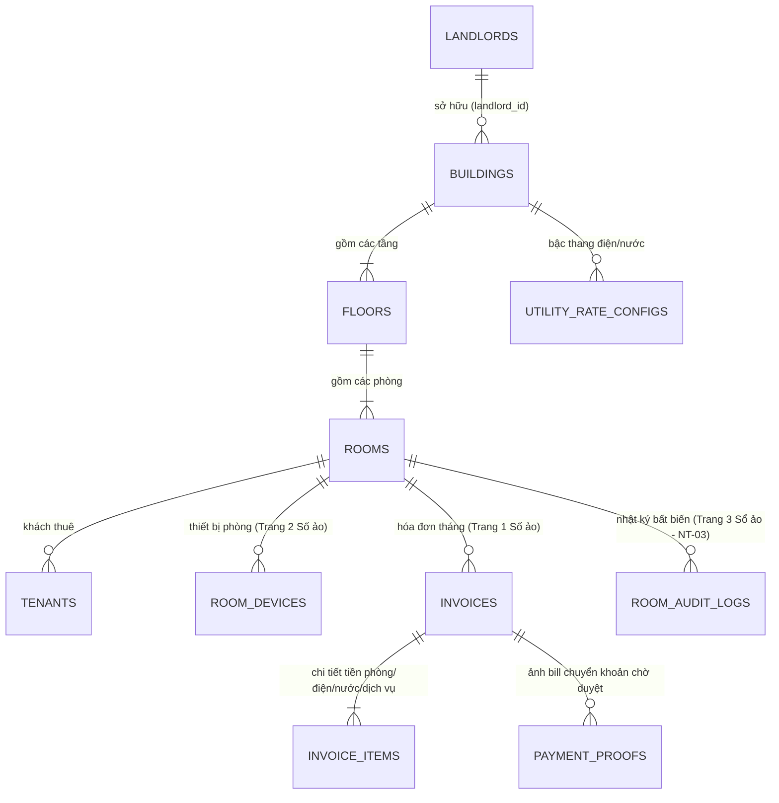

# Thiết kế Cơ sở dữ liệu & Cấu trúc DB (Database Schema & ERD) — QLNT

- **Mã dự án:** `QLNT` — Hệ thống Quản lý Nhà trọ 3D Isometric & Sổ Quản lý Ảo (`F01..F07`)
- **Phiên bản:** `1.0` (Đồng bộ cấu trúc CSDL từ `TECH_PROFILE.md`, quyết định `QLNT-D001..D015` và mô hình dữ liệu Sprint 1 & Sprint 2)
- **Ngày cập nhật:** `2026-11-14`
- **Trạng thái:** **`Đã chuẩn hóa theo G1 & Sprint 1-2`**

---

## 1. Chiến lược Lưu trữ 2 Tầng (`Dual-Layer Storage` — `QLNT-D014`)

1. **Tầng Client Local DB (`Offline-first / Headless Core Store` — Sprint 1 & Sprint 2):**
   - Sử dụng **`IndexedDB` (qua thư viện cục bộ `Dexie.js`)** kết hợp `TypeScript Headless Domain Core`.
   - Lưu trữ toàn bộ dữ liệu nghiệp vụ cho gói Miễn phí / Offline và làm bộ đệm đồng bộ cho gói Cloud.
   - Tuân thủ nghiêm ngặt ràng buộc **100% Thư viện cục bộ** (ví dụ: sinh mã `VietQR` EMVCo 100% bằng thư viện nội bộ, không gọi API bên thứ 3).
2. **Tầng Cloud SaaS Database (`Multi-tenant PostgreSQL` — Mở rộng Cloud):**
   - Sử dụng **PostgreSQL 16+** với cơ chế **Row-Level Security (`RLS`)** phân tách dữ liệu tuyệt đối theo `landlord_id` (`tenant_id`).

---

## 2. Sơ đồ Quan hệ Thực thể Tổng thể (`ERD` — `QLNT`)

---

## 3. Đặc tả Chi tiết Các Bảng Cốt lõi (`PostgreSQL & IndexedDB Schema`)

### 3.1. Nhóm Tòa nhà, Tầng & Phòng (`F01, F04` — Sprint 1 `#32`)
- **`buildings`**: `id (PK)`, `landlord_id (INDEX, RLS)`, `name`, `address`, `total_floors`, `bank_bin`, `bank_account_no`, `bank_account_name` *(dùng cho thư viện tạo chuỗi EMVCo VietQR cục bộ)*, `created_at`, `updated_at`.
- **`floors`**: `id (PK)`, `building_id (FK)`, `floor_index (INT)`, `name`, `layout_2d_config (JSONB — tọa độ các ô phòng trên trang mặt bằng tầng của Sổ quản lý ảo F04)`.
- **`rooms`**: `id (PK)`, `building_id (FK)`, `floor_id (FK)`, `room_code (VD: 'P101')`, `occupancy_status ('VACANT' | 'OCCUPIED' | 'RESERVED')`, `payment_status ('NONE' | 'PAYMENT_DUE' | 'BILL_PENDING' | 'PAID')`, `device_alert_status ('NORMAL' | 'BROKEN')`, `base_rent_amount (NUMERIC)`, `deposit_amount (NUMERIC)`, `current_elec_index (INT)`, `current_water_index (INT)`, `grid_pos_x`, `grid_pos_y`.

### 3.2. Nhóm Khách thuê & Thiết bị trong Phòng (`Trang 1 & Trang 2 Sổ Quản lý Ảo F04`)
- **`tenants`**: `id (PK)`, `room_id (FK)`, `full_name`, `phone`, `cccd_no`, `is_representative (BOOLEAN)`, `move_in_date`, `contract_end_date`, `reputation_stars (INT DEFAULT 5)`, `reward_points (INT DEFAULT 0)`, `avatar_skin_config (JSONB)`.
- **`room_devices`**: `id (PK)`, `room_id (FK)`, `device_code`, `device_name` *(Điều hòa, Bình nóng lạnh, Giường, Tủ...)*, `status ('NORMAL' | 'BROKEN' | 'REPAIRING')`, `broken_note`, `reported_at`, `updated_at`.

### 3.3. Nhóm Bậc thang Điện/Nước, Hóa đơn Tháng & Duyệt Bill (`F02, F04` — Sprint 2 `#55, #61, #64`)
- **`utility_rate_configs`**: `id (PK)`, `building_id (FK)`, `utility_type ('ELECTRICITY' | 'WATER')`, `pricing_mode ('FLAT_RATE' | 'TIERED')`, `tiers_json (JSONB — mảng bậc thang từ số kWh/m3 đến số kWh/m3 và đơn giá)`, `effective_from`.
- **`invoices` (Hóa đơn tiền phòng hàng tháng — Trang 1 Sổ ảo)**:
  - `id (PK)`, `building_id (FK)`, `room_id (FK)`, `month_key (VARCHAR(7) — VD: '2026-11', UNIQUE per room_id)`, `elec_old_index`, `elec_new_index`, `elec_usage`, `elec_amount`, `water_old_index`, `water_new_index`, `water_usage`, `water_amount`, `rent_amount`, `service_fee_amount`, `adjustment_amount`, `total_amount`, `vietqr_payload_local (TEXT — chuỗi EMVCo sinh bằng thư viện cục bộ)`, `status ('DRAFT' | 'PAYMENT_DUE' | 'BILL_PENDING' | 'PAID' | 'OVERDUE')`, `approved_by`, `approved_at`.
- **`payment_proofs` (Chứng từ chuyển khoản khách nộp — `#61`)**:
  - `id (PK)`, `invoice_id (FK)`, `tenant_id (FK)`, `local_image_blob_key (TEXT)`, `submitted_amount`, `submitted_note`, `review_status ('PENDING' | 'APPROVED' | 'REJECTED')`, `rejection_reason`, `submitted_at`, `reviewed_at`.

### 3.4. Nhóm Nhật ký Lịch sử Bất biến (`Trang 3 Sổ Quản lý Ảo — Nguyên tắc NT-03`)
- **`room_audit_logs` (`Append-only Immutable Audit Log`)**:
  - `id (PK)`, `building_id (FK)`, `room_id (FK)`, `month_key`, `action_type ('IN_PLACE_EDIT_RENT' | 'METER_RECORDED' | 'INVOICE_GENERATED' | 'BILL_SUBMITTED' | 'BILL_APPROVED' | 'BILL_REJECTED' | 'DEVICE_STATUS_CHANGED' | 'TENANT_UPDATED')`, `field_name`, `old_value (JSONB)`, `new_value (JSONB)`, `actor_role`, `actor_name`, `created_at (TIMESTAMPTZ NOT NULL)`.
  - **Bất biến `NT-03`**: Mọi thao tác sửa trực tiếp (`in-place edit` theo `QLNT-D011`) tại Trang 1 hoặc Trang 2 của Sổ quản lý ảo bắt buộc ghi 1 bản ghi không thể xóa/sửa vào `room_audit_logs` trong cùng một Transaction của `IndexedDB / PostgreSQL`.
