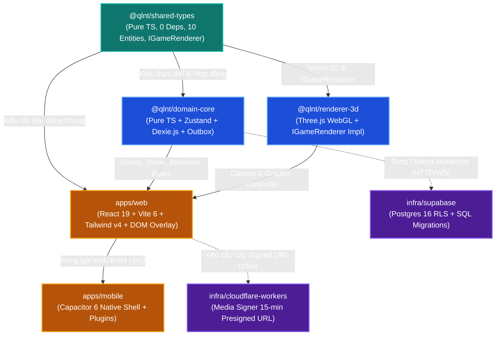

# Đặc tả Kiến trúc Monorepo & Phân rã Codebase Dự án QLNT

> **Tài liệu Kiến trúc Kỹ thuật Chuẩn hóa (Architecture Specification Document)**  
> **Mã hồ sơ:** `TECH-ARCH-001`  
> **Dự án:** Quản lý nhà trọ (QLNT)  
> **Phiên bản:** `1.0.0`  
> **Người lập:** Kiến trúc sư Trưởng (Arch Lead)  
> **Ngày ban hành:** 2026-11-13  
> **Trạng thái:** `Đã hoàn thành thiết kế — Trình Planner / PM nghiệm thu`  
> **Căn cứ tham chiếu:**
> - Hồ sơ kỹ thuật: [`TECH_PROFILE.md`](TECH_PROFILE.md)
> - Danh sách chuẩn hóa kỹ thuật: [`DANH_SACH_CAI_THIEN_VA_CHUAN_HOA_KY_THUAT.md`](DANH_SACH_CAI_THIEN_VA_CHUAN_HOA_KY_THUAT.md) (`TECH-STD-001`)
> - Hồ sơ hạ tầng & vận hành $0/tháng: [`../04-van-hanh/HA_TANG_VA_VAN_HANH_HE_THONG.md`](../04-van-hanh/HA_TANG_VA_VAN_HANH_HE_THONG.md) (`QLNT-D014`)
> - Đặc tả Sổ quản lý ảo F04 & Renderer: [`../02-nghiep-vu/DAC_TA_SO_QUAN_LY_AO_SINGLE_PAGE_VA_RENDERER.md`](../02-nghiep-vu/DAC_TA_SO_QUAN_LY_AO_SINGLE_PAGE_VA_RENDERER.md) (`QLNT-D010` .. `QLNT-D013`)

---

## 1. Mục tiêu & Nguyên tắc Thiết kế Kiến trúc

Kiến trúc Monorepo của dự án QLNT được thiết kế nhằm đáp ứng 4 yêu cầu sống còn:
1. **Tuân thủ nguyên tắc `NT-01` (Lớp game tách rời Lớp dữ liệu thật):** Toàn bộ thực thể dữ liệu, nghiệp vụ tính toán, hàng đợi đồng bộ và quản lý trạng thái được đóng gói độc lập trong `packages/domain-core` (Headless Core). Đồ họa `packages/renderer-3d` chỉ là một tầng cắm rút (pluggable presentation) thông qua hợp đồng trừu tượng `IGameRenderer`.
2. **Hiện thực hóa kiến trúc Hybrid WebGL 3D + DOM Overlay:** `apps/web` đóng vai trò là ứng dụng điều phối (Orchestrator Shell), tích hợp Three.js Canvas ở tầng đáy và phủ React 19 DOM Overlay lên trên nhằm đảm bảo trải nghiệm nhập liệu form tiếng Việt native và 60 FPS mượt mà trên mobile.
3. **Mã nguồn đơn nhất cho Web & Mobile (Single Codebase):** `apps/mobile` sử dụng Capacitor 6 để đóng gói trực tiếp bản build của `apps/web`, bổ sung các native plugin (Camera chụp ảnh chuyển khoản `R-05`, CCCD, Network status).
4. **Mô hình Local-First & Chi phí Vận hành $0/tháng (`QLNT-D014`):** Quản lý lưu trữ ngoại tuyến bằng Dexie.js (IndexedDB) với Outbox Mutation Queue, đồng bộ ngầm lên Supabase Free PostgreSQL 16 (Row-Level Security) và ký Presigned URL 15 phút qua Cloudflare Worker cho Private Bucket Cloudflare R2.

---

## 2. Công cụ Quản trị Monorepo & Tech Stack

| Thành phần | Lựa chọn chính thức | Phiên bản | Vai trò & Lý do lựa chọn |
|---|---|---|---|
| **Package Manager** | **pnpm** | `^12.4.0` | Quản lý dependencies với hard links, tiết kiệm dung lượng đĩa, hỗ trợ native `pnpm workspaces` cực nhanh và cô lập dependency nghiêm ngặt. |
| **Monorepo Build Orchestrator** | **Turborepo** | `^2.4.0` | Quản lý tác vụ song song (`turbo run build dev test lint`), lưu bộ nhớ đệm (pipeline caching) và tối ưu hóa thứ tự build dựa trên đồ thị phụ thuộc (DAG). |
| **Language & Typing** | **TypeScript** | `^5.7.0` | Strict type checking, hỗ trợ Project References (`tsc -b`) giúp biên dịch vi sai từng package siêu tốc. |
| **Frontend Framework** | **React** | `^19.0.0` | Giao diện DOM Overlay, Form Actions, `useActionState`, tối ưu render bảng biểu và Single-Page Ledger F04. |
| **Build Tool & Bundler** | **Vite** | `^6.0.0` | Khởi động HMR tính bằng mili-giây, tích hợp Rollup tối ưu bundle tĩnh cho Cloudflare Pages. |
| **CSS Framework** | **Tailwind CSS** | `^4.0.0` | Giao diện DOM Overlay, Mặt bằng 2D SVG, responsive mobile, zero-runtime CSS. |
| **3D Graphic Engine** | **Three.js** | `^0.170.0` | Dựng cảnh 3D Isometric, Orthographic Camera, hoạt ảnh 3D mở/gập bìa sổ F04. |
| **State Management** | **Zustand** | `^5.0.0` | State management không phụ thuộc UI, nhẹ (<1KB), tích hợp trực tiếp vào Domain Core. |
| **Local Database** | **Dexie.js** | `^4.0.0` | IndexedDB wrapper hiện đại, quản lý 10 bảng dữ liệu offline và hàng đợi Outbox mutations. |
| **Mobile Shell** | **Capacitor** | `^6.2.0` | Đóng gói Web app thành native iOS/Android, bridge camera chụp bill & CCCD. |
| **Edge Compute** | **Cloudflare Workers** | `wrangler ^3.90.0` | Edge Function ký S3 Presigned URL 15 phút cho Cloudflare R2 Private Bucket. |
| **Backend / DB** | **Supabase Postgres** | PostgreSQL 16 | Free Tier SaaS DB, Row-Level Security theo `landlord_id`, Realtime WebSocket. |

---

## 3. Cấu trúc Thư mục Toàn diện (Monorepo Directory Layout)

```
TEAM_ORCA/4.Du_an/QLNT/
├── .github/                           # CI/CD Workflows (GitHub Actions)
│   └── workflows/
│       ├── ci.yml                     # Kiểm tra lint, test, typecheck, build
│       └── deploy-pages.yml           # Triển khai tự động lên Cloudflare Pages
├── apps/                              # Các ứng dụng đầu cuối (Applications)
│   ├── web/                           # Ứng dụng Web chính (React 19 + Vite 6 + Tailwind v4 + DOM Overlay)
│   │   ├── public/                    # Assets tĩnh (favicon, 3D placeholder models, textures)
│   │   ├── src/
│   │   │   ├── assets/                # Hình ảnh, icon SVG
│   │   │   ├── components/            # UI components tái sử dụng (Button, Modal, Input, Badge)
│   │   │   ├── overlays/              # Tầng hiển thị DOM Overlay
│   │   │   │   ├── floor-map/         # Mặt bằng tầng 2D tương tác SVG (QLNT-D010)
│   │   │   │   │   ├── FloorMapSvg.tsx
│   │   │   │   │   ├── RoomCellNode.tsx
│   │   │   │   │   └── FloorSelectorTabs.tsx
│   │   │   │   └── ledger-single-page/# Sổ Quản lý F04 Single-Page 3 Trang (QLNT-D013)
│   │   │   │       ├── LedgerBookContainer.tsx
│   │   │   │       ├── Page1BillingAndRent.tsx
│   │   │   │       ├── Page2DeviceInventory.tsx
│   │   │   │       └── Page3RoomAuditTimeline.tsx
│   │   │   ├── bridge/                # Cầu nối điều phối giữa Renderer 3D Canvas và DOM Overlay
│   │   │   │   ├── CanvasContainer.tsx
│   │   │   │   └── useRendererBridge.ts
│   │   │   ├── pages/                 # Các màn hình chính (Dashboard, Sổ F04, Cài đặt)
│   │   │   ├── styles/                # CSS gốc (Tailwind v4 theme config & global styles)
│   │   │   │   └── globals.css
│   │   │   ├── App.tsx                # App root
│   │   │   └── main.tsx               # Entry point
│   │   ├── index.html
│   │   ├── package.json
│   │   ├── postcss.config.js
│   │   ├── tsconfig.json
│   │   └── vite.config.ts
│   └── mobile/                        # Vỏ bọc ứng dụng di động Capacitor 6
│       ├── android/                   # Dự án Android Studio Native
│       ├── ios/                       # Dự án Xcode Native
│       ├── src/
│       │   ├── plugins/               # Tích hợp native plugins (Camera, Network, FileSystem)
│       │   │   ├── cameraService.ts   # Chụp ảnh bill (R-05) và CCCD
│       │   │   └── networkWatcher.ts  # Báo trạng thái Online/Offline cho Outbox Sync
│       │   └── index.ts
│       ├── capacitor.config.ts        # Cấu hình Capacitor (App ID: vn.qlnt.app)
│       ├── package.json
│       └── tsconfig.json
├── packages/                          # Các thư viện nội bộ dùng chung (Internal Packages)
│   ├── shared-types/                  # Định nghĩa Type, DTO, Enums, IGameRenderer (Pure TS)
│   │   ├── src/
│   │   │   ├── entities/              # 10 Thực thể nghiệp vụ khớp CSDL
│   │   │   │   ├── landlord.ts
│   │   │   │   ├── property.ts
│   │   │   │   ├── room.ts
│   │   │   │   ├── tenant.ts
│   │   │   │   ├── contract.ts
│   │   │   │   ├── billing.ts
│   │   │   │   ├── paymentRecord.ts
│   │   │   │   ├── meterReading.ts
│   │   │   │   ├── roomAuditLog.ts
│   │   │   │   └── maintenanceRequest.ts
│   │   │   ├── renderer/              # Hợp đồng đồ họa & DTO hiển thị
│   │   │   │   ├── vector3d.ts        # Vector3D = { x, y, z }
│   │   │   │   ├── gameRenderer.ts    # Interface IGameRenderer chuẩn hóa
│   │   │   │   └── rendererDtos.ts    # BuildingRenderDTO, AvatarSkinDTO, FloorMapDTO, RoomDetailDTO
│   │   │   ├── sync/                  # Kiểu dữ liệu đồng bộ Outbox
│   │   │   │   └── outbox.ts          # OutboxMutation, MutationOperation, SyncStatus
│   │   │   └── index.ts               # Public entry point
│   │   ├── package.json
│   │   └── tsconfig.json
│   ├── domain-core/                   # Headless Domain Logic, Zustand Stores, Dexie.js (Offline-First)
│   │   ├── src/
│   │   │   ├── db/                    # Local Database Dexie.js (IndexedDB)
│   │   │   │   ├── appDatabase.ts     # Schema 10 bảng + bảng outbox_mutations
│   │   │   │   └── migrations.ts
│   │   │   ├── stores/                # Zustand State Stores
│   │   │   │   ├── roomStore.ts       # Quản lý danh sách phòng, trạng thái, chọn phòng
│   │   │   │   ├── billingStore.ts    # Hóa đơn, duyệt bill nộp tiền, công tơ điện nước
│   │   │   │   ├── ledgerStore.ts     # Trạng thái mở/lật trang Sổ F04 & Single-Page Tab
│   │   │   │   ├── tenantStore.ts     # Khách trọ, CCCD, tạm trú VNeID
│   │   │   │   └── gamificationStore.ts # Điểm thưởng, trừ điểm, sao uy tín chủ trọ
│   │   │   ├── sync/                  # Quản lý Outbox & Đồng bộ Đám mây
│   │   │   │   ├── outboxManager.ts   # Ghi nhận thao tác ngoại tuyến (PENDING)
│   │   │   │   ├── syncWorker.ts      # Worker nền tự động gửi batch sang Supabase khi Online
│   │   │   │   └── conflictResolver.ts# Giải quyết xung đột Last-Write-Wins (LWW)
│   │   │   ├── business/              # Nghiệp vụ lõi độc lập (NT-01..NT-08)
│   │   │   │   ├── billingCalculator.ts # Tính tiền điện nước (khoán người vs chỉ số m3)
│   │   │   │   ├── reputationCalculator.ts # Tính biến động sao uy tín
│   │   │   │   └── auditLogRecorder.ts  # Tự động sinh bản ghi RoomAuditLog bất biến (NT-03)
│   │   │   ├── events/                # Domain Event Bus (Pub-Sub)
│   │   │   │   └── domainEventBus.ts
│   │   │   └── index.ts               # Public entry point
│   │   ├── package.json
│   │   └── tsconfig.json
│   └── renderer-3d/                   # Engine hiển thị Three.js WebGL (Hiện thực hóa IGameRenderer)
│       ├── src/
│       │   ├── core/                  # Thiết lập cảnh 3D, Camera Orthographic Isometric
│       │   │   ├── sceneManager.ts
│       │   │   ├── cameraManager.ts
│       │   │   └── lightingManager.ts
│       │   ├── objects/               # Các đối tượng 3D
│       │   │   ├── buildingMesh.ts    # Dựng tòa nhà (Khối hình MVP P1 -> GLTF P2/P3)
│       │   │   ├── avatarMesh.ts      # Nhân vật cư dân, chủ nhà di chuyển
│       │   │   ├── ledgerBookMesh.ts  # Cuốn sổ 3D F04 & hoạt ảnh mở/gập bìa sổ
│       │   │   └── alertBadges.ts     # Chấm than vàng (tiền phòng) & chấm than đỏ (hỏng hóc)
│       │   ├── animation/             # Quản lý Tween / Animation
│       │   │   └── bookTween.ts       # Hoạt ảnh chuyển camera và lật bìa sổ
│       │   ├── ThreeGameRenderer.ts   # Class chính implements IGameRenderer
│       │   └── index.ts               # Public entry point
│       ├── package.json
│       └── tsconfig.json
├── infra/                             # Hạ tầng, Môi trường & Triển khai
│   ├── docker/                        # Môi trường phát triển cục bộ (Local Dev)
│   │   ├── docker-compose.local.yml   # PostgreSQL 16 local, MinIO (mock R2), Mailpit
│   │   └── minio-init.sh              # Khởi tạo bucket private R2 giả lập
│   ├── supabase/                      # Cấu hình & Lược đồ PostgreSQL Supabase
│   │   ├── migrations/                # Các file DDL 10 bảng dữ liệu
│   │   │   ├── 00001_create_tenants_and_core.sql
│   │   │   ├── 00002_create_billings_and_meters.sql
│   │   │   ├── 00003_create_audit_and_maintenance.sql
│   │   │   └── 00004_setup_rls_policies.sql # RLS bảo mật phân vùng theo landlord_id
│   │   └── functions/                 # Supabase Edge Functions / RPC batch_sync
│   │       └── batch_sync.sql
│   └── cloudflare-workers/            # Edge Function cấp Signed URL R2 15 phút
│       ├── media-signer/
│       │   ├── src/
│       │   │   ├── auth.ts            # Xác thực JWT (landlord_id / tenant_id)
│       │   │   ├── s3Signer.ts        # AWS SDK S3 Presigner (hạn 900s)
│       │   │   └── index.ts           # Worker router GET/POST /api/media/signed-url
│       │   ├── wrangler.toml          # Cấu hình R2 bucket binding & env
│       │   ├── package.json
│       │   └── tsconfig.json
├── package.json                       # Root package.json (Quản lý toàn bộ workspaces)
├── pnpm-workspace.yaml                # Khai báo pnpm workspaces
├── pnpm-lock.yaml                     # Khóa dependencies chuẩn toàn dự án
├── turbo.json                         # Cấu hình Turborepo Pipeline Caching & Tasks
├── tsconfig.base.json                 # Cấu hình TypeScript cơ sở kế thừa dùng chung
├── .gitignore
├── .editorconfig
└── README.md
```

---

## 4. Đặc tả Chi tiết Các Module / Workspaces

### 4.1. `packages/shared-types`
- **Mục đích:** Là nguồn định nghĩa kiểu (Single Source of Truth) cho toàn bộ monorepo.
- **Ranh giới:** **Chỉ chứa Pure TypeScript** (interface, type, enum). Tuyệt đối **không chứa code thực thi**, không phụ thuộc bất kỳ thư viện ngoài nào (`zero dependencies`).
- **Nội dung chính:**
  1. *10 Entity Schemas:* Khớp chính xác 10 bảng cơ sở dữ liệu đã chuẩn hóa trong `DANH_SACH_CAI_THIEN_VA_CHUAN_HOA_KY_THUAT.md`:
     - `Landlord`: `id`, `name`, `phone`, `email`, `reputation_stars`, `package_tier`, `created_at`, `updated_at`.
     - `Property`: `id`, `landlord_id`, `name`, `address`, `total_floors`, `coordinates_3d`, `is_public_on_map`, `water_calc_method`, `water_unit_price`, `electric_unit_price`, `service_fee`.
     - `Room`: `id`, `landlord_id`, `property_id`, `floor_number`, `room_number`, `area_sqm`, `base_price`, `deposit_amount`, `status` ('EMPTY' | 'RENTED' | 'MAINTENANCE').
     - `Tenant`: `id`, `landlord_id`, `room_id`, `full_name`, `phone`, `id_card_number`, `id_card_front_url`, `id_card_back_url`, `birth_year`, `hometown`, `vehicle_plate`, `role` ('REPRESENTATIVE' | 'ROOMMATE'), `temp_residence_status`, `reward_points`, `avatar_skin_config`.
     - `Contract`: `id`, `landlord_id`, `room_id`, `tenant_id`, `start_date`, `end_date`, `duration_months`, `monthly_rent`, `deposit_paid`, `payment_cycle_day`, `status`, `contract_file_url`.
     - `Billing`: `id`, `landlord_id`, `room_id`, `contract_id`, `month_period`, `room_charge`, `electric_charge`, `water_charge`, `service_charge`, `vehicle_charge`, `previous_debt`, `total_amount`, `status` ('UNPAID' | 'PENDING_APPROVAL' | 'PAID'), `bill_image_url`.
     - `PaymentRecord`: `id`, `landlord_id`, `billing_id`, `room_id`, `amount_paid`, `payment_method` ('BANK_TRANSFER_MANUAL' | 'VIETQR_AUTO' | 'CASH'), `payment_date`, `verified_by`, `note`.
     - `MeterReading`: `id`, `landlord_id`, `room_id`, `billing_id`, `month_period`, `old_electric`, `new_electric`, `electric_consumed`, `old_water`, `new_water`, `water_consumed`, `meter_photo_url`, `recorded_by`, `recorded_at`.
     - `RoomAuditLog`: `id`, `landlord_id`, `room_id`, `actor_id`, `actor_role`, `action_type`, `change_summary`, `old_data`, `new_data`, `created_at` (Bất biến Append-Only theo `NT-03`).
     - `MaintenanceRequest`: `id`, `landlord_id`, `room_id`, `tenant_id`, `device_name`, `device_category`, `issue_description`, `photo_url`, `status` ('PENDING_ALERT' | 'IN_PROGRESS' | 'RESOLVED'), `repair_cost`, `reported_at`, `resolved_at`.
  2. *Hợp đồng Đồ họa `IGameRenderer` & DTOs:*
     - `Vector3D = { x: number; y: number; z: number }`.
     - `BuildingRenderDTO`, `AvatarSkinDTO`, `FloorMapDTO`, `RoomDetailDTO`.
     - Hợp đồng `IGameRenderer` bao gồm 2 nhóm phương thức (Cảnh 3D Tòa nhà & Sổ Quản lý Ảo F04).
  3. *Định nghĩa Đồng bộ Outbox:*
     - `OutboxMutation`: `mutation_id`, `table_name`, `operation` ('INSERT' | 'UPDATE' | 'DELETE'), `record_id`, `payload`, `client_timestamp`, `sync_status` ('PENDING' | 'RETRYING' | 'SYNCED' | 'FAILED'), `retry_count`.

---

### 4.2. `packages/domain-core`
- **Mục đích:** Đảm bảo nguyên tắc `NT-01` (Headless Domain Core). Chứa toàn bộ logic nghiệp vụ, kho dữ liệu local-first, cơ chế hàng đợi đồng bộ và quản lý trạng thái.
- **Ranh giới:** Không chứa code React UI hay Three.js canvas. Chỉ phụ thuộc `@qlnt/shared-types`, `zustand`, `dexie`, `@supabase/supabase-js`.
- **Thành phần cốt lõi:**
  1. *Cơ sở dữ liệu cục bộ Dexie.js (`AppDatabase`):*
     - Khởi tạo 10 bảng offline tương ứng với 10 thực thể dữ liệu.
     - Khởi tạo bảng thứ 11: `outbox_mutations` với khóa chính `mutation_id`, chỉ mục trên `sync_status` và `client_timestamp`.
  2. *Zustand Stores:*
     - `useRoomStore`: Quản lý danh sách phòng của từng khu trọ, bộ lọc trạng thái (trống, đang thuê, có cảnh báo).
     - `useBillingStore`: Quản lý tính toán tiền phòng, chốt số điện nước, thao tác duyệt bill nộp tiền chuyển khoản của khách.
     - `useLedgerStore`: Quản lý trạng thái máy Sổ F04 (`isBookOpen`, `currentMonth`, `currentFloor`, `selectedRoomId`, `activeTab`: `PAGE_1_BILLING` | `PAGE_2_DEVICES` | `PAGE_3_AUDIT`).
     - `useGamificationStore`: Điểm thưởng của khách, lịch sử tích lũy, số sao uy tín chủ trọ.
  3. *Outbox Manager & Background Sync Worker:*
     - Khi người dùng thực hiện thao tác thay đổi (VD: sửa tại chỗ chỉ số điện `in-place edit`), hàm mutate ghi vào Dexie.js và đẩy một bản ghi vào `outbox_mutations` ở trạng thái `'PENDING'`.
     - `SyncWorker`: Tự động kích hoạt khi thiết bị Online (`navigator.onLine` hoặc sự kiện từ Capacitor Network plugin). Quét các mutation `PENDING`, gửi mẻ (batch) lên Supabase RPC `batch_sync`.
     - Xử lý xung đột theo nguyên tắc **Last-Write-Wins (LWW)** dựa trên mốc `updated_at`, tự động gọi `auditLogRecorder` để ghi vết biến động vào `room_audit_logs`.

---

### 4.3. `packages/renderer-3d`
- **Mục đích:** Tầng hiển thị đồ họa 3D WebGL, hiện thực hóa toàn bộ hợp đồng `IGameRenderer`.
- **Ranh giới:** Chỉ phụ thuộc `@qlnt/shared-types`, `three`, và thư viện diễn hoạt (như `gsap` hoặc `@tweenjs/tween.js`). Không chứa logic nghiệp vụ hay kết nối CSDL.
- **Chi tiết triển khai kỹ thuật:**
  1. *Orthographic Camera & Cảnh 3D Isometric:*
     - Camera Orthographic góc nhìn cố định $45^\circ$, loại bỏ biến dạng phối cảnh, đảm bảo tính thẩm mỹ chuẩn isometric của trò chơi quản lý xây dựng.
     - `BuildingMesh`: Lộ trình tăng dần:
       - **Giai đoạn 1 (P1 MVP):** Dựng các khối hộp (`BoxGeometry`) với vật liệu chuẩn (`MeshStandardMaterial`), màu sắc phân tầng và ô phòng.
       - **Giai đoạn 2 & 3 (P2/P3):** Thay dần bằng các asset mô hình 3D định dạng `.glb` nén Draco/Meshopt.
  2. *Avatar Controller:*
     - Quản lý vị trí nhân vật cư dân và chủ trọ trong không gian tòa nhà theo tọa độ `Vector3D`.
     - Tweening di chuyển giữa các phòng hoặc lên xuống cầu thang.
  3. *Hoạt ảnh Sổ Quản lý Ảo F04 (Book Mesh & Animation):*
     - Dựng mesh cuốn sổ 3D đặt trên bàn làm việc của chủ trọ.
     - Khi gọi `openLedgerBook()`: Camera tween từ góc nhìn isometric tiến vào trực diện mặt sổ (top-down), đồng thời mesh bìa sổ thực hiện hoạt ảnh mở lật sang bên trái. Khi hoạt ảnh hoàn tất, bắn callback báo cho tầng DOM Overlay bật hiển thị.
     - Khi gọi `closeLedgerBookTo3DScene()`: DOM Overlay tắt trước, mesh bìa sổ gập lại và camera trở về góc isometric cố định.
  4. *Hệ thống Biểu tượng Cảnh báo 3D (3D Alert Badges):*
     - Gắn biểu tượng chấm than nổi trên nóc từng phòng:
       - **Chấm than vàng:** Cảnh báo đến kỳ thu tiền hoặc bill chờ duyệt (`setRoomNotice`).
       - **Chấm than đỏ nhấp nháy:** Cảnh báo phòng có thiết bị hỏng hóc cần sửa chữa (`setDeviceStatus`).

---

### 4.4. `apps/web`
- **Mục đích:** Ứng dụng Web Single-Page chính (React 19 + Tailwind v4 + Vite 6), đóng vai trò Host và Orchestrator Shell.
- **Ranh giới:** Phụ thuộc vào cả 3 packages: `@qlnt/shared-types`, `@qlnt/domain-core`, `@qlnt/renderer-3d`.
- **Cấu trúc & Luồng hoạt động Hybrid:**
  1. *Tầng Đáy (Background Layer):* `CanvasContainer` khởi tạo thẻ `<canvas>` chiếm toàn màn hình, inject instance `ThreeGameRenderer`.
  2. *Tầng Đè Lên (DOM Overlay Layer - `z-index: 20`):*
     - **Mặt bằng Tầng 2D tương tác SVG (`FloorMapSvg`):** Hiển thị khi sổ mở ở chế độ xem tầng. Vẽ các ô phòng bằng SVG vector sắc nét, đổi màu theo trạng thái phòng, cho phép click để mở tờ chi tiết.
     - **Bộ 3 Trang Chi tiết Phòng Single-Page (`QLNT-D013`):**
       - *Trang 1 (`Page1BillingAndRent`):* Thông tin tiền phòng, ô nhập chỉ số điện nước `in-place edit` với bàn phím số native mobile tự động bật, danh sách khách trọ, và modal xem ảnh bill đối chứng.
       - *Trang 2 (`Page2DeviceInventory`):* Bảng kiểm kê thiết bị trong phòng (khớp 10 nhóm thiết bị `REF-MKT-002`), trạng thái hoạt động / báo hỏng, nút gọi thợ sửa chữa.
       - *Trang 3 (`Page3RoomAuditTimeline`):* Dòng thời gian lịch sử phòng hiển thị trực quan các bản ghi `RoomAuditLog` bất biến (ai sửa gì, lúc nào, giá trị cũ/mới).
  3. *Bridge Điều phối (`useRendererBridge`):*
     - Lắng nghe sự kiện từ Three.js (VD: click vào tòa nhà hoặc hoạt ảnh mở sổ xong) để cập nhật `useLedgerStore`.
     - Lắng nghe thay đổi từ Zustand Store để ra lệnh cho `ThreeGameRenderer` (VD: cập nhật trạng thái chấm than khi hóa đơn được duyệt).

---

### 4.5. `apps/mobile`
- **Mục đích:** Đóng gói ứng dụng di động native cho iOS và Android thông qua Capacitor 6.
- **Ranh giới:** Sử dụng chung mã nguồn và bản build của `apps/web` (`webDir: "../web/dist"`).
- **Plugins Native Tích hợp:**
  1. `@capacitor/camera`: Cung cấp hàm chụp ảnh nhanh biên lai chuyển khoản (`R-05`), công tơ điện nước và 2 mặt CCCD của khách trọ. Tự động nén ảnh phía client (Canvas WebP/JPEG `< 300KB`) trước khi đẩy lên Cloudflare R2 qua Signed URL.
  2. `@capacitor/network`: Lắng nghe trạng thái kết nối mạng của thiết bị. Khi chuyển từ Offline sang Online, ngay lập tức gửi tín hiệu đánh thức `SyncWorker` trong `domain-core` để đẩy outbox mutations lên Supabase.
  3. `@capacitor/status-bar` & `@capacitor/splash-screen`: Tùy biến giao diện thanh trạng thái và màn hình chờ thương hiệu QLNT.

---

### 4.6. `infra/`
- **Mục đích:** Toàn bộ mã nguồn hạ tầng, cấu hình Docker cục bộ, migrations cơ sở dữ liệu và Edge Workers.
- **Thành phần:**
  1. `infra/docker/docker-compose.local.yml`:
     - Chạy PostgreSQL 16 local (cổng 5432) cho môi trường dev/unit test khi không có mạng.
     - Chạy MinIO (cổng 9000/9001) tương thích chuẩn S3 API để giả lập Cloudflare R2 Private Bucket.
  2. `infra/supabase/migrations/`:
     - 4 file SQL DDL định nghĩa 10 bảng, ràng buộc khóa ngoại, chỉ mục hiệu năng (indexes on `landlord_id`, `room_id`), và các chính sách **Row-Level Security (RLS)** nghiêm ngặt:
       ```sql
       ALTER TABLE rooms ENABLE ROW LEVEL SECURITY;
       CREATE POLICY landlord_isolation_policy ON rooms
       FOR ALL USING (landlord_id = auth.uid());
       ```
  3. `infra/cloudflare-workers/media-signer`:
     - Mã nguồn TypeScript chạy trên Edge Worker của Cloudflare.
     - Điểm cuối: `GET /api/media/signed-url?key={objectKey}&action=view|upload`.
     - Kiểm tra Bearer JWT Token của người gửi -> nếu hợp lệ, dùng AWS SDK S3 Presigner tạo Signed URL với thời hạn chính xác **900 giây (15 phút)** kết nối vào R2 Private Bucket.

---

## 5. Đồ thị Phụ thuộc (Dependency Graph) & Ranh giới Module

Hệ thống tuân thủ mô hình đồ thị có hướng không chu trình (Directed Acyclic Graph - DAG). Các quy tắc ranh giới nghiêm ngặt được thực thi bằng ESLint và TypeScript Project References:
- **Nguyên tắc 1:** `shared-types` ở gốc, không được import bất kỳ module nào.
- **Nguyên tắc 2:** `domain-core` và `renderer-3d` là hai nhánh song song độc lập hoàn toàn, tuyệt đối không được tham chiếu chéo lẫn nhau (`renderer-3d` không biết `domain-core` và ngược lại).
- **Nguyên tắc 3:** `apps/web` là nơi duy nhất được quyền import đồng thời `domain-core` và `renderer-3d` để làm cầu nối giao tiếp.



---

## 6. Kế thừa Cấu hình TypeScript (TypeScript Inheritance)

Toàn bộ monorepo sử dụng cơ chế kế thừa cấu hình từ `tsconfig.base.json` ở thư mục gốc, áp dụng nghiêm ngặt chế độ kiểm tra lỗi (`strict: true`) và cơ chế Project References (`composite: true`) giúp tăng tốc độ kiểm tra kiểu vi sai:

### 6.1. Cấu hình Gốc: `tsconfig.base.json`
```json
{
  "$schema": "https://json.schemastore.org/tsconfig",
  "compilerOptions": {
    "target": "ES2022",
    "module": "ESNext",
    "moduleResolution": "Bundler",
    "lib": ["ES2022"],
    "strict": true,
    "noImplicitAny": true,
    "strictNullChecks": true,
    "strictFunctionTypes": true,
    "strictBindCallApply": true,
    "strictPropertyInitialization": true,
    "noImplicitThis": true,
    "alwaysStrict": true,
    "noUnusedLocals": true,
    "noUnusedParameters": true,
    "noImplicitReturns": true,
    "noFallthroughCasesInSwitch": true,
    "noUncheckedIndexedAccess": true,
    "allowSyntheticDefaultImports": true,
    "esModuleInterop": true,
    "isolatedModules": true,
    "skipLibCheck": true,
    "declaration": true,
    "declarationMap": true,
    "sourceMap": true
  }
}
```

### 6.2. Cấu hình Package Shared Types: `packages/shared-types/tsconfig.json`
```json
{
  "extends": "../../tsconfig.base.json",
  "compilerOptions": {
    "rootDir": "src",
    "outDir": "dist",
    "composite": true
  },
  "include": ["src/**/*"]
}
```

### 6.3. Cấu hình Package Domain Core: `packages/domain-core/tsconfig.json`
```json
{
  "extends": "../../tsconfig.base.json",
  "compilerOptions": {
    "rootDir": "src",
    "outDir": "dist",
    "composite": true
  },
  "references": [
    { "path": "../shared-types" }
  ],
  "include": ["src/**/*"]
}
```

### 6.4. Cấu hình Package Renderer 3D: `packages/renderer-3d/tsconfig.json`
```json
{
  "extends": "../../tsconfig.base.json",
  "compilerOptions": {
    "rootDir": "src",
    "outDir": "dist",
    "lib": ["ES2022", "DOM"],
    "composite": true
  },
  "references": [
    { "path": "../shared-types" }
  ],
  "include": ["src/**/*"]
}
```

### 6.5. Cấu hình App Web: `apps/web/tsconfig.json`
```json
{
  "extends": "../../tsconfig.base.json",
  "compilerOptions": {
    "lib": ["ES2022", "DOM", "DOM.Iterable"],
    "jsx": "react-jsx",
    "moduleResolution": "Bundler",
    "noEmit": true
  },
  "references": [
    { "path": "../../packages/shared-types" },
    { "path": "../../packages/domain-core" },
    { "path": "../../packages/renderer-3d" }
  ],
  "include": ["src/**/*", "vite.config.ts"]
}
```

---

## 7. Cấu hình Quản lý Workspaces & Dependencies

### 7.1. File `pnpm-workspace.yaml`
```yaml
packages:
  - 'apps/*'
  - 'packages/*'
  - 'infra/cloudflare-workers/*'
```

### 7.2. File `package.json` ở Thư mục Gốc (Root)
```json
{
  "name": "qlnt-monorepo",
  "version": "1.0.0",
  "private": true,
  "packageManager": "pnpm@12.4.0",
  "engines": {
    "node": ">=22.0.0",
    "pnpm": ">=12.0.0"
  },
  "scripts": {
    "dev": "turbo run dev --parallel",
    "dev:web": "pnpm --filter @qlnt/web dev",
    "build": "turbo run build",
    "test": "turbo run test",
    "lint": "turbo run lint",
    "typecheck": "turbo run typecheck",
    "clean": "turbo run clean && rm -rf node_modules",
    "mobile:sync": "pnpm --filter @qlnt/web build && pnpm --filter @qlnt/mobile cap:sync",
    "mobile:run:android": "pnpm --filter @qlnt/mobile cap:run:android",
    "mobile:run:ios": "pnpm --filter @qlnt/mobile cap:run:ios",
    "local:infra:up": "docker compose -f infra/docker/docker-compose.local.yml up -d",
    "local:infra:down": "docker compose -f infra/docker/docker-compose.local.yml down"
  },
  "devDependencies": {
    "turbo": "^2.4.0",
    "typescript": "^5.7.0"
  }
}
```

### 7.3. Cấu hình Pipeline Caching: `turbo.json`
```json
{
  "$schema": "https://turbo.build/schema.json",
  "tasks": {
    "build": {
      "dependsOn": ["^build"],
      "outputs": ["dist/**", ".next/**"]
    },
    "typecheck": {
      "dependsOn": ["^build"]
    },
    "test": {
      "dependsOn": ["^build"],
      "inputs": ["src/**/*.ts", "src/**/*.tsx", "test/**/*.ts"]
    },
    "lint": {},
    "dev": {
      "cache": false,
      "persistent": true
    },
    "clean": {
      "cache": false
    }
  }
}
```

---

## 8. Chi tiết Khai báo `package.json` Từng Module

### 8.1. `packages/shared-types/package.json`
```json
{
  "name": "@qlnt/shared-types",
  "version": "1.0.0",
  "private": true,
  "main": "./dist/index.js",
  "types": "./dist/index.d.ts",
  "scripts": {
    "build": "tsc -b",
    "clean": "rm -rf dist",
    "typecheck": "tsc --noEmit"
  }
}
```

### 8.2. `packages/domain-core/package.json`
```json
{
  "name": "@qlnt/domain-core",
  "version": "1.0.0",
  "private": true,
  "main": "./dist/index.js",
  "types": "./dist/index.d.ts",
  "scripts": {
    "build": "tsc -b",
    "clean": "rm -rf dist",
    "test": "vitest run",
    "typecheck": "tsc --noEmit"
  },
  "dependencies": {
    "@qlnt/shared-types": "workspace:*",
    "@supabase/supabase-js": "^2.48.0",
    "dexie": "^4.0.11",
    "zustand": "^5.0.3"
  },
  "devDependencies": {
    "typescript": "^5.7.0",
    "vitest": "^3.0.0"
  }
}
```

### 8.3. `packages/renderer-3d/package.json`
```json
{
  "name": "@qlnt/renderer-3d",
  "version": "1.0.0",
  "private": true,
  "main": "./dist/index.js",
  "types": "./dist/index.d.ts",
  "scripts": {
    "build": "tsc -b",
    "clean": "rm -rf dist",
    "test": "vitest run",
    "typecheck": "tsc --noEmit"
  },
  "dependencies": {
    "@qlnt/shared-types": "workspace:*",
    "@tweenjs/tween.js": "^25.0.0",
    "three": "^0.173.0"
  },
  "devDependencies": {
    "@types/three": "^0.173.0",
    "typescript": "^5.7.0",
    "vitest": "^3.0.0"
  }
}
```

### 8.4. `apps/web/package.json`
```json
{
  "name": "@qlnt/web",
  "version": "1.0.0",
  "private": true,
  "type": "module",
  "scripts": {
    "dev": "vite",
    "build": "tsc -b && vite build",
    "preview": "vite preview",
    "clean": "rm -rf dist",
    "test": "vitest run",
    "typecheck": "tsc --noEmit"
  },
  "dependencies": {
    "@qlnt/domain-core": "workspace:*",
    "@qlnt/renderer-3d": "workspace:*",
    "@qlnt/shared-types": "workspace:*",
    "clsx": "^2.1.1",
    "lucide-react": "^0.475.0",
    "react": "^19.0.0",
    "react-dom": "^19.0.0",
    "tailwind-merge": "^3.0.1"
  },
  "devDependencies": {
    "@tailwindcss/vite": "^4.0.0",
    "@types/react": "^19.0.0",
    "@types/react-dom": "^19.0.0",
    "@vitejs/plugin-react": "^4.3.4",
    "tailwindcss": "^4.0.0",
    "typescript": "^5.7.0",
    "vite": "^6.1.0",
    "vitest": "^3.0.0"
  }
}
```

### 8.5. `apps/mobile/package.json`
```json
{
  "name": "@qlnt/mobile",
  "version": "1.0.0",
  "private": true,
  "scripts": {
    "cap:sync": "cap sync",
    "cap:run:android": "cap run android",
    "cap:run:ios": "cap run ios",
    "cap:open:android": "cap open android",
    "cap:open:ios": "cap open ios"
  },
  "dependencies": {
    "@capacitor/android": "^6.2.0",
    "@capacitor/camera": "^6.1.2",
    "@capacitor/core": "^6.2.0",
    "@capacitor/filesystem": "^6.0.2",
    "@capacitor/ios": "^6.2.0",
    "@capacitor/network": "^6.0.3",
    "@capacitor/splash-screen": "^6.0.3",
    "@capacitor/status-bar": "^6.0.2"
  },
  "devDependencies": {
    "@capacitor/cli": "^6.2.0"
  }
}
```

---

## 9. Kịch bản Phát triển (Dev Workflow) & Kiểm thử

### 9.1. Khởi động Môi trường Cục bộ (Local Dev)
1. **Cài đặt thư viện:**
   ```bash
   pnpm install
   ```
2. **Khởi chạy hạ tầng local (Postgres + MinIO S3 Mock):**
   ```bash
   pnpm local:infra:up
   ```
3. **Chạy ứng dụng Web với HMR:**
   ```bash
   pnpm dev
   # Truy cập giao diện tại http://localhost:5173
   ```

### 9.2. Kiểm thử Tự động (Automated Testing Strategy)
1. **Unit Test Headless Domain Core:**
   - Kiểm thử thuật toán tính tiền phòng & dịch vụ (`billingCalculator.test.ts`).
   - Kiểm thử tính điểm uy tín và thưởng/phạt (`reputationCalculator.test.ts`).
   - Kiểm thử ghi nhật ký biến động phòng Append-Only `NT-03` (`auditLogRecorder.test.ts`).
   - Kiểm thử hàng đợi Outbox mutations và giải quyết xung đột Last-Write-Wins (`syncWorker.test.ts`).
2. **Unit Test Renderer 3D Contract:**
   - Kiểm thử tính hợp lệ của instance khi implement `IGameRenderer`.
   - Kiểm thử chuyển đổi tọa độ logic `Vector3D` sang tọa độ canvas 3D.
3. **Lệnh chạy toàn bộ kiểm thử:**
   ```bash
   pnpm test
   ```

### 9.3. Đóng gói & Triển khai (Build & Release)
1. **Kiểm tra kiểu dữ liệu tĩnh vi sai:**
   ```bash
   pnpm typecheck
   ```
2. **Build Web tĩnh (triển khai Cloudflare Pages $0/tháng):**
   ```bash
   pnpm build
   # Thư mục đầu ra: apps/web/dist
   ```
3. **Đồng bộ mã nguồn sang Native Mobile:**
   ```bash
   pnpm mobile:sync
   ```

---

## 10. Kế hoạch Hành động Kế tiếp (Handover to Planner)

Tài liệu đặc tả kiến trúc `TECH-ARCH-001` này đã giải quyết trọn vẹn yêu cầu thiết kế monorepo và phân rã codebase cho QLNT. 

Bàn giao lại kết quả cho `@planner` để tích hợp vào:
1. Phân rã công việc chi tiết cho Sprint 1 trong Orca Tasks.
2. Phối hợp với `@infra-devops` về việc tích hợp `infra/cloudflare-workers` và `infra/supabase` vào pipeline triển khai Cloudflare Pages + Supabase STG/Prod.
3. Chuyển giao khung cấu trúc cho các kỹ sư lập trình (Frontend Lead / Core Dev) khởi tạo khung repository code thực tế.
