# Hồ sơ Hạ tầng Máy chủ, Cloud & Chuẩn Vận hành Thực thi cho Dev — QLNT

- **Dự án:** Quản lý nhà trọ (QLNT)
- **Mã quyết định phê duyệt:** `QLNT-D013`, `QLNT-D014`, `QLNT-D016` (`01-quan-ly/DECISIONS.md`)
- **Đơn vị quản lý:** Mảng C (Quản lý vận hành — `04-van-hanh/`) phối hợp Tech Lead & PM Lead
- **Ngày ban hành:** 2026-11-12 (Cập nhật `QLNT-D016`: `2026-11-13`)
- **Trạng thái:** **`Đã phê duyệt — Tài liệu chuẩn bắt buộc cho các Dev và QA bám theo thực hiện`**

---

## 1. Mục đích & Nguyên tắc Quản lý Cốt lõi tại `04-van-hanh`

1. **Chuẩn tham chiếu duy nhất cho Dev:** Tài liệu này là chuẩn tham chiếu bắt buộc về hạ tầng, môi trường triển khai, cấu hình máy chủ/Cloud, bảo mật dữ liệu vận hành và ngưỡng hiệu năng của dự án QLNT. Toàn bộ thành viên kỹ thuật (`Tech Lead`, `Tech Contributor / Dev`, `QA`) bám sát nội dung tại thư mục `04-van-hanh/` trong suốt quá trình lập trình, kiểm thử và triển khai.
2. **Nguyên tắc Tối ưu Chi phí ("Ưu tiên Dễ & Không mất phí — `$0 First`"):**
   - **Ưu tiên tuyệt đối các phương án dễ triển khai (Zero-Ops / Low-Ops) và hoàn toàn miễn phí (`$0/tháng`)** trong mọi quyết định thiết kế kỹ thuật và vận hành.
   - Duy trì vận hành trên **Giai đoạn 1 (`$0/tháng` — Local-First `IndexedDB` và Free Tier khi được duyệt kết nối Cloud)** lâu nhất có thể, kể cả trong giai đoạn chạy thử nghiệm thực tế (Pilot) chừng nào tài nguyên thực dùng vẫn nằm trong hạn mức miễn phí sau khi đã tối ưu kỹ thuật.
3. **Cơ chế Bắt buộc Đánh giá lại khi có Đề xuất Tăng hoặc Giảm Chi phí:**
   - Mọi đề xuất thay đổi làm **tăng chi phí** (chuyển sang thuê VPS, mua thêm dung lượng, nâng gói Cloud) hoặc **giảm chi phí** đều **bắt buộc phải thực hiện đánh giá lại trên cả 2 khía cạnh** trước khi trình Chủ dự án:
     1. **Đánh giá lại Cấu trúc Hạ tầng (Infrastructure Re-architecture):** Kiểm tra xem có thể tối ưu kiến trúc (đẩy xử lý/lưu trữ về `IndexedDB` phía Client, tăng tỷ lệ Cache, nén ảnh/model 3D mạnh hơn, hoặc kết hợp các dịch vụ Free Tier khác) để tiếp tục giữ chi phí **$0** và vận hành đơn giản hay không.
     2. **Đánh giá lại Phạm vi Triển khai (Deployment Scope Re-evaluation):** Rà soát xem phạm vi tính năng hoặc đối tượng sử dụng nào đang gây tốn tài nguyên (ví dụ: giới hạn số lượng ảnh bill lưu trữ dài hạn, tự động xóa ảnh bill tạm sau `N` ngày kể từ khi chủ nhà đã duyệt thu tiền xong, hoặc chỉ bật đồng bộ Realtime cho các tác vụ thực sự cần thiết) để điều chỉnh phạm vi phù hợp với mức chi phí mục tiêu.
4. **Nguyên tắc Sử dụng Thư viện Cục bộ & Chưa Kết nối Bên thứ 3 (`QLNT-D016` — Bắt buộc):**
   - Trong giai đoạn hiện tại (Prototype P1 / Sprint 2), mọi tính năng muốn sử dụng đều phải triển khai qua **thư viện cài đặt cục bộ** (`Client-side / Local Libraries`), **tuyệt đối CHƯA kết nối đến bất kỳ API hoặc dịch vụ bên thứ 3 nào**.
   - **Áp dụng cụ thể cho VietQR:** Bắt buộc dùng **thư viện cục bộ chuẩn EMVCo / NAPAS 247** kết hợp thư viện tạo mã QR offline ngay trên trình duyệt; **KHÔNG gọi `img.vietqr.io` hay API ngân hàng bên thứ 3**.
   - **Quy tắc báo cáo trước khi kết nối:** Nếu có bất kỳ Issue hoặc Task nào **bắt buộc phải kết nối dịch vụ bên thứ 3 mới thực hiện được** (như deploy lên Cloudflare Pages/R2, kết nối Supabase Cloud, webhook đối soát ngân hàng tự động F04.5, Zalo OA/ZNS), **phải báo Chủ dự án confirm trước khi thực hiện**.

---

## 2. Quy mô Cấu hình Hạ tầng Máy chủ / Cloud theo 3 Giai đoạn (`QLNT-D014`)

> **Lưu ý vận hành:** **Giai đoạn 1 (`$0/tháng`) là cấu hình mặc định bắt buộc.** Việc chuyển sang Giai đoạn 2 hoặc 3 chỉ được kích hoạt sau khi đã thực hiện báo cáo đánh giá lại cấu trúc hạ tầng & phạm vi triển khai theo Mục 1.3 và được Chủ dự án phê duyệt.

| Giai đoạn | Quy mô phục vụ mục tiêu | Phương án Hạ tầng Chuẩn | Cấu hình Chi tiết (Compute / DB / Storage / Network) | Chi phí dự kiến |
| :--- | :--- | :--- | :--- | :--- |
| **Giai đoạn 1 (Mặc định - Ưu tiên số 1): Dev / STG / MVP & Pilot Nhỏ** | Nội bộ Team, QA, Demo & Pilot ban đầu (`1 – 50` chủ trọ sau khi tối ưu Local-First & nén ảnh) | **100% Free-Tier Managed Cloud (Cloudflare + Supabase + Local IndexedDB)** *(Dễ nhất, không mất phí, không tốn công quản trị server)* | • **Frontend & 3D Assets CDN:** `Cloudflare Pages` (Miễn phí không giới hạn băng thông tĩnh, nén `Brotli`, `HTTP/3`, CDN PoP Việt Nam/Singapore cho file `.glb`, `.ktx2`, SVG). • **Database, Auth & Realtime:** `Supabase Free Tier` (Region Singapore `ap-southeast-1`, `500MB` PostgreSQL 16 bật `Row-Level Security`, `200` kết nối Realtime WebSocket đồng thời). • **Object Storage (Ảnh bill, CCCD, 3D động):** `Cloudflare R2 Free Tier` (Miễn phí `10GB/tháng`, **0đ phí băng thông Egress**, bắt buộc `Private Bucket + Signed URL`). | **`$0 / tháng`** *(Không mất phí — Ưu tiên duy trì tối đa)* |
| **Giai đoạn 2 (Chỉ mở khi vượt ngưỡng Free Tier sau khi đã tối ưu): Pilot Mở rộng Hà Nội** | `50 – 300` chủ nhà trọ `1.500 – 6.000` phòng (`~10.000` cư dân) | **01 Cloud VPS tại Việt Nam + Cloudflare R2 & CDN** *(Cần đánh giá lại hạ tầng & phạm vi trước khi bật)* | • **Máy chủ App & DB (01 Cloud VPS tại VN — độ trễ `< 15ms`):** **`4 vCPU, 8GB RAM, 100GB NVMe SSD`**, chạy `Docker Compose` (`Caddy Auto-SSL` + `Fastify/NestJS API` + `PostgreSQL 16` + `Redis 7`). • **Object Storage & CDN:** `Cloudflare R2` (`10GB` đầu miễn phí, phần vượt `$0.015/GB`) + `Cloudflare CDN` miễn phí. • **Sao lưu (Backup):** `Rclone / Cronjob` tự động nén & mã hóa bản dump PostgreSQL đẩy lên Cloudflare R2 mỗi ngày lúc `02:00 AM`. | **`~350.000đ – 600.000đ / tháng`** *(Chỉ chi khi Chủ dự án duyệt)* |
| **Giai đoạn 3 (Tương lai): Mở rộng Thương mại SaaS** | `1.000 – 3.000` chủ trọ `> 25.000` phòng (`2.000+ CCU`) | **Cụm HA tách biệt App Node & Database Node** *(Đánh giá theo doanh thu thực tế)* | • **App & Realtime Cluster:** `02 VPS (4 vCPU, 8GB RAM)` đặt sau `Cloudflare Load Balancer`. • **Dedicated Database Node:** `01 VPS (4 vCPU, 16GB RAM, 250GB NVMe RAID)` chuyên chạy PostgreSQL + Redis. • **Storage & CDN:** `Cloudflare R2 + CDN`. | **`~1.500.000đ – 2.500.000đ / tháng`** |

---

## 3. Kiến trúc 3 Tầng Môi trường (`Local Dev` $\rightarrow$ `STG` $\rightarrow$ `PROD`)

```mermaid
flowchart LR
    subgraph LOCAL ["1. Local Dev (Máy trạm Dev)"]
        L1["Vite + Three.js + TypeScript"]
        L2["IndexedDB (Dexie.js - Gói Miễn phí Offline)"]
        L3["Docker Compose: Postgres 16 + Redis + MinIO/Supabase Local"]
    end

    subgraph STG ["2. Staging (STG - Kiểm thử & UAT)"]
        S1["GitHub Actions CI/CD (Build + Lint + Typecheck)"]
        S2["Cloudflare Pages Preview HTTPS URL"]
        S3["Supabase STG (Mock Data, không chứa CCCD thật)"]
        S4["Cloudflare R2 STG Bucket (Private Signed URL)"]
    end

    subgraph PROD ["3. Production (PROD - Pilot Hà Nội)"]
        P1["Cloudflare CDN + Web / Capacitor Mobile App"]
        P2["VPS Việt Nam (4 vCPU, 8GB RAM, 100GB NVMe - Docker Compose)"]
        P3["Cloudflare R2 PROD (Signed URL + Daily DB Backup 02:00 AM)"]
    end

    LOCAL -->|"Pull Request + Tech Lead Review"| STG
    STG -->|"Pass X02 Checklist + Chủ dự án duyệt Cổng G3"| PROD
```

---

## 4. Kế hoạch Triển khai 4 Bước (Roadmap Thực thi Hạ tầng)

1. **Bước 1 — Thiết lập Chuẩn Codebase trong Sprint 1:**
   - Dev thiết kế tầng dữ liệu theo mẫu **Repository / Storage Adapter**: hỗ trợ song song `IndexedDB (Dexie.js)` cho gói Miễn phí (Offline-first) và `PostgreSQL / Supabase` cho gói Trả phí (SaaS Multi-tenant).
   - Tuyệt đối không viết cứng (hardcode) logic nghiệp vụ vào Database Trigger của nhà cung cấp Cloud để đảm bảo chuyển đổi từ Giai đoạn 1 (Supabase) sang Giai đoạn 2 (VPS Docker tại Việt Nam) không phải sửa code nghiệp vụ.
2. **Bước 2 — Dựng môi trường Staging (STG) tự động (`$0/tháng`):**
   - Thiết lập `.github/workflows/ci-staging.yml` trên repo `theGonlyK/QLNT`: mỗi Pull Request vào nhánh `main`/`staging` tự động chạy `typecheck`, `lint`, `unit test` và deploy bản Preview HTTPS lên `Cloudflare Pages`.
   - Cấu hình biến môi trường `.env.example` rõ ràng giữa `LOCAL`, `STG`, `PROD`.
3. **Bước 3 — Dựng cụm VPS Pilot Hà Nội (Trước Cổng phát hành G3):**
   - Đóng gói chuẩn bộ `docker-compose.prod.yml` gồm: `caddy`, `api`, `postgres`, `redis`, `backup-cron`.
   - Khởi tạo 01 VPS Việt Nam (`4 vCPU / 8GB RAM / 100GB NVMe`), trỏ DNS qua Cloudflare và kết nối bucket Cloudflare R2.
4. **Bước 4 — Nghiệm thu Môi trường theo Checklist `X02`:**
   - QA Lead và Tech Lead kiểm tra toàn bộ danh mục trong `1.Bieu_Mau/1. Test cases/3. Checklist/X02_Checklist_Check Enviroment (STG) Before build.xlsx` trước khi trình Chủ dự án duyệt Cổng G3.

---

## 5. Quy tắc Bắt buộc cho Dev khi Lập trình & Triển khai (Developer Operational Rules)

### 5.1. Bảo mật Dữ liệu Đa Chủ trọ (Multi-tenant Isolation & Privacy)
1. **Cách ly dữ liệu theo `landlord_id` (Bắt buộc 100% bảng):**
   - Mọi bảng dữ liệu nghiệp vụ (`buildings`, `floors`, `rooms`, `tenants`, `contracts`, `devices`, `invoices`, `room_logs`) phải có cột `landlord_id` và bật **Row-Level Security (RLS)** hoặc Middleware kiểm tra quyền sở hữu ở tầng API.
2. **Bảo mật ảnh chụp nhạy cảm (Ảnh Bill chuyển khoản & CCCD khách thuê):**
   - Tuyệt đối **KHÔNG** lưu ảnh bill và ảnh CCCD trong `Public Bucket`.
   - Bắt buộc upload vào **Private Bucket** trên Cloudflare R2 / Supabase Storage và chỉ trả về **Signed URL có thời hạn tối đa 15 phút (`900 giây`)** cho đúng chủ nhà hoặc khách của phòng đó.
   - Trước khi upload từ điện thoại, Client phải nén ảnh xuống định dạng `WebP/JPEG` (chiều ngang tối đa `1280px`, dung lượng `< 300KB`) để tiết kiệm băng thông 4G và dung lượng lưu trữ.
3. **Tuân thủ nguyên tắc riêng tư `NT-05` và `NT-06`:**
   - API công khai cho Bản đồ tìm phòng (`F06`) và Sale trọ (`F03`) chỉ trả về các trường của **phòng đang trống (`EMPTY`)**, tuyệt đối lọc bỏ ở tầng Backend mọi thông tin cá nhân khách đang thuê, số điện/nước thực tế và lịch sử hóa đơn.

### 5.2. Chuẩn Hiệu năng 3D & Cơ chế Tự động Hạ cấp (Auto-Fallback) trên Thiết bị Yếu
1. **Ngân sách tài nguyên (Asset Budget) cho mỗi cảnh 3D:**
   - Tổng dung lượng tải lần đầu (Initial 3D Scene Bundle `.glb` + Texture): **`< 5 MB`** (nén `Draco` / `Meshopt` và texture `KTX2/WebP`).
   - Thời gian tải cảnh trên mạng 4G tiêu chuẩn: **`< 1.5 giây`**.
2. **Chế độ hiển thị Single-Page cho Sổ quản lý ảo F04 (`QLNT-D013`):**
   - Khi mở chi tiết phòng từ mặt bằng tầng 2D, luôn hiển thị theo chế độ **Single-Page (1 trang đơn toàn vùng nhìn)** cho 3 trang: *Trang 1 (Thông tin & Tiền trọ)* $\leftrightarrow$ *Trang 2 (Thiết bị)* $\leftrightarrow$ *Trang 3 (Lịch sử)*.
   - Mọi thao tác sửa trực tiếp (`in-place edit` theo `QLNT-D011`) phải thực hiện qua Headless Domain Core và tự động ghi vết bất biến (`append-only`) vào Trang 3 (`NT-03`).
3. **Ngưỡng tự động chuyển đổi hiệu năng (Performance Auto-Fallback):**
   - Khi mở Sổ quản lý ảo F04 hoặc cảnh 3D, nếu bộ đo FPS ghi nhận **`FPS trung bình < 30` trong 2 giây liên tiếp** (hoặc thiết bị có **`RAM < 3GB`** / không hỗ trợ WebGL2), hệ thống tự động phát sự kiện `PERF_FPS_DROP` qua `Event Bus` để hạ hiệu ứng lật trang 3D Mesh uốn cong xuống **2D Slide-Card mượt nhẹ** mà không làm mất trạng thái dữ liệu đang nhập.

### 5.3. Quy trình Nhánh Git, PR & Kiểm tra trước khi Merge
1. **Nhánh làm việc:** Mỗi task trên Orca / GitHub Project `#2` phải thực hiện trên nhánh riêng theo quy ước: `feat/<role>-<task-id>-<mo-ta-ngan>` hoặc `fix/<issue-id>-<mo-ta>`.
2. **Điều kiện gộp nhánh (Merge Gate):**
   - Đảm bảo tách biệt hoàn toàn giữa `packages/domain-core` (không import `three` hay DOM) và `packages/renderer-3d` (giao tiếp qua `IGameRenderer`).
   - Pass 100% kiểm tra `typecheck`, `lint` và đối chiếu với đặc tả trong `02-nghiep-vu/DAC_TA_SO_QUAN_LY_AO_SINGLE_PAGE_VA_RENDERER.md`.
